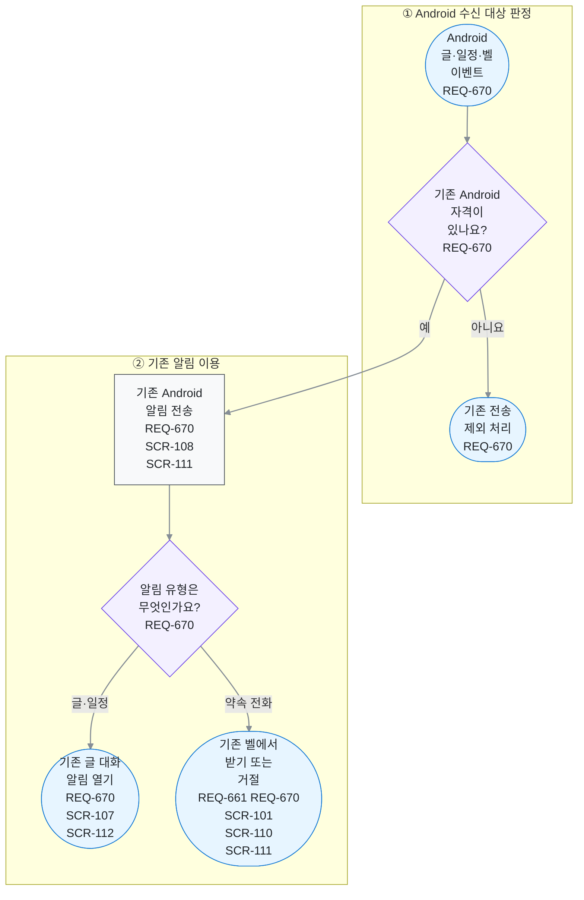

# FL-228 Android에서 기존 알림과 전화 이용

03단계 초안 · CTX-001·020 · [02 고정 요구사항](../02-prd/iphone-home-webapp-notifications-version-candidate.md)

연결 요구사항 REQ-661, REQ-670.

Android의 글·일정·벨 수신 자격은 기존 계약을 적용합니다. 같은 계정에 웹 구독을 추가해도 Android 경로를 따로 판단합니다.

| 기호 | 의미 |
| --- | --- |
| 둥근 상자 | 시작 또는 종료 상태 |
| 사각형 | 사용자 동작 또는 시스템 처리 |
| 마름모 | 관찰 결과나 사용자 선택 |
| 실선 화살표 | 다음 단계 또는 종료 상태 |

## 기존 흐름과의 차이

[FL-176](FL-176-web-inbox.md)과 [기존 Android 알림·통화 FL-111](../app-ring.md#3-사용자-흐름-03)을 회귀 확인합니다. APK 설치와 업데이트는 [FL-147](FL-147-app-update.md)·[FL-148](FL-148-app-update-confirm.md), 상태 보고는 [FL-194](FL-194-app-update-report.md)의 기존 Android 경로를 사용합니다.

## 확인 조건

웹 구독이 있는 상태와 없는 상태에서 같은 Android 기기의 알림·벨 자격 결과를 비교합니다. 웹과 Android에서 같은 약속 전화를 수락하는 경우는 FL-225의 최초 유효 수락 한 건과 함께 검증합니다. 단일 방 기록과 기기 표시도 따로 셉니다. APK 배너와 실제 FCM 후속 검증은 기존 항목 2·96에 따릅니다.
