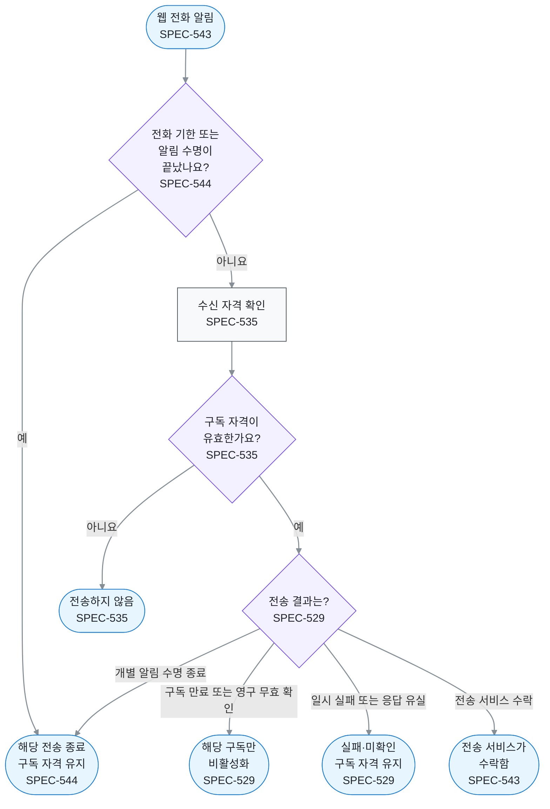

# 아이폰 홈 화면 웹앱 알림 04단계 기능 명세 초안

2026-11-25 KST · 마롱이 Orca 항목 143 · SPEC-520~554 · 04 체크포인트 대기

- **승인 기준** — 사용자님 직접 선택 e2412, 02 버전 고정 답변 `msg_0354290a56b2`, 03 흐름 승인 `msg_3a78868b4953`(요청 `msg_afe6359e84ec`)을 적용합니다. 기존 원문과 승인 해시는 [04 진행 기록](../../iphone-webapp-04-spec-checkpoint-2026-11-25.md)에 연결했습니다. [02 고정 요구사항](../02-prd/iphone-home-webapp-notifications-version-candidate.md) · [03 승인 대상 흐름 목록](../../iphone-webapp-03-flow-checkpoint-2026-11-25.md#흐름-파일과-sha-256)
- **상태** — 아래 행은 04 초안입니다. 화면의 의미와 결과를 명세하며 버튼 배치와 실제 안내 문구는 08에서 정합니다. 데이터 구조, API 경로와 응답 코드, 최소 iOS 버전, 서비스 워커 구조와 전송 기술은 [후속 계약 질문](#후속-계약-질문)으로 넘깁니다.
- **용어** — 홈 화면 웹앱, 웹 푸시 구독, 약속 전화(TERM-081), 기기 로그인(TERM-174), 통화 재연결은 고정 요구사항의 뜻을 사용합니다. ‘알림 수명’은 한 알림이 전송될 수 있는 기간, ‘전화 응답 기한’은 약속 전화를 수락할 수 있는 시각, ‘구독 자체의 만료’는 기기가 새 알림을 받을 수 있는 등록의 자격 종료입니다.

## 공통 규칙

1. **접근과 상태 효과** — 웹 구독의 조회와 변경은 기존 인증을 적용한 뒤 대상 계정과 설치를 확인합니다. 로그인된 사람이 알림을 탭해도 그 사람의 방·메시지·전화임을 확인하기 전에는 내용을 표시하지 않습니다. 잘못된 입력·권한 없음·대상 무효에서 새 구독, 방 기록, 수락 또는 일반 통화를 만들지 않습니다.
2. **중복·경합·응답 유실** — 성공 표시와 상태 변경을 구분합니다. 등록·갱신·해제는 같은 실행이나 상태 확인으로 이미 처리된 결과를 확인합니다. 방 기록은 발생당 한 번이고 전화 수락은 최초 유효한 한 건입니다. 성공을 확인 못 했다는 이유만으로 새 통화나 중복 알림을 만들지 않습니다. 재시도 방법·횟수·간격은 기존 승인 범위를 바꾸지 않는 조건에서 06에 연결합니다.
3. **개인정보와 실측** — 기본 알림 미리보기에 대화 원문·개인적인 일정과 전화 내용을 포함하지 않습니다. 운영 기록에 구독 원본·직접 식별값을 담지 않습니다. 전송 서비스 수락, 실제 기기 표시, 알림 탭, 전화 수락, 통화 연결은 서로 다른 관측입니다. 새 AI 호출 없이 기존 답변·선톡·일정 및 통화 동작을 사용합니다.

## 기능 명세

### 설치·권한·구독

| ID | 동작 | REQ·FL | 전제 | 주 동작 | 예외 | Given–When–Then 수용 조건 | 상태 |
| --- | --- | --- | --- | --- | --- | --- | --- |
| SPEC-520 | 홈 화면 추가 안내 | REQ-640 · FL-220, FL-227 | 아이폰 일반 Safari에서 사용자가 웹 알림 안내를 엽니다. | 공유 메뉴에서 홈 화면에 추가하고 웹앱으로 여는 순서를 안내합니다. | 추가하지 않거나 안내를 닫으면 일반 Safari의 기존 글 대화·통화를 계속 이용합니다. 안내 열기만으로는 권한을 요청하지 않습니다. | Given 일반 Safari, When 웹 알림 안내를 엶, Then 설치 안내가 보이고 시스템 권한 요청은 0회입니다. | proposed |
| SPEC-521 | 미지원 설치 안내 | REQ-674 · FL-220 | 홈 화면 웹앱의 알림 기능을 지원하지 않는 조건이 확인됩니다. | 알림을 켤 수 없는 상태와 알림 없이 웹을 이용하는 경로를 안내합니다. | 일시적인 연결 실패나 지원 유무를 확인할 수 없는 상태에서는 미지원으로 확정하지 않습니다. 미지원 상태에서 권한 요청과 구독 시도는 하지 않습니다. | Given 알림을 지원하지 않는 설치, When 알림 설정을 엶, Then 일반 웹 이용 안내가 보이고 알림 권한 요청·서버 구독 요청은 각각 0회입니다. | proposed |
| SPEC-522 | 현재 설치의 알림 상태 조회 | REQ-642, REQ-668 · FL-220, FL-221 | 사용자가 알림 설정을 열고 서비스에 상태 조회를 요청합니다. | 현재 설치의 지원·시스템 권한·서버 구독 상태를 구분해 표시합니다. 시스템 허용과 유효한 서버 등록이 함께 확인된 설치가 수신 가능입니다. | 비로그인은 계정의 구독 내용을 볼 수 없습니다. 서버 확인이 실패하면 준비 중·연결 필요 등 현재 확인 가능한 상태를 사용합니다. 읽기 실패나 반복 조회는 등록을 바꾸지 않습니다. | Given 사용자가 OS에서 허용했으나 서버 등록이 끝나지 않음, When 설정을 엶, Then 수신 가능 대신 등록이 필요하거나 아직 확인되지 않았음을 표시합니다. | proposed |
| SPEC-523 | 명시적 알림 허용과 거부 | REQ-641, REQ-643 · FL-220 | 지원되는 홈 화면 웹앱에서 로그인했고 OS 알림 권한에 아직 응답하지 않았습니다. | 사용자가 직접 알림 켜기를 선택할 때만 OS 권한 허용을 요청합니다. | 페이지 방문·재개만으로 요청하지 않습니다. 이미 거부했다면 자동 재요청 대신 OS 설정에서 변경할 수 있음을 안내합니다. 허용하지 않거나 닫으면 새 구독을 활성화하지 않습니다. | Given 권한 미응답 상태, When 방문·로그인 후 알림 켜기를 직접 누름, Then 누르기 전 요청 0회, 누른 뒤 요청 1회입니다. Given 거부 상태, When 여러 차례 다시 방문, Then 자동 요청 0회입니다. | proposed |
| SPEC-524 | 현재 계정의 설치에 구독 등록 | REQ-644, REQ-668 · FL-220, FL-221 | 로그인된 설치에 메시지를 받을 OS 권한이 있고 구독을 확인했습니다. | 현재 계정과 기기 로그인에 속한 해당 설치의 구독을 연결합니다. 같은 설치·계정의 동일한 등록은 기존 결과를 사용합니다. | 구독 제출이 비었거나 형식·크기 조건을 벗어나면 활성화하지 않습니다. 사용자·다른 설치를 확인할 수 없으면 거절합니다. 상태 변경 실패와 응답 유실은 구분합니다. 등록 후 응답만 유실됐다면 동일 등록 요청 또는 상태 조회로 기존 결과를 확인합니다. | Given 계정 가의 두 설치와 계정 나의 한 설치, When 각 설치가 구독하고 한 설치가 같은 요청을 반복, Then 각 설치는 자기 계정으로만 활성화되고 반복한 설치의 활성 구독은 한 개입니다. | proposed |
| SPEC-525 | 구독 조회와 변경 요청의 권한 확인 | REQ-668 · FL-220, FL-221 | 조회·등록·갱신·해제 요청으로 설치의 구독에 접근합니다. | 기존 기기 로그인과 해당 계정·설치의 권한을 확인한 뒤 허용 범위 안에서 처리합니다. 등록 요청이 사용하는 구독 정보는 보호합니다. | 비로그인·다른 계정·권한 없는 설치·허용되지 않은 출처 또는 대상 확인 실패면 구독 주소·키·다른 설치 상태를 내보내거나 바꾸지 않습니다. 입력 형식과 허용 범위는 06에서 고정합니다. | Given 계정 가의 구독, When 계정 나·비로그인·다른 출처에서 읽기 또는 변경을 요청, Then 구독의 존재·주소·키와 상태 변경이 노출되지 않습니다. | proposed |
| SPEC-526 | 같은 설치의 구독 갱신 | REQ-646, REQ-668 · FL-221 | 해당 설치가 알림을 허용했고 구독 변경 요청 권한을 확인했습니다. | 갱신 성공 시 같은 설치에서 유효한 새 구독이 이전 구독을 대체합니다. | 실패 또는 응답 유실을 두 구독의 동시 활성으로 처리하지 않습니다. 이전 구독의 자격은 실제 유효성으로 판정합니다. 갱신 중 철회 또는 로그아웃이 먼저 완료됐으면 이전 로그인에 속한 구독을 다시 활성화하지 않습니다. 확인·재시도는 같은 설치 상태 기준입니다. | Given 이전 구독이 있는 한 설치, When 새 구독 등록 후 응답이 유실돼 같은 갱신을 반복, Then 이후 새 구독만 발송 대상으로 사용됩니다. | proposed |
| SPEC-527 | 설치 단위 수신 해제 | REQ-647, REQ-668 · FL-221 | 사용자가 자기 설치의 수신을 해제하거나 웹이 시스템 권한 철회를 확인했습니다. | 해당 구독을 새 발송 대상에서 제외합니다. 같은 계정의 다른 설치는 각각의 허용 상태로 판단합니다. | 이미 해제한 요청을 다시 해도 같은 상태입니다. 저장 실패면 해제 완료를 단정하지 않습니다. 전송 서비스에 이미 인계된 알림의 회수는 보장하지 않으며, 탭 시에는 최신 권한을 확인합니다. | Given 계정 가의 허용 설치 두 개, When 한 설치에서 해제가 완료된 뒤 새 알림을 생성, Then 해제한 설치에는 전송 0건이며 다른 설치의 수신 자격은 유지됩니다. | proposed |
| SPEC-528 | 기기 로그인 종료 뒤 새 발송 차단 | REQ-648, REQ-645 · FL-221, FL-222, FL-224 | 기기 로그인이 로그아웃·만료·폐기로 종료됐습니다. | 아직 전송 서비스에 인계되지 않은 대상도 인계 전 로그인 자격을 다시 판정해, 종료된 로그인에 속한 구독으로 보낼 수 없게 합니다. | 다른 유효한 로그인과 설치에는 영향을 주지 않습니다. 응답 유실 후에는 기존 로그인 상태를 기준으로 확인합니다. 이미 인계된 알림을 열 때는 다시 인증·접근을 확인합니다. | Given 발송 대기 중인 이전 로그인과 유효한 다른 설치, When 이전 로그아웃이 발송 인계 전에 완료, Then 이전 로그인 대상은 0건이고 다른 적격 설치는 수신 대상입니다. | proposed |
| SPEC-529 | 구독 자체의 만료와 영구 무효 | REQ-649, REQ-667 · FL-221, FL-224 | 해당 웹 구독 자체의 만료 또는 전송 서비스의 영구 무효가 확인됩니다. | 해당 구독만 비활성화합니다. 결과는 구독 원본을 제외하고 기록합니다. | 약속 전화의 응답 기한·개별 알림 수명 만료, 일시 오류, 응답 유실, 분류가 확정되지 않은 실패는 이 비활성화 조건에 해당하지 않습니다. Android FID와 다른 웹 구독은 그대로 각각 판정합니다. 어떤 증거를 영구 무효로 인정할지는 06에서 정합니다. | Given 구독 A와 B, When A의 구독 자체가 영구 무효로 확인됨, Then A만 비활성화합니다. Given 일시 오류 또는 판단 불가 결과, When 전송이 끝남, Then 구독 비활성화는 0건입니다. Given 같은 설치의 갱신이 완료됨, When 이전 구독의 전송 결과가 뒤늦게 영구 무효로 확인, Then 이전 구독 결과를 새 구독에 적용하지 않습니다. | proposed |
| SPEC-530 | 현재 로그인에서 수신 다시 등록 | REQ-650, REQ-644 · FL-220, FL-221 | 사용자가 해제·삭제·로그인 종료 뒤 현재 설치에서 로그인해 수신을 다시 선택합니다. | 시스템 권한과 등록 성공이 확인되면 현재 계정과 설치의 수신을 복원합니다. | 거부·미지원·등록 실패면 복원을 완료하지 않습니다. 이전 계정이나 끝난 로그인에 대해 수신을 되살리지 않습니다. 기존 알림을 누르는 동작 자체로 다시 등록하지 않습니다. | Given 기존 계정 가로 쓰던 설치에 계정 나가 로그인함, When 나가 알림을 다시 허용해 등록 성공, Then 나로 보낸 알림만 수신 대상이고 가의 구독은 복원되지 않습니다. | proposed |

### 글·일정 알림 전달

| ID | 동작 | REQ·FL | 전제 | 주 동작 | 예외 | Given–When–Then 수용 조건 | 상태 |
| --- | --- | --- | --- | --- | --- | --- | --- |
| SPEC-531 | 발생 이벤트당 방 기록 한 건 | REQ-655 · FL-222 | 기존 글 대화 또는 일정 루프에서 새 답변·선톡·일정 발생이 확정됐습니다. | 같은 이벤트의 결과는 기존 방에 한 건만 남깁니다. 웹·Android 전달은 이 결과를 사용합니다. | 기기 수, 재처리, 전송 실패가 방 기록을 추가하거나 삭제하지 않습니다. 저장을 확인할 수 없는 경우 새 레코드나 발송 성공을 추정하지 않습니다. | Given 같은 이벤트를 두 전달 수단에 보내고 재처리함, When 방 기록을 조회, Then 해당 발생의 기록은 한 건이고 전송 결과는 따로 확인됩니다. | proposed |
| SPEC-532 | 새 답변 알림 전달 | REQ-651, REQ-645, REQ-675 · FL-222 | 알림 대상인 새 답변이 방에 저장됐습니다. | 수신 자격이 있고 해당 답변의 열람이 확인되지 않은 홈 화면 웹앱 설치에 새 답변을 알립니다. | 해당 설치가 거부·철회·로그인 종료·구독 무효 상태면 발송 대상에서 빠집니다. 발송이 실패해도 새 답변을 방에서 조회할 수 있습니다. | Given 글 대화가 닫힌 적격 설치 한 개, When 새 답변 한 건이 저장, Then 그 설치는 발송 대상 한 개입니다. | proposed |
| SPEC-533 | 선톡 알림 전달 | REQ-652, REQ-645 · FL-222 | 기존 정책에 따라 선톡이 방에 저장됐습니다. | 각각의 적격 홈 화면 웹앱에 선톡 알림을 전달합니다. | 선톡 생성·횟수·발송 시각은 기존 정책을 적용합니다. 수신 기기가 없거나 전달이 실패해도 방에서 조회합니다. 답변 열람 조건으로 선톡을 생략하지 않습니다. | Given 기존 정책으로 저장된 선톡 한 건과 허용 웹앱 두 개, When 수신 대상을 판정, Then 두 설치를 각각 대상으로 선택합니다. | proposed |
| SPEC-534 | 일정 알림 전달 | REQ-653, REQ-645, REQ-655 · FL-222 | 기존 일정 알림 결과가 방에 저장됐습니다. | 발생 시각마다 같은 기록을 참조해 적격 홈 화면 웹앱에 알립니다. | 디스코드 연결 정보 유무로 수신 대상을 제한하지 않습니다. 동일 반복 일정의 동일 발생을 재처리해도 방 기록은 한 건입니다. 전송 오류로 기존 방의 알림 기록을 바꾸지 않습니다. | Given 디스코드 연결 정보 없는 계정에 반복 일정과 허용 웹앱 한 개, When 같은 일정 발생을 여러 번 처리, Then 방에는 그 시각의 알림 한 건이 남고 해당 설치를 그 발생의 발송 대상으로 판단합니다. | proposed |
| SPEC-535 | 웹앱 설치별 발송 자격 판정 | REQ-645, REQ-648 · FL-222, FL-224 | 기존 방 이벤트 또는 유효한 약속 전화의 전송 대상을 확인합니다. | 대상 계정에 속하고 기기 로그인·알림 허용·구독이 모두 유효한 홈 화면 웹앱을 설치별로 선택합니다. | 계정이나 설치의 일치·권한을 확인하지 못하면 해당 설치에는 보내지 않습니다. 한 설치가 거부·철회하거나 실패해도 다른 설치의 자격은 다시 개별 판정합니다. Android는 SPEC-553의 기존 기준입니다. | Given 계정 가의 허용 웹앱 두 개와 거절 웹앱 한 개, 계정 나의 허용 웹앱 한 개, When 가에게 발송, Then 가의 허용 웹앱 두 개만 후보이고 나에게는 0건입니다. | proposed |
| SPEC-536 | 같은 설치에서 읽고 있는 답변 푸시 생략 | REQ-675, REQ-651 · FL-222 | 새 답변 푸시 발송을 판단하는 시점입니다. | 같은 홈 화면 웹앱 설치에서 해당 답변을 보고 있음이 확인된 경우에만 그 설치의 그 답변 전송을 생략합니다. | 일치하는 설치와 답변 열람을 확인하지 못한 허용 설치는 발송 대상으로 남깁니다. 일반 탭에서의 열람이나 다른 설치의 열람은 이 설치에 적용하지 않습니다. 선톡·일정·전화 알림과 기존 방 기록은 별도 기준으로 처리합니다. | Given 적격 웹앱 두 개 중 하나만 해당 답변을 보고 있음이 확인, When 전송을 판정, Then 확인된 설치 0건, 확인되지 않은 설치 1건입니다. Given 같은 계정에 유효한 약속 전화, When 전송을 판정, Then 답변 열람 때문에 전화 알림을 생략하지 않습니다. | proposed |
| SPEC-537 | 같은 설치의 중복 표시 방지 | REQ-656 · FL-222, FL-224 | 같은 이벤트의 같은 알림이 설치에 중복 도착하거나 재처리됩니다. | 같은 설치에서는 사용자에게 한 번만 표시합니다. 다른 적격 설치의 표시와는 독립입니다. | 전송 성공 응답이 유실되거나 전송 결과를 모를 때 수신 성공을 표시하지 않습니다. 다시 전달되더라도 표시가 늘지 않아야 합니다. 재시도를 허용할 조건과 기한은 06에서 정합니다. | Given 같은 설치에 동일 이벤트 알림이 두 번 도착함, When 두 건을 처리, Then 이 설치에서 화면 표시 한 번이며 다른 적격 설치는 그 설치 기준으로 한 번입니다. | proposed |
| SPEC-538 | 잠금 화면의 기본 알림 미리보기 | REQ-651, REQ-652, REQ-653, REQ-654, REQ-666 · FL-222, FL-224 | 글·일정·약속 전화의 홈 화면 웹앱 알림을 만듭니다. | 기본 알림은 알림 종류를 알 수 있는 내용으로 표시합니다. 대화 원문·개인적인 일정 및 전화 제목·메모를 기본 미리보기에서 제외합니다. | 기기 설정이 미리보기 항상 표시여도 제외된 정보는 제공하지 않습니다. 방이나 전화의 인증된 화면에서만 해당 계정의 내용을 읽을 수 있습니다. 표기 문구는 08에서 정합니다. | Given 합성 메시지 원문·일정 제목·전화 할 말이 있는 이벤트와 항상 미리보기, When 잠금 알림이 도착, Then 준비한 원문 표식이 알림 내용과 잠금 화면에 각각 0건입니다. | proposed |

### 알림 탭과 대상 확인

| ID | 동작 | REQ·FL | 전제 | 주 동작 | 예외 | Given–When–Then 수용 조건 | 상태 |
| --- | --- | --- | --- | --- | --- | --- | --- |
| SPEC-539 | 알림 진입에서 기존 로그인 사용 | REQ-657, REQ-659 · FL-223, FL-225 | 글 또는 전화 알림을 눌렀고 연결할 수 있으나 유효한 로그인이 없습니다. | 대상 내용을 열기 전에 기존 로그인 흐름으로 진입합니다. 로그인을 마치면 현재 인증 상태로 원래 알림의 대상과 권한을 다시 확인합니다. | 로그인 취소·실패에는 대상 내용이나 전화 상태를 표시하지 않습니다. 다른 계정으로 인증됐거나 대상이 만료·삭제된 예외는 SPEC-540·547·549의 확인 결과를 따릅니다. 원래 로그인 정보가 없다고 이전 계정으로 복귀시키지 않습니다. | Given 알림을 눌렀으나 로그인이 만료됨, When 로그인 화면을 열고 같은 계정으로 인증, Then 인증 전 대상 공개 0건이며 인증 뒤 대상 확인이 새로 실행됩니다. | proposed |
| SPEC-540 | 현재 계정의 알림 대상 접근 확인 | REQ-659 · FL-223, FL-225 | 유효한 로그인으로 글 또는 전화의 알림 대상 열기를 요청합니다. | 현재 계정에 할당된 방과 대상 메시지, 또는 해당 계정의 전화인지를 서버 상태로 확인합니다. | 대상 누락·형식 위반·허용 크기 초과·대상 삭제·권한 철회·다른 계정은 접근을 거절합니다. 응답으로 다른 계정의 메시지나 일정 제목·전화 상태 또는 존재를 알려 주지 않습니다. 같은 계정의 유효 대상이 확인되면 내용 열기 전에 최신 상태를 판단합니다. | Given 계정 가의 글·전화 알림, When 계정 나로 다시 로그인해 열거나 대상이 삭제된 후 열기, Then 방 내용, 제목, 전화 상태 노출과 전화 수락은 모두 0건입니다. | proposed |
| SPEC-541 | 확인한 글 알림의 방 열기 | REQ-658 · FL-223 | 현재 계정의 접근 가능한 방과 해당 알림의 대상 메시지를 확인했습니다. | 새 답변·선톡·일정 알림의 해당 방을 기존 글 대화로 엽니다. | 대상이 확인되지 않으면 SPEC-540의 접근 거절, 접속할 수 없으면 SPEC-542의 미확인 상태로 처리합니다. 재탭은 방을 다시 열기 위한 동작이며 방 기록을 추가하지 않습니다. 대상 글의 스크롤 위치는 08에서 정합니다. | Given 같은 계정의 새 답변·선톡·일정 알림 각각과 접근 가능한 대상, When 알림을 하나씩 누름, Then 모두 각 알림이 가리킨 방을 열고 다른 방이나 새 기록은 생기지 않습니다. | proposed |
| SPEC-542 | 오프라인·확인할 수 없는 알림 진입 | REQ-664 · FL-223, FL-225 | 알림을 누르거나 받기를 시도했으나 현재 계정이나 대상을 서버에서 확인할 수 없습니다. | 대상 미확인으로 처리합니다. 접근할 수 있는 화면에는 연결이 필요함을 알리고, 다시 열 때는 현재 로그인·대상·전화의 기한과 수락 상태를 확인합니다. | 이미 표시된 OS 알림은 유효성이나 수락을 보장하지 않습니다. 로컬에 남은 다른 계정의 내용이나 성공 상태를 표시하지 않습니다. 응답 유실 뒤 수락 여부는 SPEC-546에 따라 기존 결과를 확인합니다. | Given 오프라인 상태에서 글·전화 알림을 누름, When 웹이 해당 대상을 확인할 수 없음, Then 방 내용과 통화 성공 표시는 0건입니다. Given 다시 연결될 때 전화가 만료, When 같은 계정으로 다시 엶, Then 만료로 표시합니다. | proposed |

### 약속 전화 전송과 수락

| ID | 동작 | REQ·FL | 전제 | 주 동작 | 예외 | Given–When–Then 수용 조건 | 상태 |
| --- | --- | --- | --- | --- | --- | --- | --- |
| SPEC-543 | 유효한 약속 전화의 웹 알림 | REQ-654, REQ-645, REQ-656 · FL-224 | 기존 일정 처리에서 응답 가능한 약속 전화가 생성됐습니다. | 발송 자격을 갖춘 홈 화면 웹앱에 같은 약속 전화의 알림을 설치별로 전달합니다. 알림을 받는 것만으로 수락하지 않습니다. | 기존 통화 중·대기 벨·전화 불가 조건으로 응답 가능한 전화가 생기지 않으면 새 웹 전화 알림을 보내지 않습니다. 발송 전 기간 종료는 SPEC-544로 판정합니다. 답변 열람에 따른 생략을 전화 알림에 적용하지 않습니다. | Given 유효한 전화 한 건과 허용 웹앱 한 개, When 상대가 통화 가능한 상태에서 전송, Then 같은 전화의 웹 알림은 설치당 한 건이며 전화 수락은 0건입니다. | proposed |
| SPEC-544 | 약속 전화 기한과 개별 알림 수명 종료 | REQ-665, REQ-649 · FL-224, FL-221 | 웹 약속 전화 알림이 대기 중이거나 전송 결과를 확인합니다. | 기존 전화의 서버 응답 기한 또는 해당 알림의 수명 중 하나가 끝나면 그 알림의 전송만 종료합니다. 구독 자격은 구독 자체의 상태로 별도 판정합니다. | 이미 전달된 알림이 늦게 도착해도 탭에서 현재 전화 상태를 다시 봅니다. 약속 전화 기한이나 알림 수명 종료는 구독 비활성화 근거가 아닙니다. 일시 실패와 구독 영구 무효는 SPEC-529를 적용하며 공급자의 오류 범주는 06에서 정합니다. | Given 유효한 구독과 발송 대기 전화, When 발송 전에 서버 응답 기한 또는 알림 수명이 각각 끝남, Then 그 알림의 새 전송 0건이며 구독은 다음 유효한 전화의 대상입니다. Given 알림 수명은 끝났으나 기존 전화는 응답 가능, When 사용자가 웹을 직접 열어 기존 경로로 접근, Then 전화의 기존 응답 가능 판정은 그대로입니다. | proposed |
| SPEC-545 | 알림 탭 뒤 기존 웹 받기 화면 | REQ-660, REQ-659, REQ-664 · FL-225 | 로그인 확인, 전화 소유 계정 일치, 아직 응답 가능한 대기 전화가 모두 확인됐습니다. | 해당 약속 전화의 기존 웹 받기 화면을 엽니다. 전화 연결은 다음 명시적인 받기 선택에 따릅니다. | 탭만으로 수락·일반 통화·마이크 시작이 진행되지 않습니다. 다른 계정·대상 무효는 거절, 오프라인은 미확인, 미수락 만료와 이미 수락은 각각 SPEC-547·549로 안내합니다. | Given 같은 계정의 유효한 전화 알림과 잠긴 아이폰, When 알림을 누르고 잠금을 풀어 접근 확인에 성공, Then 해당 전화의 받기 화면이 보이고 수락과 마이크 시작은 각각 0건입니다. | proposed |
| SPEC-546 | 첫 유효한 받기와 중복·응답 유실 처리 | REQ-661, REQ-660, REQ-663, REQ-664 · FL-225, FL-228 | 현재 계정이 해당 약속 전화의 받기를 별도로 선택합니다. | 받기 요청을 처리하는 시점에 현재 계정, 응답 기한, 수락 상태 및 기존 통화 가능 조건을 다시 확인합니다. 동시 요청에서도 최초 유효 수락과 그 약속 전화의 연결은 한 번입니다. | 두 번 누름, 다른 기기와 경쟁, 응답 유실 뒤 다시 확인할 때 기존 수락 결과를 사용합니다. 다른 기기가 이미 받았으면 SPEC-549, 첫 수락 전 만료면 SPEC-547입니다. 기존 마이크 거절·통화 불가·연결 실패나 성공을 확인 못 하는 경우 새 통화 성공으로 표시하거나 일반 통화로 바꾸지 않습니다. 수락이 완료되기 전 실패했으면 다시 열 때 현재 유효 상태를 확인합니다. 수락 완료 뒤 연결에 실패했다면 기존 수락을 유지하고 같은 클라이언트의 복구는 SPEC-550을 적용합니다. | Given 같은 전화에 대해 두 기기가 거의 동시에 받기 선택, When 수락 결과를 확인, Then 최초 유효 수락 한 건과 그 전화의 연결 한 건입니다. Given 첫 수락 결과가 저장된 뒤 응답만 유실, When 다시 확인하거나 받기를 반복, Then 추가 수락·새 통화는 0건입니다. Given 수락 판정 전 서버 오류, When 받기 결과를 확인할 수 없음, Then 성공 표시와 자동 일반 통화는 0건이며 다시 진입하면 현재 유효성부터 확인합니다. | proposed |
| SPEC-547 | 미수락 약속 전화 만료 안내 | REQ-662, REQ-660, REQ-657 · FL-225 | 현재 계정이 알림 대상에 접근할 수 있고 해당 전화는 미수락이며 기존 응답 기간이 끝났습니다. | 서버가 확인하는 시각이 기존 응답 기한에 도달한 미수락 전화는 만료로 안내합니다. 진입 전에 끝났거나 유효한 받기 화면에서 선택한 뒤 서버 판정 시점까지 끝났어도 수락하지 않습니다. | 잠금 해제 또는 같은 계정으로 재로그인하는 동안 기한이 지났으면 계정 확인 뒤 만료를 표시합니다. 다른 계정과 대상 무효는 거절이며, 먼저 수락된 전화는 이미 처리된 상태입니다. 서버 상태를 확인 못 한 경우는 미확인입니다. 자동 일반 통화를 시작하지 않습니다. | Given 탭 당시 유효했던 전화가 잠금 해제 또는 같은 계정 재로그인 도중 각각 만료, When 대상 확인을 마침, Then 만료 안내·수락 0건·자동 통화 0건입니다. Given 유효한 받기 화면을 먼저 열었으나 받기 직전 혹은 요청 도착 전 만료, When 받기 처리, Then 같은 만료 결과입니다. | proposed |
| SPEC-548 | 만료 안내 뒤 별도 선택에서 일반 통화 시작 | REQ-662 · FL-225 | 현재 계정에 만료된 전화 상태가 표시됐습니다. | 사용자가 일반 통화를 별도로 선택할 때만 기존 일반 통화 경로로 진입합니다. 이 선택으로 만료된 전화나 다른 약속 전화를 수락하지 않습니다. | 알림 탭, 만료 안내, 늦은 받기, 닫기에서는 일반 통화가 시작되지 않습니다. 별도 선택 뒤 마이크와 동시 통화 제한 등은 기존 일반 통화 정책을 사용합니다. | Given 만료 안내, When 일반 통화를 누르지 않음, Then 새 통화 0건입니다. Given 같은 상태, When 일반 통화를 별도로 선택, Then 일반 통화 경로로 진입하며 만료된 전화나 다른 약속 전화의 수락은 0건입니다. | proposed |
| SPEC-549 | 먼저 수락된 전화 상태 안내 | REQ-663, REQ-661 · FL-225 | 접근 권한이 확인된 알림의 전화가 이미 수락됐습니다. | 현재 약속 전화가 이미 처리됐음을 표시합니다. 최초 수락 결과는 그대로 유지합니다. | 화면 열기 전 또는 받기 직전에 다른 기기가 먼저 받았을 때 동일하게 처리합니다. 약속 전화 추가 수락·일반 통화 자동 시작은 각각 0건입니다. 확인되지 않은 상태를 선행 수락으로 단정하지 않습니다. | Given 다른 허용 기기가 먼저 받음, When 알림을 늦게 열거나 이미 열린 화면에서 받기를 선택, Then 만료 대신 처리된 상태를 안내하고 추가 수락·새 통화는 각각 0건입니다. | proposed |

### 복귀 및 기존 사용자 경로 회귀

| ID | 동작 | REQ·FL | 전제 | 주 동작 | 예외 | Given–When–Then 수용 조건 | 상태 |
| --- | --- | --- | --- | --- | --- | --- | --- |
| SPEC-550 | 복구할 수 있는 같은 클라이언트의 재연결 | REQ-672 · FL-226 | 잠금 해제·앱 복귀 또는 망 전환 뒤 같은 클라이언트의 통화가 기존 재연결 조건을 충족합니다. | 기존 통화가 계속 연결돼 있으면 그대로 사용하고, 연결이 끊겼으면 같은 통화 ID에 재연결합니다. 이를 새 약속 전화 수락으로 세지 않습니다. | 다른 클라이언트의 실제 동시 통화에는 기존 제한을 적용합니다. 망 단절 등으로 확인되지 않으면 연결 확인 필요 상태입니다. 잠금 중 오디오가 계속 재생된다는 약속은 이 조건에 포함되지 않습니다. | Given 기존 클라이언트가 복구 가능한 단절을 겪음, When 잠금 해제·앱 복귀·망 전환 후 재연결, Then 같은 통화 ID와 양방향 오디오를 확인하고 새 수락은 0건입니다. 실기기 결과는 12에서 기록합니다. | proposed |
| SPEC-551 | 복구할 수 없는 통화의 다시 걸기 안내 | REQ-673 · FL-226 | OS가 페이지를 종료했거나 서버가 통화를 끝내 기존 통화에 연결할 수 없습니다. | 통화가 끝난 상태에서 기존 다시 걸기 경로를 제공합니다. | 재연결 조건을 확인 중일 때 기존 통화의 성공으로 표시하지 않습니다. 사용자가 다시 걸기를 선택하면 기존 일반 통화 경로를 사용합니다. 실제 다른 기기의 통화 상태와는 기존 판정으로 구분합니다. | Given 서버가 종료한 통화 또는 OS가 종료한 페이지로 돌아옴, When 복구할 수 없음이 확인, Then 이전 통화에 연결됐다는 표시 없이 기존 다시 걸기 경로를 사용할 수 있습니다. | proposed |
| SPEC-552 | 일반 Safari의 기존 웹 진입 | REQ-669 · FL-227 | 사용자가 일반 Safari 탭에서 기존 웹 기능을 사용합니다. | 홈 화면 추가나 웹 푸시 권한을 요구하지 않고 기존 가입·로그인, 글 대화, 발신과 직접 진입한 약속 전화의 받기 흐름을 제공합니다. | 기존 계정·마이크·약속 전화의 유효 조건은 적용합니다. 웹 알림 안내를 열 때만 설치 안내로 이동할 수 있습니다. | Given 웹앱을 설치하지 않은 아이폰 Safari, When 기존 계정으로 로그인해 글 대화 조회·전송, 통화 걸기·직접 받기를 각각 시험, Then 설치나 알림 허용을 선행 조건으로 붙이지 않습니다. | proposed |
| SPEC-553 | Android 수신 자격과 기존 앱 경로 | REQ-670 · FL-228 | 같은 계정에 Android 앱과 새 웹앱 설치가 있습니다. | Android의 글·일정·벨 수신 자격을 기존 계약에서 판정하고 기존 받기 동작을 사용합니다. | 웹 구독 추가·해제·영구 무효나 답변 열람 확인을 Android 판정에 적용하지 않습니다. FCM 등록 해제 분류, 앱 버전 보고와 APK 업데이트는 기존 경로로 회귀 검증합니다. | Given 같은 Android 코드 12 기준 앱에 웹 구독이 없을 때와 있을 때, When 글·일정·벨 대상으로 각각 판정, Then 해당 Android의 자격·동작이 같습니다. | proposed |
| SPEC-554 | 기존 홈 화면 설치의 진입 유지 | REQ-671 · FL-220 | 이미 홈 화면에 마롱이를 추가한 아이폰에 웹 변경이 적용됩니다. | 기존 아이콘으로 마롱이의 기존 진입 경로를 계속 이용할 수 있게 합니다. | 로그인이 없는 경우 기존 로그인으로 들어갑니다. 새 알림 권한은 기존 설치 여부만으로 부여하지 않습니다. manifest 식별자와 경로 및 로그인 쿠키는 별도 기술 계약과 실기기에서 검증합니다. | Given 변경 전에 추가한 아이콘과 변경 후 새로 추가한 아이콘, When 둘 다 실행, Then 기존 아이콘은 삭제·재추가 없이 들어갈 수 있고 각 아이콘의 로그인 결과를 각각 기록합니다. | proposed |

## 전송 기한과 구독 상태

FL-224의 수신 실패 분기에서 **구독 비활성화**는 구독 자체의 만료 또는 영구 무효가 확인됐을 때만 적용합니다. 약속 전화 기한이나 개별 알림 수명의 종료는 그 알림의 전달만 끝냅니다.

| 기호 | 의미 |
| --- | --- |
| 둥근 상자 | 시작과 종료 결과 |
| 사각형 | 시스템 확인 단계 |
| 마름모 | 시점·자격·전송 결과의 분기 |
| 실선 화살표 | 결과 또는 다음 판정으로 이동 |

| 확인한 상태 | 현재 알림과 전화 | 구독 및 사용자 안내 |
| --- | --- | --- |
| 약속 전화의 응답 기한 종료 | 대기 중인 해당 알림 전송을 종료합니다. 해당 전화가 미수락이고 사용자가 탭하면 계정 확인 뒤 만료를 안내합니다. | 이 결과는 구독 비활성화 근거가 아닙니다. 일반 통화는 별도 선택입니다. SPEC-544·547·548. |
| 개별 알림 수명 종료 | 해당 알림 전송을 종료합니다. 전화 자체의 남은 응답 기간을 바꾸지 않습니다. 이미 받은 알림의 탭에서는 현재 전화 상태를 확인합니다. | 구독 자격을 유지하고 다음 유효한 전송에 사용합니다. SPEC-544·545. |
| 구독 자체의 만료·영구 무효 확인 | 해당 구독은 더 이상 새 전송 대상이 아닙니다. 이전 알림의 탭에서는 기존 대상 확인을 적용합니다. | 해당 구독만 비활성화하고 현재 설치의 상태를 조회할 때 재연결 필요로 구분할 수 있습니다. SPEC-522·529·539. |
| 일시 실패·결과 미확인 | 알림 표시나 성공으로 간주하지 않습니다. 방에 남은 글은 접속해서 확인할 수 있습니다. 전송 재시도 허용 여부와 기한은 별도 계약입니다. | 이 결과 자체로 구독이나 전화 수락 상태를 바꾸지 않습니다. SPEC-529·531·537. |

03 승인에서 승인한 구분입니다. 승인된 FL-224의 “영구 무효 또는 만료” 대사는 위의 **구독 자체**를 뜻하며, 흐름 원본은 보존했습니다.

## 사용자 상태와 실패 후 확인

| 입력·상황 | 표시 또는 사용자 동작 | 효과 확인 |
| --- | --- | --- |
| 미지원·권한 거절·등록 준비 중 | 알림 없이 기존 웹을 이용하거나 OS 권한 설정을 사용하거나 등록 상태를 확인합니다. | 비슷한 사용자 표시라도 미지원, 거부, 서버 확인 실패를 따로 시험합니다. SPEC-521~524. |
| 등록·갱신·해제 요청의 응답을 받지 못함 | 현재 상태를 다시 조회하거나 같은 동작을 다시 요청합니다. | 완료가 확인되기 전에는 성공 표시를 확정하지 않습니다. 동일 상태 변경을 반복한 뒤 활성 구독이나 영향을 받은 설치가 늘지 않습니다. SPEC-524·526~528. |
| 알림 대상 확인 불가 | 비로그인은 기존 로그인, 오프라인은 연결 필요, 다른 계정·무효 대상은 접근 거절입니다. | 표시되는 알림 자체로 방·메시지·전화의 내용을 읽을 수 없습니다. 로그인 뒤 같은 계정의 접근을 다시 확인합니다. SPEC-539~542. |
| 잠금 해제·재로그인 중 또는 받기 직전 만료 | 계정 확인 뒤 만료를 안내합니다. 일반 통화는 별도 선택입니다. | 약속 전화 수락과 자동 일반 통화는 각각 0건입니다. SPEC-547·548. |
| 다른 기기의 선행 수락, 받기 응답 유실 | 선행 수락 여부가 확인되면 처리된 상태로 구분합니다. 미확인 상태에서는 새 연결 성공을 가정하지 않습니다. | 이미 수락한 전화의 중복 수락·일반 자동 통화 0건입니다. 같은 클라이언트의 유효한 복구는 기존 재연결입니다. SPEC-546·549·550. |

## 12단계 검증으로 넘길 항목

| 검증 범위 | Given–When–Then 수용 예시 |
| --- | --- |
| REQ-666 잠금 화면과 전송 내용 | Given 원문·일정 제목·전화 할 말에 다른 시험 표식과 기기 설정의 항상 미리보기, When 각 알림을 생성·수신, Then 전송 내용과 실제 잠금 화면에서 해당 표식이 0건입니다. 지원 iOS 버전과 잠금·미리보기 설정을 함께 기록합니다. SPEC-538. |
| REQ-667 운영 기록의 데이터 노출 | Given 구독 등록·유실·거절·영구 무효와 알림 탭 오류를 가짜 전송에서 재현, When 운영 기록 형식으로 확인, Then 원문·이메일·구독 주소와 키·세션 토큰·원본 기기 식별값은 각각 0건입니다. 결과 유형을 확인하되 공급자 원문은 사용하지 않습니다. SPEC-529 및 공통 규칙. |
| 권한·다기기·한 번 처리 | Given 허용한 Android와 웹앱 두 곳, 거부한 다른 웹앱 및 접근 권한 없는 다른 계정, When 동일 이벤트를 전송·응답 유실·재처리하고 같은 전화를 두 기기에서 받기, Then 설치별 자격, 해당 답변 생략, 방 기록 한 건, 최초 수락 한 건, 다른 계정 데이터 노출 0건을 각각 확인합니다. SPEC-525·531·535~537·540·546. |
| iPhone 잠금·앱 전환 후 통화 | Given 일반 Safari와 홈 화면 웹앱에서 각각 시작한 기존 통화, When 잠금 해제·다른 앱으로부터 복귀·망 전환 뒤 기존 조건에서 연결을 복구, Then 복구 가능 사례에서 기존 통화 ID와 양방향 오디오를 각각 확인합니다. 서버 종료·OS 종료나 실제 다른 기기 통화를 별도 사례로 기록합니다. SPEC-550·551. [TC-643 검증 기록](../12-qa/BUG-114-web-call-reconnect.md) |
| 기존 Safari와 Android 회귀 | Given 일반 Safari 탭과 Android 0.3.4 코드 12 기준 앱, When 가입·글 대화·기존 통화 또는 Android 글·일정·벨 수신, 받기와 업데이트를 각 환경에서 검증, Then 웹 등록 유무에 따른 기존 자격과 경로가 같습니다. 새 웹 알림 수신률이나 Android FCM 실제 전달을 이 문서 검사로 입증하지 않습니다. SPEC-552~554. [통합 QA](../12-qa/unified.md) · [Android 업데이트 QA](../12-qa/app-update.md) |

## 후속 계약 질문

| 단계 | 이어서 결정할 내용 |
| --- | --- |
| 05 데이터 모델 | 구독과 현재 계정·설치·기기 로그인의 연결, 접근 범위와 폐기·보관 시점은 어떻게 저장할까요? 구독 갱신과 로그아웃이 겹칠 때 이전 구독의 부활을 어떻게 막을까요? 기존 방 이벤트와 약속 전화 수락 기록을 한 번만 사용할 데이터 경계를 확정합니다. |
| 06 입력과 응답 계약 | 구독 조회·등록·갱신·해제, 알림 대상 재진입과 확인, 동일 설치의 해당 답변 열람, 전화 재검증의 API 경로·입력 한도·응답과 오류 코드를 확정합니다. 응답 유실 뒤 확인·중복 요청의 결과와 성공 판정 시점을 함께 정합니다. |
| 06 수명·전송 계약 | 최소 iOS 버전, 서비스 워커 구조와 전송 기술, 알림 수명·기존 전화 응답 기한과의 관계, 재시도와 중복 표시 제어를 검토합니다. 구독 만료·영구 무효를 입증하는 공급자 결과, 일시 실패·응답 유실·개별 알림 수명 종료의 구분도 여기서 정합니다. SPEC-510의 FCM 코드를 웹 분류로 가져오지 않습니다. |
| 06 일반 통화 진입 | 만료된 웹 알림에서 사용자가 일반 통화를 별도로 선택했는지, 최초 유효 수락이 이미 처리됐는지 구분하는 계약이 필요합니다. 기존 직접 진입과 Android의 동작을 보존하면서 웹 알림의 판정 실패·시간 초과가 일반 통화 시작으로 전달되지 않도록 결과를 정합니다. |
| 07·08·12 화면과 시험 | 기존 설치 식별자를 유지할 수 있는 경로, 권한·오프라인·만료·처리된 전화의 문구와 단계, iPhone과 Android의 시험 환경을 정합니다. 새 요구사항이나 플랫폼 제한으로 제품 범위가 바뀌는 답은 기존 승인 유지와 별도로 확인합니다. |
