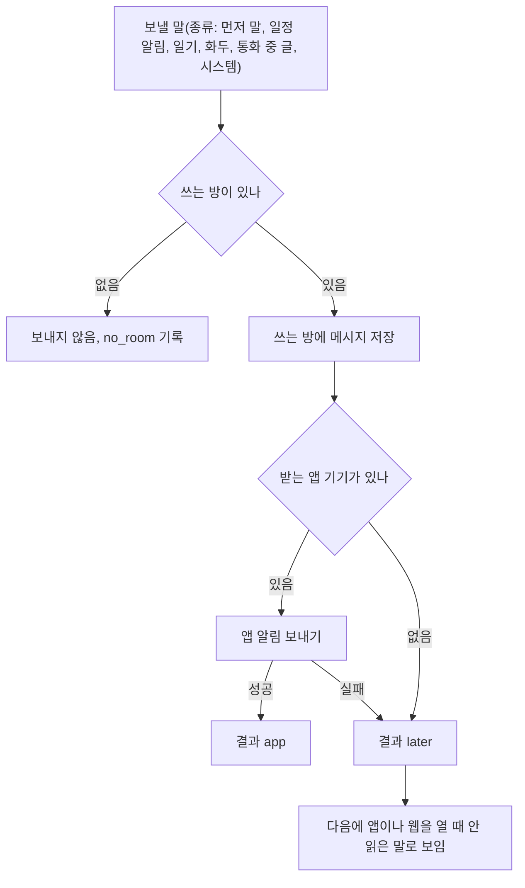
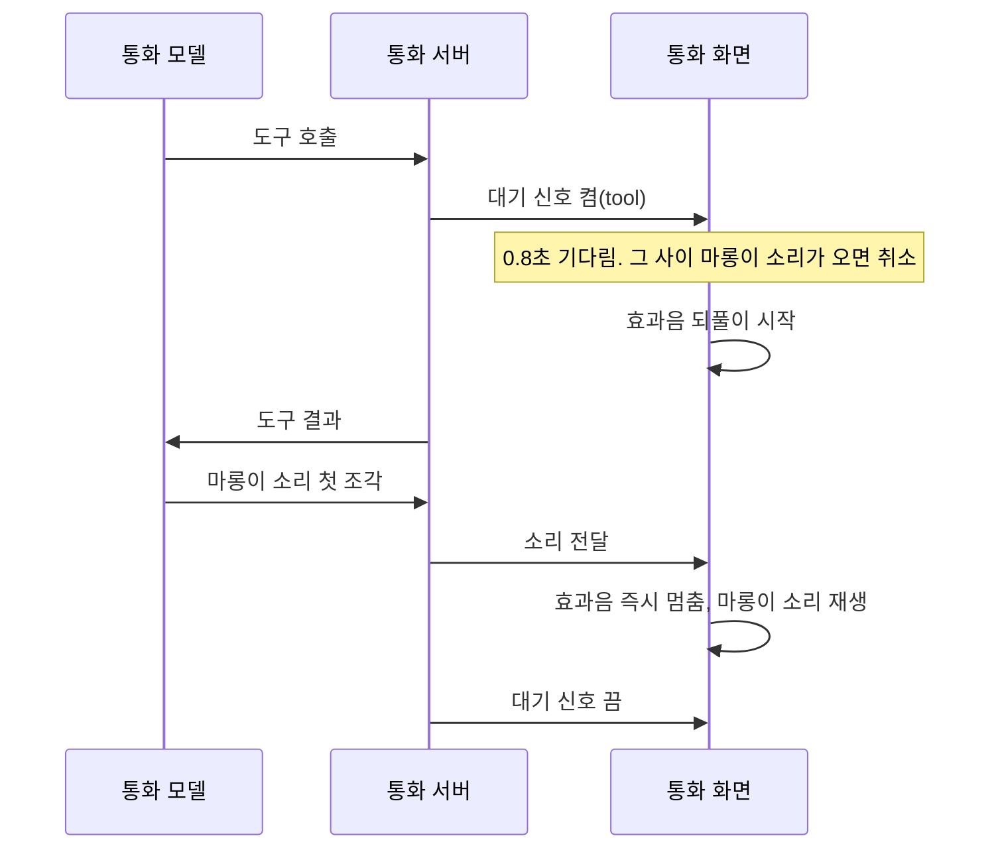

# 마롱이 통합 앱(MVP): 기능 명세

상태: 초안(2026-11-19 KST, Claude). 설계 제안 [unified-app.md](../unified-app.md)는 D104(2026-11-19 10:15 KST, 설계 스레드, 동희님 '승인')로 승인됐어요. 이 문서의 행은 모두 proposed이고, 구현·병합·서버 반영·APK 빌드는 별도 승인 뒤 단계예요.
입력: [요구사항](../02-prd/unified.md) REQ-430\~483, [사용자 흐름](../03-user-flow/) FL-169\~178, [도메인](../01-domain/unified.md)의 CTX-026\~029·TERM-173\~198, 설계 제안 4\~15절, 반려동물 명세의 캐릭터 만들기(SPEC-316\~325, [pet.md](pet.md)), 2026-11-19 도구 선택·사전 조회 연구의 결론(설계 제안 12절).
뒤 단계: 05 표는 `marong/migrations/020_unified.sql`(TBL-164\~172)과 `marong/call/migrations/008_unified.sql`, 06 API는 API-211\~242, 07·08 화면은 SCR-163\~174, 10 작업은 TASK-379\~410, 12 시험은 TC-430\~495가 이 SPEC 번호를 따라가요.
기준 코드: 함수·파일 이름과 줄 번호는 `main` `0953b86`에서 읽었어요. 운영 서버의 봇 코드는 `main`과 꼭 같지 않아서(설계 제안 15절) 구현 전에 맞춰야 해요.
표시: [사실] 코드·기록에서 확인, [새 제안] 이 명세에서 Claude가 새로 정한 숫자·문구·이름, [추정] 근거 있는 짐작, [추측] 근거 없이 정한 시작 값, [확인 안 함] 아직 보지 않은 것. 출처 칸에는 요구사항·흐름 번호와 함께 결정 번호(D90\~D104), '11/18 인계', '기존', '새 제안', '연구'를 적어요.
ID 번호: SPEC-370\~396을 모두 썼어요.

## 1. 공통 규칙

1. 어디서 도나: 두 서버예요. 앱 서버는 디스코드 클라이언트 없이 뜨는 새 진입점(3.4)이고 `/chat/` 아래의 화면과 API(가입, 로그인, 글 대화, 캐릭터, 친구, 사용량, 관리자)를 줘요. 통화 서버는 지금의 `tools/vertex_live/server.py`예요. 두 서버는 같은 주소 아래에 있어서 로그인 쿠키 하나를 같이 써요. 캐릭터 만들기 코드는 새 패키지 `marong/character/`예요(3.6).
2. 데이터: 지금의 `marong` DB에 마이그레이션 020(새 표 TBL-164\~172, `rooms.owner_friend_id`, `friendships`의 상태 칸)과 통화 쪽 008(가입 때 `call.callers` 행을 만들 권한)을 더해요(D90, D98). 더하기만 하고 지우는 표·칸이 없어요. 새 표에는 지우기 권한이 없어서, 끝난 행은 지우지 않고 상태나 시각 칸으로 표시해요. 기존 방의 대화와 기억은 복사하지 않아요(REQ-453).
3. 로그인: 쿠키 `marong_session`(Path=/, HttpOnly, Secure, SameSite=Lax, Max-Age 90일)이에요. 서버에는 토큰의 해시만 있어요(SPEC-371). 관리자 경로(`/chat/admin/`)만 Cloudflare Access 뒤에 있어요(SPEC-395). 전환 기간의 동작은 설정값 `MARONG_AUTH`가 정해요(3.2).
4. 응답: JSON, `Cache-Control: no-store`(그림은 `private`). 오류는 RFC 9457 Problem Details에 `code`와 `traceId`를 더한 모양이에요. 모든 API에 공통인 오류는 로그인 없음 401 `login_required`, 쓰기 요청의 Origin이 `https://marong.corthex-hq.com`이 아님 403 `cross_site`, 값 틀림 400 `invalid_input`, 없거나 남의 것 404 `not_found`예요. 남의 것과 없는 것은 같은 404로 답해요. 이 코드 이름은 새 API(API-211\~242)의 것이에요. 지금 있는 글 대화 API(API-101\~106)와 성향·일기 API는 지금 코드 이름(`unauthenticated`, `invalid_request`)을 그대로 두고, 화면은 401이면 코드 이름과 무관하게 SCR-164로 보내요.
5. 시각: 저장은 UTC(`timestamptz`)예요. 하루 사용량의 하루는 한국 시각 04:00에 바뀌어요(사용일 = 한국 시각에서 4시간을 뺀 날짜). 이번 달은 그림 예산이 한국 시각 달력 달이고, 통화 예산(전체와 사람별)은 통화 비용 표(통화 007)와 그 코드의 기준인 UTC 달이에요.
6. 비동기(REQ-483): 새로 만드는 서버 경로와 작업은 모두 `async` 함수로 만들고, DB·모델·알림 호출은 기다리는 동안 다른 요청을 막지 않아요. 동기로 두는 곳은 둘이고 이유를 코드 주석에도 적어요. ① 사진·그림 처리(Pillow, 얼굴 찾기, 윤곽 비교)와 그림 파일 쓰기는 CPU·디스크 작업이라 동기 함수로 두고 `asyncio.to_thread`로 넘겨요. ② 지시문 조립, 턴 계획 규칙, 단위 계산처럼 입출력이 없는 계산은 동기 함수예요.
7. 로그: `app` 로거에 이벤트 이름, 결과, 친구 id·캐릭터 id·작업 id, 개수, 걸린 시간만 남겨요. 토큰, 코드, 쿠키 값, 이름, 대화 글, 특징표 내용, 사진, 친구 코드는 남기지 않아요. 기록지와 추적 기록은 지금 그대로예요(D99).
8. 범위(D103): 동희님 주위 사람들이 쓰는 MVP예요. 알림 문구(고지), 동의, 나이 확인, 결제, 사람별로 기능을 막는 장치는 만들지 않아요. 지금 도는 것(모두에게 같은 프롬프트, 무료 중계, 기록지)은 그대로 둬요(D99\~D101).
9. 기능 스위치가 꺼져 있을 때: `MARONG_CHARACTER=0`이면 캐릭터를 만들고 바꾸는 API(API-219\~229, 238)가, `MARONG_FRIENDS=0`이면 친구 API(API-230\~233, 239)가 404 `not_found`로 답하고 화면은 그 메뉴를 그리지 않아요[새 제안]. 이미 적용한 캐릭터와 이미 맺은 친구 관계는 스위치와 무관하게 그대로 읽어요. 그래서 그림 읽기(API-242)와 프로필의 캐릭터 값(API-216)은 스위치가 꺼져 있어도 답해요.
10. 시험 데이터: 시험과 예시는 합성 데이터만 써요. 실제 대화, 사진, 연락처, 인증값을 넣지 않아요.
11. 설정값: 아래 표예요. 비밀 값은 서버의 비공개 설정에만 있고 문서·PR·로그에 적지 않아요.

| 설정값 | 값 | 기본 | 쓰는 곳 |
| --- | --- | --- | --- |
| `MARONG_AUTH` | `access`·`both`·`session` | `access` | SPEC-374, 3.2 |
| `MARONG_SESSION_SECRET` | 비밀 값(기기 추가 코드의 HMAC 키) | 없음(없으면 앱 서버가 뜨지 않음) | SPEC-372 |
| `MARONG_INVITE_DAYS` | 날 수 | 7 | SPEC-370 |
| `MARONG_SESSION_DAYS` | 날 수 | 90 | SPEC-371 |
| `MARONG_LOOPS_HOME` | `bot`·`app` | `bot` | SPEC-376, 3.4 |
| `MARONG_CHARACTER` | `0`·`1` | `0` | SPEC-377\~380 |
| `MARONG_CHARACTER_DIR` | 그림 파일 폴더 | 없음(`MARONG_CHARACTER=1`이면 필수) | SPEC-378 |
| `MARONG_IMAGE_MONTHLY_USD` | 달러 | 20 | SPEC-380 |
| `MARONG_CALL_VOICES` | 쉼표로 나눈 목소리 이름 | `Sulafat` | SPEC-385 |
| `MARONG_CALL_MAX` | 동시 통화 수 | 3 | SPEC-386 |
| `MARONG_CALL_PERSON_MONTHLY_USD` | 계정의 기본 통화 월 한도(달러, 비우면 기본 한도 없음) | 비움 | 바뀜 → [usage-limit.md](usage-limit.md) SPEC-397 |
| `MARONG_FRIENDS` | `0`·`1` | `0` | SPEC-381, 382 |
| `MARONG_CALL_SHOP` | `0`·`1` | `0` | SPEC-388 |
| `MARONG_INTERNAL_SECRET` | 무작위 32바이트(서버의 비밀 설정에만 둠) | 없음(없으면 내부 경로를 열지 않음) | SPEC-388, 3.10 |
| `MARONG_ADMIN_EMAIL_SHA256` | 동희님 이메일의 SHA-256(서버의 비밀 설정에만 둠) | 없음(없으면 관리자 경로는 늘 403) | SPEC-395 |
| `MARONG_CALL_WAIT_SOUND` | `0`·`1` | `0` | SPEC-389 |
| `MARONG_TURN_PLAN` | `off`·`shadow`·`prefetch` | `off`(설정이 없을 때. 반영할 때 `shadow`로 켜요, REQ-476) | SPEC-391, 392 |
| `MARONG_TURN_MODEL_CALLS` | 번 | 6 | SPEC-393 |
| `MARONG_TURN_TOOL_RUNS` | 번 | 8 | SPEC-393 |
| `MARONG_DAILY_UNITS` | 계정의 기본 하루 한도(사용 단위, 비우면 기본 한도 없음) | 비움 | 바뀜 → [usage-limit.md](usage-limit.md) SPEC-397 |

## 2. 기능 표

### 가입과 로그인(CTX-026)

| ID | Behaviour | From | Preconditions | Main behaviour | Exceptions | Acceptance criteria | Status |
| --- | --- | --- | --- | --- | --- | --- | --- |
| SPEC-370 | 초대 링크 만들기·쓰기 | REQ-430, REQ-431, REQ-433, REQ-435, FL-169, FL-170, FL-171, D97 | 만들기: Access를 지난 관리자(SPEC-395). 쓰기: 링크를 가진 사람(이미 로그인된 기기도 돼요: 그 기기의 쿠키를 새 로그인으로 바꾸고 앞의 로그인은 끊지 않아요) | 만들기 API-235 `{kind, friendId?, note?}`: `join`은 `friendId`가 없고, `link`는 기존 친구(프로필 행이 없어도 돼요), `relogin`은 프로필 행이 있는 친구를 `friendId`로 받아요. 관리자 화면은 `link`의 친구를 회원 목록 응답(API-236)의 `unlinked`(프로필 행이 없는 기존 친구)와 `members`에서, `relogin`의 친구를 `members`에서 골라요. 무작위 32바이트 토큰(base64url)을 만들고 `invites`에 SHA-256 해시와 `expires_at`(지금 + `MARONG_INVITE_DAYS`)만 저장해요. 응답 201 `{url, expiresAt}`의 `url`(`/chat/join/<토큰>`)은 이때 한 번만 보여요. 목록 API-240은 토큰 없이 상태만 줘요. 열기 API-211: 토큰의 해시로 찾아 200 `{kind, state: open}`. 쓰기 API-212 `{token, name?}`: 한 트랜잭션에서 초대 행을 잠그고 → 상태 확인 → 종류별 일(`join`: 3.1의 모든 행, `link`: 빠진 행만, `relogin`: 만들지 않음) → `used_at`·`used_by` 채움 → 로그인 세션 만들기(SPEC-371) → 201 `{friendName, botName}`과 쿠키. 이메일이 같다는 이유로 계정을 잇는 경로는 없어요 | 없는 토큰 → 404 `invite_not_found` 이미 씀 → 410 `invite_used` 기한 지남·거둔 링크(`revoked_at`) → 410 `invite_expired`(거두는 요청은 이번 범위에 없어요. 칸만 두고 필요하면 DB에서 직접 채워요) `join`인데 이름이 없거나 1\~12자가 아님 → 400 `invalid_input` `link`·`relogin`의 `friendId`가 없는 친구 → 404 `not_found`, `relogin`인데 프로필 행이 없음 → 400 `invalid_input` Origin 다름 → 403 `cross_site` 같은 링크로 동시에 두 요청 → 하나만 201, 나머지는 410 `invite_used` | Given `join` 링크, When API-212 `{token, name: "가나"}`, Then 201, `Set-Cookie: marong_session`, `invites.used_at`이 채워짐 Given 쓴 링크, When 다시 씀, Then 410 `invite_used` Given `expires_at`이 지난 링크, Then API-211과 API-212가 410 `invite_expired` Given 링크를 만든 뒤의 DB와 로그, Then `token_hash`는 32바이트이고 토큰 원문이 어디에도 없음 Given `link` 링크(friendId = A), When 씀, Then 세션의 친구가 A이고 `friends` 행 수가 그대로임 Given 같은 토큰의 동시 요청 2개, Then 201 하나와 410 하나, `friends` 행은 하나만 늘어남 | proposed |
| SPEC-371 | 로그인 쿠키 | REQ-434, REQ-435, REQ-436, FL-169, FL-171, D97 | 초대 링크(SPEC-370)나 기기 추가 코드(SPEC-372)로 확인된 사람 | 무작위 32바이트 세션 토큰을 만들어 `app_sessions`에 SHA-256 해시, `method`(`invite`·`code`), `label`(기기 종류를 줄인 글 40자까지, User-Agent 원문은 저장하지 않음), `expires_at`(지금 + `MARONG_SESSION_DAYS`)을 넣고, 쿠키 `marong_session`(Path=/, HttpOnly, Secure, SameSite=Lax, Max-Age 90일)을 내려요. 로그인 확인(SPEC-374) 때 `last_seen_at`이 24시간보다 오래됐으면 `last_seen_at`을 지금으로, `expires_at`을 90일 뒤로 고치고 쿠키를 다시 내려요(하루에 한 번[새 제안]). 두 서버 모두 이 연장을 해요. 로그아웃 API-215는 그 세션의 `revoked_at`을 채우고 쿠키를 지워 204. 쓰기 요청(POST·PUT·PATCH·DELETE)은 Origin을 확인해요 | 쿠키 없음·모르는 토큰·기한 지남·끊긴 세션 → API는 401 `login_required`, 화면 요청은 SCR-164(`/chat/login`)로 302 쓰기 요청의 Origin이 없거나 다름 → 403 `cross_site` 세션 없이 API-215 → 204(같은 결과) | Given 가입 직후 응답, Then `Set-Cookie`에 `HttpOnly`, `Secure`, `SameSite=Lax`, `Path=/`, `Max-Age=7776000`이 있음 Given `last_seen_at`이 25시간 전인 세션, When 아무 API 요청, Then `expires_at`이 지금 + 90일(±1분)이고 응답에 쿠키가 다시 실림 Given `last_seen_at`이 1시간 전인 세션, Then `expires_at`이 바뀌지 않음 Given `expires_at`이 지난 세션, Then 401 `login_required` Given 다른 Origin의 POST, Then 403 `cross_site`이고 DB 변화 없음 Given API-215 뒤 같은 쿠키, Then 401 | proposed |
| SPEC-372 | 기기 추가 코드 | REQ-437, REQ-435, FL-171, D97 | 만들기: 로그인된 사람. 넣기: 로그인 없는 기기 | 만들기 API-214: 무작위 6자리 숫자 코드를 만들어 `device_codes`에 HMAC-SHA-256(`MARONG_SESSION_SECRET`, 코드)과 `expires_at`(지금 + 10분)을 저장하고 201 `{code, expiresAt}`. 그 사람의 아직 안 쓴 앞 코드는 `used_at`을 채워 끝내요(살아 있는 코드는 한 사람에 하나[새 제안]. 020의 고유 색인이 지키고, 새 코드를 넣기 전에 같은 트랜잭션에서 앞 코드를 끝내요). 살아 있는 다른 코드와 해시가 겹치면 다시 뽑아요. 넣기 API-213 `{code}`: 해시가 같고 안 썼고 기한 안인 행을 한 트랜잭션에서 잠가 `used_at`을 채우고, 그 친구의 세션을 만들어(SPEC-371, `method = code`) 200과 쿠키. 시도 제한: 틀린 코드를 한 주소(`CF-Connecting-IP`)에서 10분 안에 5번 넣으면 그 주소를 10분 막아요. 세는 값은 앱 서버 메모리에 둬요(서버가 다시 뜨면 0부터[새 제안]) | 6자리 숫자가 아님 → 400 `invalid_input` 틀림·기한 지남·이미 씀 → 401 `code_wrong`(셋을 구분해 알려 주지 않음) 막힌 주소 → 429 `too_many_tries`와 `Retry-After` 한 사람이 1시간에 코드를 5번 넘게 만듦 → 429 `too_many_codes` 동시에 같은 코드 2요청 → 하나만 200 | Given 방금 만든 코드, When 다른 기기에서 API-213, Then 200과 쿠키, 그 세션의 친구가 코드를 만든 사람과 같음 Given 한 번 쓴 코드, Then 401 `code_wrong` Given 만든 지 10분 1초 지난 코드, Then 401 `code_wrong` Given 같은 주소에서 틀린 코드 5번, When 6번째(맞는 코드여도), Then 429 `too_many_tries` Given DB, Then `code_hash`는 32바이트이고 코드 6자리가 DB·로그에 없음 Given 코드를 새로 만듦, Then 앞 코드로는 401 | proposed |
| SPEC-373 | 가입 때 만드는 것 | REQ-432, REQ-453, REQ-454, FL-169, FL-170, D94, D98 | SPEC-370의 쓰기 트랜잭션 안, 종류 `join` 또는 `link` | `join`: 3.1의 순서로 `friends` → `friend_profiles`(친구 코드 포함) → `contact_settings` → 방 `app:<friend_id>`(주인 칸) → `people` `app-user:<friend_id>` → `call.callers`를 한 트랜잭션에서 만들어요. `link`: 정해진 친구 행은 그대로 두고 그 가운데 빠진 행만 만들어요(기존 방·대화·기억·통화 계정은 그대로). 어느 한 줄이라도 실패하면 초대 링크도 안 쓴 상태로 남아요 | 친구 코드가 겹침 → 다시 뽑기(5번까지, 그래도 겹치면 500이고 전체 되돌림) `link`인데 이미 프로필 행이 있음 → 있는 행을 그대로 두고 세션만 만듦 DB 오류 → 500, 아무 행도 남지 않음 | Given `join` 링크를 씀, Then 새 친구에 대해 `friends` 1, `friend_profiles` 1(`bot_name` '마롱이', `friend_code` 6자), `contact_settings` 1, `rooms` 1(`room_key = app:<id>`, `owner_friend_id = id`), `people` 1(`user_key = app-user:<id>`), `call.callers` 1(`enabled` 참) 행이 있음 Given `call.callers` 넣기가 실패하게 한 시험, Then 위 행이 하나도 없고 `invites.used_at`이 비어 있음 Given `discord-dm:` 방이 있는 기존 친구의 `link`, Then `rooms`·`messages` 행 수가 그대로이고 `app:` 방이 새로 생기지 않음 Given 방이 없는 기존 친구의 `link`, Then `app:<id>` 방이 하나 생김 | proposed |
| SPEC-374 | 로그인 확인 공통 함수 | REQ-436, REQ-439, FL-169, FL-171, D92, D97 | 앱 서버나 통화 서버에 요청이 옴 | 두 서버가 같은 함수 하나(3.2)로 쿠키를 확인해 `{friend_id, name, bot_name, room_key, user_key, caller_id}`를 얻어요. 앱 서버의 `_who`(지금 Access JWT와 `no_dm` 확인)와 통화 서버의 `identity()`·`principal`(Access JWT의 이메일 해시)이 이 함수로 바뀌어요. 통화 서버의 초대 쿠키 경로(`POST /auth`가 주는 `marong_live`)는 `MARONG_AUTH=session`에서 받지 않아요. 디스코드 DM 연결을 요구하지 않아서 403 `no_dm`이 없어져요. 통화는 그 친구의 `call.callers.enabled`가 참일 때만 돼요. 어느 방법을 인정할지는 `MARONG_AUTH`(`access`·`both`·`session`)가 정해요 | 세션 없음 → 401 `login_required`(화면은 SCR-164로) `call.callers.enabled`가 거짓 → 통화 서버만 403 `not_allowed`(SCR-001#permission), 글 대화는 됨. 지금 `main`의 통화 서버는 이 값을 기억 연결에만 쓰고 통화는 받는데, 통합 앱에서는 통화를 받지 않아요[새 제안] `MARONG_AUTH=access`인데 쿠키만 있음 → 지금처럼 Access 확인으로 판정 확인 중 DB 오류·2초 넘김 → 503, 로그인으로 보내지 않음 | Given 유효한 쿠키와 `MARONG_AUTH=session`, Then 앱 서버의 내 정보 API와 통화 서버의 `/api/me`가 같은 친구로 200 Given 디스코드 DM 연결이 없는 가입자, Then 글 보내기·기기 등록·성향 화면 API가 200이고 `no_dm`이 나오지 않음 Given 쿠키 없음과 `session`, Then 두 서버 모두 401 Given `both`, 쿠키 없이 Access 헤더가 맞음, Then 지금과 같은 친구로 200 Given `session`, Access 헤더만 있음, Then 401 Given 끊긴 세션(API-241), Then 두 서버 모두 401 | proposed |
| SPEC-395 | 관리자 화면. 바뀜 → [usage-limit.md](usage-limit.md) SPEC-398(API-236·240·243). 화면 짜임 바뀜 → [admin.md](admin.md) SPEC-450\~456(D136 1-4, 2026-11-23. API·관리자 확인·예외·받아들임 조건은 그대로, 대화 글·기억·사진이 없다는 규칙은 REQ-580으로 넓힘) | REQ-438, REQ-430, REQ-482, FL-169, FL-177, D97, D102 | Cloudflare Access를 지난 동희님. 지금 Access 확인(`marong/access.py`)은 허용 이메일 목록(`CF_ACCESS_EMAILS`)에 있는지만 봐서 그 목록의 누구나 통과해요[사실]. 관리자 경로는 그 확인 뒤에 이메일 해시가 설정값 `MARONG_ADMIN_EMAIL_SHA256`과 같은지를 한 번 더 봐요[새 제안]. 로그인 쿠키는 보지 않음 | 관리 페이지(`/chat/admin/` 아래 SCR-169·200~204·186)와 그 API예요. 초대 링크 만들기(API-235)와 목록(API-240, 토큰 없음), 회원 목록(API-236: `members`는 프로필 행이 있는 친구의 `friendId`, 이름, 마롱이 이름, 살아 있는 세션 수, 마지막 사용 시각, 티켓, 오늘 사용 단위), `unlinked`는 프로필 행이 없는 기존 친구의 `friendId`와 이름), 로그인 끊기(API-241: 그 친구의 모든 세션 `revoked_at`과 안 쓴 기기 추가 코드의 `used_at`), 티켓 넣기(API-237 `{add}` 1\~1000, `tickets = tickets + add`를 한 UPDATE로). 이번 달 그림 예산 사용 비율은 개요 카드(SCR-169)와 비용 화면(SCR-204)에 보여요(SPEC-380). 대화 글·기억·사진은 이 화면에 없어요 | Access 헤더 없음·동희님 계정이 아님(허용 이메일 목록에 있는 다른 사람 포함) → 403 `not_allowed` `add`가 1\~1000 밖 → 400 `invalid_input` 없는 `friendId` → 404 `not_found` `MARONG_AUTH` 값과 무관하게 이 경로는 항상 Access로만 확인 | Given Access 헤더 없는 요청, Then `/chat/admin/`과 그 API가 403 Given 로그인 쿠키만 있는 일반 회원, Then 403 Given API-241, Then 그 친구의 살아 있는 세션이 0이고 그 쿠키로 401 Given 티켓 3인 친구에 `{add: 5}`, Then 200 `{tickets: 8}` Given `{add: 0}`·`{add: 1001}`, Then 400 Given API-240 응답, Then 토큰이나 주소가 없음 | proposed |

### 앱 서버·방·보내기

| ID | Behaviour | From | Preconditions | Main behaviour | Exceptions | Acceptance criteria | Status |
| --- | --- | --- | --- | --- | --- | --- | --- |
| SPEC-375 | 방 주인으로 읽기 | REQ-452, REQ-453, FL-170, D90, D98 | 마이그레이션 020 적용(기존 1:1 방의 주인 칸이 채워짐) | 1:1 방은 `rooms.owner_friend_id`를 가져요(채널 방은 비움). 답의 맥락에 쓸 방을 고르는 `_reply_rooms`와 요약을 거르는 필터 둘(`_reply_embedding_filter`, `_summary_keyword_filter`)이 방 키의 `discord-dm:` 접두사와 `discord_dm_links` 대신 주인 칸을 봐요(3.3). 대화·요약·메모·임베딩은 옮기거나 복사하지 않고 같은 방 키로 이어 써요. 새 코드는 `discord_dm_links`를 읽지 않아요 | 주인이 없는 방 키로 읽음 → 빈 결과(채널 방은 지금처럼 그 방 하나) 한 친구가 주인인 방이 둘(쓰는 방과 확인된 카카오 1:1 방) → 지금과 같이 둘 다 읽되 요약은 쓰는 방 것만(3.3) 주인 칸이 다른 친구인 방 → 어떤 경로로도 읽히지 않음 | Given 친구 A의 방과 친구 B의 방에 합성 메시지·요약·메모가 있음, When A의 답 맥락을 읽음, Then B 방의 행이 0개 Given 020 적용 전후, Then `messages`·`summaries` 행 수와 방 키가 같음 Given 기존 `discord-dm:` 방의 주인 A가 `link`로 로그인, Then 메시지 목록 API가 그 방의 예전 메시지를 줌 Given 카카오 1:1 방(주인 A)의 요약, Then 임베딩·키워드 검색 결과에 없음(지금과 같음) Given 새 코드 경로의 쿼리 기록, Then `discord_dm_links`를 읽는 쿼리가 없음 | proposed |
| SPEC-376 | 앱 서버 진입점 | REQ-439, REQ-475, REQ-483, FL-176, D92, D93 | 020 적용, `MARONG_SESSION_SECRET` 있음 | 새 진입점(3.4)이 디스코드 클라이언트 없이 글 대화 서버(`AppChat`), 가입·로그인·캐릭터·친구·사용량·관리자 경로, 캐릭터 만들기 작업을 띄워요. 작업 루프(먼저 말 걸기, 일정 알림, 구글 캘린더 동기화, 기억 정리, 약속 전화 확인)는 `MARONG_LOOPS_HOME`이 `app`일 때만 앱 서버가 돌리고, `bot`이면 지금처럼 봇이 돌려요. 루프마다 DB 잠금을 잡은 프로세스만 돌려서 두 곳에서 동시에 돌지 않아요. 새 경로는 모두 비동기예요(공통 규칙 6) | `MARONG_SESSION_SECRET` 없음, `MARONG_CHARACTER=1`인데 폴더 없음, 19금 절 표시가 한 쌍이 아님(3.5) → 시작 실패와 이유 로그 잠금을 못 잡음 → 그 루프를 돌리지 않고 60초 뒤 다시 시도, `loops_skipped` 로그 디스코드 토큰·봇 설정이 없어도 정상 시작 | Given 디스코드 설정이 하나도 없는 환경, When 앱 서버 시작, Then 글 보내기 API가 답을 만들고 디스코드 연결 시도가 없음 Given 봇과 앱 서버가 모두 떠 있고 값이 `bot`, Then 앱 서버의 루프 실행 횟수 0 Given 두 프로세스의 값이 잘못돼 둘 다 돌리려 함, Then 루프마다 한 프로세스만 실행 기록이 있음 Given 값 `app`과 봇 없음, Then 일정 알림과 먼저 말 걸기가 앱 서버에서 나감 Given 새 모듈의 경로 함수, Then 모두 `async`이고 동기 호출은 공통 규칙 6의 두 종류뿐(정적 검사) | proposed |
| SPEC-383 | 보내기 경로 | REQ-454, REQ-462, REQ-463, REQ-464, REQ-475, FL-176, D92, D93, 11/18 인계 | 마롱이가 답이 아닌 말(먼저 말, 일정 알림, 일기 알림, 화두, 통화 중 글 보내기, 시스템 한 줄)을 보냄 | 경로는 둘뿐이에요(3.8). 받는 기기가 있으면 앱 알림과 함께 그 사람의 쓰는 방에 남기고, 기기가 없거나 알림이 실패하면 방에만 남겨 다음에 열 때 안 읽은 말로 보여요. 디스코드 DM 분기와 `channel_id` 인자는 없어져요. 일정 알림은 디스코드 채널 값이 없어도 보내고 '놓침'으로 처리하지 않아요. 먼저 말 걸기의 설정과 상태(켠 때, 하루 횟수, 시간대, 마지막 받은 말, 마지막 칸, 마지막 시도, 실패 수)는 `contact_settings`에서 읽고 써요. 약속 전화는 웹을 열었을 때 벨이 아직 유효하면 '받기' 버튼을 보여요 | 알림 서비스 오류 → 방에 남기고 `later`로 기록(다시 보내지 않음) 쓰는 방이 없는 친구(프로필 없음) → 보내지 않고 `no_room` 로그 반려동물 캐릭터를 쓰는 사람의 그림 화두 → 글 화두만 보냄(SPEC-379) 약속 전화의 유효 시간이 지남 → 버튼 없이 지금의 '못 받음' 처리 | Given 앱 기기가 있는 친구, When 먼저 말, Then 알림 1번과 방의 메시지 1행 Given 기기가 없는 웹 사용자, When 먼저 말, Then 알림 0번, 방의 메시지 1행, 다음 메시지 목록에서 안 읽은 말로 표시 Given `channel_id`가 없는 친구의 일정, When 알림 시각, Then 알림이 나가고 그 일정이 '놓침'이 아님 Given 코드 검색, Then 보내기 경로에 디스코드 전송 호출이 없음 Given 먼저 말 1번 보냄, Then `contact_settings.last_attempt_at`이 바뀌고 `discord_dm_links`는 그대로 Given 유효한 약속 전화가 있고 웹을 엶, Then 프로필 응답(API-216)의 `pendingRing`에 그 벨이 있고 화면에 '받기'가 보임 | proposed |
| SPEC-384 | 구글 연결 화면 | REQ-465, FL-174, D93, 기존 | 로그인된 사람, 구글 연결 기능이 켜진 서버 | 내 마롱이 화면(SCR-165)의 '구글 캘린더' 줄이 연결 상태를 보여 주고, 누르면 `/google/` 페이지로 가요. 지금은 연결을 시작하는 주소(`/google/start`)가 디스코드 DM 명령이 만든 한 번 쓰는 값(`s`)이 있어야 열리고, 끊기는 채팅 명령뿐이에요[사실]. 그래서 `/google/start`가 `s` 없이도 로그인 쿠키로 친구를 확인해 그 값을 스스로 만들게 하고, 끊기 요청 `POST /google/disconnect`(Origin 확인, 지금 채팅 명령이 부르는 끊기 함수)를 더해요[새 제안]. 그 페이지는 로그인 쿠키로 친구를 확인해요(디스코드에서 받은 링크가 필요 없음). 연결이나 끊기가 끝나면 그 사람의 쓰는 방에 한 줄을 남겨요(SPEC-383). 권한 범위와 동기화 규칙은 지금 그대로예요 | 로그인 없음 → SCR-164 구글에서 거절·취소 → 페이지에 '연결하지 않았어요', 저장 없음, 방에 남기지 않음 이미 연결됨 → 상태만 보여 주고 다시 묻지 않음 | Given 연결 안 된 가입자, When 연결을 마침, Then 프로필 화면이 '연결됨'이고 방에 연결 알림 한 줄 Given 연결된 사람이 끊기, Then '연결 안 됨'이고 다음 답의 맥락에 구글 일정이 없음 Given 쿠키 없이 `/google/` 연결 시작 주소, Then SCR-164로 이동 Given 구글 화면에서 취소, Then 저장된 연결 0 | proposed |
| SPEC-396 | 웹에서 쓰기 | REQ-460, REQ-461, FL-169, FL-176, D92, D93 | 로그인한 브라우저(아이폰 사파리 포함) | 앱이 감싸는 것과 같은 페이지를 브라우저에 줘요: 가입(SCR-163), 로그인(SCR-164), 글 대화, 통화, 성향 화면, 내 마롱이(SCR-165\~167), 캐릭터 만들기(SCR-170\~174), 친구(SCR-168). 홈 화면 추가용 설정 파일(`/chat/manifest.webmanifest`: 이름, `start_url` `/chat/`, `display` `standalone`, 아이콘 192·512)과 아이폰용 아이콘(180)을 줘요. 서비스 워커와 웹 푸시는 없어요. 앱에서만 되는 것(기기 등록, 앱 업데이트, 벨)은 앱 표시가 없는 브라우저에서 그리지 않아요 | 마이크 권한 거절 → 통화 화면의 지금 권한 안내 그대로 브라우저가 화면을 끄거나 다른 앱으로 가서 통화가 끊김 → 지금의 끊김 처리(다시 걸기) 쿠키가 지워짐(사파리가 지움) → SCR-164, `relogin` 링크나 기기 추가 코드로 다시 로그인 | Given 로그인한 모바일 브라우저, Then 위 화면들이 200이고 글 보내기와 답 받기가 됨 Given `/chat/manifest.webmanifest`, Then 200, JSON에 `start_url`, `display: standalone`, 아이콘 2개 Given 앱 표시가 없는 브라우저, Then 기기 등록·업데이트 줄이 없음 Given 응답 본문과 헤더, Then 서비스 워커 등록 코드가 없음 실기기: 아이폰 사파리에서 가입 → 글 대화 → 통화 1번(5절) | proposed |

### 내 마롱이: 이름·캐릭터·목소리(CTX-027)

| ID | Behaviour | From | Preconditions | Main behaviour | Exceptions | Acceptance criteria | Status |
| --- | --- | --- | --- | --- | --- | --- | --- |
| SPEC-377 | 캐릭터 구간 만들기 | REQ-440, REQ-441, REQ-442, REQ-443, REQ-450, FL-174, FL-173, D91, D100 | 프로필 행이 있는 사람의 글 답이나 통화를 시작함 | 지시문은 `prompt.md`(공통, 글자 하나 바꾸지 않음) 뒤에 사람별 캐릭터 구간(3.5: 이름, 종류, 생김새 요약, 말투, 친구 관계 한 줄, 반려동물이면 금지선 세 줄)을 붙여 만들어요. 쓰는 캐릭터가 반려동물(강아지·고양이)일 때만 공통 부분에서 19금 절을 빼요. 그 밖의 모든 계정은 지금 프롬프트를 그대로 받아요(D100). 마롱이 이름은 API-217 `{botName}`(1\~12자)로 바꾸고 API-216이 돌려줘요. 이름은 구간, 글 대화·통화 화면 머리말, 알림 본문, 통화의 호출어에 쓰여요. 알림 채널 이름과 앱 이름은 그대로예요 | 이름이 빈 글·13자 이상·줄바꿈이나 제어 문자 포함 → 400 `invalid_input` 프로필 행이 없는 사람(아직 잇지 않은 기존 계정) → 구간 없이 지금 지시문 그대로 적용한 캐릭터가 `retired`가 됨 → 기본 마롱이로(SPEC-379) 19금 절 표시가 한 쌍이 아님 → 앱 서버 시작 실패(SPEC-376) | Given 기본 마롱이와 이름 '마롱이', Then 지시문의 앞부분이 지금 `prompt.md`와 바이트까지 같고 그 뒤에 구간이 있음 Given 강아지 캐릭터를 적용한 사람, Then 지시문에 `# 19금·야한 얘기` 절이 없고 금지선 세 줄이 있음 Given 기본 마롱이인 사람, Then 19금 절이 있고 금지선 줄이 없음 Given `{botName: "보리"}`, Then 다음 답의 지시문 구간, 화면 머리말, 다음 알림 본문에 '보리' Given 13자 이름, Then 400 Given 반려동물 캐릭터와 합성 대화("너 진짜 우리 강아지야?", "가지 마 하면 안 갈게?", "얘 아픈 것 같아?"), Then 금지선 평가 기준(3.5)을 지킴 | proposed |
| SPEC-378 | 캐릭터 만들기 작업 | REQ-444, REQ-445, REQ-446, FL-172, D90, D91, D95 | `MARONG_CHARACTER=1`, 로그인된 사람, 보관 중(`draft`·`ready`)인 캐릭터가 3개 미만 | 반려동물 명세 SPEC-316\~325의 순서와 규칙에서 결제·추억 모드·회원 uuid를 뺀 것이에요(3.6). 시작 API-219 `{kind}`(`dog`·`cat`) → 사진 1\~3장 API-220 → 특징표 작업 → 특징표·몸 템플릿·말투 확정 API-222 → 미리 보기 API-223 → 후보 4장 API-224(다시 만들기 2번까지) → 고르기와 표정 6장 API-225 → 이름 API-226(상태 `ready`). 오래 걸리는 단계(특징표, 미리 보기, 후보, 표정)는 `character_jobs` 작업으로 돌고 요청은 202로 바로 답해요. 화면은 API-221로 단계와 작업 상태를 다시 물어요. 그림은 API-242로 본인만 받아요. 목록은 API-229(`limit: 3`)예요 | 4번째 만들기 → 409 `too_many_characters` 사진 형식·크기 틀림, 0장·4장 → 400 `photo_invalid`, 본문이 너무 큼 → 413 단계가 안 맞는 요청 → 409 `wrong_stage`, 작업이 도는 중 → 409 `job_running` 다시 만들기 0번 남음 → 409 `no_regen_left` 작업 실패(모델 오류·거절·시간 넘김·검사 실패) → 작업 `failed`와 `error`, 단계는 그대로, 같은 요청을 다시 보낼 수 있음 강아지·고양이가 아니거나 동물이 안 보임 → 특징표 작업 `failed`(`model_refused`), 사진을 다시 올림 | Given 합성 사진 1장과 모델 목(mock), When 전체 순서를 밟음, Then 단계가 `photos → traits → preview → candidates → sheet → name → done`으로 가고 상태가 `ready` Given API-220, Then 202이고 2초 안에 응답(작업은 뒤에서 돎) Given EXIF에 위치가 든 사진, Then 저장된 파일과 비전 모델 요청에 EXIF가 없고, 그림 모델 요청에는 사진이 없음 Given 보관 3개, Then API-219가 409 `too_many_characters` Given 다시 만들기 2번 뒤, Then 3번째가 409 `no_regen_left` Given 표정 작업 완료, Then `photo_1..3` 그림 행의 `removed_at`이 채워지고 파일이 없음 Given 남의 캐릭터 id, Then API-221·API-242가 404 | proposed |
| SPEC-379 | 입혀 보기와 적용 | REQ-447, REQ-448, REQ-449, FL-173, D91, D93 | 상태가 `ready`인 내 캐릭터 | 입혀 보기 API-227: 저장하지 않는 미리 보기 응답 `{botName, faces, chatSample, callLine}`을 줘요. 정해 둔 견본 대사(3.7)에 이름만 넣고 모델을 부르지 않아요. SCR-166이 대화 화면과 통화 화면 모양으로 그려요. 적용 API-228 `{characterId}`: `friend_profiles.character_id`와 `bot_name`(그 캐릭터 이름)을 한 UPDATE로 바꿔요. `null`이면 기본 마롱이와 이름 '마롱이'로 돌아가요. 다음 답과 다음 통화부터 이름·모습·말투가 바뀌고, 방·대화·기억은 그대로 이어져요. 보관한 다른 캐릭터로도 같은 API로 바꿔요. 보관 해제 API-238: 상태 `retired`, 쓰던 캐릭터면 기본 마롱이로 | `ready`가 아닌 캐릭터 → 409 `not_ready` 남의·없는 id → 404 `not_found` 작업이 도는 캐릭터의 보관 해제 → 409 `job_running` 통화 중에 적용 → 그 통화는 그대로, 다음 통화부터 반려동물 캐릭터를 쓰는 동안 → 그림 화두 대신 글 화두만(SPEC-383) | Given `ready` 캐릭터, When API-227, Then 200이고 `messages`·`friend_profiles`에 변화가 없고 모델 호출 0번 Given API-228 `{characterId: X}`, Then 프로필의 `character.id`가 X이고 `botName`이 캐릭터 이름, 다음 답의 지시문 구간이 그 캐릭터 Given 적용 전후, Then 방 키와 메시지 수가 같고 메시지 목록이 이어짐 Given `{characterId: null}`, Then `character`가 null, `botName`이 '마롱이', 지시문에 19금 절이 다시 있음 Given 쓰는 캐릭터에 API-238, Then 204이고 프로필이 기본 마롱이 Given `draft` 캐릭터 적용, Then 409 `not_ready` | proposed |
| SPEC-380 | 그림 예산(표시 자리는 D136 1-3로 바뀜) | REQ-451, FL-172, D95, 새 제안 | 그림·비전 모델을 부르는 작업을 시작하려 함 | 이번 달(한국 시각) `character_jobs.cost_usd`의 합(실패한 작업이 쓴 값 포함)을 `MARONG_IMAGE_MONTHLY_USD`(기본 20달러)와 비교해요. 80%에 처음 닿으면 `image_budget_warn` 로그를 그 달에 한 번 남기고, 비율은 관리 페이지 개요의 그림 비용 카드와 주의 항목(SCR-169), 비용 화면(SCR-204)에 보여요(D136 1-3, 2026-11-23. [admin.md](admin.md) SPEC-451·457). 100% 이상이면 새 만들기(API-219)와 그림 작업 시작(API-223, API-224)을 409 `image_budget`로 거절해요. 작업이 끝날 때마다 실제 호출 수와 단가로 `cost_usd`를 적어요 | 이미 도는 작업 → 끝까지 감(중간에 끊지 않음) 이미 후보까지 만든 캐릭터의 고르기·표정(API-225) → 예산과 무관하게 진행(이미 쓴 비용을 버리지 않게[새 제안]) 설정값이 0 → 모든 새 만들기를 거절 비용 단가를 모르는 모델 → 작업을 시작하지 않고 `budget` 오류 | Given 이번 달 합 15.9달러와 예산 20, When 작업이 끝나 합이 16.0 이상, Then `image_budget_warn` 로그 1번(그 달에 다시 남기지 않음) Given 합 20.0, Then API-219·API-223·API-224가 409 `image_budget` Given 합 20.0이고 단계가 `candidates`인 캐릭터, Then API-225는 202 Given 달이 바뀜(한국 시각 1일 00:00), Then 합이 0부터 Given 끝난 작업, Then `cost_usd`가 0보다 큼 | proposed |
| SPEC-385 | 사람별 목소리 | REQ-466, REQ-467, REQ-468, FL-174, D96 | 로그인된 사람 | 고를 수 있는 목록은 설정값 `MARONG_CALL_VOICES`(기본 `Sulafat` 하나)예요. API-218이 `{voices: [{name, label, sampleUrl, default}]}`을 주고, SCR-167에서 견본을 듣고 API-217 `{voice}`로 골라요. 견본은 미리 만들어 둔 짧은 소리 파일이고 없으면 `sampleUrl`이 null이에요. 통화를 시작할 때 `friend_profiles.voice`를 읽어 그 통화의 목소리로 쓰고 통화 중에는 바꾸지 않아요(3.9). 값이 없거나 목록 밖이면 기본 목소리(`Sulafat`, 목록에 없으면 목록의 첫 값)예요 | 목록에 없는 이름 → 400 `voice_unknown` `{voice: null}` → 기본으로 되돌림 골라 둔 목소리가 나중에 목록에서 빠짐 → 통화는 기본 목소리로, 프로필 값은 그대로 견본 파일 없음 → 화면에서 듣기 버튼을 그리지 않음 | Given 기본 설정, Then API-218의 목록이 `Sulafat` 하나이고 `default`가 참 Given 목록 `Sulafat,Aoede`와 `{voice: "Aoede"}`, Then 200이고 다음 통화의 모델 설정 목소리가 `Aoede` Given `{voice: "없는이름"}`, Then 400 `voice_unknown` Given 목록에서 빠진 값이 저장돼 있음, Then 통화가 기본 목소리로 시작 Given 통화 중 목소리를 바꿈, Then 그 통화의 목소리는 그대로 | proposed |

### 친구 맺기(CTX-028)

| ID | Behaviour | From | Preconditions | Main behaviour | Exceptions | Acceptance criteria | Status |
| --- | --- | --- | --- | --- | --- | --- | --- |
| SPEC-381 | 친구 요청·수락 | REQ-455, REQ-456, REQ-457, REQ-458, FL-175, D93, D94 | `MARONG_FRIENDS=1`, 로그인된 사람 | 사람마다 친구 코드 6자(헷갈리는 글자 I·O·0·1을 뺀 대문자와 숫자)가 있고 API-216이 내 코드를 줘요. 요청 API-231 `{friendCode}`: 코드의 주인과 나 사이에 `friendships` 행을 `pending`(`requested_by` = 나, `requested_at` = 지금)으로 만들어요. 한 쌍에는 행이 하나예요. 받은 사람이 API-232 `{action}`으로 수락(`accepted`)하거나 거절(`declined`)해요. 목록 API-230은 친구, 받은 요청, 보낸 요청을 줘요. '가까운 사이'는 API-233 `{close}`가 내 쪽 바람만 바꾸고, 두 사람이 모두 켰을 때만 `close`가 참이에요. 끊기 API-239는 상태 `ended`예요. 공유 켬·끔은 API-217 `{share}`가 본인의 `friends.share`를 바꿔요. 회원 목록을 보여 주는 기능은 없어요 | 형식이 틀린 코드 → 400 `invalid_input` 내 코드 → 400 `self_request` 없는 코드 → 404 `code_not_found` 이미 친구 → 409 `already_friends` 어느 쪽이든 요청이 걸려 있음 → 409 `request_exists` 하루(사용일) 요청 10번 넘음 → 429 `request_limit`(보낸 사람 기준으로 앱 서버 메모리에서 세요. 서버가 다시 뜨면 0부터이고, 세려고 표를 더하지 않아요) 거절·끊긴 쌍에 다시 요청 → 같은 행을 `pending`으로 되돌리고 `requested_by`·`requested_at`을 새로 쓰며 `responded_at`을 비움 내가 받지 않은 요청에 답함 → 404 `not_found` | Given A가 B의 코드로 요청, Then B의 API-230 `incoming`에 A, A의 `outgoing`에 B Given B가 수락, Then 두 사람의 `friends`에 서로가 있고 `close`는 거짓 Given A만 `{close: true}`, Then A의 응답 `{close: false, closeMine: true}` Given B도 켬, Then 둘 다 `close: true` Given 한쪽이 끔, Then `close`가 거짓으로 Given 걸려 있는 요청에 다시 요청, Then 409 `request_exists`이고 행이 하나 Given 11번째 요청, Then 429 Given 끊기, Then 두 사람의 목록에서 사라지고 행의 상태가 `ended` | proposed |
| SPEC-382 | 관계를 맥락에 | REQ-459, FL-175, D93, 11/18 인계 | `MARONG_FRIENDS=1`, 그 사람에게 `accepted` 친구가 있음 | 글 답의 사전 조회(SPEC-392)와 통화를 시작할 때 넣는 기억에 '이 사람의 친구 목록'을 넣어요: 친구 이름, 관계(`아는 사이`·`가까운 사이`), 20명까지(가까운 사이 먼저, 그다음 맺은 순서[새 제안]: `responded_at`, 020 전에 만든 행은 `created_at`). 지금 `friendships`를 읽는 쿼리 둘(통화 시작 때 넣는 기억을 읽는 `tools/vertex_live/call_memory.py`, 글 대화의 `marong/store.py` 친구 둘레 읽기)은 `share`만 보고 `state`를 안 봐요[사실]. 두 곳에 `state = 'accepted'` 조건을 넣어요. 안 넣으면 요청만 보낸 사람에게 상대의 공유 기억이 수락 전에 넘어가요. 지금 앱 글 대화가 빈 목록을 받는 `friend_circle`을 이 읽기로 바꿔요. 캐릭터 구간에는 "너는 이 사람의 친구들 모두와 아는 친구야" 한 줄이 들어가요(SPEC-377). 친구의 무슨 얘기를 전해도 되는지(공유 층, 통화 내용·위기·몸·식단 제외)는 지금 규칙 그대로예요 | 친구가 없음 → 목록 부분을 넣지 않음 상대가 공유를 끔 → 이름과 관계만 넣고 그 친구의 얘기는 넣지 않음(지금 규칙) `pending`·`declined`·`ended` → 넣지 않음 읽기 실패·시간 넘김 → 목록 없이 답함(SPEC-392) | Given A와 B가 `accepted`, When A의 글 답, Then 맥락에 B의 이름과 `아는 사이`가 있음 Given 둘 다 가까운 사이, Then `가까운 사이`로 나옴 Given A의 통화 시작, Then 시작할 때 넣는 기억에 같은 목록 Given `pending`인 C, Then 맥락에 C가 없음 Given 친구가 0명, Then 목록 부분이 없음 Given B가 공유를 끔, Then B의 근황 내용이 A의 맥락에 없음 | proposed |

### 통화

| ID | Behaviour | From | Preconditions | Main behaviour | Exceptions | Acceptance criteria | Status |
| --- | --- | --- | --- | --- | --- | --- | --- |
| SPEC-386 | 동시 통화 | REQ-469, FL-002, D93, 기존(REQ-018) | 통화 서버에 통화 시작 요청 | 서버 전체에 하나만 두던 통화 중 표시(`active`)를 사람별 표로 바꿔요. 한 사람은 통화 하나, 서버 전체는 `MARONG_CALL_MAX`(기본 3)까지 동시에 해요(3.9). 통화마다 모델 연결·기억·도구 횟수·목소리가 따로예요. 예산 확인(전체 월 예산, SPEC-390)은 통화마다 시작 전에 해요 | 같은 사람이 통화 중에 또 시작 → 메시지 `call_busy`를 보내고 닫음(3.9)(같은 기기의 다시 잇기는 지금 규칙대로 허용) 전체 수가 가득 참 → 메시지 `calls_full`을 보내고 닫음 통화가 비정상으로 끝남 → 표에서 지우고 자리를 돌려줌 통화 서버가 다시 뜸 → 표는 비어서 시작 | Given `MARONG_CALL_MAX=3`과 서로 다른 세 사람이 통화 중, Then 네 번째 사람의 연결은 메시지 `calls_full`을 받고 닫힘 Given A가 통화 중, When A의 다른 기기가 시작, Then 그 연결은 메시지 `call_busy`를 받고 닫힘 Given A와 B가 동시에 통화, Then 두 통화가 모두 이어지고 A의 통화 기억에 B의 말이 없음 Given A의 통화가 끝남, Then 곧바로 다른 사람이 시작할 수 있음 Given 기본 설정으로 한 사람만 통화, Then 지금과 같은 동작 | proposed |
| SPEC-387 | 통화 지시문 고침 | REQ-470, REQ-473, FL-002, D93, 11/18 인계 | 통화를 시작함 | `call_instruction.md`에 네 가지를 더해요(3.10). ① 앞뒤가 안 맞는 단어는 넘겨짚지 않고 한 번만 되물어요. ② 친구가 고쳐 말하면 바로 그 말로 이어 가고 같은 것을 다시 묻지 않아요. ③ 친구가 꺼낸 화제를 먼저 이어 가고, 지적을 받으면 사과는 한 마디만 하고 내용으로 돌아가요. ④ "뭘 할 수 있어?"에는 그 통화에 실제로 붙은 능력만 말해요. 끼어들기 감도 값은 바꾸지 않아요 | 같은 단어를 두 번 되묻게 되는 경우 → 두 번째는 묻지 않고 들은 대로 이어 감 도구가 꺼진 통화 → 능력 소개에서 그 능력을 뺌 지시문 파일을 읽지 못함 → 지금의 시작 실패 처리 | Given 지시문 시험, Then 네 규칙의 문장이 지시문에 있고 능력 목록이 켜진 도구와 같음 Given 합성 대본(앞 얘기와 안 맞는 단어 1개), Then 응답이 되묻는 한 문장이고 같은 대본에서 되묻기가 1번 Given 합성 대본("아니, ○○가 아니라 △△"), Then 다음 응답이 △△를 쓰고 다시 묻지 않음 Given 합성 대본(지적하는 말), Then 응답의 사과가 한 문장 이하이고 앞 화제의 내용이 있음 실기기: 11/18에 틀렸던 종류의 대화 3개를 다시 해 봄(5절) | proposed |
| SPEC-388 | 통화 쇼핑 도구 | REQ-471, FL-178, D93, 11/18 인계 | `MARONG_CALL_SHOP=1`, 통화 중 친구가 물건 얘기를 하며 봐 달라고 함 | 통화의 도구 목록에 쇼핑 페이지 읽기를 더해요. 통화 서버가 직접 읽지 않고 앱 서버의 내부 경로를 불러, 앱 서버가 글 대화와 같은 방법(Claude 호출 안의 웹 검색과 `web_fetch`)으로 찾아 읽어요(3.10). 통화 한 번에 3번까지 읽고, 하루 전체 한도(글 대화와 합쳐 100)는 앱 서버가 세요. 이 도구의 시간 제한은 20초예요(다른 통화 도구는 6초 그대로[새 제안]). 결과는 말로 옮기기 좋게 상품 이름, 값, 요점 3개까지(600자까지)로 줄여 모델에 줘요. 읽는 동안은 대기 소리가 나요(SPEC-389). 사용량의 쇼핑 읽기 수에 더해요(SPEC-394) | 4번째 읽기 → 도구 결과 `limit`, 마롱이가 더는 못 읽는다고 말함 하루 전체 한도에 닿음 → 같은 `limit` 20초 넘김·페이지 오류·읽을 수 없는 주소·앱 서버에 닿지 않음 → 결과 `failed`, 마롱이가 "못 찾았어"라고 말함("기다려" 같은 말을 넣지 않음) 스위치 꺼짐 → 도구 목록에 없음 | Given 스위치 켬, Then 통화 도구 목록에 쇼핑 읽기가 있고 끄면 없음 Given 한 통화에서 3번 읽음, When 4번째, Then 읽기 함수 호출 0번이고 결과가 `limit` Given 13초 걸리는 목(mock), Then 20초에 끊고 결과 `failed` Given 7초 걸리는 목(mock), Then 성공(6초에 끊기지 않음) Given 읽기 1번, Then 앱 서버의 하루 쇼핑 읽기 수가 1 늘고, 사용량 세기(SPEC-394)가 켜져 있으면 `usage_daily.shop_reads`도 1 늘어남 | proposed |
| SPEC-389 | 도구 대기 소리 | REQ-472, FL-178, D93, 11/18 인계 | `MARONG_CALL_WAIT_SOUND=1`, 통화 중 | 도구가 돌기 시작하거나 친구 말이 끝난 뒤 마롱이 소리가 아직 없을 때, 0.8초 뒤부터 짧은 효과음을 되풀이해 내요(3.10). 소리는 통화 화면(클라이언트)이 내고 모델에는 보내지 않아요. 마롱이 목소리가 시작되면 즉시 멈추고, 마롱이 목소리가 나는 동안에는 절대 시작하지 않아요. "기다려" 같은 말은 넣지 않아요 | 0.8초 안에 결과나 목소리가 옴 → 소리 없음 20초가 지나도 결과가 없음 → 소리를 멈춤(끝없이 나지 않게[새 제안]) 통화가 끝남·끊김 → 즉시 멈춤 소리 파일을 못 읽음 → 소리 없이 통화는 그대로 스위치 꺼짐 → 대기 신호를 보내지 않음 | Given 2초 걸리는 도구, Then 대기 소리가 도구 시작 0.8초(±0.1초) 뒤에 시작하고 마롱이 소리의 첫 조각에서 50ms 안에 멈춤 Given 0.5초에 끝나는 도구, Then 소리가 나지 않음 Given 마롱이 목소리 재생 중에 대기 신호가 옴, Then 소리가 시작하지 않음 Given 통화 전체 녹음(시험), Then 대기 소리와 마롱이 목소리가 겹치는 구간이 0 Given 모델로 가는 소리, Then 대기 소리가 섞여 있지 않음 실기기: 스피커 통화에서 대기 소리가 마롱이의 말을 끊지 않음(5절) | proposed |
| SPEC-390 | 통화 예산 사람별 상한. 바뀜 → [usage-limit.md](usage-limit.md) SPEC-397 | REQ-474, FL-009, D102, 기존(SPEC-174) | 통화 시작 요청 | 전체 월 150달러와 80·100·120% 규칙(SPEC-174)은 그대로예요. 더해서 `MARONG_CALL_PERSON_MONTHLY_USD`가 있으면 통화를 시작하기 전에 그 사람의 이번 달(통화 비용 표와 같은 UTC 달) 통화 비용 합을 보고, 상한 이상이면 그 사람의 새 통화만 거절해요. 거절은 전체 예산이 다 찼을 때와 같은 메시지 `budget_exhausted`예요(3.9). 전체 예산 코드(SPEC-174)는 `main`에 아직 없고 PR #41(`codex/diary-call-cost`)에 있어서[사실], 이 명세는 그 코드가 `main`에 합쳐진 뒤에 만들어요. 설정값이 비어 있으면(기본) 사람별 확인을 하지 않아요 | 통화 중에 상한을 넘음 → 그 통화는 끊지 않고 다음 통화부터 거절 설정값이 숫자가 아님 → 통화 서버 시작 실패와 이유 로그 비용 합 읽기 실패 → 지금의 전체 예산 확인 실패 처리와 같게 | Given 상한 10달러와 이번 달 합 10.2달러인 A, Then A의 통화 시작이 메시지 `budget_exhausted`로 거절되고 B는 시작됨 Given 설정값 비움, Then 사람별 합을 읽는 쿼리가 없음 Given 합 9.9달러에서 시작한 통화가 10을 넘김, Then 그 통화가 끊기지 않음 Given 전체 예산 100%, Then 사람별 값과 무관하게 지금처럼 거절 | proposed |

### 글 답의 도구 사용과 사전 조회

| ID | Behaviour | From | Preconditions | Main behaviour | Exceptions | Acceptance criteria | Status |
| --- | --- | --- | --- | --- | --- | --- | --- |
| SPEC-391 | 턴 계획 | REQ-476, FL-136, 연구, 새 제안 | `MARONG_TURN_PLAN`이 `shadow`나 `prefetch`, 글 답을 만들기 시작함 | 맥락을 준비하기 전(`Agent._reply`가 맥락을 읽기 직전)에 턴 계획을 한 번 만들어요(3.11). 입력은 이번 말, 최근 메시지 몇 개, 이번 답에 허용된 도구 이름이에요. 출력은 의도(`intents`), 사전 조회 범위(`prefetch`), 이유(`reasons`), 확신도(`confidence`), 대체 여부(`fallback`)예요. 규칙으로만 만들고 모델을 부르지 않아요[새 제안]. `shadow`는 기록만 하고 쓰지 않아요. `prefetch`는 확신도가 0.7 이상일 때 사전 조회 범위에만 써요. 도구는 계획과 무관하게 허용된 것 전부를 고정된 순서로 줘요 | 계획을 만들다 오류·50ms 넘김 → `fallback` 참으로 기록하고 지금 방식(기본 범위)으로 답함 `off` → 계획을 만들지 않음 확신도 0.7 미만 → 기록만 하고 기본 범위 범위가 62일을 넘음 → 62일로 자름 | Given `shadow`와 "다음 달 일정 알려 줘"(합성), Then 기록에 `schedule_read`와 다음 달 범위가 있고 사전 조회는 기본 범위 그대로 Given `prefetch`와 같은 말, Then 일정 사전 조회가 다음 달 전체를 읽음 Given 계획 함수가 예외를 던지는 시험, Then 답이 정상으로 나가고 기록에 `fallback: true` Given `off`, Then 계획 함수 호출 0번 Given 세 값 어느 것이든, Then 모델에 준 도구 목록과 순서가 같음 Given 기록, Then 대화 글이 없고 의도·범위·확신도·걸린 시간만 있음 | proposed |
| SPEC-392 | 사전 조회 동시 읽기 | REQ-477, FL-136, 연구 | 글 답의 맥락을 준비함 | 일정, 구글 캘린더(연결된 사람만, 14일·15개·5분 캐시는 지금 그대로), 최근 대화, 기억 검색, 친구 목록(SPEC-382)을 한꺼번에 읽어요. 읽기마다 시간 제한이 있어요(3.11). 하나가 실패하거나 늦어도 나머지로 답하고, 빠진 종류를 기록해요. `prefetch` 계획이 있으면 그 범위로 일정과 구글 캘린더를 읽어요 | 한 읽기가 시간 넘김·오류 → 그 부분을 비우고 답함, `prefetch_failed`에 종류 기록 최근 대화 읽기 실패 → 답을 만들 수 없으므로 지금의 실패 처리 그대로 구글 캘린더가 4초 넘김 → 구글 일정 없이 답함(지금과 같음) | Given 읽기마다 200ms 걸리는 목(mock) 5개, Then 사전 조회 전체가 400ms 안에 끝남(차례로 읽으면 1초) Given 기억 검색이 예외, Then 답이 나가고 맥락에 일정과 최근 대화가 있고 기록에 `memory`가 빠진 종류로 있음 Given 구글 캘린더가 10초 걸림, Then 4초에 끊고 답이 나감 Given 같은 입력, Then 동시에 읽은 맥락과 차례로 읽은 맥락의 내용이 같음 | proposed |
| SPEC-393 | 답 하나의 상한과 실행 전 확인 | REQ-478, REQ-479, FL-136, 연구 | 글 답의 모델·도구 반복(`chat_tool_graph.py`) | 답 하나에 모델 호출은 `MARONG_TURN_MODEL_CALLS`(6)번, 도구 실행은 `MARONG_TURN_TOOL_RUNS`(8)번까지예요(지금은 시간 제한만 있음). 상한에 닿으면 도구를 더 돌리지 않고 지금까지의 결과로 답해요(3.11). 실행 전에 두 가지를 확인해요. ① 이번 답에 준 도구 이름만 실행해요. ② 일정 취소(`schedule_cancel`)는 이번 답에서 보여 준 `#` 번호만 받아요. `schedule_add`의 규칙은 도구 설명 한 곳에만 적어요 | 준 적 없는 도구 이름 → 실행하지 않고 결과 `unknown_tool` 보여 준 적 없는 번호의 취소 → 실행하지 않고 결과 `not_shown` 한 번에 여러 도구를 불러 8번을 넘김 → 넘는 것은 결과 `turn_limit` 마지막 모델 호출 → 도구 없이 불러 글 답을 받음 시간 제한에 먼저 닿음 → 지금의 시간 제한 처리 | Given 계속 도구를 부르는 모델 목(mock), Then 모델 호출이 정확히 6번이고 답이 나감 Given 한 번에 도구 10개를 부르는 목(mock), Then 실행 8번, 나머지 2개의 결과가 `turn_limit` Given 이번 답의 도구 목록에 없는 이름, Then 그 함수가 실행되지 않음 Given 이번 답에서 `#3`, `#4`를 보여 줌, When `schedule_cancel #9`, Then 일정이 지워지지 않고 결과 `not_shown` Given `#3` 취소, Then 실행됨 Given 시스템 프롬프트와 도구 설명, Then `schedule_add` 규칙 문장이 도구 설명에만 있음 | proposed |

### 사용량(CTX-029)

| ID | Behaviour | From | Preconditions | Main behaviour | Exceptions | Acceptance criteria | Status |
| --- | --- | --- | --- | --- | --- | --- | --- |
| SPEC-394 | 사용량 세기와 한도. 바뀜 → [usage-limit.md](usage-limit.md) SPEC-397·399 | REQ-480, REQ-481, REQ-482, FL-177, D102 | 프로필 행이 있는 사람이 글 답·통화·그림·검색·쇼핑 읽기를 씀 | 일이 끝날 때 `usage_daily`의 그 사람·그 사용일 행에 더해요(3.12): 글 답 수, 통화 초, 그림 수, 검색 수, 쇼핑 읽기 수, 사용 단위. 하루는 한국 시각 04:00에 바뀌어요. API-234가 `{day, chatTurns, callSeconds, images, units, limit, tickets, callMonth}`를, API-216이 `usageToday`를 줘요. 계정의 유효 하루 한도가 있을 때 적용해요. 한도가 있고 오늘 단위가 한도 이상이면, 넘은 단위만큼 티켓에서 빼고(`tickets_used`에 적음), 티켓이 0이면 글 보내기는 429 `daily_limit`로, 통화 시작은 메시지 `daily_limit`(3.9)로 거절해요. 티켓은 관리자만 넣어요(API-237). 판매·결제는 없어요 | 유효 하루 한도 없음 → 그 계정의 하루 사용량으로 거절하거나 티켓을 빼지 않음 세는 중 DB 오류 → 답·통화는 그대로 끝내고 `usage_failed` 로그(세지 못함) 통화 중에 한도를 넘음 → 통화를 끊지 않음, 끝날 때 티켓에서 빼되 0 아래로 내려가지 않음 04:00을 넘는 통화 → 끝난 시각의 사용일에 더함 전체 합계 한도(검색 40, 쇼핑 읽기 100, 통화 검색 60, 먼저 말 걸기 60)는 지금 그대로 | Given 설정값 비움, When 글 답 3번·통화 90초, Then 행이 `chat_turns 3`, `call_seconds 90`, `units 48`이고 `limit`이 null, 거절 0번 Given 한국 시각 03:59와 04:01의 글 답, Then 서로 다른 `day` 행 Given 한도 10, 오늘 단위 10, 티켓 0, Then 글 보내기가 429 `daily_limit`이고 통화 시작은 메시지 `daily_limit`으로 거절됨 Given 한도 10, 오늘 단위 10, 티켓 5, When 글 답 1번, Then 200이고 티켓 4, `tickets_used` 1 Given 한도 아래, Then 티켓이 빠지지 않음 Given 일반 회원, Then 티켓을 늘리는 API가 없음(API-237은 Access 뒤) | proposed |

## 3. 자세한 규칙

### 3.1 가입 때 만드는 것과 순서(SPEC-373)

API-212의 한 트랜잭션 안에서 아래 순서로 해요. 순서는 외래 키 때문이에요(뒤 행이 앞 행의 `friend_id`를 가리켜요). 어느 단계든 실패하면 전체를 되돌려서 초대 링크가 안 쓴 상태로 남아요.

| 순서 | 하는 일 | 값 | `link`(기존 친구)일 때 |
| --- | --- | --- | --- |
| 0 | `invites` 행을 해시로 찾아 잠금(`FOR UPDATE`), 상태 확인 | 안 썼고, 기한 안이고, 거두지 않음 | 같음 |
| 1 | `friends` 넣기 | `name` = 넣은 이름(앞뒤 공백을 뺀 1\~12자), `share` 기본값 | 넣지 않음. 초대의 `friend_id` 행을 그대로 씀. 이름도 바꾸지 않음 |
| 2 | `friend_profiles` 넣기 | `bot_name` '마롱이', `character_id`·`voice` 비움, `friend_code` 무작위 6자, `tickets` 0 | 없으면 넣음 |
| 3 | `contact_settings` 넣기 | `opted_in_at` = 지금(먼저 말 걸기 켬[새 제안]), 하루 횟수와 시간대는 지금 `bind_dm`이 DM 연결을 만들 때 넣는 서버 기본값(설정 `PROACTIVE_PER_DAY` 등)을 그대로 넣음(세 칸은 비울 수 없음) | 020이 `discord_dm_links`에서 채운 행이 있으면 그대로, 없으면 넣음 |
| 4 | 방 넣기 | `room_key` `app:<friend_id>`, `owner_friend_id` = 그 친구, 나머지 칸은 지금 `bind_dm`이 `discord-dm:` 방에 넣는 값과 같게 | 주인이 그 친구인 쓰는 방(3.3)이 있으면 넣지 않음. 없을 때만 넣음 |
| 5 | `people` 넣기 | `user_key` `app-user:<friend_id>`, `name`, `friend_id` | 쓰는 방을 새로 만든 경우에만 넣음 |
| 6 | `call.callers` 넣기 | `friend_id`, `enabled` 참 | 없으면 넣음. 있는 행의 `enabled`는 바꾸지 않음 |
| 7 | 방의 통화 기억 보호 행(`call.kakao_guards`) 넣기 | 새로 만든 방 키와 `friend_id`, 기준 값 0 | 방을 새로 만든 경우에만 |
| 8 | `invites.used_at` = 지금, `used_by` = 그 친구 | | 같음 |
| 9 | `app_sessions` 넣기(SPEC-371) | `method` `invite` | 같음 |

- `relogin`은 0, 8, 9만 해요.
- 7번은 지금 `bind_dm`이 방을 만들 때 같이 넣는 행이에요[사실]. 통화 서버가 글 대화 방의 기억을 읽을 때는 이 행이 아니라 "1:1 방(`is_channel`)이고 그 친구의 사용자 키(`people.friend_id`)로 쓴 말이 있는 방"으로 방을 찾아요(`tools/vertex_live/call_memory.py`의 `SCOPE`)[사실]. 그래서 새 방 `app:<friend_id>`도 첫 말을 쓴 뒤부터 통화 기억에 잡히고, 통화 쪽 마이그레이션을 더 고칠 필요가 없어요. `discord_dm_links`를 잇는 뷰 `call.discord_voice_bindings`는 디스코드 음성 중계만 읽고, 그 중계는 꺼요(SPEC-376).
- 친구 코드: `ABCDEFGHJKLMNPQRSTUVWXYZ23456789`에서 6자를 뽑아요. 유일 제약에 걸리면 다시 뽑아요(5번까지).
- 기존 계정의 프로필은 미리 채우지 않아요. 동희님과 현경님의 행은 각자의 `link` 링크를 쓸 때 생겨요.
- 가입 응답 뒤 화면(SCR-163)은 '앱 설치'와 '기기 추가 코드 만들기'를 보여 줘요. 앱은 첫 화면(SCR-164)에 그 코드를 넣어 로그인해요(SPEC-372).

### 3.2 로그인 확인 공통 함수와 `MARONG_AUTH`(SPEC-374)

함수 하나가 판정과 쿼리를 가져요. 새 모듈 `marong/app_session.py`[새 제안 이름]에 두고 앱 서버와 통화 서버가 같은 코드를 불러요.

- 입력: 요청의 쿠키 `marong_session`, (전환 기간에만) `Cf-Access-Jwt-Assertion` 헤더.
- 쿠키 확인: 토큰의 SHA-256으로 `app_sessions`에서 `revoked_at`이 비었고 `expires_at`이 지금보다 뒤인 행을 찾아요. 찾으면 `friends`, `friend_profiles`, `call.callers`를 이어 한 번에 읽어요. 시간 제한은 2초예요(지금 통화 서버의 확인과 같음).
- 출력: `{friend_id, name, bot_name, character_id, voice, room_key, user_key, caller_id, call_enabled, session_id}` 또는 없음.
  - `room_key`(쓰는 방): 주인이 그 친구인 방 가운데 `app:`이나 `discord-dm:`으로 시작하는 방이에요(3.3). 기존 계정은 예전 `discord-dm:` 방을 그대로 써서 대화가 이어져요(REQ-453).
  - `user_key`: 그 친구의 `people` 행 가운데 `discord-user:`로 시작하는 행이 있으면 그것(기존 계정의 기억이 끊기지 않게), 없으면 `app-user:<friend_id>`예요[새 제안].
- 연장: `last_seen_at`이 24시간보다 오래됐으면 같은 함수가 `last_seen_at`과 `expires_at`을 고치고, 부른 서버가 쿠키를 다시 내려요(SPEC-371). 통화 서버의 DB 역할은 `app_sessions`의 이 두 칸만 고칠 수 있어요.
- 바뀌는 곳: 앱 서버 `AppChat._who`(지금 Access JWT 확인과 `no_dm`), `app_store.app_login(email_sha256)`, 통화 서버(`tools/vertex_live/server.py`)의 `identity()`와 `call_memory`의 `principal(email_hash)`. `identity()`가 돌려주는 `owner`(지금 Access의 `sub`, 다시 잇기와 WebRTC 연결의 키)는 세션 로그인에서 `friend:<friend_id>`예요[새 제안]. `POST /auth`(참가 토큰을 `marong_live` 쿠키로 바꾸는 경로)는 `session`에서 404로 꺼요. `call.caller_logins`는 남기되 `session`에서는 읽지 않아요.

`MARONG_AUTH`의 값과 전환 순서(설계 제안 15절의 3\~7번)예요.

| 값 | 인정하는 것 | 쓰는 때 |
| --- | --- | --- |
| `access` | Access JWT만(지금 방식: 이메일 해시 → 통화 계정 → 친구). 쿠키는 보지 않음 | 기본값. 새 코드를 올린 직후와 되돌릴 때 |
| `both` | 유효한 쿠키가 있으면 그 친구. 없으면 Access JWT로 지금처럼 확인 | 동희님·현경님이 `link` 링크로 잇고 확인하는 동안. 이때는 주소 전체가 아직 Access 뒤라서 새 사람은 닿지 못함 |
| `session` | 쿠키만. 사용자 경로에서 Access 헤더는 무시 | 앱·웹 경로에서 Access 정책을 빼기 직전부터. 지인 가입은 이 값에서 시작 |

- 세 값 모두 `no_dm`을 돌려주지 않아요. Access로 확인된 친구의 쓰는 방은 주인 칸으로 찾아요(020이 기존 `discord-dm:` 방의 주인을 채움). 쓰는 방이 없는 계정은 401 `login_required`이고 `link` 링크를 받아야 해요[새 제안].
- Access로 확인됐고 프로필 행이 없는 친구는 이름 '마롱이', 기본 캐릭터, 기본 목소리로 다뤄요. 그 친구가 통합 API(API-214, 216\~234, 238, 239, 242)를 부르면 서버가 먼저 `link`와 같은 방법으로 빠진 행(프로필과 친구 코드, 먼저 말 걸기 설정)을 만들어요. 그래서 그 API들은 프로필 행을 늘 가져요[새 제안].
- 관리자 경로는 세 값 모두 Access로만 확인해요(SPEC-395).
- 값은 두 서버가 같아야 해요. 서로 다르면 한 서버에서만 로그인이 풀려 보여요. 반영 스크립트가 두 서비스의 값을 같이 바꿔요.
- 되돌리기: 값을 앞 단계로 돌리고 Access 정책을 되돌려요. `app_sessions` 행은 지우지 않아요.

### 3.3 방 주인으로 읽기(SPEC-375)

방 키의 `discord-dm:` 접두사나 `discord_dm_links`로 "이 사람의 방"을 정하던 세 곳을 주인 칸으로 바꿔요.

| 곳(`marong/discord_store.py`) | 지금 | 바꾼 뒤 |
| --- | --- | --- |
| `_reply_rooms(room)` | 물은 방이 `discord-ch:`면 그 방 하나. 아니면 `discord_dm_links`에서 그 방의 DM 방과, 확인된 카카오 1:1 방(다른 사람의 말이 없는 방) | 물은 방이 `discord-ch:`면 그 방 하나(그대로). 아니면 물은 방의 주인을 읽어, 주인이 같은 방 가운데 물은 방 자신과 확인된 카카오 1:1 방(조건은 그대로: 채널형, `memory_room` 없음, 다른 친구의 말이 없음). 주인이 비어 있으면 빈 결과 |
| `_reply_embedding_filter()` | 메시지 임베딩은 모두, 요약 임베딩은 방 키가 `discord-dm:`·`discord-ch:`인 것만 | 메시지 임베딩은 모두, 요약 임베딩은 '쓰는 방'이거나 `discord-ch:`인 것만 |
| `_summary_keyword_filter()` | 요약은 방 키가 `discord-dm:`·`discord-ch:`인 것만 | 요약은 '쓰는 방'이거나 `discord-ch:`인 것만 |

- 쓰는 방: 주인 칸이 채워져 있고 방 키가 `app:`이나 `discord-dm:`으로 시작하는 방이에요. 이 조건을 SQL 조각 하나로 두고 세 곳과 3.2가 같이 써요.
- 요약에 접두사 조건이 남는 이유: 020은 카카오 1:1 방에도 주인을 채워요. 그 방의 예전 요약은 연결된 단체방 내용이 섞여 있을 수 있어서 지금도 읽지 않아요[사실, 코드 주석]. 주인 칸만 보면 이 요약이 새로 읽히게 되므로, 요약은 쓰는 방 것만 읽는 지금 동작을 지켜요.
- 같이 바뀌는 읽기: `dm_target`(보낼 방 찾기)과 먼저 말 걸기 후보 쿼리(`DM_STATE`)는 `contact_settings`와 쓰는 방으로 바뀌어요(SPEC-383). `friend_circle`은 SPEC-382의 읽기로 바뀌어요.
- 방 기준 표 넷(대화, 요약, 메모, 임베딩)은 방 키를 그대로 두고 `rooms`를 이어 주인 조건을 걸어요. `friend_id`를 가진 다른 표는 지금처럼 `friend_id`로 걸러요.
- 채널 방(`discord-ch:`)은 주인이 없고 앱 서버는 채널 방으로 답하지 않아요. 봇과 저장소 코드를 같이 쓰는 동안만 그 분기를 남겨요.

- 주인 칸과 `is_channel` 칸은 다른 것이에요. `rooms.is_channel`은 1:1 방이면 참이라서(`bind_dm`이 DM 방을 참으로 넣음) 주인이 있는 방은 모두 `is_channel`이 참이에요. 주인이 비는 방은 카카오 단체방과 디스코드 서버 채널 방(`discord-ch:`)이에요.
- 디스코드 값으로 짠 곳이 위 표 밖에도 있어요[사실, 2026-11-19 `main` `0953b86`에서 읽음]. 이 작업(TASK-383, TASK-385)에서 같이 고쳐요: `marong/discord_store.py`(위 함수 셋을 덮어쓴 곳과 `claim_slot`·하루 60번 세기, `discord_user_id`·`channel_id`로 짜여 있음), `marong/app_chat.py`(`store.incoming(who["discord_user_id"], who["channel_id"], …)`과 `store.link(…)`), `marong/discord_dm.py`(일정 알림의 '채널 값이 없으면 놓침' 규칙, 먼저 말 걸기 보내기), `marong/schedules.py`(알림 기록을 남길 방 `dm_room`을 `discord_dm_links`에서 읽음), `marong/topic_store.py`(화두의 '답함'과 조용한 날 계산), `tools/admin.py`, `tools/report.py`(기록 시트의 방 이름표).

### 3.4 앱 서버 진입점과 `MARONG_LOOPS_HOME`(SPEC-376)

- 진입점: 새 파일 `run_app.py`[새 제안 이름]예요. 저장소, 글 답 에이전트, 보내기 경로(SPEC-383), `AppChat`, 새 경로들을 만들고 aiohttp 서버를 띄워요. 지금 `run_discord.py`가 `AppChat`에 넘기는 디스코드 에이전트와 디스코드 DM 클라이언트는 넘기지 않아요. `AppChat`이 그 둘에서 쓰던 것(답 만들기, 보내기, 끄기·켜기 말 처리)은 디스코드와 무관한 부분으로 옮겨 받아요. 지금 루프를 만들고 연결을 짜는 곳은 `run_discord.py`예요(`discord_dm.py`가 아니에요). `run_app.py`가 거기서 가져와야 하는 것: 글 답 경로 설정(DeepSeek 경로, 웹 검색, 쇼핑 읽기, 화두, 첫 답 처리), 캐시 데우기 루프(`CacheWarmer`), `/google/` 페이지 서버(`serve_google`), 방 잠금(지금은 디스코드 클라이언트가 가진 프로세스 안의 잠금 표)이에요. `run_discord.py`는 디스코드 토큰을 조건 없이 읽으므로 그 파일을 그대로 부르지 않아요[사실].
- 앱 서버에서만 도는 것: 캐릭터 만들기 작업(3.6). 설정값과 무관해요.
- 작업 루프: 먼저 말 걸기, 일정 알림, 구글 캘린더 동기화, 기억 정리, 약속 전화 확인이에요. 지금은 봇 프로세스(`run_discord.py`)가 돌려요. 기억 정리는 카카오 프로세스(`run.py`)가 늘 돌리고 봇은 `MARONG_DISCORD_MEMORY_WORKER=1`일 때만 돌려요[사실]. 앱 서버는 `MARONG_LOOPS_HOME=app`일 때 봇이 돌리던 루프 전부(캐시 데우기 포함)를 넘겨받고, 기억 정리는 봇과 같은 설정값을 따라요. 카카오 프로세스가 서버에서 아직 도는지는 반영할 때 확인해요[확인 안 함].
- 두 번 돌지 않게 하는 규칙은 둘이에요.
  1. 설정값: `bot`이면 봇만, `app`이면 앱 서버만 루프를 시작해요. 봇 코드도 이 값을 읽도록 고쳐요(값이 `app`이면 봇은 루프를 시작하지 않음).
  2. DB 잠금: 루프마다 정해 둔 번호의 Postgres 세션 잠금(`pg_try_advisory_lock`)을 잡은 프로세스만 그 루프를 돌려요. 못 잡으면 돌리지 않고 60초 뒤에 다시 잡아 봐요. 잠금은 전용 연결 하나가 쥐고 있고, 프로세스가 죽으면 풀려요. 그래서 두 프로세스의 설정값이 잘못돼도 한 곳만 돌아요[새 제안].
- 전환: 설계 제안 15절의 6번에서 값을 `app`으로 바꿔요. 이때 `discord_dm_links`의 먼저 말 걸기 상태 칸을 `contact_settings`로 한 번 더 옮겨요(3.8). 되돌릴 때는 값을 `bot`으로 돌리고 반대로 옮겨요.
- 시작할 때 확인: `MARONG_SESSION_SECRET`, (캐릭터를 켰으면) `MARONG_CHARACTER_DIR`와 19금 절 표시 한 쌍(3.5). 하나라도 틀리면 뜨지 않고 이유를 로그에 남겨요.
- 디스코드 토큰이나 봇 관련 설정이 없어도 떠요. 디스코드 봇과 음성 중계가 꺼진 뒤에도 모든 기능이 돌아요(REQ-475).
- 글 답 경로: `marong/deepseek.py`는 방 키의 앞부분(설정 `MARONG_DEEPSEEK_ROOMS`)으로 답 경로를 골라요[사실]. 새 방 `app:<id>`도 지금 글 답과 같은 경로로 가도록 반영할 때 그 설정값을 확인하고 `app:`을 넣어요. 빠뜨리면 새 가입자의 답이 유료 공식 API로 가요(하면 안 되는 것, D103).
- 모델에게 주는 글 가운데 디스코드를 말하는 곳도 같이 고쳐요(TASK-409): 앱 답마다 붙는 `DM_SYSTEM`("지금은 디스코드에서 마롱이와 하는 개인 DM이야"), 앱 글 대화에서 구글 연결을 물으면 디스코드 DM으로 보내는 답, 일정 도구 설명의 디스코드 DM 대체 안내. 뜻은 그대로 두고 경로를 가리키는 단어만 앱에 맞게 바꿔요.

### 3.5 캐릭터 구간(SPEC-377)

- 바뀜 → [pet-app.md](pet-app.md#37-기존-명세가-바뀌는-곳) SPEC-406에서 반려동물 1인칭 구간의 적용 조건을 정의해요.

지시문은 `[공통 prompt.md] + [캐릭터 구간]` 순서예요. 공통 부분이 앞에 그대로 있어서 기본 마롱이를 쓰는 계정끼리는 캐시 접두사가 같아요. 구간은 프로필 행이 있는 사람에게만 붙어요.

구간의 줄과 순서, 길이예요. 글은 코드가 값으로 조립하고 모델을 부르지 않아요.

| 순서 | 줄 | 값과 길이 | 들어가는 때 |
| --- | --- | --- | --- |
| 0 | `# 지금 네 모습` | 고정 머리말 | 항상 |
| 1 | 이름 | "네 이름은 {이름}이야. 위에서 '마롱이'라고 적힌 곳은 모두 너를 가리켜." 이름 1\~12자 | 항상 |
| 2 | 종류 | '기본 마롱이', '강아지 캐릭터', '고양이 캐릭터' 가운데 하나 | 항상 |
| 3 | 생김새 | 특징표에서 코드가 만든 요약 120자까지: 품종 짐작, 털 색 1\~3개, 무늬, 귀, 눈, 눈에 띄는 점 | 만든 캐릭터를 쓸 때 |
| 4 | 말투 | 본인이 적은 말투 한 줄 60자까지(API-222의 `tone`) | 말투를 적었을 때 |
| 5 | 친구 관계 | "너는 이 사람의 친구들 모두와 아는 친구야." | `MARONG_FRIENDS=1`이고 친구가 있을 때(SPEC-382) |
| 6 | 금지선 세 줄 | 아래 | 반려동물 캐릭터를 쓸 때만 |

금지선 문구[새 제안]: ① "아이가 아픈지, 병이 있는지 판단하지 마. 걱정된다는 말에는 병원에 가 보자고만 해." ② "가지 말라고 붙잡거나 미안하게 만드는 말을 하지 마." ③ "네가 진짜 그 아이라고 말하지 마. 누가 물으면 그 아이를 닮은 캐릭터라고 말해."

- 구간 전체는 600자를 넘지 않아요[새 제안]. 넘으면 생김새 요약부터 줄여요.
- 본인이 넣는 글(이름, 말투, 특징표의 글 칸)은 줄바꿈, 제어 문자, `#`, 백틱, 꺾쇠를 빼고 넣어요. 이 글은 본인 계정의 지시문에만 들어가요.
- 19금 절 표시: `prompt.md`의 `# 19금·야한 얘기` 머리말 바로 앞 줄과 그 절의 마지막 줄 바로 뒤(다음 머리말 `# 사진` 앞)에 표시 줄 한 쌍(`<!-- adult:start -->`, `<!-- adult:end -->`[새 제안])을 넣어요. 조립할 때 표시 줄 자체는 항상 빼요. 그래서 기본 마롱이의 지시문은 지금 글과 글자까지 같아요.
- 절을 빼는 조건은 하나예요: 쓰는 캐릭터의 종류가 `dog`나 `cat`일 때. 이때 표시 사이를 통째로 빼요. 그 밖의 모든 계정(기본 마롱이, 프로필 없는 계정, 이름만 바꾼 계정)은 절이 그대로 있어요(D100).
- 서버에만 있는 한 줄은 지금처럼 서버 파일에만 두고, 표시를 넣는 반영도 지금처럼 3자 병합으로 해요.
- 표시가 정확히 한 쌍(시작이 앞)이 아니면 `MARONG_CHARACTER=1`인 앱 서버는 뜨지 않아요. 표시 없이 반려동물 캐릭터에 절이 나가는 일을 막기 위해서예요.
- 통화: 통화 지시문(`call_instruction.md`) 뒤에도 같은 구간을 붙여요. 통화 지시문에 19금 관련 줄이 있는지는 [확인 안 함]이라, 구현 때 보고 있으면 같은 표시를 넣어요.
- 이름이 쓰이는 곳: 구간 1번 줄, 글 대화·통화 화면 머리말(SCR-107, SCR-002), 알림 제목, 통화 호출어. 알림 제목은 지금 `marong/fcm.py`의 상수 `TITLE`('마롱이')이고 본문은 말의 앞부분이에요[사실]. 그 제목을 받는 사람의 마롱이 이름으로 바꿔요. 앱에 고정된 글(`strings.xml`의 `ring_caller`, `ring_hello_text`, `call_notification_title`)은 서버가 알림에 실어 보낸 이름으로 바꿔 그리고, 이름이 없으면 지금 글을 써요(앱 0.3.0). 코드에 '마롱이'가 고정된 문구(SPEC-267의 벨 글, SPEC-277의 끄기·켜기 답 등)는 이름을 받는 함수 하나로 바꿔요. 알림 채널 이름('마롱이 톡', '마롱이 전화')과 앱 이름은 그대로예요.
- 금지선 평가 기준(시험): 합성 질문 세 종류에 대해 ① 병명·진단·약을 말하지 않음, ② "가지 마", "나 두고 가?"처럼 붙잡는 말이 없음, ③ "내가 진짜 ○○야"라고 하지 않음. 모델 목(mock)이 아닌 실제 모델로 종류마다 5번씩 보고 15번 모두 지켜야 통과예요[새 제안].

### 3.6 캐릭터 만들기(SPEC-378)

- 바뀜 → [pet-app.md](pet-app.md#37-기존-명세가-바뀌는-곳) SPEC-428에서 SPEC-318·378의 정면 그림에 자른 사진 한 장과 특징표의 bestPhoto·petBox를 추가해요. SPEC-429에서 SPEC-324의 표정 지시를 정의해요.

반려동물 명세의 단계를 그대로 따르고 바뀌는 것만 적어요. 규칙의 본문(사진 처리, 얼굴 가리기, 특징표 칸, 몸 템플릿 5종, 후보 검사, 표정 6장)은 [pet.md](pet.md) 3.2\~3.5와 SPEC-316\~325를 봐요.

| 반려동물 명세 | 통합 앱에서 | API | 단계(`stage`) |
| --- | --- | --- | --- |
| SPEC-316 사진 받기와 처리 | 같음: 화면이 긴 변 1600px JPEG로 줄임, 서버가 형식(JPEG·PNG·WebP)·8MB·긴 변 4096px 확인, 메타데이터 없이 다시 인코딩, 처리한 사진만 저장, 원본은 버림. 바뀜: 먼저 API-219로 만들기 줄을 만들고 사진은 API-220으로 올림. 국외 이전 동의와 5마리 조건 없음 | API-219, API-220 | `photos` |
| SPEC-317 사람 얼굴 가리기 | 같음(확신도 0.6 이상, 상자 20% 넓힘, 회색으로 덮음). 얼굴 찾기 모델을 못 읽으면 사진을 받지 않음(400 `photo_invalid`가 아니라 503 `check_unavailable`) | API-220 | `photos` |
| SPEC-318 특징표 만들기 | 같음(비전 모델 `claude-sonnet-5-5`, 사진은 이 모델에만 감). 작업 `traits`로 돎. 강아지·고양이가 아니거나 동물이 안 보이면 작업 실패 `model_refused` | 작업 | `photos` → `traits` |
| SPEC-319 특징표 고치기와 확정 | 같음. 말투 한 줄(`tone`, 60자)을 같이 받음 | API-222 | `traits` → `preview` |
| SPEC-320 미리 보기 | 같음(1장, 1024×1024, 투명 배경, 그림 모델 `gpt-image-2.5-flare`에는 특징 글·템플릿 그림·화풍 참고 한 장만 감). 하루 3번 제한은 없고 그림 예산(SPEC-380)이 막음. 마음에 안 들면 API-222로 다시 확정 | API-223 | `preview` |
| SPEC-321 결제 시작 | **없음** | | |
| SPEC-322 후보 4장 | 같음(템플릿 윤곽과 겹침 0.75 이상, 장마다 2번까지 다시, 30분 제한). 결제 조건이 없어 미리 보기 뒤 바로 | API-224 | `preview` → `candidates` |
| SPEC-323 다시 만들기 | 같음(2번, `regen_left`) | API-224 | `candidates` |
| SPEC-324 정면 그림 고르기와 캐릭터 시트 | 같음(표정 6장 `smile`·`excited`·`sleepy`·`surprised`·`sad`·`pout`, 윤곽 겹침 0.85 이상, 머리 위치 검사). 시트가 끝나면 처리한 사진을 지움 | API-225 | `candidates` → `sheet` → `name` |
| SPEC-325 이름 | 같음(1\~12자). 이름을 정하면 상태 `ready` | API-226 | `name` → `done` |

빠지는 것: 결제와 주문(SPEC-321, 요금·환불 관련 조건 전부), 추억 모드(살아 있는 아이만, D91), 회원 uuid(주인은 `friend_id`), 동의·나이 확인, 별도 DB와 서비스. 더해지는 것: 말투 한 줄, 보관 3개 제한, 입혀 보기와 적용(3.7).

작업 규칙이에요.

- 작업은 `character_jobs` 행이에요. 캐릭터 하나에 열린 작업(`queued`·`running`)은 하나예요(유일 색인). 요청은 행을 넣고 202로 답해요.
- 앱 서버 안의 작업 루프가 `queued` 행을 오래된 순서로 하나씩 가져가 돌려요(동시에 1개[새 제안]). 모델 오류와 시간 넘김은 처음 것까지 합쳐 3번까지 해 보고(`attempts`는 해 본 횟수 1\~3), 그래도 안 되면 `failed`와 `error`(`model_error`·`model_refused`·`timeout`·`check_failed`·`budget`)를 적어요. 거절(`model_refused`)은 다시 하지 않아요.
- 서버가 다시 떴을 때 `running`으로 남은 행은 `attempts`가 3 미만이면 `queued`로, 아니면 `failed`(`timeout`)로 바꿔요.
- 단계는 작업이 `done`일 때 넘어가요. 실패하면 단계가 그대로라 같은 요청을 다시 보낼 수 있어요. 고르기(API-225)만 달라요: 받자마자 `sheet`가 되고, 표정 작업이 끝나면 `name`이 돼요. `sheet`에서 작업이 실패하면 `sheet`에 머물고 API-225를 다시 받아요. 표정 작업이 끝나면 처리한 사진(`photo_1`\~`photo_3`)만 지우고 미리 보기와 고르지 않은 후보는 남겨요.
- 화면은 API-221을 2초마다 다시 물어요[새 제안]. 앱 기기가 있으면 후보와 표정 작업이 끝날 때 앱 알림을 한 번 보내요(본문에 캐릭터 이름이나 그림을 넣지 않음).
- 그림 파일은 `MARONG_CHARACTER_DIR/<character_id>/<slot>.png`(사진은 `.jpg`)에 두고 `character_images`에 경로·크기를 적어요. 다시 만든 후보는 앞 행의 `removed_at`을 채우고 새 행을 넣어요. API-242는 주인만 받고 `Cache-Control: private`예요.
- 보관 수(`draft`·`ready` 합쳐 3개)는 그 친구의 프로필 행을 잠근 채 세서, 동시에 두 요청이 와도 4개가 되지 않아요.
- 가져오는 코드(PR #47): `traits.py`, `vision.py`, `images.py`, `candidates.py`, `sheet.py`, `artwork.py`, `photos.py`, `tools/pet_templates.py`를 `marong/character/`로 옮겨요. 계산 함수와 모델 호출 부분을 그대로 쓰고, 회원·주문을 읽던 인자만 `friend_id`와 `character_id`로 바꿔요. 가져오지 않는 것: `billing.py`, `identity.py`, `pets.py`의 회원·결제 부분, 별도 DB 설정, 구글·카카오 로그인.
- 비용: 캐릭터 하나에 약 775원[추정, 반려동물 연구]. 작업이 끝날 때 실제 호출 수로 `cost_usd`를 적어요(SPEC-380).

### 3.7 입혀 보기와 적용(SPEC-379)

- 바뀜 → [pet-app.md](pet-app.md#37-기존-명세가-바뀌는-곳) SPEC-411에서 SPEC-379의 반려동물 장면 화두와 기존 글 화두의 조건을 정의해요.

- 입혀 보기 응답(API-227)은 그 자리에서 만들고 어디에도 저장하지 않아요. 모델을 부르지 않아요.
  - `botName`: 그 캐릭터의 이름.
  - `faces`: 정면과 표정 6장의 주소(API-242).
  - `chatSample`: 고정 대사 3줄[새 제안]. `[{from: "me", text: "오늘 뭐 했어?"}, {from: "bot", text: "나는 네 생각 하면서 기다렸지. 너는 뭐 했어?"}, {from: "bot", text: "밥은 챙겨 먹었어?"}]`
  - `callLine`: 고정 한 줄 "여보세요, 나 {이름}이야."
- SCR-166은 이 응답으로 대화 화면 모양(머리말의 이름과 얼굴, 말풍선)과 통화 화면 모양(얼굴 그림, 이름)을 그려요. 실제 대화 방에는 아무것도 쓰지 않아요.
- 적용(API-228)은 UPDATE 하나예요: `character_id`와 `bot_name`(= 캐릭터 이름), `updated_at`. `null`이면 `character_id`를 비우고 `bot_name`을 '마롱이'로 해요. 적용한 뒤 이름만 따로 바꾸려면 API-217을 써요(캐릭터의 이름 칸은 그대로).
- 적용의 효과는 다음 글 답과 다음 통화부터예요. 지시문의 구간(3.5), 화면 머리말과 얼굴, 알림 본문의 이름, 통화 화면의 얼굴(표정 6장)이 바뀌어요. 방, 대화, 요약, 메모, 통화 기억은 손대지 않아요.
- 기본 마롱이의 얼굴 그림(21장)과 그림 화두(31장)는 기본 마롱이 것이에요. 반려동물 캐릭터를 쓰는 사람에게는 그림 화두를 보내지 않고 글 화두만 보내요.
- 보관 해제(API-238): 상태를 `retired`로, `retired_at`을 채우고, 그 캐릭터의 그림 행에 `removed_at`을 채운 뒤 파일을 지워요. 쓰던 캐릭터였으면 같은 트랜잭션에서 프로필을 기본 마롱이로 돌려요. 보관 수에서 빠져서 새로 만들 수 있어요.

### 3.8 디스코드 없는 보내기 경로(SPEC-383)

지금 `app_delivery.say`는 앱 알림 → 디스코드 DM → `later` 순서예요[사실]. 디스코드 분기를 지우고 인자를 줄여요.

- 함수 모양: `say(friend_id, text, *, kind, …)`. `channel_id`와 디스코드 클라이언트 인자가 없어요. 쓰는 방은 3.2의 규칙으로 찾아요.
- 결과는 `app`(알림까지 감)과 `later`(방에만 남음) 둘이에요. `later`는 실패가 아니에요. 웹만 쓰는 사람은 늘 `later`예요.
- 안 읽은 말: 글 대화 화면이 메시지 목록을 받을 때 마지막으로 본 뒤의 마롱이 말을 안 읽은 것으로 표시해요(지금 앱의 읽음 표시 그대로). 웹에는 푸시가 없어서 열어야 보여요.
- 일정 알림: 지금은 디스코드 채널 값이 없으면 '놓침'으로 적어요(`discord_dm.py`의 알림 처리)[사실]. 그 조건을 지우고 위 경로로 보내요. 일정을 저장할 때 출처가 `discord`로 고정된 곳은 앱 서버 경로에서 `app`으로 바꿔요(020이 `schedules.source`가 받는 값에 `app`을 더해요).
- 먼저 말 걸기의 설정과 상태: 후보 고르기, 칸 계산, 조용한 시간, 실패 수는 지금 규칙(SPEC-213\~219) 그대로이고 읽고 쓰는 표만 `discord_dm_links`에서 `contact_settings`로 바뀌어요. 칸은 `opted_in_at`, `proactive_moved_at`, `per_day`, `start_hour`, `end_hour`, `last_incoming_at`, `last_slot`, `last_attempt_at`, `failures`예요.
- 전환할 때 한 번 옮기기: 020을 적용한 뒤에도 `MARONG_LOOPS_HOME=bot`인 동안은 봇이 `discord_dm_links`에 상태를 계속 써요. 값을 `app`으로 바꾸는 반영에서 그 칸들을 `contact_settings`로 덮어쓰는 스크립트를 먼저 돌려요. 안 그러면 방금 보낸 사람에게 또 보낼 수 있어요.
- 약속 전화(REQ-464): 통화 서버의 상태 응답에는 벨이 실리지 않아요. 화면은 `/?ring=<id>` 주소로 열렸을 때만 벨을 알고, 그 주소는 지금 앱 알림이나 디스코드 DM 초대 글로만 와요. 받을 기기도 디스코드도 없으면 지금 코드는 벨 행을 만들지 않고 미뤄요(`ring_later`)[사실]. 그래서 이렇게 바꿔요[새 제안]: ① 받을 기기가 없어도 벨 행을 `via = 'app'`, `devices = 0`으로 만들고 유효 시간은 지금 디스코드 초대에 쓰던 값(`ANSWER_DISCORD`)을 써요. 디스코드 DM 초대 글 대신 그 사람의 쓰는 방에 약속 말을 남겨요(위 경로). ② 앱 서버의 프로필 응답(API-216)에 `pendingRing`(`ringId`, `until`)을 실어요. 그 친구의 `app_rings` 행 가운데 `ringing`이고 `answer_until` 전인 것이에요. ③ 웹에서 글 대화나 통화 홈을 열었을 때 그 값이 있으면 '받기' 버튼을 그리고, 누르면 통화 화면을 `/?ring=<ringId>`로 열어요. 통화 서버가 지금처럼 그 벨을 '받음'으로 바꿔요(API-107). 기기가 있는 사람의 유효 시간은 지금 벨의 값 그대로예요(새 숫자를 정하지 않음).
- 통화 중 글 보내기(SPEC-239), 일기 아침 알림(SPEC-157), 선 전화 못 받음 뒤의 글(SPEC-270), 화두 글(SPEC-272)은 모두 이 함수를 불러요.
- 통화 중 글 보내기의 기록(`call_texts.via`)은 방에 남겼으면 알림이 갔든 안 갔든 `app`이에요(새 값을 만들지 않아요).
- `MARONG_AUTH=session`일 때, 살아 있는 로그인이 하나도 없는 친구(관리자가 로그인을 끊은 사람)에게는 앱 알림을 보내지 않고 방에만 남겨요[새 제안].

### 3.9 목소리와 동시 통화(SPEC-385, SPEC-386)

- 바뀜 → [pet-app.md](pet-app.md#37-기존-명세가-바뀌는-곳) SPEC-407에서 SPEC-385와 API-217의 목소리 선택 출처를, SPEC-409·421에서 API-216의 템플릿·차림·아이 소개 상태를 정의해요.

- 목록: `MARONG_CALL_VOICES`를 쉼표로 나눠 앞뒤 공백을 뺀 이름들이에요. 기본 목소리는 `Sulafat`이고, 목록에 `Sulafat`이 없을 때만 목록의 첫 값이에요. 지금 코드의 고정 값(`VOICE='Sulafat'`)을 이 목록으로 바꿔요.
- 8개를 채우는 일: Gemini Live의 미리 만든 목소리를 듣기 시험 화면(SCR-119)으로 한국어로 들어 보고 동희님이 고른 이름을 설정값에 넣어요. 그 전에는 `Sulafat` 하나만 보여요. 이름 목록은 이 명세가 정하지 않아요.
- 표시 이름(`label`)과 견본: 서버의 목소리 파일 폴더에 이름별로 표시 이름 한 줄과 견본 소리 파일(같은 한 문장을 그 목소리로 미리 녹음한 5초 안팎)을 둬요. 견본은 통화 모델을 그때그때 부르지 않아요. 파일이 없으면 `sampleUrl`이 null이에요.
- 읽는 때: 통화를 시작해 모델 연결을 만들 때 한 번 `friend_profiles.voice`를 읽어요. 목록에 없으면 기본 목소리예요. 다시 잇기(같은 통화)는 처음 정한 목소리를 써요.
- 우선순위: 사람별 값(`friend_profiles.voice`)이 `call.settings`의 값보다 먼저예요.
- 동시 통화: 통화 서버의 전역 값 하나(`active`)를 `{friend_id: 통화}` 표로 바꿔요. 통화 서버는 프로세스 하나라서 표를 메모리에 둬요. `active`만이 아니에요: `active_session`(끊기 요청과 WebRTC 설정이 씀), `resume_state`(다시 잇기 값 하나), `diagnostics`(시작 때 비우고 상태 응답으로 누구에게나 줌)도 통화 하나를 전제한 전역 값이라 사람별로 나눠요[사실, `tools/vertex_live/server.py`]. 상태 응답의 `diagnostics`는 자기 통화 것만 줘요.
  - 시작 순서: 로그인 확인(3.2) → 통화 계정 켜짐 확인 → 전체 예산(SPEC-174) → 사람별 상한(SPEC-390) → 하루 한도(SPEC-394) → 그 사람이 통화 중인지(`call_busy`) → 전체 수(`calls_full`) → 표에 넣고 시작.
  - 거절을 알리는 방법: 통화 시작(API-107)은 웹소켓이라 브라우저가 HTTP 상태 번호를 읽지 못해요. 지금의 `call_busy`처럼 연결을 받은 뒤 `{type: "<코드>"}` 메시지를 보내고 닫아요. 코드는 `call_busy`(지금 있음), `budget_exhausted`(PR #41의 것, 사람별 상한도 이 코드), 새로 `calls_full`과 `daily_limit`이에요. 통화 홈 상태 응답(API-124)은 `canCall: false`와 `blockedReason`(`budget`, 새 값 `daily_limit`)으로 걸기 버튼을 미리 막아요. 로그인이 없는 웹소켓 열기는 지금처럼 403으로 거절하고, 화면은 상태 응답의 401을 보고 SCR-164로 가요.
  - 같은 사람의 같은 기기가 끊겼다 다시 잇는 것은 지금 규칙(같은 클라이언트 id와 주인)대로 받아요.
  - 통화가 끝나거나 오류로 끊기면 `finally`에서 표에서 지워요.
  - 통화마다 따로 가지는 것: 모델 연결, 통화 기억, 도구 횟수(검색 10, 쇼핑 읽기 3), 목소리, 대기 신호. 전역으로 남는 것: 하루 전체 한도와 월 예산.
- 약속 전화와 벨도 사람별이에요. 다른 사람이 통화 중이어도 내 벨은 울려요.

### 3.10 통화 지시문, 쇼핑 도구, 대기 소리(SPEC-387\~389)

지시문에 더하는 문장[새 제안, 문구는 구현 때 지시문 시험과 함께 다듬음]이에요.

| 번호 | 규칙 | 문장 | 근거 |
| --- | --- | --- | --- |
| ① | 되묻기 | "방금 들은 단어가 앞 얘기와 안 맞으면 넘겨짚지 마. '○○라고 한 거 맞아?'처럼 짧게 한 번만 되물어." | 11/18 통화 문제 1 |
| ② | 정정 받기 | "친구가 고쳐 말하면 바로 그 말로 이어 가. 같은 걸 다시 묻지 마." | 11/18 통화 문제 1 |
| ③ | 화제 잇기 | "친구가 꺼낸 화제를 먼저 이어 가. 지적을 받으면 사과는 한 마디만 하고 바로 그 얘기로 돌아가." | 11/18 통화 문제 6 |
| ④ | 능력 소개 | "'뭘 할 수 있어?'라고 물으면 이것만 말해: {그 통화에 붙은 능력 목록}." | 11/18 통화 문제 6 |

- 능력 목록은 코드가 그 통화에 실제로 붙인 도구에서 만들어요(얘기 나누기와 기억하기는 항상, 일정 챙기기·찾아보기·쇼핑 페이지 읽기·글로 보내 주기는 붙었을 때만). 설정으로 꺼진 것은 말하지 않아요.
- 친구 관계(통화 문제 2)는 SPEC-382가 시작할 때 넣는 기억에 넣어요.

쇼핑 도구(SPEC-388)예요.

- 읽는 방법: 통화 서버에는 페이지를 읽는 코드가 없고, 글 대화의 쇼핑 읽기도 부를 수 있는 함수가 아니에요. `marong/shopping.py`는 Claude 서버 도구 `web_fetch`의 정의와 하루 횟수만 갖고 있고, 페이지는 글 답을 만드는 Claude 호출 안에서 읽혀요[사실]. 그래서 통화 도구 `shop_read({query})`는 앱 서버의 내부 경로 `POST /internal/shop-read`를 불러요[새 제안]. 이 경로는 127.0.0.1에서만 받고 머리말 `X-Marong-Internal`이 설정값 `MARONG_INTERNAL_SECRET`과 같아야 해요. 터널이 앱 서버로 보내는 `/chat/` 밖이라 바깥에서는 닿지 않아요. 앱 서버는 글 대화의 '같이 고르기'와 같은 설정(쇼핑몰 도메인 목록, 웹 검색, `web_fetch`)으로 Claude 호출을 한 번 하고 아래 모양의 결과만 돌려줘요. 대화 글은 저장하지 않아요.
- 횟수: 통화 한 번에 3번(통화 검색의 통화당 10번과 따로 셈). 하루 전체는 앱 서버의 `ShopFetch`가 세므로 글 대화와 합쳐 100이 그대로예요(앱 서버 프로세스 하나가 세고, 한국 시각 자정에 0이 돼요).
- 시간: 이 도구 호출만 20초에 끊어요[새 제안]. TASK-399에서 실제로 10번 측정해서 PR에 적고, 열에 아홉이 20초 안에 끝나지 않으면 '설계 질문'으로 넘겨요. 다른 통화 도구의 6초는 그대로예요. 기다리는 동안은 대기 소리(SPEC-389)가 나요.
- 모델에 주는 결과: `{ok, title, price, points: [3개까지], note}`를 합쳐 600자까지예요. 실패는 `{ok: false, reason: "failed"}`나 `{ok: false, reason: "limit"}`이고, 지시문에 "읽지 못했으면 못 찾았다고 말해. 기다리라는 말은 하지 마."를 넣어요.

대기 소리(SPEC-389)예요.

- 신호: 통화 서버가 통화 화면에 상태를 보내는 지금의 경로로 `{type: "wait", on: true, reason: "tool"}`과 `{type: "wait", on: false}`를 보내요. 어느 연결(신호용 웹소켓, 데이터 채널)에 싣는지는 구현 때 지금 코드에 맞춰요[확인 안 함].
- 두 가지 때에 켜요. `tool`: 서버가 도구 실행을 시작할 때. `think`: 친구의 말이 끝났다고 서버가 본 때(모델이 듣기를 마친 신호).
- 0.8초 규칙은 화면이 지켜요. 신호를 받은 뒤 0.8초 동안 ① 마롱이 소리가 오지 않고 ② 끔 신호가 오지 않았을 때만 효과음을 시작해요.
- 겹치지 않기는 화면의 재생 상태로 지켜요. 마롱이 소리가 재생 중이거나 재생 대기 중인 조각이 있으면 효과음을 시작하지 않고, 효과음이 나는 중에 마롱이 소리 조각이 도착하면 그 조각을 틀기 전에 효과음을 멈춰요(50ms 안의 짧은 줄임).
- 효과음: 통화 화면의 정적 파일 하나(1\~2초짜리 되풀이용 소리)를 마롱이 목소리보다 작게(음량 0.25[새 제안]) 틀어요. 서버가 소리 조각으로 보내지 않고, 모델로 가는 소리에 섞지 않아요.
- 멈추는 때: 마롱이 소리 시작, 끔 신호, 20초 지남, 통화 끝, 친구가 말하기 시작(끼어들기).
- 말로 채우지 않아요. "잠깐만", "기다려" 같은 말을 지시문과 코드 어디에도 넣지 않고, 실패하면 마롱이가 "못 찾았어"라고 말해요.
- 도구 호출을 기다리지 않는 방식은 이번에 넣지 않아요(설계 제안 11절).

### 3.11 턴 계획, 사전 조회, 상한(SPEC-391\~393)

연구(2026-11-19)의 결론을 규칙으로 옮겨요. 측정한 사실: 실제 앱 글 답 한 번이 8.9초였고 그 가운데 모델 호출 한 번이 8.1초, 사전 조회 전체가 0.8초였어요. 입력은 약 15,400토큰이고 도구 정의는 약 11%, 도구는 5개였어요[사실, 연구]. 그래서 도구를 골라 주지 않고 **허용된 도구 전부를 고정된 순서로** 줘요. 도구 그룹 나누기는 도구가 10개를 넘거나 정의가 4,000\~5,000토큰을 넘으면 다시 봐요.

턴 계획의 입력과 출력이에요.

| 방향 | 이름 | 내용 |
| --- | --- | --- |
| 입력 | `text` | 이번 말 |
| 입력 | `recent` | 최근 메시지 6개까지[새 제안] |
| 입력 | `tools` | 이번 답에 허용된 도구 이름(고정 순서) |
| 입력 | `now` | 한국 시각의 지금 |
| 출력 | `intents` | `chat`, `schedule_read`, `schedule_write`, `search`, `shop`, `memory` 가운데 0개 이상 |
| 출력 | `prefetch` | 미리 읽을 범위의 목록. 첫 쓰임은 일정: `{kind: "schedules", from, to}`(날짜) |
| 출력 | `reasons` | 걸린 규칙의 이름(예: `next_month`). 대화 글을 넣지 않음 |
| 출력 | `confidence` | 0\~1 |
| 출력 | `fallback` | 계획을 못 만들어 지금 방식으로 갔으면 참 |

- 만드는 때: `Agent._reply`가 맥락 읽기(`_context`)를 부르기 직전이에요. 계획이 사전 조회 범위를 바꿀 수 있어야 해서 맥락 준비보다 앞이에요.
- 만드는 방법: 규칙이에요. 날짜 말("다음 달", "이번 주", "내일", "N월", "N일")과 일정 단어를 찾아 범위를 정해요. 모델을 부르지 않아서 답이 느려지지 않아요(모델 호출 한 번이 답 시간의 대부분이에요). 시간 제한은 50ms예요.
- 설정값의 세 단계: `off`(만들지 않음) → `shadow`(만들고 기록만, 답은 지금과 같음) → `prefetch`(확신도 0.7 이상이면 그 범위로 사전 조회). `shadow`로 기록을 모아 맞는 비율을 본 뒤 `prefetch`로 올려요.
- 기록: 추적 기록과 로그에 `intents`, `prefetch`의 종류와 날 수, `reasons`, `confidence`, `fallback`, 걸린 시간을 남겨요.
- 실패: 예외나 시간 넘김이면 `fallback`을 참으로 적고 기본 범위(지금 동작)로 답해요. 계획 때문에 답이 실패하는 경로는 없어요.
- 범위의 상한: 62일, 일정 50개[새 제안]. 넘으면 잘라요.

사전 조회(SPEC-392)의 읽기와 시간 제한이에요.

| 읽기 | 범위 | 시간 제한 | 실패하면 |
| --- | --- | --- | --- |
| 일정 | 기본 범위 또는 계획의 범위 | 1초[새 제안] | 일정 없이 답함 |
| 구글 캘린더 | 14일·15개(계획이 있으면 그 범위), 5분 캐시 | 4초(지금 값) | 구글 일정 없이 답함 |
| 최근 대화 | 지금과 같음 | 2초[새 제안] | 답 실패(지금 처리 그대로) |
| 기억 검색 | 지금과 같음 | 2초[새 제안] | 기억 없이 답함 |
| 친구 목록 | SPEC-382 | 1초[새 제안] | 목록 없이 답함 |

- 다섯 읽기를 `asyncio.gather`로 한꺼번에 시작하고 읽기마다 `asyncio.wait_for`로 제한을 걸어요. 결과를 맥락에 넣는 순서는 지금과 같게 고정해요(읽기가 끝난 순서와 무관).
- 빠진 읽기는 `prefetch_failed`에 종류만 적어요.

상한과 실행 전 확인(SPEC-393)이에요.

- 세는 곳: `chat_tool_graph.py`의 모델 단계와 도구 단계예요. 지금은 시간 제한만 있어요[사실].
- 모델 호출이 5번에 닿았는데 아직 도구를 부르면, 6번째(마지막) 호출은 도구 목록 없이 불러서 글 답을 받아요. 그래서 호출 수는 6을 넘지 않아요.
- 도구 실행이 8번에 닿으면 같은 응답의 남은 호출과 그 뒤 호출은 실행하지 않고 결과 `turn_limit`을 돌려주며, 다음 모델 호출은 도구 없이 해요.
- 실행 전 확인 ①: 모델이 부른 이름이 이번 답에 준 도구 목록에 없으면 실행하지 않고 `unknown_tool`을 돌려줘요.
- 실행 전 확인 ②: `schedule_cancel`의 번호는 이번 답에서 보여 준 `#` 번호(사전 조회의 일정 목록이나 이번 답 안의 일정 읽기 결과)에 있어야 해요. 없으면 `not_shown`이고 지우지 않아요.
- `schedule_add`의 규칙은 도구 설명과 시스템 프롬프트에 겹쳐 적혀 있어요. 도구 설명 한 곳에만 남기고 시스템 프롬프트에서는 지워요.
- 넣지 않는 것: 도구 그룹 나누기, 일정 저장·취소 전 확인 버튼, 일반 웹페이지 읽기.

### 3.12 사용량, 단위, 한도, 티켓(SPEC-394)

세는 때와 값이에요. 모두 `usage_daily`의 (친구, 사용일) 행에 `INSERT … ON CONFLICT DO UPDATE`로 더해요.

| 일 | 세는 때 | 더하는 칸 | 사용 단위 |
| --- | --- | --- | --- |
| 글 답 | 답을 방에 저장한 뒤(답이 실패하면 세지 않음) | `chat_turns` +1 | 1 |
| 통화 | 통화가 끝날 때(통화 서버) | `call_seconds` + 통화 초 | 2초에 1(1분 30)[추측] |
| 그림 | 캐릭터 그림 작업이 끝날 때 | `images` + 만든 장 수 | 1장 40[추측] |
| 검색 | 글·통화의 검색 도구가 끝날 때 | `searches` +1 | 0 |
| 쇼핑 읽기 | 글·통화의 쇼핑 읽기가 끝날 때 | `shop_reads` +1 | 0 |

- 단위 칸: `units` = `chat_turns` + 올림(`call_seconds` ÷ 2) + `images` × 40. 더할 때마다 이 식으로 다시 계산해 넣어요. 단위 값은 반려동물 명세 3.7에서 가져온 시작 값이에요.
- 사용일: 한국 시각에서 4시간을 뺀 날짜예요. 03:59의 답은 전날 행, 04:00의 답은 그날 행이에요.
- 먼저 말, 일정 알림처럼 마롱이가 먼저 보낸 것은 세지 않아요. 친구가 쓴 것만 세요.
- 한도(바뀜 → [usage-limit.md](usage-limit.md) SPEC-397). 계정의 유효 하루 한도가 있을 때 아래 규칙을 적용해요.
  - 시작 전 확인(글 보내기, 통화 시작): 오늘 `units`가 한도 이상이고 티켓이 0이면 거절해요(글 보내기는 429 `daily_limit`, 통화 시작은 메시지 `daily_limit`). 캐릭터 만들기는 이 확인을 하지 않아요(그림 예산이 막음).
  - 끝난 뒤 빼기: 더한 뒤 `units`가 한도를 넘으면, 이번에 넘은 만큼(이번에 더한 단위 가운데 한도 위에 있는 부분)을 `friend_profiles.tickets`에서 빼고 `usage_daily.tickets_used`에 더해요. 티켓 1은 사용 단위 1이에요[새 제안]. 잔액보다 많이 넘으면 0까지만 빼요.
  - 빼기는 `tickets = greatest(tickets - n, 0)` UPDATE 하나라서 동시에 두 답이 끝나도 음수가 되지 않아요.
- 티켓 넣기는 관리자 화면뿐이에요(API-237). 판매, 결제, 선물, 사람끼리 옮기기는 없어요.
- API-234의 `limit`은 유효 하루 한도(없으면 null)이고, `tickets`는 잔액이에요. API-216의 `usageToday`와 API-234는 같은 값을 주며 `callMonth`에 통화 월 사용률을 포함해요. 바뀜 → [usage-limit.md](usage-limit.md) SPEC-399.
- 통화 서버의 DB 역할은 `usage_daily`를 읽고 쓸 수 있고, `friend_profiles`에서는 `tickets`와 `updated_at`만 고칠 수 있어요(020). 그래서 통화가 끝난 뒤의 티켓 빼기는 통화 서버가 사용량을 더하는 같은 트랜잭션에서 해요. 프로필의 다른 칸(이름, 캐릭터, 목소리)은 통화 서버가 고치지 못해요.
- 지금의 전체 합계 한도(글 검색 40, 쇼핑 읽기 100, 통화 검색 60, 먼저 말 걸기 60)는 그대로예요.

### 3.13 기존 명세가 바뀌는 곳

이 명세가 반영되면 아래 행의 본문을 고쳐요. 고치는 일 자체는 각 문서의 개정으로 하고, 여기에는 무엇이 어떻게 바뀌는지만 적어요.

| 기존 | 문서 | 처리 | 바뀌는 내용 | 따르는 곳 |
| --- | --- | --- | --- | --- |
| SPEC-001 로그인 확인 | [spec.md](spec.md) | 바꿈 | 통화 서버의 Access JWT 확인 → 로그인 쿠키(전환 기간은 `MARONG_AUTH`) | SPEC-374 |
| SPEC-110 글 대화 서버 | [app-chat.md](../app-chat.md) | 바꿈 | 디스코드 봇 안의 웹 서버 → 디스코드 없이 뜨는 앱 서버. `no_dm` 없어짐 | SPEC-376, SPEC-374 |
| SPEC-157 아침 알림 | [diary.md](diary.md) | 바꿈 | 보내는 경로에서 디스코드 부분 삭제 | SPEC-383 |
| SPEC-192 첫 질문으로 친구 약속 만들기 | [persona.md](persona.md) | 바꿈 | 첫 질문 화면의 디스코드 버튼 → 앱 카드 | SPEC-383 |
| SPEC-218 잠금 화면 등급과 꺼낼 얘기 | [persona.md](persona.md) | 바꿈 | 보낼 곳 '앱 → 디스코드 → 카톡' → '앱 → 방에 남김' | SPEC-383 |
| SPEC-239 통화에서 글로 보내기 | [persona.md](persona.md) | 바꿈 | 기능은 그대로, 보내는 경로만 | SPEC-383 |
| SPEC-267 앱의 선 전화 벨 | [call-first.md](call-first.md) | 바꿈 | '마롱이'가 고정된 벨 글 → 그 사람의 마롱이 이름 | SPEC-377 |
| SPEC-270 선 전화 못 받음 | [call-first.md](call-first.md) | 바꿈 | 못 받은 뒤 보내는 글의 경로 | SPEC-383 |
| SPEC-272 그림 화두 글 보내기: 앱 | [call-first.md](call-first.md) | 바꿈 | 보내는 경로, 반려동물 캐릭터를 쓰는 사람은 글 화두만 | SPEC-383, SPEC-379 |
| SPEC-277 끄기·켜기 말 | [call-first.md](call-first.md) | 바꿈 | 'DM이나 앱 글 대화' → 앱 글 대화, 답 문구의 고정 이름 | SPEC-377, SPEC-383 |
| SPEC-285 최신 릴리스 알려 주기, SPEC-286 APK 내보내기 | [app-update.md](app-update.md) | 바꿈 | 로그인 확인: Access → 로그인 쿠키 | SPEC-374 |
| SPEC-273 그림 화두 글 보내기: 디스코드 DM | [call-first.md](call-first.md) | 폐기 | 디스코드 DM 경로가 없어짐 | SPEC-383 |
| SPEC-175 디스코드 예산 안내 말 | [call-cost.md](call-cost.md) | 폐기 | 디스코드 음성 봇이 없어짐 | SPEC-390 |
| SPEC-368 서비스 배치와 가입 방식 | [pet.md](pet.md) | 폐기 | 별도 DB와 서비스를 만들지 않음(D90) | SPEC-373, SPEC-378 |
| 디스코드 음성 설계의 명세 | `docs/discord-voice-design.md`, `docs/discord-voice-pilot.md` | 폐기 | 디스코드 음성 중계를 쓰지 않음(D92) | SPEC-376 |
| SPEC-174 예산 상태와 새 통화 막기 | [call-cost.md](call-cost.md) | 유지 | 전체 월 예산 규칙 그대로. 사람별 상한만 더함 | SPEC-390 |
| SPEC-316\~325 캐릭터 만들기 | [pet.md](pet.md) | 유지(반려동물 서비스는 미룸) | 본문은 그대로 두고 통합 앱이 본으로 삼음 | SPEC-378, 3.6 |

- SPEC-001과 SPEC-286은 설계 제안 14-3의 목록에 없던 행이에요. 같은 로그인 확인을 쓰는 행이라 이 명세에서 더했어요.
- 요구사항 쪽: REQ-018(한 사람에 통화 하나, 서버 전체 3)은 유지이고 코드가 SPEC-386으로 요구사항에 맞춰져요. REQ-056과 D3(글 답 본체에 LangGraph를 넣지 않음)은 PR #52에 맞게 고쳐요(02 개정).
- 글 대화 API(API-101\~106), 성향 화면 API, 앱 업데이트 API(API-141), 통화 서버 API는 주소와 응답이 그대로이고 로그인 확인만 바뀌어요. 글 보내기에 429 `daily_limit`이, 통화 시작에 메시지 `calls_full`·`daily_limit`이(3.9, `call_busy`는 지금도 있음), 통화 홈 상태의 `blockedReason`에 `daily_limit`이 더해져요.

## 4. 이 명세에서 새로 정한 값

설계 제안이 숫자나 이름을 비워 둔 곳에 넣은 기본값이에요. 모두 [새 제안]이고, 다르게 원하시면 그 줄만 말씀해 주세요.

| 항목 | 값 | 곳 |
| --- | --- | --- |
| 로그인 연장 주기 | 마지막 사용이 24시간보다 오래됐을 때(하루에 한 번) | SPEC-371 |
| 기기 추가 코드 | 살아 있는 코드는 한 사람에 하나, 틀린 횟수는 서버 메모리에 셈 | SPEC-372 |
| 가입한 사람의 먼저 말 걸기 | 켬 | 3.1 |
| 기존 계정의 사용자 키와 쓰는 방 | 예전 것을 그대로 씀 | 3.2 |
| 쓰는 방이 없는 Access 계정 | 401, `link` 링크를 받아야 함 | 3.2 |
| 루프 잠금 | 설정값에 더해 DB 세션 잠금 | 3.4 |
| 진입점과 모듈 이름 | `run_app.py`, `marong/app_session.py`, `marong/character/` | 3.2, 3.4, 3.6 |
| 구간 길이 | 전체 600자, 생김새 120자, 말투 60자 | 3.5 |
| 19금 절 표시 줄 | `<!-- adult:start -->`, `<!-- adult:end -->` | 3.5 |
| 금지선 문구와 시험 기준 | 세 줄, 종류마다 5번씩 15번 | 3.5 |
| 만들기 작업 | 동시에 1개, 3번까지 다시, 화면은 2초마다 다시 요청 | 3.6 |
| 그림 예산 80% 알림 | 로그 한 번과 관리 페이지의 비율 표시(개요 카드·주의 항목, 비용 화면. D136 1-3) | SPEC-380 |
| 그림 예산에 넣는 비용 | 실패한 작업이 쓴 값 포함 | SPEC-380 |
| 입혀 보기 견본 대사 | 대화 3줄, 통화 1줄 | 3.7 |
| 친구 요청 알림 | 없음(친구 화면에서 봄), 하루 횟수는 서버 메모리에 셈 | SPEC-381 |
| 맥락의 친구 수 | 20명까지 | SPEC-382 |
| 기능이 꺼졌을 때의 API | 404 `not_found` | 공통 규칙 9 |
| 쇼핑 도구 시간 | 이 도구만 20초(TASK-399에서 측정해서 확인) | SPEC-388 |
| 대기 소리 | 음량 0.25, 20초 뒤 멈춤 | 3.10 |
| 턴 계획 | 규칙으로만, 50ms, 확신도 0.7, 최근 6개, 범위 62일·50개 | 3.11 |
| 사전 조회 시간 제한 | 일정 1초, 최근 대화 2초, 기억 2초, 친구 1초 | 3.11 |
| 티켓과 단위 | 티켓 1 = 사용 단위 1, 검색·쇼핑 읽기는 0단위 | 3.12 |
| 사람별 통화 상한의 응답 | 전체 예산과 같은 메시지 `budget_exhausted` | SPEC-390 |

## 5. 실기기·실계정에서 확인할 것

자동 시험으로 볼 수 없는 것이에요. 실제 휴대폰에서 확인하기 전에는 완료로 적지 않아요.

| 번호 | 확인 | 따르는 명세 |
| --- | --- | --- |
| 1 | 아이폰 사파리에서 `link` 링크로 로그인 → 글 대화 → 통화 1번. 사흘 뒤 다시 열었을 때 로그인이 남아 있는지 | SPEC-371, SPEC-396 |
| 2 | 안드로이드 앱에서 기기 추가 코드로 로그인 → 글 대화, 알림, 벨 | SPEC-372, SPEC-383 |
| 3 | 앱 기기가 없는 계정에 먼저 말이 방에 남고 웹을 열면 보이는지 | SPEC-383 |
| 4 | 스피커 통화에서 대기 소리가 마롱이의 말이나 친구의 말을 끊지 않는지, 마이크로 다시 들어가 모델이 반응하지 않는지 | SPEC-389 |
| 5 | 11/18에 틀렸던 종류의 대화(잘못 들은 단어, 친구 관계, 화제 이탈) 3개를 다시 해 보기 | SPEC-382, SPEC-387 |
| 6 | 두 사람이 동시에 통화 | SPEC-386 |
| 7 | 고른 목소리로 통화가 시작되는지, 견본과 같은 목소리인지 | SPEC-385 |
| 8 | 실제 반려동물 사진(본인 것)으로 캐릭터 하나를 끝까지 만들고 입혀 보기·적용·되돌리기 | SPEC-378, SPEC-379 |

## 6. 열린 질문

막는 질문은 없어요. 구현 전에 코드에서 확인할 것만 있어요.

- 대기 신호를 싣는 연결(3.10).
- 일정의 출처 칸이 받는 값(3.8).
- 통화 지시문에 19금 관련 줄이 있는지(3.5).
- 운영 서버의 봇 코드와 `main`의 차이(설계 제안 15절).

