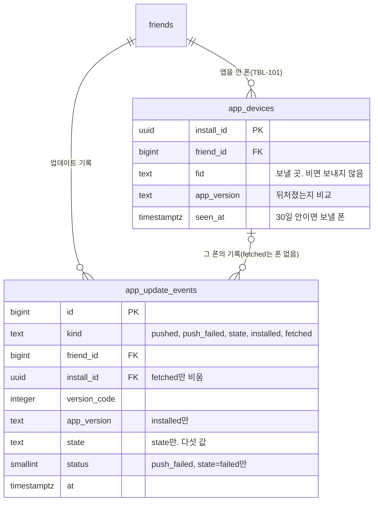

# 마롱이 앱 자동 업데이트: DB 표

상태: 초안(2026-11-22 KST, Claude 마롱이 봇, 기능 변경). 마이그레이션은 파일로만 있고 서버 DB에는 적용하지 않았어요. 적용은 구현 뒤 서버 반영(SPEC-442 ①)이에요.
원본: [`marong/migrations/023_app_update_events.sql`](../../marong/migrations/023_app_update_events.sql). 이 그림은 그 파일에서 손으로 옮긴 것이고, 다르면 SQL이 맞아요.
입력: [기능 명세](../04-functional-spec/app-update.md#8-2026-11-22-기능-변경-게시-즉시-업데이트와-업데이트-상태) SPEC-430\~438, [도메인](../01-domain/app-update.md) CTX-021, TERM-219\~224, 결정 D126(05 단계에 새 표).
사람 보기: 다른 05 문서처럼 GitHub의 Mermaid 그림과 NEXUS로 봐요(`.corthex/project.json` 05-erd 메모).
API 계약: [`api/app-chat.openapi.yaml`](../../api/app-chat.openapi.yaml)의 API-105(`update` 칸), [`api/app-update.openapi.yaml`](../../api/app-update.openapi.yaml)의 API-267.

## 1. 바뀌는 것

2026-11-17 설계에서 이 부분의 05 단계는 '건너뜀(DB 표 없음, 릴리스 폴더만)'이었어요. 2026-11-22 동희님이 "1\~5 모두 바꿈"(Orca 마롱이 항목 2, e17)으로 4번 제안 'app-update의 05 ERD에 새 표 app_update_events를 더할까요?'를 바꾸기로 해서(D126) 표 하나를 더해요. 있는 표는 바꾸지 않아요.

| TBL | 표 | 하는 일 | 명세 |
| --- | --- | --- | --- |
| TBL-182 | `marong.app_update_events` | 업데이트 기록(TERM-223). 한 일마다 한 줄을 더하기만 해요. 종류 다섯: 업데이트 데이터 메시지 보냄(`pushed`)·보내지 못함(`push_failed`), 폰이 보고한 업데이트 상태(`state`), 보고한 앱 버전이 올라감(`installed`), 친구가 APK를 받아 감(`fetched`). 칸은 친구, 폰(설치 ID, `fetched`만 비움), 버전 코드, 앱 버전(`installed`만), 업데이트 상태, 번호, 때 | SPEC-430, 434, 435, 438 |

표가 없는 것: 릴리스 노트(TERM-221)와 버전 기록(TERM-222)은 릴리스 폴더의 `history.json`(SPEC-437, 형식은 [04 8.3](../04-functional-spec/app-update.md#83-버전-기록-historyjson))에 있어요. 최신 릴리스는 지금처럼 `release.json`이에요. 업데이트 배너(TERM-224)는 화면 상태예요.

## 2. 종류마다 채우는 칸

DB 제약 `app_update_events_kind_check`가 이 표와 다른 줄을 막아요.

| 종류 | 설치 ID | 버전 코드 | 앱 버전 | 업데이트 상태 | 번호 | 누가 쓰나 |
| --- | --- | --- | --- | --- | --- | --- |
| `pushed` | 있음 | 있음 | 비움 | 비움 | 비움 | SPEC-430 |
| `push_failed` | 있음 | 있음 | 비움 | 비움 | 401·410·500 | SPEC-430 |
| `state` | 있음 | 있음 | 비움 | 다섯 값 | `failed`일 때만 1\~999 | SPEC-434 |
| `installed` | 있음 | 알면 | 있음 | 비움 | 비움 | SPEC-435(API-105) |
| `fetched` | 비움 | 있음 | 비움 | 비움 | 비움 | SPEC-435(API-142) |

규칙(도메인의 규칙을 DB가 지키는 곳):

- 한 폰에 한 버전의 업데이트 데이터 메시지는 한 번(REQ-553): `pushed` 줄에 (설치 ID, 버전 코드) 유일 인덱스 `app_update_events_pushed_once`. 봇이 다시 시작해도 두 번 보내지 않아요.
- 기록은 더하기만(REQ-556): 봇 계정 `marong`에 `SELECT`, `INSERT`만 줘요. 고치기·지우기 권한이 없어요.
- 기기 식별자 밖의 개인 정보 없음(REQ-312, REQ-559): FID, 이메일, 이름, 릴리스 노트, 대화 글을 넣는 칸이 없어요. 관리자 읽기(API-267)는 설치 ID도 주지 않고 친구 이름과 폰 순번으로 바꿔 줘요.

## 3. 읽는 곳과 인덱스

| 읽기 | 인덱스 |
| --- | --- |
| 감시: 그 폰·버전에 `pushed`가 있는지, `push_failed`가 몇 번이고 마지막이 언제인지(SPEC-430) | `app_update_events_pushed_once`, `app_update_events_device_idx`(설치 ID, 때 내림차순) |
| 관리자 읽기: 폰마다 최근 20줄(SPEC-438) | `app_update_events_device_idx` |
| 관리자 읽기: 친구마다 최근 APK 받아 감 20줄(SPEC-438) | `app_update_events_friend_idx`(친구, 때 내림차순) |

폰이 둘이고 릴리스마다 열 줄 안팎이라 표가 작아요. 지우기와 보관 규칙은 두지 않았어요(새 제안. 한 해에 몇천 줄이 넘으면 다시 봐요).

## 4. 권한

| 역할 | 할 수 있는 것 | 근거 |
| --- | --- | --- |
| `marong`(봇, 글 대화 서버) | 읽기·더하기 | SPEC-430, 434, 435, 438 |
| `marong_call`(통화 서버) | 없음 | 통화는 업데이트 기록을 쓰지 않아요 |
| `PUBLIC` | 없음 | |

## 5. 검사(2026-11-22 KST, Claude)

- `pglast`(Postgres 파서 libpg_query)로 마이그레이션의 9문장이 모두 파싱됨. 통과.
- 빈 DB에 014·023을 적용하는 시험, 두 번 적용, 제약 위반 줄 거절, 권한 시험은 이 작업 환경에 Postgres가 없어 하지 않았어요. TASK-475의 끝 조건이에요(TC-608).

## 6. 되돌리기

표를 더하기만 해서, 반영 뒤 문제가 있으면 코드만 앞 버전으로 되돌려도 돼요(앞 코드는 이 표를 읽지 않음). DB까지 되돌려야 할 때만 백업 뒤 `DROP TABLE marong.app_update_events`를 해요. 그러면 업데이트 기록이 사라져요.
