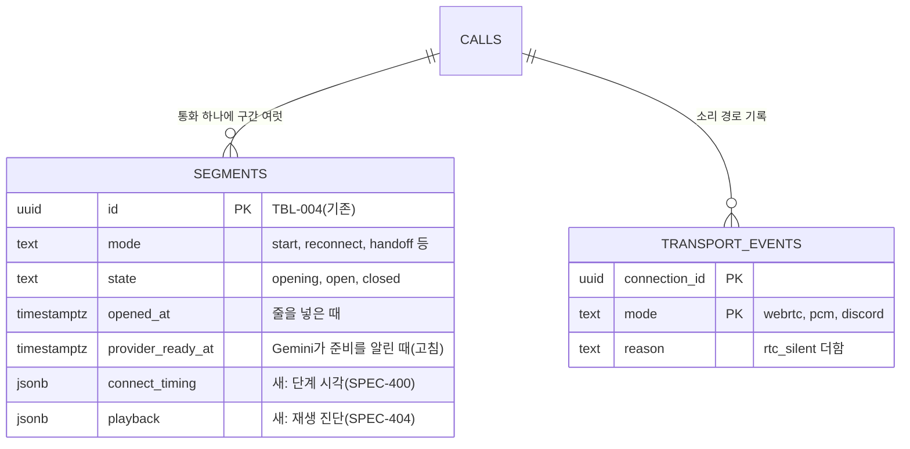

# 통화 연결 속도와 무음 고치기: DB 표

상태: 초안(2026-11-21 16시대 KST, Claude, corthex 0.12.x). 스키마 동결 전이에요.
원본: [`marong/call/migrations/010_call_connect.sql`](../../marong/call/migrations/010_call_connect.sql). 이 그림은 그 파일에서 손으로 옮긴 것이고, 다르면 SQL이 맞아요.
새 표는 없어요. 있는 표 두 개에 칸과 값을 더해요.

## 1. 바뀌는 것

| 대상 | 바뀐 것 | SPEC |
| --- | --- | --- |
| TBL-004 `call.segments` | `connect_timing jsonb`(구간 하나의 단계 시각, 4KB 이하 객체), `playback jsonb`(마지막 재생 진단, 2KB 이하 객체). `provider_ready_at`의 뜻을 'Gemini `setupComplete`를 받은 때'로 고침(칸은 그대로, 넣는 순서만 바뀜: `opening`으로 넣고 준비되면 `open`). 새 통화의 첫 구간 `mode`는 `start` | SPEC-400, SPEC-404 |
| `call.transport_events` | `reason`에 `rtc_silent`(WebRTC 소리가 도착했는데 재생되지 않아 PCM으로 바꿈) | SPEC-404 |

- 권한은 그대로예요. 통화 서버 계정(`marong_call`)은 이미 `call.segments`를 읽고 쓰고, `call.transport_events`에 더할 수 있어요.
- 이 칸들에는 숫자와 상태 이름만 들어가요. 대화 글, 이름, 주소, 토큰, 기기 id는 넣지 않아요(REQ-492).
- 되돌리기: 칸을 지우지 않아도 옛 코드가 그대로 돌아요(옛 코드는 두 칸을 읽지 않음). `rtc_silent` 줄이 있으면 옛 제약으로 돌아갈 수 없으니 되돌릴 때 제약은 그대로 둬요.

## 2. 그림

