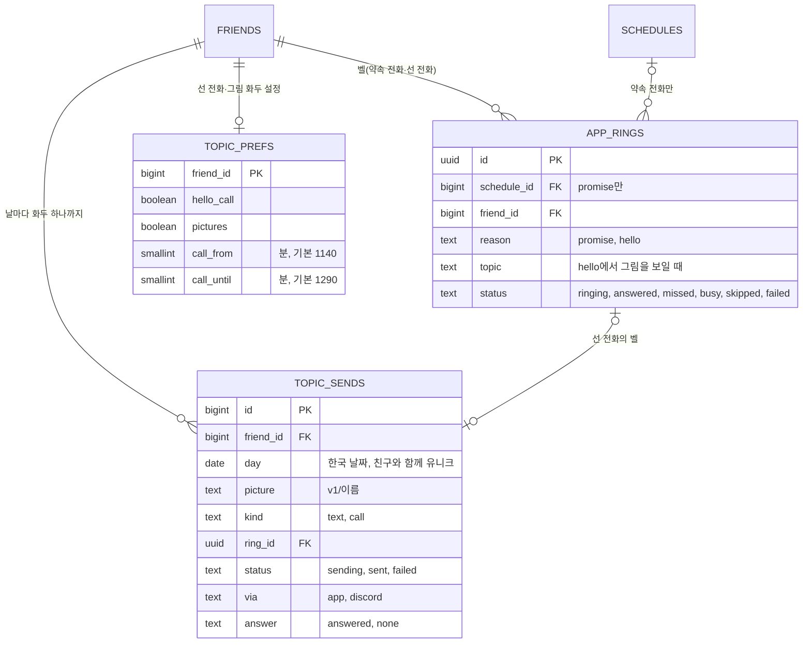

# 마롱이 선 전화와 그림 화두: DB 표

상태: 초안(2026-11-16 23시대 KST, Claude, corthex 0.12.1). 스키마 동결 전이에요.
원본: [`marong/migrations/018_call_first.sql`](../../marong/migrations/018_call_first.sql). 이 그림은 그 파일에서 손으로 옮긴 것이고, 다르면 SQL이 맞아요.
사람 보기: 01·05 단계와 같이 GitHub의 Mermaid 그림으로 봐요(ERD Editor는 이 작업 환경에서 쓸 수 없음, `.corthex/project.json` 05-erd 메모).
05 원본: 이번에 `.corthex/project.json`의 05 원본을 `marong/call/schema.sql`에서 `marong/` 폴더로 바꿨어요(PR #25와 같은 바꿈). 카톡 표, 통화 표, 두 곳의 마이그레이션을 함께 읽어야 TBL-102(015)와 TBL-125·126(018)이 허브에 잡혀요.

## 1. 바뀌는 것

| TBL | 표 | 바뀜 | 명세 |
| --- | --- | --- | --- |
| TBL-102 | `marong.app_rings` | 칸 `reason`(`promise`·`hello`, 기본 `promise`)과 `topic`(그림 이름) 더함. `schedule_id`를 비울 수 있게(이유가 `promise`면 꼭 있음, `hello`면 늘 비어 있음). 친구별 최근 벨 색인 | SPEC-266, SPEC-268, SPEC-270 |
| TBL-125 | `marong.topic_sends` | 새 표. 친구·한국 날짜마다 화두 하나(유니크 색인). 그림 이름, 글·전화, 벨 id, 보낸 결과, 경로, 화두 답 | SPEC-263, SPEC-264, SPEC-266, SPEC-270, SPEC-272, SPEC-273, SPEC-275 |
| TBL-126 | `marong.topic_prefs` | 새 표. 친구마다 선 전화·그림 화두 켜짐과 선 전화 시간대(분). 줄이 없으면 둘 다 켜짐, 19:00\~21:30 | SPEC-277, SPEC-278, SPEC-279 |

권한: 봇(`marong`)은 두 새 표를 읽기·더하기·고치기, 통화 서버(`marong_call`)는 벨 줄의 `reason`, `topic`만 더 읽어요. 지우기 권한은 아무에게도 없어요. 봇은 간격 늘리기(SPEC-264)와 6시간 규칙(SPEC-265)에 쓰는 `call.calls`의 `caller_id`, `started_at`을 이미 읽을 수 있어요(`marong/call/schema.sql`의 칸 권한).

## 2. 그림

## 3. 규칙을 DB로 지키는 곳

| 규칙 | 어떻게 |
| --- | --- |
| 친구에게 화두는 하루 하나(REQ-260) | `topic_sends_one_a_day` 유니크 색인. 보내기 전에 줄을 먼저 만들어요 |
| 약속 전화는 일정이 있고 선 전화는 없음 | `app_rings_reason_schedule` |
| 그림 이름은 약속 전화에 붙지 않음 | `app_rings_topic_hello` |
| 전화 화두는 벨이 있음 | `topic_sends` CHECK(`kind = 'text' OR ring_id IS NOT NULL`) |
| 답은 보낸 화두에만, 받은 때와 함께 | `topic_sends` CHECK 두 개 |
| 선 전화 시간대는 시작이 끝보다 앞 | `topic_prefs` CHECK |
| 한 친구에 울리는 벨은 하나(앱 벨 규칙) | 015의 `app_rings_one_ringing` 그대로(선 전화에도 걸림) |

## 4. AI 호출 기록

- AI-20(그림 화두 글): 보통 선톡처럼 그 글의 `marong.messages.meta`에 모델 답의 기록(토큰 수 등, 지금 `ask`가 남기는 칸)이 남고, `meta.topic`(그림 이름), 고정 글로 갔으면 `meta.topic_fallback`(이유 코드)을 더해요. 새 표는 만들지 않아요(지금 선톡 기록 방식과 같게).
- AI-21(선 전화 지시문): 통화 기록(`call.calls`, `call.segments`)에 지금처럼 남고, 그 통화가 선 전화였는지는 `app_rings.call_id`와 `reason`으로 이어 봐요.
- AI-22(그림 후보): 서버 밖 스크립트라 DB에 남기지 않아요. 후보마다 모델, 품질, 걸린 시간, 비용, 검수 결과를 Git 밖 검수 파일(`review.json`)에 적어요.

## 5. 확인한 것

- 2026-11-16 시험용 Postgres 16(로컬)에서 `marong/schema.sql` → 통화 스키마 → 010\~015 → 018을 두 번 적용: 두 번째도 오류 없음.
- 같은 친구·날짜 두 번째 화두 거절(UniqueViolation), 일정 없는 약속 전화·그림 붙은 약속 전화·벨 없는 전화 화두·보내지 않은 화두의 답·거꾸로 된 시간대 거절(CheckViolation), 봇의 지우기 거절, 통화 서버는 `reason`·`topic`만 읽고 `topic_sends`는 못 읽음(InsufficientPrivilege).
