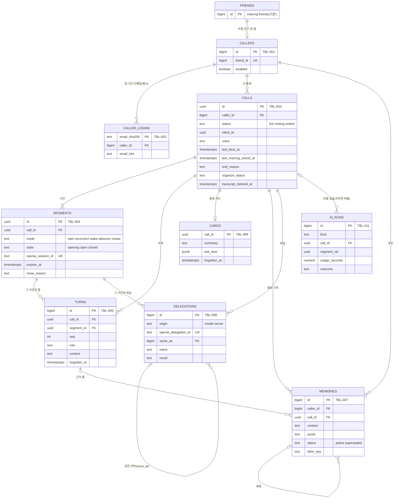
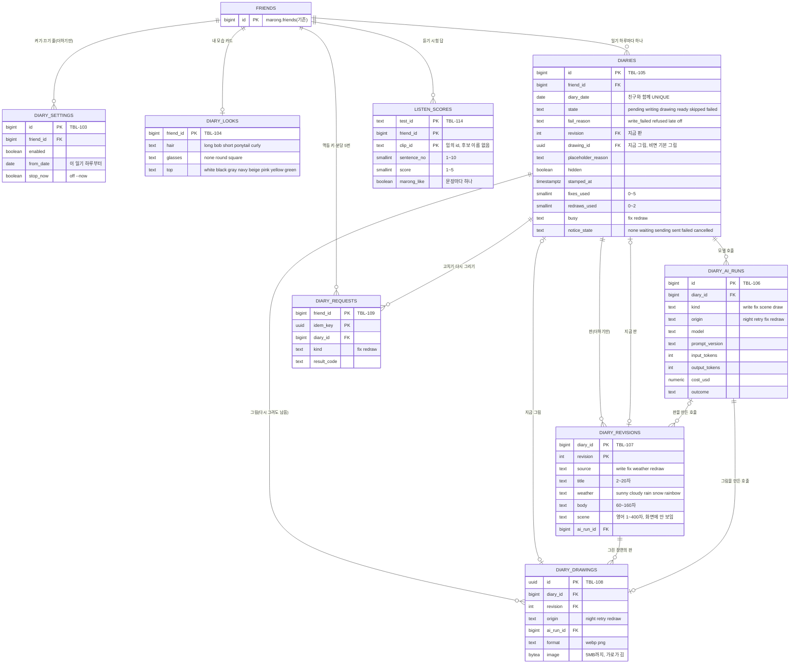
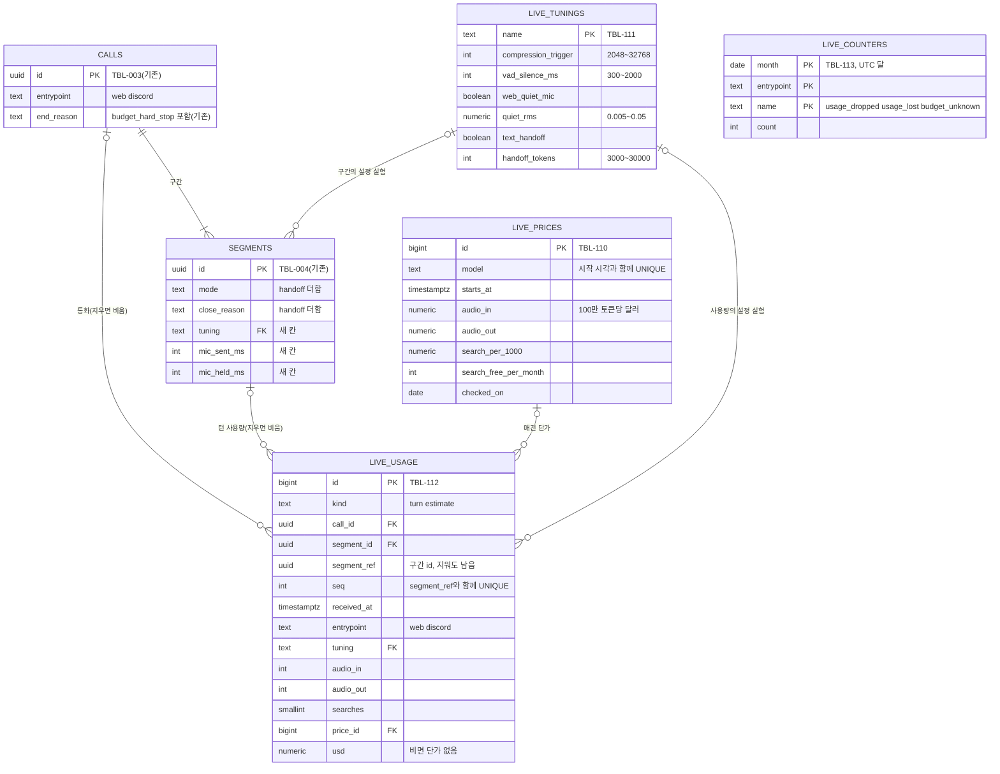

# 마롱이 통화 기능: DB 표

상태: 초안(2026-11-12, Claude). 스키마 동결 전이에요. 독립 검토를 반영했어요(동희님 2026-11-12 15:45 KST 결정 카드, `docs/call-design.md` 11절). 2026-11-16 마롱이의 일기와 통화 비용 표를 [아래 절](#2026-11-16-마롱이의-일기와-통화-비용)에 더했어요(초안, 스키마 동결 전).
원본: [`marong/call/schema.sql`](../../marong/call/schema.sql)과 마이그레이션(`marong/call/migrations/`, `marong/migrations/`). 05단계 source는 2026-11-16부터 `marong/` 폴더예요. 이 그림은 그 파일들에서 손으로 옮긴 것이고, 다르면 SQL이 맞아요.
사람 보기: ERD Editor는 이 작업 환경에서 쓸 수 없어 GitHub의 Mermaid 그림으로 봐요(`.corthex/project.json` 05-erd 메모).

## 1. 어디에 두나

- 같은 Postgres 16, 같은 `marong` DB에 `call` 스키마를 새로 둬요. 카톡 표(`marong` 스키마)는 바꾸지 않아요.
- 통화 서버 계정 `marong_call`은 `call` 표를 읽고 쓰고 지우며, `marong` 표는 지시문·기억 찾기에 쓰는 8개만 읽어요.
- 카톡 봇 계정 `marong`은 '# 최근 통화'(SPEC-024)와 시트 '통화' 탭(SPEC-026)에 필요한 것만 읽어요. 자막(`call.turns`)은 못 읽어요.
- LangGraph 체크포인트는 `call_graph` 스키마에 `AsyncPostgresSaver.setup()`이 표를 만들어요(우리가 정의하지 않는 표라 TBL 번호가 없음).

## 2. 그림

설정·예산 기록·메타 표(TBL-009 `settings`, TBL-010 `budget_events`, TBL-012 `meta`)는 다른 표와 이어지지 않아 그림에서 뺐어요.

## 3. 표 목록

| ID | 표 | 컨텍스트 | 용어 | 쓰는 SPEC | 지킬 규칙(DB가 막음) |
| --- | --- | --- | --- | --- | --- |
| TBL-001 | `call.callers` | CTX-005 | TERM-003 | 001, 002, 024, 025 | 카톡 친구 한 명에 하나 |
| TBL-002 | `call.caller_logins` | CTX-005 | TERM-004 | 001, 025 | 이메일 원문 없음(sha256 64자, 가린 표시) |
| TBL-003 | `call.calls` | CTX-002 | TERM-001, 009, 013, 015 | 002\~004, 007\~011, 017\~020, 022\~024 | 친구 한 명에 안 끝난 통화 하나, 끝남과 끝난 시각·이유·정리 상태가 함께 감, 목소리는 1\~100자(통화마다 하나, D16) |
| TBL-004 | `call.segments` | CTX-002 | TERM-002, 010, 011, 012, 020 | 003, 006\~011, 023, 031 | 통화 하나에 안 닫힌 구간 하나(미리 넘기기는 한 트랜잭션으로 닫고 엶), 열린 구간은 OpenAI 세션 id가 있음 |
| TBL-005 | `call.turns` | CTX-004 | TERM-005 | 006, 012\~015, 017, 019, 021, 022 | 한 줄 4,000자, 통화 안 순서 겹침 없음, 잊기 표시(`forgotten_at`) |
| TBL-006 | `call.cards` | CTX-004 | TERM-006 | 004, 013, 015, 017, 019, 021, 024 | 통화 하나에 카드 하나, 잊기 표시(`forgotten_at`) |
| TBL-007 | `call.memories` | CTX-004 | TERM-007 | 004, 013\~015, 017, 019\~022, 024 | 같은 통화에서 같은 내용 한 줄(멱등 키), 내용 2\~200자, 인용 1\~200자(180일 뒤 비움) |
| TBL-008 | `call.delegations` | CTX-003 | TERM-008 | 012\~016 | 모델 위임은 위임 id 한 번만, 서버 보조 판단(`origin server`)은 위임 id 없음, 말 내용 없음(길이만) |
| TBL-009 | `call.settings` | CTX-006 | TERM-014 | 004, 023, 025 | 예산 0 초과 10,000 이하, 요금 0 초과 |
| TBL-010 | `call.budget_events` | CTX-006 | TERM-014 | 023, 025, 026 | 달마다 종류마다 한 줄(OpenAI 지출 한도가 먼저 막은 달은 `provider_limit`) |
| TBL-011 | `call.ai_runs` | CTX-002, CTX-003, CTX-004 | none | 003, 006, 012, 013, 017, 022, 023, 026, 030 | 음성 구간 사용 초는 한 번만 셈, 내용 없음(느낌 고르기도 문장·느낌을 안 둠) |
| TBL-012 | `call.meta` | CTX-002 | none | 028 | 스키마 버전 |

표가 없는 용어: TERM-016 sideband, TERM-017 통화 마롱이(데이터가 아니라 연결과 말하는 방식), TERM-018 마롱이 얼굴(정적 그림 파일), TERM-019 느낌(저장하지 않음).

## 4. 지우기와 보관

| 일 | 지워지는 것 | 남는 것 |
| --- | --- | --- |
| 통화 지우기(SPEC-020) | 통화, 구간, 자막, 카드, 이 통화 기억, 위임, LangGraph thread | AI 호출 기록(통화 id 비움, 사용 초는 예산에 그대로). 이 통화 기억이 대체했던 이전 기억은 다시 활성 |
| 기억 하나 지우기·잊어 줘(SPEC-021, SPEC-015) | 그 기억과 그 기억이 대체했던 이전 기억들, 맞는 카드 항목 | 카드 요약·자막 줄은 잊기 표시만(통화 상세에는 보임, 기능 명세 3.7) |
| 180일(SPEC-022) | 자막, 그 통화 기억의 인용 | 통화, 카드, 통화 기억 내용(근거 줄 id와 인용은 비움) |
| 7일(SPEC-022) | 정리 끝난 통화의 LangGraph thread | 나머지 전부 |
| 400일(SPEC-022) | AI 호출 기록 | 나머지 전부 |
| 14일(SPEC-022, 제안) | 서버 DB 백업 파일 | 나머지 전부. 기간은 `docs/call-design.md` 8절 7번 승인 때 정함 |

## 5. 확인한 것

- 2026-11-12, 이 작업 환경의 임시 Postgres 16 클러스터에서 빈 DB에 `marong/schema.sql` → `marong/call/schema.sql`을 두 번씩 적용했어요. 두 번 모두 오류 없이 끝났어요. 임시 환경에 pgvector가 없어서 카톡 스키마 사본에서만 `vector`를 `bytea`로 바꿨어요(원본 파일은 그대로).
- [`schema-check.sql`](schema-check.sql)로 규칙을 시험했어요(독립 검토 반영 뒤 2026-11-12 다시 돌림). 기대한 오류 16개(안 끝난 통화 두 개, 안 닫힌 구간 두 개, 세션 id 없는 열린 구간, 같은 멱등 키, 위임 id 없는 모델 위임, 위임 id 있는 서버 보조 판단, 끝난 시각 없는 끝남, 같은 구간 사용 초 두 번, 모르는 AI 호출 종류, 빈 목소리, 예산 0, 같은 달 경고 두 번, 통화 서버의 카톡 표 쓰기, 카톡 봇의 자막 읽기, 카톡 봇의 화면 id 칸 읽기, 카톡 봇의 카드 지우기)가 모두 났고 그 밖의 오류는 없었어요. 미리 넘기기(직전 구간을 `renewed`로 닫고 새 구간을 연 한 트랜잭션)는 안 닫힌 구간 하나 규칙을 어기지 않고 지나갔어요. 카톡 봇은 잊기 표시된 카드를 거를 수 있어요(카드 1장 중 잊기 표시 없는 것 0장). 통화를 지운 뒤 자막·기억·카드·구간·위임은 0줄, AI 호출 기록은 2줄(음성 구간 1줄·느낌 고르기 1줄, 통화 id 비움, 600초)로 남았어요.
- 확인하지 못한 것: 실제 서버 DB(pgvector 있음)에 적용, LangGraph `setup()`이 `call_graph`에 표를 만드는지, 데이터가 많을 때의 검색 속도.

## 2026-11-12 Vertex 운영 적용

현재 통화·기억 경로는 위 정본에 [`002_vertex_memory.sql`](../../marong/call/migrations/002_vertex_memory.sql)을 순서대로 적용한 스키마 버전 2를 사용합니다. OpenAI 전용 식별자는 호환성을 위해 남기고 `segments.provider`, `provider_model`, `provider_ready_at` 및 위임의 `request_key`/`result_data`를 추가했습니다. `turn_key`·`finalized`·`revision`으로 자막을 확정하고 `callers.context_revision`·`deletions`·`kakao_guards`로 삭제와 비공개 파생 자료를 관리합니다. `call_graph`에는 후보 본문 없이 작업 ID와 revision만 둡니다.

배포된 API·권한·보관·되돌리기 규칙은 [Vertex 통화 운영 문서](../../tools/vertex_live/README.md)에 있습니다. 이번 배포는 Vertex Live WebSocket으로 모델과 통신하고, 싱가포르 서버의 LiveKit에서 브라우저로 WebRTC 음성을 전달합니다. 마이크 입력과 대체 PCM 재생은 독립 음성 작업자를 사용합니다. 기존 OpenAI 세션 발급 경로는 사용하지 않습니다.

## 2026-11-16 마롱이의 일기와 통화 비용

상태: 초안(2026-11-16, Claude). 스키마 동결 전이에요. 입력은 [일기 기능 명세](../04-functional-spec/diary.md) SPEC-150\~168·AI-6\~8, [통화 비용 기능 명세](../04-functional-spec/call-cost.md) SPEC-169\~183, [도메인](../01-domain/domain.md)의 CTX-002·006·007과 TERM-021\~039예요.
원본: [`016_diary.sql`](../../marong/migrations/016_diary.sql)(일기, TBL-103\~109), [`017_listen_test.sql`](../../marong/migrations/017_listen_test.sql)(듣기 시험, TBL-114), [`007_call_cost.sql`](../../marong/call/migrations/007_call_cost.sql)(통화 비용, TBL-110\~113과 기존 표 바꾸기). 적용 순서는 지금 마이그레이션 다음이에요(카톡 015 → 016 → 017, 통화 006 → 007).

### 일기 표

### 통화 비용 표

### 표 목록

| ID | 표 | 컨텍스트 | 용어 | 쓰는 SPEC | 지킬 규칙(DB가 막음) |
| --- | --- | --- | --- | --- | --- |
| TBL-103 | `marong.diary_settings` | CTX-007 | TERM-031 | 150, 151, 165, 168 | 줄을 더하기만 함(봇 계정에 고치기·지우기 없음), `off --now` 줄은 켜기일 수 없음 |
| TBL-104 | `marong.diary_looks` | CTX-007 | TERM-030, 031 | 153\~155, 166 | 세 값이 모두 있거나 모두 비어 있음, 값은 목록 안 |
| TBL-105 | `marong.diaries` | CTX-007 | TERM-021, 022, 027, 033 | 150\~153, 155, 157\~165, 167, 168 | 친구·일기 하루마다 하나, `failed`면 이유가 있음, `drawing`·`ready`면 판이 있음, 숨기기·도장·고치기·다시 그리기·알림은 `ready`에서만, 고치기 5번·다시 그리기 2번까지, 지금 판·그림은 같은 일기의 것(복합 외래 키), '보냄'은 보낸 시각과 함께 |
| TBL-106 | `marong.diary_ai_runs` | CTX-007 | none | 153, 155, 156, 160, 161, 167 | 모델 호출마다 한 줄, 내용 없음, 호출 종류와 계기가 맞음(밤 작업이 고치기를 부르지 않음), 추정 비용은 값이 있음 |
| TBL-107 | `marong.diary_revisions` | CTX-007 | TERM-021, 025, 026 | 153, 154, 158\~163 | 더하기만 함, 제목 2\~20자, 글 60\~160자, 장면 400자까지, 날씨는 다섯 값, 날씨 판만 모델 호출이 없음 |
| TBL-108 | `marong.diary_drawings` | CTX-007 | TERM-024 | 155, 158, 161, 167 | 더하기만 함, 5MB까지, 가로가 세로보다 김, 호출 하나에 그림 하나, 그린 판은 같은 일기의 판 |
| TBL-109 | `marong.diary_requests` | CTX-007 | none | 160, 161 | 친구·멱등 키마다 한 줄, 결과에는 끝난 시각, 요청 글은 두지 않음 |
| TBL-110 | `call.live_prices` | CTX-006 | TERM-035 | 170, 172, 173, 180 | 더하기만 함(통화 계정에 고치기 없음), 모델·시작 시각마다 한 줄, 값은 0 이상 |
| TBL-111 | `call.live_tunings` | CTX-002 | TERM-037 | 177\~180 | 이름마다 한 값(더하기만), 이름 `[a-z0-9-]` 2\~40자, 칸마다 범위(기능 명세 3.3), 압축 뒤 토큰은 시작 토큰의 절반 이하 |
| TBL-112 | `call.live_usage` | CTX-006 | TERM-034 | 169\~171, 173, 180, 181 | (구간, 순번) 한 번, 단가 줄이 있으면 달러도 있음, 통화를 지워도 남음(통화·구간 id만 비움), 추정 줄은 순번 0과 초가 있음, 숫자와 이름표만 |
| TBL-113 | `call.live_counters` | CTX-006 | none | 169, 170, 174, 180 | UTC 달·입구·이름마다 한 줄, 이름은 세 가지 |
| TBL-114 | `marong.listen_scores` | CTX-002 | TERM-039 | 183 | 친구·소리마다 답 하나(다시 답하면 마지막 것), 문장마다 '마롱이 같다' 하나, 점수 1\~5, 후보 이름 없음 |

표가 없는 용어: TERM-018 마롱이 얼굴(정적 그림 파일), TERM-023 하루 모음(메모리에서만 만들고 저장하지 않음), TERM-028 기본 그림(정적 그림 파일), TERM-029 일기장(위 표를 읽는 읽기 모델), TERM-032 그림 월 예산(서버 설정, 쓴 돈은 TBL-106에서 셈), TERM-036 지출 상한 예산(구글 콘솔 설정), TERM-038 글로 갈아타기(구간의 `handoff`).

바뀐 기존 표와 뷰(`007_call_cost.sql`):

| 대상 | 바뀐 것 | SPEC |
| --- | --- | --- |
| TBL-004 `call.segments` | `tuning`(설정 실험 이름, TBL-111 외래 키), `mic_sent_ms`·`mic_held_ms`(웹 문이 보낸·안 보낸 시간), `mode`와 `close_reason`에 `handoff` | 177\~179 |
| TBL-009 `call.settings` | 키 `live_tuning`(처음 값 `base-20261116`), `credit_checked_on`(날짜), `usage_mode`(`turn`·`cumulative`, 구현 전 시험으로 정함) | 169, 177, 180 |
| TBL-011 `call.ai_runs` | `thoughts_tokens`(통화 정리의 생각 토큰) | 173 |
| 뷰 `call.segment_costs`(새로) | 구간마다 저장 달러, 또는 사용량이 없거나 단가 없는 줄이 있는 닫힌 구간의 추정(길이 × 분당 0.05달러) | 171, 173, 180 |
| 뷰 `call.session_report` | 끝에 `input_tokens`, `output_tokens`, `usd`, `usd_estimated`, `tunings` 다섯 칸(앞 칸은 그대로) | 181 |

### 권한

| 계정 | 일기 | 듣기 시험 | 통화 비용 |
| --- | --- | --- | --- |
| `marong`(봇: 밤 작업·아침 알림·일기장·관리 명령) | 설정·판·그림·호출 기록은 읽기·더하기, 모습 카드·일기·멱등 키는 읽기·더하기·고치기. 지우기는 아무 표에도 없음 | 읽기·더하기·고치기 | 없음(시트는 지금처럼 `session_report` 뷰만) |
| `marong_call`(통화 서버·디스코드 중계·`cost_admin.py`) | 없음 | 없음 | 단가표·설정 실험·사용량은 읽기·더하기, 세는 표는 읽기·더하기·고치기, `segment_costs` 읽기 |

일기 밤 작업이 읽는 통화 자막은 지금 있는 권한(`call.transcript_report` 뷰, `call.calls`의 몇 칸, `call.callers`, `call.source_exclusions`, `call.kakao_hidden`)으로 읽어요. 새 권한은 없어요.

### 지우기와 보관

| 일 | 지워지는 것 | 남는 것 |
| --- | --- | --- |
| 일기 숨기기(SPEC-163) | 없음(넘기기·달력에서만 빠짐) | 전부 |
| 고치기·마음 날씨·다시 그리기(SPEC-160\~162) | 없음 | 지난 판과 지난 그림. 지금 판·그림만 바뀜 |
| 일기 끄기(SPEC-150) | 없음 | 지난 일기 전부(끄기는 새 줄) |
| 통화 지우기(지금 코드, SPEC-171 보완) | 통화·구간 등 지금 규칙대로 | 통화 사용량(통화·구간 id만 비움)과 지우기 전에 남긴 추정 줄. 이번 달 통화 비용이 줄지 않음 |

일기 표의 보관 기간은 요구사항에 없어서 정하지 않았어요(지금은 지우지 않음, README '기록은 지워지지 않아요'). 그림은 장당 약 0.1\~0.3MB로 봐서 친구 한 명이 1년에 다시 그리기까지 많아야 약 300MB예요 [추정: 1536×1024 webp 낮은 품질, 연구 8.1 시제품].

### 05단계에서 함께 고친 04 명세

- SPEC-150: `off --now`가 지난 일기 하루의 줄을 만들기 전(04:00\~04:10)이면 그 줄도 만들지 않음을 예외에 더했어요(`stop_now` 줄의 뜻).
- SPEC-171: 추정할 구간이 있는 통화를 지우면 지우는 트랜잭션에서 그 구간의 추정 값을 사용량 줄(`estimate`)로 남겨, 통화를 지워도 이번 달 비용이 줄지 않게 했어요(TERM-034 규칙과 맞춤).
- SPEC-177: 설정 실험 이름을 2\~40자로 고쳤어요. 같은 행의 예 `t2`가 3자 규칙에 맞지 않았어요.

### 확인한 것(2026-11-16)

- 이 작업 환경의 임시 Postgres 16(UTF8) 빈 DB에 `marong/schema.sql` → `marong/call/schema.sql`(두 번씩) → 통화 002\~004 → 카톡 010\~013 → 통화 005·006 → 카톡 014·015 → 카톡 016·017·통화 007(두 번씩)을 적용했어요. 오류 없이 끝났어요. pgvector가 없어 카톡 스키마 사본에서만 `vector`를 `bytea`로 바꿨어요(원본 그대로).
- [`schema-check-2026-11-16.sql`](schema-check-2026-11-16.sql)로 규칙을 시험했어요. 기대한 오류 35개가 모두 기대한 제약에서 났고 그 밖의 오류는 없었어요. 구간 비용은 저장 값 0.034800달러·추정 0.500000달러(10분 × 0.05), 시트 칸은 입력 9,000·출력 900토큰·0.534800달러·추정 있음·`base-20261116`, 통화를 지운 뒤 사용량 2줄이 통화·구간 id만 비고 합 0.534800달러로 남았어요. 봇 계정은 시퀀스 권한 없이 일기 표에 줄을 더할 수 있었어요.
- hub(`corthex-hub` 0.4.0) 스냅숏: 오류 0, TBL-103\~114가 SPEC·CTX·TERM과 이어짐, 그림 읽기(작업 트리로 돌림)가 새 표 12개의 열·기본 키·고유 키·외래 키(복합 외래 키와 `ALTER TABLE`로 건 것 포함)와 '표가 없는 용어' 9개를 읽음.
- 확인하지 못한 것: 실제 서버 DB(pgvector 있음, 데이터 있음)에 적용과 걸리는 잠금 시간, 운영 DB의 기존 CHECK 이름(이름 대신 내용으로 찾아 지움), 데이터가 많을 때의 속도, 그림 바이트를 DB에 둘 때 백업 크기.
