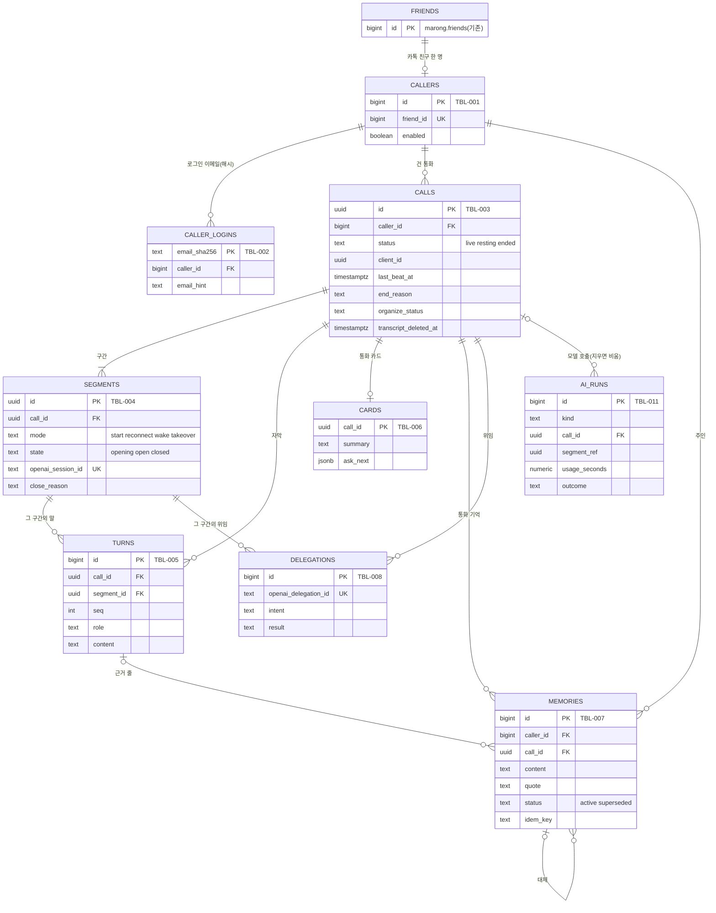

# 마롱이 통화 기능: DB 표

상태: 초안(2026-11-12, Claude). 스키마 동결 전이에요.
원본: [`marong/call/schema.sql`](../../marong/call/schema.sql). 이 그림은 그 파일에서 손으로 옮긴 것이고, 다르면 SQL이 맞아요.
사람 보기: ERD Editor는 이 작업 환경에서 쓸 수 없어 GitHub의 Mermaid 그림으로 봐요(`.corthex/project.json` 05-erd 메모).

## 1. 어디에 두나

- 같은 Postgres 16, 같은 `marong` DB에 `call` 스키마를 새로 둬요. 카톡 표(`marong` 스키마)는 바꾸지 않아요.
- 통화 서버 계정 `marong_call`은 `call` 표를 읽고 쓰고 지우며, `marong` 표는 지시문·기억 찾기에 쓰는 8개만 읽어요.
- 카톡 봇 계정 `marong`은 '# 최근 통화'(SPEC-024)와 시트 '통화' 탭(SPEC-026)에 필요한 것만 읽어요. 자막(`call.turns`)은 못 읽어요.
- LangGraph 체크포인트는 `call_graph` 스키마에 `AsyncPostgresSaver.setup()`이 표를 만들어요(우리가 정의하지 않는 표라 TBL 번호가 없음).

## 2. 그림

설정·예산 기록·메타 표(TBL-009 `settings`, TBL-010 `budget_events`, TBL-012 `meta`)는 다른 표와 이어지지 않아 그림에서 뺐어요.

## 3. 표 목록

| ID | 표 | 컨텍스트 | 용어 | 쓰는 SPEC | 지킬 규칙(DB가 막음) |
| --- | --- | --- | --- | --- | --- |
| TBL-001 | `call.callers` | CTX-005 | TERM-003 | 001, 002, 024, 025 | 카톡 친구 한 명에 하나 |
| TBL-002 | `call.caller_logins` | CTX-005 | TERM-004 | 001, 025 | 이메일 원문 없음(sha256 64자, 가린 표시) |
| TBL-003 | `call.calls` | CTX-002 | TERM-001, 009, 013, 015 | 002, 003, 007~011, 017~020, 022~024 | 친구 한 명에 안 끝난 통화 하나, 끝남과 끝난 시각·이유·정리 상태가 함께 감 |
| TBL-004 | `call.segments` | CTX-002 | TERM-002, 010, 011, 012 | 003, 006~011, 023 | 통화 하나에 안 닫힌 구간 하나, 열린 구간은 OpenAI 세션 id가 있음 |
| TBL-005 | `call.turns` | CTX-004 | TERM-005 | 006, 012~014, 017, 019, 022 | 한 줄 4,000자, 통화 안 순서 겹침 없음 |
| TBL-006 | `call.cards` | CTX-004 | TERM-006 | 017, 019, 024 | 통화 하나에 카드 하나 |
| TBL-007 | `call.memories` | CTX-004 | TERM-007 | 004, 013~015, 017, 019~021, 024 | 같은 통화에서 같은 내용 한 줄(멱등 키), 내용 2~200자 |
| TBL-008 | `call.delegations` | CTX-003 | TERM-008 | 012~016 | 위임 id 한 번만, 말 내용 없음(길이만) |
| TBL-009 | `call.settings` | CTX-006 | TERM-014 | 004, 023, 025 | 예산 0 초과 10,000 이하, 요금 0 초과 |
| TBL-010 | `call.budget_events` | CTX-006 | TERM-014 | 023, 025, 026 | 달마다 종류마다 한 줄 |
| TBL-011 | `call.ai_runs` | CTX-002, CTX-003, CTX-004 | none | 003, 006, 012, 013, 017, 022, 023, 026, 030 | 음성 구간 사용 초는 한 번만 셈, 내용 없음(느낌 고르기도 문장·느낌을 안 둠) |
| TBL-012 | `call.meta` | CTX-002 | none | 028 | 스키마 버전 |

표가 없는 용어: TERM-016 sideband, TERM-017 통화 마롱이(데이터가 아니라 연결과 말하는 방식).

## 4. 지우기와 보관

| 일 | 지워지는 것 | 남는 것 |
| --- | --- | --- |
| 통화 지우기(SPEC-020) | 통화, 구간, 자막, 카드, 이 통화 기억, 위임, LangGraph thread | AI 호출 기록(통화 id 비움, 사용 초는 예산에 그대로) |
| 기억 하나 지우기(SPEC-021) | 그 기억 | 그 기억이 대체했던 이전 기억은 다시 활성 |
| 180일(SPEC-022) | 자막 | 통화, 카드, 통화 기억(근거 줄 id만 비움) |
| 7일(SPEC-022) | 정리 끝난 통화의 LangGraph thread | 나머지 전부 |
| 400일(SPEC-022) | AI 호출 기록 | 나머지 전부 |

## 5. 확인한 것

- 2026-11-12, 이 작업 환경의 임시 Postgres 16 클러스터에서 빈 DB에 `marong/schema.sql` → `marong/call/schema.sql`을 두 번씩 적용했어요. 두 번 모두 오류 없이 끝났어요. 임시 환경에 pgvector가 없어서 카톡 스키마 사본에서만 `vector`를 `bytea`로 바꿨어요(원본 파일은 그대로).
- [`schema-check.sql`](schema-check.sql)로 규칙을 시험했어요. 기대한 오류 12개(안 끝난 통화 두 개, 안 닫힌 구간 두 개, 세션 id 없는 열린 구간, 같은 멱등 키, 끝난 시각 없는 끝남, 같은 구간 사용 초 두 번, 예산 0, 같은 달 경고 두 번, 통화 서버의 카톡 표 쓰기, 카톡 봇의 자막 읽기, 카톡 봇의 화면 id 칸 읽기, 카톡 봇의 카드 지우기)가 모두 났고, 통화를 지운 뒤 자막·기억·카드·구간·위임은 0줄, AI 호출 기록은 1줄(통화 id 비움, 600초)로 남았어요.
- 확인하지 못한 것: 실제 서버 DB(pgvector 있음)에 적용, LangGraph `setup()`이 `call_graph`에 표를 만드는지, 데이터가 많을 때의 검색 속도.
