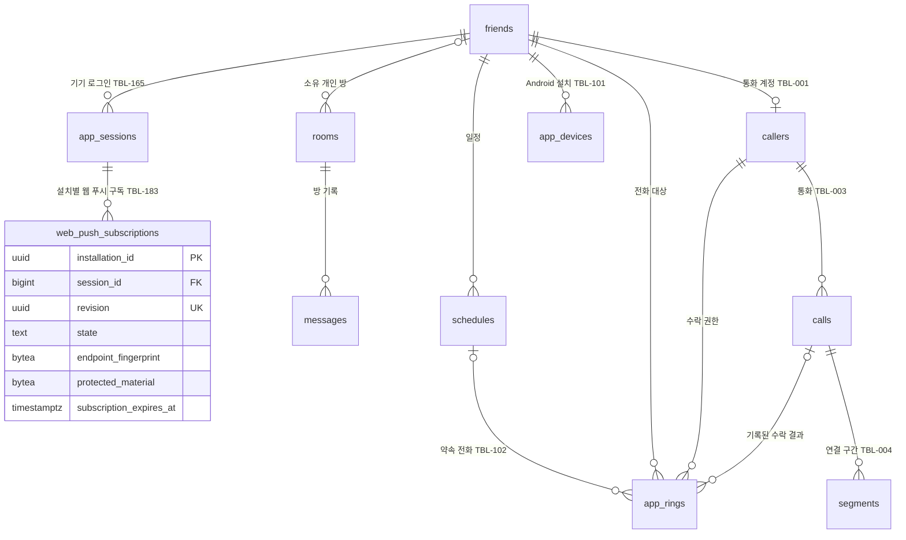

# 아이폰 홈 화면 웹앱 알림 05단계 데이터 모델 초안

2026-11-25 KST · 마롱이 Orca 항목 143 · 05 체크포인트 대기

홈 화면 웹앱 설치별로 현재 웹 푸시 구독 하나를 보관하는 TBL-183을 제안합니다. 소유 계정은 기존 기기 로그인에서 확인합니다. 답변·선톡·일정은 기존 방 기록을, 약속 전화의 최초 수락 결과는 기존 전화 행을 사용합니다. [04 고정 명세](../04-functional-spec/iphone-home-webapp-notifications-draft.md) · [05 승인 근거와 검토 기록](../../iphone-webapp-05-erd-checkpoint-2026-11-25.md)

## 기존 스키마와 소유권

| 데이터 | 현재 저장 관계와 재사용 범위 |
| --- | --- |
| 계정과 기기 로그인 | `marong.friends.id`가 계정 소유 관계의 기준입니다. TBL-165 `marong.app_sessions`에는 `id`, `friend_id`, 토큰 해시, `expires_at`, `revoked_at`이 있습니다. 로그인은 기존 쿠키·기기 코드 흐름을 사용하며 구독 표에 토큰·이메일·계정 프로필을 복제하지 않습니다. `app_sessions_friend_idx`와 기존 세션 판정을 사용합니다. [020 통합 마이그레이션](../../marong/migrations/020_unified.sql) · [기기 로그인 ERD](unified.md) · [로그아웃 코드](../../marong/app_session.py) |
| 채팅 방과 메시지 | `rooms.room_key`가 PK이고 020에서 추가한 `owner_friend_id`가 개인 방 소유권을 연결합니다. `messages.id`가 PK, `messages.room_key`가 방 FK, `(room_key, kakao_id)`가 기존 중복 방지 키입니다. 답변의 기존 요청 중복 방지와 선톡의 `app-proactive` 키, 일정 ID와 발생 시각을 묶은 `app-reminder` 키가 유지됩니다. NULL인 `kakao_id`에는 유일성이 적용되지 않으므로 웹 전달이 별도 방 쓰기를 수행하면 안 됩니다. 방을 열기 전에 현재 계정에 허용된 방과 대상 메시지의 소속·삭제·표시 상태를 기존 조회 규칙으로 확인합니다. [기본 스키마](../../marong/schema.sql) · [웹 대화](../../marong/app_chat.py) · [메시지 조회](../../marong/app_store.py) · [통합 전달](../../marong/unified_delivery.py) |
| 일정과 약속 전화 | `schedules.id`와 `friend_id`가 일정의 기준입니다. TBL-102 `app_rings`에는 대상 계정, `schedule_id`, `caller_id`, `answer_until`, 상태와 수락 결과 `answered_at`·`call_id`가 있습니다. 018 이후 `reason = 'promise'`일 때만 일정 FK가 있습니다. TBL-001 `call.callers.friend_id`는 유일하고, TBL-003 `call.calls`는 통화 ID와 현재 클라이언트, TBL-004 `call.segments`는 기존 연결 구간을 보관합니다. iPhone 알림은 동일한 약속 전화 ID를 씁니다. 수신 기기 수에 따라 전화나 일정 행을 추가하지 않습니다. [012 일정](../../marong/migrations/012_schedules.sql) · [015 약속 전화](../../marong/migrations/015_app_ring.sql) · [018 전화 구분](../../marong/migrations/018_call_first.sql) · [통화 스키마](../../marong/call/schema.sql) |
| Android 설치 | TBL-101 `app_devices`의 설치 UUID, `friend_id`, FID, Android 알림·벨 허용 및 버전은 등록과 갱신 규칙이 다릅니다. TBL-183은 그 행과 연결하지 않습니다. Android의 FCM 판정·`app_rings.devices`·앱 업데이트 기록은 각각 기존 의미를 유지합니다. [014 Android 등록](../../marong/migrations/014_app_chat.sql) · [Android FCM 명세](../04-functional-spec/fcm-unregistered.md) · [앱 업데이트 ERD](app-update.md) |

## TBL-183 웹 푸시 구독

아래는 새 표와 기존 표의 소유 관계입니다. 구독에서 메시지나 전화로 이어지는 영구 FK는 필요하지 않습니다. 사용자가 알림을 열 때 기존 방·전화에서 직접 권한을 확인합니다.

| 컬럼 또는 제약 | 목적과 적용 규칙 |
| --- | --- |
| `installation_id` UUID PK | 홈 화면 웹앱 설치마다 현재 구독 행 하나. 기기 고유 하드웨어 ID를 수집하지 않습니다. UUID를 아는 사실은 권한 증거로 쓰지 않습니다. 설치 확인 방식을 06에서 정합니다. |
| `session_id` bigint FK | TBL-165의 기기 로그인 한 건이 현재 구독을 소유합니다. 계정은 `friend_id`로 조회하고 로그인 유효성은 매번 원본 세션에서 확인합니다. 세션의 물리 삭제 시 `ON DELETE CASCADE`로 구독 행이 같이 지워지도록 제안합니다. 기존 세션 보존 기간이나 실제 삭제 작업을 바꾸는 DDL은 없습니다. |
| `revision` UUID UNIQUE | 등록 교체, 재등록, 비활성 전환과 소유 세션 변경에 새 UUID를 사용합니다. 같은 요청의 기존 결과 조회는 버전을 유지합니다. 전송 결과는 발송 당시 설치 ID와 이 버전으로만 상태를 변경할 수 있습니다. 버전을 바꾸는 쓰기 규칙은 서비스 책임입니다. |
| `state`, `subscription_expires_at` | `active`, `revoked`, `expired`, `invalid`만 허용합니다. `expired`는 구독 자체의 만료, `invalid`는 확인된 영구 무효입니다. 권한 철회와 세션 종료 정리는 `revoked`로 제안합니다. 활성 행의 기한 NULL은 구독 기한을 알 수 없음을 의미합니다. 발송 자격은 활성 상태 외에 기기 로그인과 알려진 구독 기한도 확인합니다. |
| `endpoint_fingerprint`, `protected_material` | 활성 행에는 주소의 서버 키 기반 HMAC-SHA-256 32바이트와 주소·키 재료의 암호화 봉투가 모두 있어야 합니다. 비활성화와 같은 트랜잭션에서 두 값과 구독 기한을 NULL로 비웁니다. 지문은 중복 확인에만 쓰고 사용자·로그·응답에 노출하지 않습니다. 봉투 암호화·키 회전과 입력 검증은 서비스 계약에서 결정합니다. |
| 유일 인덱스 및 조회 인덱스 | 활성 주소 지문의 부분 유일 인덱스가 같은 주소로 중복 활성화되는 경합을 막습니다. `(session_id)`는 계정의 유효 세션에서 설치를 조회하거나 세션을 종료할 때, 활성 행의 구독 기한 부분 인덱스는 기한이 알려진 행만 정리할 때 사용합니다. 지문 생성 키 교체 시 기존 활성 주소의 유일성을 보존하는 방식은 06에서 정합니다. |

## SPEC별 데이터 사용

표의 쓰기는 기존 동작 또는 승인 범위를 위한 쓰기입니다. 조회·탭·표시 시도 자체로 새 방·전화 데이터를 만들지 않습니다.

| SPEC | 읽기 | 쓰기·보존 |
| --- | --- | --- |
| SPEC-520, SPEC-521, SPEC-523 | 현재 진입 방식·기기 지원·OS 권한과 명시적 선택 | 브라우저·OS 상태를 사용합니다. 서버 구독을 만들지 않습니다. |
| SPEC-522, SPEC-525 | 현재 TBL-165와 해당 설치의 TBL-183 상태. 지원 여부와 기기 권한은 웹앱 | 조회에는 쓰기 없음. 주소·키·지문은 상태 응답에도 제외합니다. |
| SPEC-524, SPEC-526 | 로그인 유효성, 설치 소유 관계, 현재 구독·버전·주소 지문, 등록 결과 | TBL-183에 등록하거나 같은 설치 행을 교체합니다. 같은 구독과 같은 요청의 확인에는 추가 활성 행을 만들지 않습니다. |
| SPEC-527, SPEC-528, SPEC-529, SPEC-530 | 구독과 버전, OS 권한, 세션 종료 상태, 구독 기한이나 확인된 영구 무효, 재등록 선택 | 기존 기기 로그아웃의 상태 변경과 연동합니다. 대상 구독 비활성화·재등록은 TBL-183 한 행을 갱신합니다. 전송이 끝난 이유의 제한된 분류 결과만 기록합니다. |
| SPEC-531, SPEC-532 | 커밋된 기존 답변과 방·계정, 해당 설치의 수신 자격 | 기존 답변 저장을 한 번 수행합니다. 웹 발송에서 메시지 재저장·새 AI 호출은 없습니다. |
| SPEC-533, SPEC-534 | 기존 선톡 상태, 일정 ID·발생 시각, 방 소유권·기존 저장 결과 및 적격 설치 | 기존 실행이 선톡·일정 메시지와 상태를 갱신합니다. 웹 발송용 별도 일정·방·메시지는 없습니다. |
| SPEC-535 | TBL-165의 계정·로그인 자격과 TBL-183의 설치·버전·구독 기한, 발송에 필요한 암호화 봉투 | 자격 조회는 쓰기 없음. Android 자격은 기존 표와 방식으로 계산합니다. |
| SPEC-536, SPEC-537 | 커밋된 메시지 ID 또는 약속 전화 ID와 알림 종류. 답변 생략은 인증된 동일 설치의 해당 답변 열람 확인 | 열람 신호와 메시지 연결은 발송 판단에만 필요한 임시 데이터입니다. 서버 열람 이력과 알림 사본 없음. 동일 이벤트의 설치별 중복 표시를 막는 식별자와 보존 경계는 06 계약이 필요합니다. |
| SPEC-538 | 알림 종류와 인증 후 조회할 대상 식별자 | 발송에는 기본 안내와 필요한 대상 참조만 사용합니다. 대화·일정 제목·전화 메모 원문을 푸시나 운영 로그·별도 표에 복제하지 않습니다. |
| SPEC-539, SPEC-540, SPEC-541, SPEC-542 | 현재 TBL-165, 권한이 있는 방·대상 메시지 또는 약속 전화, 최신 전화 상태 | 기존 인증에서 하는 쓰기만 사용합니다. 알림 진입 기록·방 쓰기·전화 수락은 없습니다. 오프라인에서 보호된 대상 내용이나 성공 상태를 복구 표시하지 않습니다. |
| SPEC-543, SPEC-544 | 기존 TBL-102의 유효한 약속 전화, 현재 수신 자격, 전화 응답 기한, 해당 알림의 전송 수명 | 기존 일정 처리의 전화 행을 사용합니다. 알림 수명·응답 기한이 끝나면 해당 발송만 닫고 TBL-183은 바꾸지 않습니다. |
| SPEC-545, SPEC-547, SPEC-549 | 계정 일치와 대상 전화의 현재 수락·기한 상태 | 알림 탭과 이미 받음·만료 안내에는 쓰기 없음. 앞서 수락된 전화는 기한이 지난 뒤에도 이미 처리된 상태입니다. |
| SPEC-546 | 같은 계정의 호출자·약속 전화·통화 가능 조건과 현재 서버 시각, 기존 수락 결과 | 최초 유효 수락 트랜잭션에서 기존 `calls`와 `app_rings.answered_at`·`call_id`를 사용합니다. 결과가 이미 있으면 재사용합니다. |
| SPEC-548 | 미수락 만료 안내와 일반 통화의 명시적 선택, 기존 일반 통화 조건 | 별도 선택이 있는 때 기존 일반 통화와 연결 구간을 사용합니다. 이 경로에서 약속 전화 결과는 바꾸지 않습니다. |
| SPEC-550, SPEC-551 | 기존 `calls.id`·클라이언트·상태와 `segments`, 현재 연결 조건 | 같은 클라이언트의 기존 통화로 복귀하고 필요한 기존 연결 구간만 갱신합니다. 복구 불가의 다시 걸기는 별도 선택이며 새 약속 전화 수락이 아닙니다. |
| SPEC-552, SPEC-553, SPEC-554 | Safari·Android와 기존 아이콘·진입·로그인의 기존 데이터 | 기존 경로의 쓰기만 실행합니다. 기존 아이콘, 로그인, Android 데이터를 웹 알림 구독으로 자동 이관하지 않습니다. |

## 경합과 상태 전이

### 구독 등록과 발송

1. **현재 자격** — 발송 후보는 `subscriptions.session_id = app_sessions.id`, 대상 계정 일치, 세션 유효, 구독 활성, 확인된 구독 기한 유효를 모두 만족한 행입니다. 발송 후보를 조회할 때와 서비스 인계 직전에 확인합니다. 같은 설치에서 해당 답변을 보고 있음이 확인된 경우에만 그 설치에 그 답변을 생략합니다. 확인되지 않은 다른 적격 설치, 선톡·일정·약속 전화, 방 기록은 각각 자기 기준을 따릅니다.
2. **갱신과 철회** — 명시적 설정 변경은 현재 소유 로그인과 설치를 먼저 확인합니다. 서비스는 세션과 해당 설치의 쓰기를 직렬화합니다. 자동 갱신은 기존 활성 버전과 현재 유효 세션이 일치할 때만 교체하며, 명시적 철회가 같은 로그인에서 현재 유효한 구독을 먼저 제외했다면 활성화하지 못합니다. 자동 갱신이 먼저 완료돼도 같은 로그인에서 유효하게 요청된 철회는 갱신된 구독을 종료합니다. 철회가 완료된 뒤에는 새 명시적 선택으로만 다시 등록할 수 있습니다. 철회나 명시적 선택의 이전 요청을 재전송해 더 최근의 선택을 덮어쓰지 않도록 요청 순서의 확인을 06에서 정합니다. 저장 또는 응답이 불확실하면 현재 상태를 다시 읽습니다.
3. **로그아웃·계정 변경** — 로그아웃·폐기 완료 및 세션 만료는 소유 세션에 연결된 미인계 발송을 차단합니다. 같은 설치에서 계정이 바뀔 때 기존 연결은 종료하고, 새 계정에는 별도의 명시적 선택과 설치 확인을 거친 뒤에만 새 버전을 등록합니다. 이전 계정의 세션으로 늦게 들어온 요청은 현재 설치 행을 바꾸지 못합니다. 구독을 다른 설치의 자격 증명처럼 쓰거나 주소 충돌만으로 다른 계정의 행을 덮어쓸 수 없습니다. 같은 설치임을 안전하게 증명할 수 없는 경우 기존 구독을 새 계정으로 옮기지 않습니다. 연결 종료의 증명과 요청 재실행 방지는 06에서 정합니다.
4. **늦은 전송 결과** — 영구 무효 또는 구독 자체의 만료가 확인되면 `installation_id`와 발송 당시 `revision`이 둘 다 일치하는 활성 행만 비활성화합니다. 일시 오류, 응답 유실, 분류 불명 결과에서는 구독을 유지합니다. 전화 응답 기한·개별 알림 수명 종료는 그 전송만 끝냅니다. 같은 주소가 새 버전으로 다시 쓰여도 이전 결과가 현재 행을 변경할 수 없습니다. 지워진 행은 전송 결과에서 재생성하지 않습니다.
5. **인계 경계** — PostgreSQL의 제약은 행과 유일성을 보장합니다. 인계 직전 검증만으로는 마지막 검증과 서비스 인계 사이의 경합이 남습니다. 종료 완료 전 인계와 종료 완료 뒤 미인계 항목을 분리하도록 서비스가 종료와 인계를 순서화해야 합니다. 세션과 설치의 잠금 순서, 복수 작업자에서의 순서화 방법, 인계 실패·시간 제한은 06에서 검토합니다. 이미 인계한 알림은 회수를 보장하지 않으며 탭에서 다시 인증·권한을 확인합니다.

### 약속 전화 최초 수락

| 판단 순서 | 데이터 결과와 동시성 보장 |
| --- | --- |
| 계정·대상 확인 | 현재 계정과 `app_rings.friend_id` 및 활성 `callers.friend_id`가 일치하고 전화가 `reason='promise'`일 때만 약속 전화 처리로 들어갑니다. 이 확인 전에는 다른 계정 전화의 만료·수락 여부를 반환하지 않습니다. 탭은 조회만 합니다. |
| 명시적 받기와 첫 수락 | 제안하는 웹 수락 경로는 기존 호출자·통화 제약과 해당 전화 행을 같은 트랜잭션에서 확인합니다. 통화 가능 조건에 맞는 `calls` 행을 만든 뒤 또는 기존 재개 조건으로 선택한 뒤에, 해당 전화의 미수락·기한 조건을 이제 확보한 잠금 상태에서 다시 확인하여 `answered`·`answered_at`·`call_id`를 한 번에 확정합니다. 승인 판정은 잠금 뒤의 실제 서버 시각과 `answer_until`을 비교하며, `answer_until`에 도달하면 미수락 전화는 만료입니다. 수락에 실패하면 신규 통화 행이나 이번 요청의 통화 상태 변경을 함께 롤백합니다. 연결과 성공 표시는 수락 트랜잭션 확정 뒤에 진행합니다. |
| 경쟁과 응답 유실 | 기존 FK와 수락 상태 제약을 유지하고, 경합 시 현재 전화 행을 다시 조회합니다. 최초 승자의 `answered_at`·`call_id`는 고치지 않습니다. Android 또는 다른 기기가 먼저 받았으면 이미 처리된 결과만 표시합니다. 응답 유실 뒤에는 해당 전화의 기존 수락을 확인하고, 같은 클라이언트와 현재 재개 조건을 확인할 수 있을 때만 같은 통화 ID에 복귀합니다. 두 번째 받기·다른 기기에 성공 연결·새 일반 통화는 생성하지 않습니다. |
| 기한·오류·별도 발신 | 잠금 해제·같은 계정 로그인 중의 만료와 받기 직전의 만료 모두 미수락이라면 만료를 표시합니다. 조회 실패는 미확인 상태입니다. 관련 데이터가 쓰일 수 없는 경우 새 통화를 남기지 않습니다. 별도의 일반 통화 선택은 통합 수락 경로를 호출하지 않습니다. |

현재 코드는 통화 시작과 약속 전화 수락을 별도 트랜잭션에서 처리하고, `claim_ring`은 `SKIP LOCKED`의 빈 결과나 지연을 일반 통화로 처리할 수 있습니다. 기존 열기를 그대로 호출하면 SPEC-546~549에 어긋납니다. `calls.client_id`는 현재 클라이언트를 가리키며 최초 수락 기기의 영구 증거로 쓰지 않습니다. 따라서 수락 여부는 전화의 확정 결과로 돌려주고, 복귀는 기존 연결을 현재 호출자·클라이언트가 다시 사용할 수 있는지 따로 확인합니다. 위 원자성은 구현 가정입니다. 기존 경로와 만나도 한 통화만 연결되고 기존 Android·일반 Safari의 경로가 유지되는지는 06·12에서 잠금 순서, 같은 통화 재사용 및 경합을 검증합니다. [통화 생성·수락 저장 코드](../../tools/vertex_live/call_memory.py) · [기존 일반 통화 분기](../../tools/vertex_live/live_session.py)

## 접근과 보존

- **데이터 최소화** — 계정은 로그인 FK, 설치는 무작위 식별자로만 연결합니다. 기존 대화·일정·전화 기록의 보존 규칙은 그대로 적용합니다. 알림 이력, 전송 원문, 노출 분석, 서버 열람 대장, 수락 영수증을 위한 신규 테이블은 제안하지 않습니다.
- **접근 통제 제안** — 앱 서비스 역할만 등록·조회·변경에 필요한 권한을 가집니다. 별도의 공개·일반 관리 화면·통화 실행 역할에 구독 원본을 제공하지 않습니다. 주소와 키 재료를 읽어 복호화할 수 있는 범위는 인증된 발송 경로로 제한하도록 제안합니다. 상태 조회에는 수신 가능 여부와 허용된 상태만 반환합니다. 운영 로그에는 통과·실패·만료 등의 범주와 집계만 남기고, 공급자 응답 원문·주소·키·지문·직접 식별값을 기록하지 않습니다. 암호화 키·필드 검증·전송 권한의 경계는 06에서 정합니다.
- **정리 제안** — 수신 해제나 확인된 구독 자체의 만료·영구 무효에서는 즉시 주소·키와 지문을 지웁니다. 로그인 종료 시 미인계 발송은 세션으로 즉시 막고, 같은 트랜잭션에서 구독을 비활성화할 수 있는 경로는 함께 정리합니다. 저장된 세션의 시간 경과에 따른 만료는 읽기 판정에서 즉시 제외하고, 보호 재료는 별도 권한을 가진 정리 경로에서 비웁니다. 정리 주기·물리 삭제 시점·백업 보존에는 [05 검토 선택지](../../iphone-webapp-05-erd-checkpoint-2026-11-25.md#보존-정책-검토)가 필요합니다.

## 마이그레이션과 검증 범위

[스키마·마이그레이션 SQL 초안](024_web_push_subscriptions.draft.sql)은 기존 `marong/migrations/023_app_update_events.sql`까지 적용한 스키마에 빈 TBL-183, 제약, 인덱스와 권한만 추가합니다. 기존 행의 복사·채우기 및 스키마 변경은 없습니다. 승인 후 실제 편입 후보는 `marong/migrations/024_web_push_subscriptions.sql`입니다. 기존 코드가 이 표를 쓰지 않는 한 구독은 생기지 않습니다. SQL을 운영에 적용하는 절차와 새 데이터가 생긴 뒤의 삭제 여부는 이 체크포인트에서 승인하지 않습니다.

합성 DB에서 기존 DDL 전체 적용 뒤 이 초안을 적용한 결과와 상태 경쟁 사례는 [05 검토 기록](../../iphone-webapp-05-erd-checkpoint-2026-11-25.md#검증-결과)에 남깁니다. 12단계에서 일반 Safari의 로그인·글 대화·기존 통화와 Android 수신·받기·업데이트를 각각 회귀 검증합니다. 아이폰에서는 잠금 화면 알림의 정보 제외, 탭과 수락의 분리, 잠금 해제·앱 전환·망 전환 뒤 기존 통화 ID와 양방향 오디오를 별도 실기기 검증으로 확인합니다.

## 06 기술 계약 질문

- 지원하는 최소 iOS와 기능 확인 방식, 기존 아이콘·manifest 식별자·로그인 쿠키 호환, 서비스 워커와 전송 방식. 실제 약속 전화 수신·잠금·복귀는 기기 검증 조건으로 유지합니다.
- API 경로, 오류 코드와 대상 참조의 형식, 기존 인증·설치 권한 및 계정 변경의 검증, 재실행된 등록과 새 명시적 동의 구분. 권한 없는 요청에는 보호 데이터를 반환하지 않습니다.
- 공급자 오류 매핑과 증거 기준, 버전이 일치하는 결과의 적용, 일시 오류와 실패·응답 유실의 재시도 기준, 인계 순서화, 설치별 중복 표시 방지 범위와 임시 상태 수명. 승인 범위를 충족하려면 추가적인 영구 저장이 필요한 경우 05를 다시 검토합니다.
- 암호화 봉투·키 접근과 회전, 정리 권한과 주기, 전화 트랜잭션·락 순서, 기존 Android·일반 Safari 수락과의 경합 및 별도 일반 통화 진입 방식.
