# 마롱이 성향 맞춤·선톡 1\~4단계: DB 표

상태: 초안(2026-11-17 14시대 KST, Claude, corthex 0.12.1). 스키마 동결 전이에요. 구현 전 2차 논의에서 8절 질문을 정해요.
원본: [`marong/migrations/019_persona.sql`](../../marong/migrations/019_persona.sql). 이 그림은 그 파일에서 손으로 옮긴 것이고, 다르면 SQL이 맞아요.
입력: [기능 명세](../04-functional-spec/persona.md) SPEC-192\~242와 3.9\~3.22, [도메인](../01-domain/persona.md) CTX-008\~013·TERM-040\~079.
사람 보기: 다른 05 문서처럼 GitHub의 Mermaid 그림으로 봐요(`.corthex/project.json` 05-erd 메모).
0단계 고침(SPEC-184\~191)은 표를 바꾸지 않아요(명세 1절 2번).

## 1. 바뀌는 것

새 표 17개와 그래프 체크포인트 스키마 하나예요. 지금 있는 표는 바꾸지 않아요.

| TBL | 표 | 하는 일 | 명세 |
| --- | --- | --- | --- |
| TBL-115 | `marong.friend_cards` | 친구마다 한 줄. 친구 약속 값(지지 방식·조언·솔직함·대화 이끌기·선톡 정도), 만드는 중인 단계(`none`·`asking`·`draft`·`set`), 지금 바람(24시간), 선톡 멈춤 시각(`quiet_until`). 약속 문장은 저장하지 않고 코드가 값으로 만들어요 | SPEC-192\~197, 202, 220 |
| TBL-116 | `marong.friend_rules` | 친구 규칙(금지 호칭, 싫은 주제, 부르는 이름). 지운 규칙은 `removed_at`만 적어요 | SPEC-194, 198, 199, 201, 212 |
| TBL-117 | `marong.custom_instructions` | 맞춤형 지침 글(500자)과 AI-14가 이해한 내용(300자), 존댓말 여부, 버전. 친구마다 지금 것 하나만 두고 지우면 비워요 | SPEC-199\~201 |
| TBL-118 | `marong.preference_signals` | 선호 신호. 친구·칸·값·한국 날짜마다 한 줄이고, 제안의 답이 나오면 그 칸의 열린 신호를 닫아요 | SPEC-195\~197, 225 |
| TBL-119 | `marong.chat_cards` | 답에 붙이는 고르기 카드(첫 질문, 초안 확인, 바꾸기 제안, 지지 방식 묻기, 민감 기억 허락, 전하기 확인, 밤 전화 확인). 칸 글은 코드 상수라 친구 글이 없어요 | SPEC-192, 193, 196, 197, 212, 231, 238, 241 |
| TBL-120 | `marong.safety_states` | 위기 상태(`crisis`, 3.13)와 몸·식단 걱정(`body`, 3.14, 7일). 친구·종류마다 열린 줄 하나. 신호 글은 없어요 | SPEC-206\~211, 242 |
| TBL-121 | `marong.proactive_turns` | 선톡 결과. 칸마다 보냄·안 보냄과 이유, 근거 키, 등급, 채널, 2·24시간 안 답 여부, 꺼낼 얘기 상태. 글은 없어요 | SPEC-209, 213\~223 |
| TBL-122 | `marong.proactive_drafts` | AI-15가 쓴 첫 말과 꺼낼 얘기. 그래프 상태에 id만 두려고 있고, 보낸 뒤·쓴 뒤·24시간 뒤 비워요 | SPEC-218, 222 |
| TBL-123 | `marong.memory_items` | 기억 항목(3.19). 종류·글(80자)·상태·들은 때·채널·근거 메시지나 통화 턴·인용(120자)·유효 기간·방 범위·공개 범위·민감 종류·대체한 항목 | SPEC-225\~235 |
| TBL-124 | `marong.open_loops` | 열린 고리. 일(60자)·기한·민감도·상태·만료 | SPEC-213, 216, 217, 225, 228, 230, 240 |
| TBL-127 | `marong.memory_jobs` | 정리 작업. 친구·출처(`text`·`call`)마다 한 줄, 기한·워터마크·기다리는 통화·토큰·임대 | SPEC-224, 225, 235 |
| TBL-128 | `marong.forget_marks` | 잊기가 기억 표 밖에서 건드린 것: 원문 메시지·통화 턴은 '잊음', 요약·메모·공유 메모는 '숨김'에서 다시 쓴 뒤 '다시 씀'(세 번 실패면 '버림') | SPEC-230, 233, 234, 242 |
| TBL-129 | `marong.memory_forgets` | 잊기 한 번(도구, SCR-122 단추, 민감 기억 카드, 통화). 요청 키가 같으면 결과 하나 | SPEC-230, 231, 234, 242 |
| TBL-130 | `marong.watches` | 조건 연락. 조건(60자, 끝나면 비움)·연락 방법·기한·상태 | SPEC-205, 237, 241 |
| TBL-131 | `marong.relays` | 전할 말과 받은 친구의 답 하나(`reply_of`). 글은 보내거나 취소·만료되면 비워요 | SPEC-238, 241 |
| TBL-132 | `marong.call_texts` | 통화 중 `send_text`로 보낼 글. 통화 서버가 넣고 봇이 D18 경로로 보낸 뒤 비워요 | SPEC-239 |
| TBL-133 | `marong.persona_ai_runs` | AI-13\~19 호출마다 한 줄. 숫자와 이름만(일기 `diary_ai_runs`, 통화 `call.ai_runs`와 같은 칸) | SPEC-193, 199, 206, 212, 213, 218, 225, 230 |

- 그래프 체크포인트: 스키마 `talk_graph`(주인 봇 `marong`)에 `AsyncPostgresSaver.setup()`이 표를 만들어요. 우리가 정의하지 않는 표라 TBL 번호가 없어요(`call_graph`와 같음, [erd.md](erd.md)). 스레드는 `proactive:{친구}:{칸}`, `memory:{친구}`, `talk:{친구}`이고 상태는 id만이에요(명세 공통 13).
- 번호: 이 작업에 나눈 TBL-115\~124(10개)가 모자라 TBL-127\~133을 더 썼어요. 2026-11-17 14시대에 모든 원격 브랜치에서 TBL-126보다 큰 번호를 쓴 곳이 없음을 확인했어요. [WBS README의 ID 범위](../10-wbs/README.md#id-범위)에 더해 달라고 인계 목록 스레드에 알려요.
- 마이그레이션 번호 019: 016·017은 일기(PR #25), 018은 선 전화(PR #27)가 써요.

### 권한

| 계정 | 새 표에 하는 것 |
| --- | --- |
| 봇 `marong` | 읽기·더하기·고치기: 115\~124, 127, 128, 130, 131. 읽기·더하기만: 129, 133. 읽기·고치기만: 132(보낸 결과만 적음). `talk_graph` 주인. `forget_embeddings()` 실행 |
| 통화 서버 `marong_call` | 읽기만: 115\~117(통화 지시문). 읽기·더하기·고치기: 120, 123, 124, 127, 128(위기 상태 같이 쓰기, 통화 정리 작업, 통화에서 잊기). 읽기·더하기만: 118, 129, 132, 133. 선톡 표(121·122)·카드(119)·전하기(131)·조건 연락(130)은 못 읽어요 |
| 둘 다 | 지우기(DELETE) 없음. 예외 제안 하나: `marong.forget_embeddings(잊기 id)`가 그 잊기가 표시한 메시지·요약의 검색 벡터만 지워요(8절 질문 1) |

- 봇은 통화 자막(`call.turns`)을 지금처럼 못 읽어요. 통화에서 나온 기억은 통화 정리기(`tools/vertex_live/organizer.py`, `marong_call`)가 `source = 'call'` 작업으로 만들어요(8절 질문 2). 글 대화의 잊기가 통화에서 나온 항목을 가리키면 봇은 `forget_marks`에 `call_turn` 줄만 넣고, 통화 서버가 그 줄을 읽어 `call.turns.forgotten_at`과 자기 제외 표(`call.source_exclusions`)를 채워요.
- 위기 상태(120)는 관리자 명령, 동희님 알림, `ask_owner`, 시트 보고가 읽지 않아요(SPEC-211). DB 권한으로는 막을 수 없어서(같은 봇 계정) 코드 규칙과 시험으로 지켜요.

## 2. 그림

```mermaid
erDiagram
  FRIENDS ||--o| FRIEND_CARDS : "친구 약속 하나"
  FRIENDS ||--o{ FRIEND_RULES : "친구 규칙"
  FRIENDS ||--o| CUSTOM_INSTRUCTIONS : "맞춤형 지침 하나"
  FRIENDS ||--o{ PREFERENCE_SIGNALS : "선호 신호"
  FRIENDS ||--o{ CHAT_CARDS : "고르기 카드"
  FRIENDS ||--o{ SAFETY_STATES : "위기·몸 상태(종류마다 열린 것 하나)"
  FRIENDS ||--o{ PROACTIVE_TURNS : "선톡 결과"
  PROACTIVE_TURNS ||--o| PROACTIVE_DRAFTS : "쓴 글(잠깐)"
  FRIENDS ||--o{ MEMORY_ITEMS : "기억 항목"
  MEMORY_ITEMS |o--o{ MEMORY_ITEMS : "대체함"
  FRIENDS ||--o{ OPEN_LOOPS : "열린 고리"
  FRIENDS ||--o{ MEMORY_JOBS : "정리 작업(글·통화)"
  FRIENDS ||--o{ MEMORY_FORGETS : "잊기"
  MEMORY_FORGETS ||--o{ FORGET_MARKS : "표시"
  MEMORY_FORGETS |o--o{ MEMORY_ITEMS : "잊은 항목"
  MEMORY_FORGETS |o--o{ OPEN_LOOPS : "잊은 고리"
  MESSAGES |o--o{ MEMORY_ITEMS : "근거 말"
  MESSAGES |o--o{ OPEN_LOOPS : "근거 말"
  FRIENDS ||--o{ WATCHES : "조건 연락"
  FRIENDS ||--o{ RELAYS : "보낸·받은 전할 말"
  RELAYS |o--o{ RELAYS : "답 하나"
  RELAYS |o--o{ CHAT_CARDS : "전하기 확인"
  MEMORY_ITEMS |o--o{ CHAT_CARDS : "민감 기억 허락"
  FRIENDS ||--o{ CALL_TEXTS : "통화에서 글"
  FRIENDS |o--o{ PERSONA_AI_RUNS : "AI 호출"
  FRIEND_CARDS {
    bigint friend_id PK
    text state "none, asking, draft, set"
    text support "listen, side, solve, distract, chat, ask"
    text advice "asked, sometimes, any"
    text honesty "gentle, direct, let_go"
    text lead "follow, lead"
    text proactive "normal, less, off"
    text want "지금 바람, 24시간"
    timestamptz quiet_until "다음 날 8시"
  }
  FRIEND_RULES {
    bigint id PK
    bigint friend_id FK
    text kind "no_vocative, avoid_topic, call_me"
    text text "1-4자, 주제 2-20자"
    timestamptz removed_at
  }
  CUSTOM_INSTRUCTIONS {
    bigint friend_id PK
    text text "500자, 지우면 비움"
    text understood "AI-14, 300자"
    boolean polite
    integer version
  }
  PREFERENCE_SIGNALS {
    bigint id PK
    bigint friend_id FK
    text field
    text value
    date day "친구·칸·값·날짜 유니크"
    timestamptz closed_at
  }
  CHAT_CARDS {
    bigint id PK
    bigint friend_id FK
    text kind "7종"
    smallint step "첫 질문 1-3"
    bigint memory_item_id FK
    bigint relay_id FK
    text status "open, answered, expired, replaced"
    text answer "고른 값"
  }
  SAFETY_STATES {
    bigint id PK
    bigint friend_id FK
    text kind "crisis, body"
    timestamptz asked_at
    text answer "now, not_now, unknown"
    timestamptz told_109_at
    timestamptz care_sent_at
    timestamptz closed_at
  }
  PROACTIVE_TURNS {
    bigint id PK
    bigint friend_id FK
    text room_key FK "친구 없는 단체방"
    timestamptz slot_start
    text mode "shadow, on"
    text decision "sent, skip"
    text reason "loop, care, schedule, interest, topic, daily"
    text source_key "같은 일 한 번"
    smallint grade "1-3"
    text pending_state "none, open, used, expired"
  }
  PROACTIVE_DRAFTS {
    bigint turn_id PK
    text first_text "보내면 비움"
    text later_text "꺼낼 얘기, 24시간"
  }
  MEMORY_ITEMS {
    bigint id PK
    bigint friend_id FK
    text kind "fact, preference, event, relation, hard"
    text text "80자, 잊으면 비움"
    text status "current, superseded, retracted, forgotten, pending_ok"
    text channel
    bigint message_id FK
    bigint call_turn_id "FK 아님"
    text quote "120자"
    text room_key FK "단체방 범위"
    text share "self, close, known"
    text sensitive
  }
  OPEN_LOOPS {
    bigint id PK
    bigint friend_id FK
    text text "60자"
    date due
    text sensitivity "low, mid, high"
    text status "open, closed, expired, forgotten"
    timestamptz expires_at
  }
  MEMORY_JOBS {
    bigint friend_id PK
    text source PK "text, call"
    timestamptz due_at
    bigint watermark
    uuid token
    timestamptz lease_until
  }
  MEMORY_FORGETS {
    bigint id PK
    bigint friend_id FK
    text via "tool, screen, card, call"
    text request_key "친구와 함께 유니크"
  }
  FORGET_MARKS {
    bigint id PK
    bigint forget_id FK
    text target_type "message, call_turn, summary, note, shared_note"
    bigint target_id "종류와 함께 유니크"
    text state "forgotten, hidden, rewritten, dropped"
  }
  WATCHES {
    bigint id PK
    bigint friend_id FK
    text condition "60자, 끝나면 비움"
    text contact "call, text"
    timestamptz until_at
    text status "open, fired, expired, cancelled"
  }
  RELAYS {
    bigint id PK
    bigint from_friend FK
    bigint to_friend FK
    bigint reply_of FK
    text text "300자, 끝나면 비움"
    text status "pending_confirm, confirmed, sent, cancelled, expired"
    timestamptz send_after "밤이면 8시"
  }
  CALL_TEXTS {
    bigint id PK
    bigint friend_id FK
    uuid call_id "FK 아님"
    text text "1500자, 끝나면 비움"
    text status "queued, sent, failed"
  }
  PERSONA_AI_RUNS {
    bigint id PK
    text kind "AI-13부터 AI-19"
    bigint friend_id FK
    text outcome
    numeric cost_usd
  }
```

## 3. 규칙을 DB로 지키는 곳

| 규칙 | 어떻게 |
| --- | --- |
| 약속이 '설정됨'이면 세 값과 설정 시각이 있음, 초안도 세 값이 있음 | `friend_cards` CHECK |
| 지금 바람은 만료와 함께 | `friend_cards` CHECK(`want`와 `want_until`이 같이 비거나 같이 있음) |
| 친구 규칙 길이(호칭 1\~4자, 주제 2\~20자), 같은 규칙 하나, 부르는 이름 하나 | `friend_rules` CHECK와 부분 유니크 색인 두 개. 종류마다 20개 한도는 친구 잠금 안에서 코드가 셈 |
| 맞춤형 지침 500자, 이해한 내용 없이 저장 안 됨, 지우면 모두 빔 | `custom_instructions` CHECK |
| 선호 신호는 같은 날 같은 값 하나, 칸에 맞는 값만 | `preference_signals` 유니크와 CHECK |
| 한 친구에 위기 상태·몸 상태가 종류마다 열린 것 하나 | `safety_states_one_open_idx` |
| 안전 질문 답은 물은 뒤에만, 몸 상태에는 질문·109·돌봄 안부가 없음 | `safety_states` CHECK |
| 기억 항목 근거는 메시지나 통화 턴 중 하나, 통화면 통화 턴 | `memory_items` CHECK |
| 단체방에서 들은 기억은 그 방 범위 | `memory_items` CHECK(채널이 단체방이면 `room_key`가 있음) |
| 민감 기억은 본인에게만 | `memory_items` CHECK(`sensitive`가 있으면 `share = 'self'`) |
| 잊은 항목·고리는 글과 인용이 비고 잊기 id가 있음 | `memory_items`·`open_loops` CHECK |
| 같은 잊기 두 번이면 결과 하나 | `memory_forgets` 유니크(친구, 요청 키) |
| 원문·통화 턴은 숨김이 아니라 '잊음', 요약 다시 씀은 글과 함께, 메모 다시 씀·버림은 새 메모 줄과 함께 | `forget_marks` CHECK. 같은 대상은 한 줄(유니크) |
| 검색 벡터는 잊은 것만 지움 | `forget_embeddings()`가 그 잊기의 표시와 맞는 줄만 지움(SECURITY DEFINER, 봇에 표 DELETE 없음) |
| 열린 카드는 친구·종류마다 하나, 민감 기억·전하기 카드는 대상마다 하나 | `chat_cards` 부분 유니크 색인 세 개 |
| 카드 답은 값·때·경로와 함께, 두 번째 누름은 바뀌지 않음 | `chat_cards` CHECK, 코드는 `UPDATE … WHERE status = 'open'` |
| 같은 칸·같은 모드 선톡 결과 하나(그림자와 켬은 따로) | `proactive_turns_slot_idx`(친구 또는 방, 칸 시작, 모드) |
| 그림자는 보내지 않음, 안 보냄은 이유와 함께, 꺼낼 얘기는 ③에서만 | `proactive_turns` CHECK |
| 근거 키 모양(`loop:12`, `item:88`, `schedule:5`, `safety:3`, `topic:v1/이름`) | `proactive_turns` CHECK 정규식. 같은 일 한 번(SPEC-216)은 `proactive_turns_source_idx`로 코드가 찾음 |
| 임대 토큰과 만료는 같이 | `memory_jobs` CHECK. 글 작업은 통화 목록이 없고 통화 작업은 워터마크가 0 |
| 같은 조건 연락은 열린 것 하나, 끝나면 조건 글을 비움 | `watches_same_idx`와 CHECK. 친구당 3개는 코드가 셈 |
| 전할 말은 자기에게 안 됨, 보낼 때까지만 글이 있음, 보냄은 메시지·답 기한과 함께 | `relays` CHECK. 받는 친구 하루 3개는 코드가 셈 |
| 같은 통화의 같은 `send_text`는 한 번, 보냄은 메시지와 경로와 함께 | `call_texts` 유니크와 CHECK |
| AI 호출 기록은 고치지 않음 | `persona_ai_runs`는 읽기·더하기만 |

## 4. AI 호출 기록

- AI-13\~19는 호출마다 `persona_ai_runs`에 한 줄(종류, 친구 id, 관련 id, 모델, 프롬프트 버전, 시간, 토큰, 비용, 결과, 대체)을 적어요. 프롬프트·답·카드 값·기억 연산·친구 글은 적지 않아요(공통 10).
- 관련 id(`ref_id`): AI-15는 선톡 결과 id, AI-16은 없음(친구 id로 충분), AI-17은 선톡 결과 id나 비움, AI-19는 잊기 id, AI-13·14·18은 비움.
- AI-11·12(0단계)는 지금처럼 `marong.messages.meta`에 남아요.
- 오래된 줄 지우기는 봇 권한에 없어요(일기와 같음). 통화의 `call.ai_runs` 400일처럼 줄이고 싶으면 관리자 작업으로 해요.

## 5. LangGraph Store 대신 marong 표(작은 시험)

명세 6절과 도메인 6절의 열린 질문 "기억 항목·위기 상태를 marong 표로 둘지 LangGraph Store로 둘지"를 이렇게 정했어요 [새 제안: 05 결정, 2차 논의에서 확인].

- 시험(2026-11-17, 시험용 Postgres 16, `langgraph==1.2.20`, `langgraph-checkpoint-postgres==3.2.0`, 저장소 요구 버전과 같음): `AsyncPostgresStore.setup()`이 만드는 표는 `store(prefix text, key text, value jsonb, created_at, updated_at, expires_at, ttl_minutes)` 하나와 `store_migrations`이고, 제약은 기본 키(`prefix`, `key`)뿐이었어요. 종류가 `nonsense`인 값도 그대로 들어갔어요.
- 그래서 marong 표로 둬요. 이유:
  1. 규칙(민감이면 본인만, 잊으면 글이 빔, 근거가 하나, 열린 상태 하나)을 CHECK와 유니크 색인으로 DB가 지켜요. Store는 jsonb 하나라 코드만 지켜요.
  2. 잊기는 원문 표시·기억 항목·요약 숨김·검색 벡터를 한 트랜잭션(친구 잠금)에서 바꿔야 해요. 같은 DB라도 Store 표는 이 표들과 FK·조인이 없어요.
  3. 봇과 통화 서버의 권한을 표·칸마다 나눠요(통화 서버는 선톡·카드를 못 읽음). Store는 표 하나라 나눌 수 없어요.
  4. 지금 통화 기억(`call.memories`)도 같은 방식이고, 화면(SCR-122)·API가 SQL로 읽어요.
- LangGraph는 체크포인트(`talk_graph`)에만 써요. 상태에는 id만 둬요.

## 6. 잊기 줄기와 표(3.20)

| 단계 | 표에서 일어나는 일 |
| --- | --- |
| 시작 | `memory_forgets` 한 줄(요청 키). 이미 있으면 그 결과를 돌려줌 |
| 1 | 대상 항목과 같은 근거 메시지의 `memory_items`·`open_loops` → `forgotten`, 글·인용 비움, `forget_id` |
| 2 | 근거 메시지 → `forget_marks`(`message`, `forgotten`). 통화 턴이면 `call_turn` |
| 3 | `forget_embeddings(잊기 id)`로 그 메시지 벡터 지움(8절 질문 1) |
| 4 | 그 메시지 범위를 덮는 `summaries`, 그 친구의 `notes`·`shared_notes` 가운데 그 메시지 뒤 것 → `forget_marks`(`hidden`). 작업자가 AI-19로 다시 써서 요약은 `replacement`에, 메모는 새 줄을 넣고 `replaced_by`에 적음. 세 번 실패면 요약 `dropped`, 메모는 빈 새 줄 |
| 5 | `talk_graph`의 그 친구 스레드 체크포인트 가운데 그 메시지 id를 든 것 지움(봇이 스키마 주인) |
| 6 | 고정 요약 다시 만듦: 다음 답이 `memory_forgets`의 그 친구 최신 id가 바뀐 것을 보고 다시 만듦 |

- 읽는 곳(최근 대화, 검색, 요약 만들기, 일기 재료, 시트 보고, 선톡 재료, 기억 정리, 통화 `recall`)은 모두 `forget_marks`의 `message`·`call_turn` 줄을 빼고, `summary`는 `rewritten`이면 `replacement`를 읽고 `hidden`·`dropped`면 빼요. 이 목록을 11단계 시험 목록으로 넘겨요.
- 통화 쪽 잊기 표(`call.deletions`, `call.source_exclusions`)와 같은 모양이에요.

## 7. 확인한 것

- 2026-11-17 시험용 Postgres 16.4(pgvector 포함, `pgserver` 패키지의 실행 파일)에서 `marong/schema.sql` → 통화 스키마 → 통화 002\~004 → 010 → 통화 005\~006 → 011\~015 → 018 → 019를 적용하고 019를 한 번 더 적용: 두 번째도 오류 없음. 016·017(일기, PR #25)은 이 브랜치에 없어 넣지 않았어요(019는 그 표를 쓰지 않음).
- 제약·권한 시험 76개 통과(스크립트는 Git 밖 작업 폴더): 위 3절 규칙마다 거절(CheckViolation, UniqueViolation)과 통과, 봇의 표 지우기 거절, 봇의 검색 벡터 지우기 거절, `forget_embeddings`가 표시한 메시지 벡터 1개만 지우고 다른 1개는 남김, 통화 서버의 선톡 결과·전할 말 읽기 거절, 봇의 `call_texts` 더하기 거절, 봇이 `talk_graph`에 표를 만들 수 있고 통화 서버는 못 함.
- LangGraph Store 표 모양(5절).
- 확인하지 못한 것: 실제 서버 DB에 적용, `AsyncPostgresSaver.setup()`이 `talk_graph`에 표를 만드는지(같은 방식의 `call_graph`는 돌고 있음), 데이터가 많을 때 색인 속도, 일기 016·017과 같이 적용.

## 8. 2차 논의에 올릴 것

1. 검색 벡터 지우기: `forget_embeddings()`(그 잊기가 표시한 것만 지우는 함수, 추천)와, 지우지 않고 모든 검색 쿼리가 `forget_marks`를 빼는 방법 가운데 고르기. 앞쪽은 '봇은 아무것도 못 지움' 원칙의 첫 예외이고, 뒤쪽은 벡터가 디스크에 남아요.
2. 통화에서 나온 기억을 통화 정리기(`marong_call`)가 만들기(추천)와, 봇에게 친구 쪽 자막을 읽는 보기(view)를 주기 가운데 고르기. 앞쪽은 지금 '봇은 자막을 못 읽음' 경계를 지키고, 기억 연산 코드가 두 곳(봇, 통화 서버 사본)에 있어요.
3. `send_text`의 '보냈어': 통화 서버가 줄을 넣고 봇이 보내요. 도구가 봇의 '보냄' 표시를 몇 초 기다릴지(제안 5초, 넘으면 실패 결과 "지금은 못 보냈어")를 11단계 전에 정해요. 명세 SPEC-239는 '보낼 데가 없음'만 실패로 적었어요.
