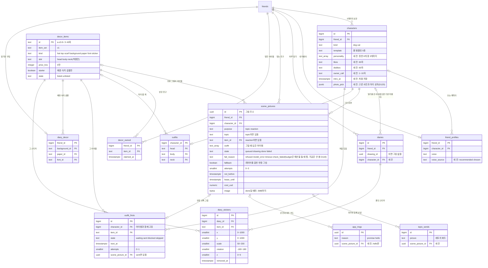

# 마롱이 통합 앱의 반려동물 캐릭터: DB 표

상태: 초안(2026-11-21 KST, Claude, corthex 한 번에 초안). 마이그레이션은 파일로만 있고 서버 DB에는 적용하지 않았어요. 적용은 10 단계 체크포인트와 구현 뒤의 서버 반영 작업이에요.
원본: [`marong/migrations/022_pet_app.sql`](../../marong/migrations/022_pet_app.sql). 이 그림은 그 파일에서 손으로 옮긴 것이고, 다르면 SQL이 맞아요.
입력: [기능 명세](../04-functional-spec/pet-app.md) SPEC-406\~427, [도메인](../01-domain/pet-app.md) CTX-030·031, TERM-210\~218.
사람 보기: 다른 05 문서처럼 GitHub의 Mermaid 그림과 NEXUS로 봐요(`.corthex/project.json` 05-erd 메모).
API 계약: [`api/pet-app.openapi.yaml`](../../api/pet-app.openapi.yaml) API-250\~266.
번호: 021은 같은 때 설계 중인 사용량 한도 작업 몫으로 비워 두고 이 파일은 022예요. 022는 021에 기대지 않아요.

## 1. 바뀌는 것

스키마 `marong`에 새 표 7개(TBL-175\~181)를 더하고, 있는 표 5개(`characters`, `friend_profiles`, `diaries`, `topic_sends`, `app_rings`)에 칸을 더해요. 지우거나 이름을 바꾸는 표·칸은 없어요(5절).

| TBL | 표 | 하는 일 | 명세 |
| --- | --- | --- | --- |
| TBL-175 | `marong.decor_items` | 관리자가 상점에 한 번이라도 올린 아이템마다 한 줄. id(아이템 목록 폴더의 id), 세트(`v1`), 종류 7가지, 착용 자리(모자 `head`, 옷 `body`, 목도리 `neck`), 값(지금은 0원만 허락), 처음 아이템 표시, 상태(`listed`·`unlisted`)와 시각. 그림 파일과 라이선스 대장은 저장소 폴더 `marong/decor/v1/`에 있어요 | SPEC-417, 418, 425, 426 |
| TBL-176 | `marong.scene_pictures` | 그림 화두나 첫 착용 반응으로 그린 장면 그림 한 장에 한 줄. 친구, 캐릭터, 용도(`topic`·`reaction`), 그린 화두나 아이템, 그때의 차림, 상태(`queued`→`drawing`→`done`·`failed`)와 실패 까닭, 겹친 그림 표시, 시도 수, 그리기 시작 시각(선 전화는 화두 30분 전), 임대 시각, 모델·지시 버전, 비용, 그림 바이트. id(uuid)가 그림 주소예요. 일기 장면 그림은 지금 일기 그림 표(TBL-108)에 있어요 | SPEC-410, 411, 414\~416, 422 |
| TBL-177 | `marong.decor_owned` | 친구가 상점에서 받은 아이템. 친구와 아이템마다 한 줄이라 두 번 받아도 줄이 그대로예요. 처음 아이템은 줄 없이 모두가 가진 것으로 봐요 | SPEC-418, 419 |
| TBL-178 | `marong.outfits` | 반려동물 캐릭터마다 차림 한 줄. 머리·몸·목 자리마다 아이템 하나 | SPEC-420, 421 |
| TBL-179 | `marong.outfit_firsts` | 캐릭터가 아이템을 처음 입은 기록과 반응 선톡 하나. 상태(`waiting`→`sent`·`blocked`·`skipped`), 보낼 시각, 막힌 횟수, 보낸 장면 그림. 캐릭터와 아이템마다 한 줄이라 두 번째 착용에는 반응이 없어요 | SPEC-420, 422 |
| TBL-180 | `marong.diary_decor` | 친구마다 일기장 배경·속지·글꼴 하나씩. 줄이 없으면 처음 아이템 셋(지금 일기장 모습) | SPEC-423 |
| TBL-181 | `marong.diary_stickers` | 일기 한 장에 붙인 스티커 한 개에 한 줄. 자리(카드 기준 천분율), 크기(%), 기울기(도), 겹치는 순서, 뗀 시각. 살아 있는 줄은 한 장에 10개까지 | SPEC-424 |

있는 표에 더하는 칸:

| 표 | 더하는 칸 | 하는 일 | 명세 |
| --- | --- | --- | --- |
| `characters`(TBL-169) | `personality`(글 배열 3개까지, 정한 8개 중), `likes`·`dislikes`(60자), `owner_call`(1\~10자), `intro_at` | 아이 소개(TERM-179의 일부). 처음 저장한 때가 `intro_at` | SPEC-409, 406 |
| `characters`(TBL-169) | `photo_pick`(JSON `{photo, box}`) | 특징표 작업이 고른 사진과 그 안의 아이 상자. 정면 그림 때 잘라 쓰고 시트가 끝나면 사진과 함께 비워요(D120) | SPEC-428 |
| `friend_profiles`(TBL-167) | `voice_source`(`recommended`·`chosen`) | 추천 목소리(TERM-217)인지 친구가 고른 목소리인지. 지금 목소리가 있는 줄은 `chosen`으로 채워요 | SPEC-407 |
| `diaries`(TBL-105) | `character_id` | 그 날 일기를 쓴 반려동물 캐릭터. 비면 기본 마롱이 | SPEC-408, 413 |
| `topic_sends`(TBL-125) | `scene_picture_id` | 그 화두와 함께 보낸 장면 그림 | SPEC-411 |
| `app_rings`(TBL-102) | `scene_picture_id` | 선 전화 벨이 통화 화면 화두 카드에 보일 장면 그림. `hello` 벨만 가질 수 있어요 | SPEC-411 |

표가 없는 용어: 참조 이미지(TERM-211)는 지금 `character_images`의 `front`와 표정 줄이에요. 차림(TERM-218)은 `outfits` 줄이고, 첫 착용 반응은 `outfit_firsts`예요. 아이 1인칭 캐릭터 구간은 코드가 `characters`와 `friend_profiles`로 그때그때 만들어요(통합 앱의 TERM-180과 같음). 아이템 그림·글꼴 파일과 라이선스 대장은 저장소 폴더예요.

## 2. 그림

새 표 7개와 칸이 늘어나는 표, 모두가 기대는 `friends`예요. 있는 표는 이 일에 쓰는 칸만 그렸어요.

## 3. 규칙을 DB가 지키는 곳

| 규칙 | 지키는 것 | 명세 |
| --- | --- | --- |
| 성격은 정한 8개 중 3개까지, 좋아하는 것·싫어하는 것 60자, 부르는 말 1\~10자, 소개를 저장했으면 부르는 말이 있음 | `characters_intro_check` | SPEC-409 |
| 고른 사진은 `photo_1`\~`photo_3` 가운데 하나이고 상자는 숫자 4개 자리 | `characters_photo_pick_check` | SPEC-428 |
| 추천 목소리 표시는 목소리가 있을 때만 | `friend_profiles_voice_source_check` | SPEC-407 |
| 아이템 값은 0원만 | `decor_items.price_krw` CHECK | SPEC-417, D113 |
| 착용 자리는 종류를 따름(모자=머리, 옷=몸, 목도리=목), 다른 종류는 자리 없음 | `decor_items` CHECK 두 개 | SPEC-417 |
| 처음 아이템은 일기장 배경·속지·글꼴만 | `decor_items` CHECK | SPEC-426 |
| 내린 아이템은 내린 시각이 있음 | `decor_items` CHECK | SPEC-417 |
| 같은 아이템을 두 번 받아도 한 줄 | `decor_owned` 기본 키 | SPEC-418 |
| 화두 장면은 화두가, 반응 장면은 아이템이 있음 | `scene_pictures` CHECK 두 개 | SPEC-411, 422 |
| 그림은 `done`일 때만 있고, 형식·가로·세로가 그림과 같이 있음. 5MB까지 | `scene_pictures` CHECK | SPEC-410, 416 |
| 실패에는 까닭이, 끝난 줄에는 끝난 시각이, 그리는 줄에는 임대 시각이 있음 | `scene_pictures` CHECK 세 개 | SPEC-410 |
| 겹친 반응 그림은 반응·`done`·비용 0 | `scene_pictures` CHECK | SPEC-422 |
| 장면 그림을 가진 벨은 선 전화뿐 | `app_rings_scene_hello` | SPEC-411 |
| 캐릭터와 아이템마다 첫 착용은 한 번, 보낸 반응에는 그림이 있음 | `outfit_firsts` 고유와 CHECK | SPEC-420, 422 |
| 스티커 자리·크기·기울기·순서 범위 | `diary_stickers` CHECK | SPEC-424 |

DB가 지키지 않고 앱이 지키는 것: 차림의 아이템이 보관함에 있고 자리가 맞는지(SPEC-420), 일기장 꾸밈의 칸마다 종류가 맞는지(SPEC-423), 한 장의 살아 있는 스티커 10개(그 일기 줄을 잠그고 세요, SPEC-424), 그림 월 예산(SPEC-414), 내린 아이템의 새 받기 막기(SPEC-418).

## 4. 질문 A가 바꿀 곳

기본 마롱이도 입는다면(질문 A) `outfits`의 기본 키가 캐릭터라서 기본 마롱이 줄을 둘 곳이 없어요. 그때는 새 마이그레이션에서 `outfits`에 `friend_id`를 더하고 '캐릭터나 친구 하나' 규칙을 두거나, 기본 마롱이 차림 표를 따로 둬요(명세 3.10). 답이 오기 전에는 만들지 않아요.

## 5. 지우는 것이 없어요

- 022에는 표·칸을 지우거나 이름을 바꾸는 문장이 없고 줄을 지우는 문장도 없어요. `DROP CONSTRAINT IF EXISTS`는 다시 적용할 때 같은 CHECK를 새로 걸기 위한 것뿐이에요.
- 그래서 지금 코드(`main` `ad9f2f4`)는 022를 적용한 DB에서 그대로 돌아요. 새 표와 새 칸을 읽지 않고, 더한 CHECK는 새 칸에만 걸려요. 되돌릴 때는 코드만 되돌리고 표는 남겨 둬요.
- 새 표에도 지우기 권한이 없어요. 내린 아이템, 끝난 반응, 뗀 스티커는 줄이 남고 시각이나 상태만 바뀌어요. 쓰지 못한 장면 그림도 비용 기록으로 남아요.

## 6. 권한

| 계정 | 022가 주는 것 |
| --- | --- |
| `marong`(앱 서버) | 새 표 7개의 읽기·넣기·고치기. 있는 표의 새 칸은 이미 가진 표 권한을 따라요 |
| `marong_call`(통화 서버) | `app_rings.scene_picture_id` 읽기(선 전화의 화두 카드에 그림 주소를 넣으려고). `characters`·`friend_profiles`는 020에서 받은 표 읽기 권한으로 아이 소개와 목소리를 읽어요. 장면 그림 바이트는 읽지 못해요 |

## 7. 검사

- 임시 Postgres 16(`pgserver`, 임시 폴더, 합성 행만)에서 돌려 봤어요(2026-11-21, D120을 넣은 뒤 다시 돌림). 저장소의 `tests/pg.py` 순서대로 `schema.sql`, 통화 스키마, 통화 002\~007, 010\~019, 020과 통화 008, 021과 통화 009·010 뒤에 022를 두 번 적용해 통과했어요. 022 전에 목소리를 고른 프로필은 `voice_source`가 `chosen`으로 채워졌어요. 앱 서버 계정으로 새 표 7개의 읽기·넣기·고치기가 되고 지우기는 안 되는 것, 통화 서버 계정이 `app_rings.scene_picture_id`, `characters.personality`, `friend_profiles.voice_source`는 읽고 새 표 7개는 하나도 읽지 못하는 것을 확인했어요. 3절 규칙이 거절해야 할 넣기·고치기·지우기 21가지가 모두 거절됐어요(성격 목록 밖·4개, 부르는 말 없이 소개, 61자, 사진 고르기의 사진 이름 틀림·상자 3칸·객체 아님, 자리 틀림, 자리 없는 옷, 100원, 처음 스티커, 시각 없이 내리기, 화두 없는 화두 장면, 화두 있는 반응 장면, 그림 없이 `done`, 임대 없이 `drawing`, 비용 있는 겹친 그림, 같은 첫 착용, 그림 없이 `sent`, 목소리 없이 추천 표시, 지우기). 이 확인 스크립트는 저장소에 넣지 않았어요. 같은 확인을 시험 코드로 만드는 것은 10 단계 TASK-420·TC-510\~512예요.
- 지금 목소리가 있는 `friend_profiles` 줄을 `chosen`으로 채우는 백필은 빈 DB에서만 돌렸어요. 채울 줄 수는 서버에서 세지 않았어요 [확인 안 함].
- 운영 DB에는 적용하지 않았어요.
- 명세의 저장하는 데이터가 표와 칸에 있어요: 아이 소개(SPEC-409), 추천 목소리(SPEC-407), 일기를 쓴 아이(SPEC-408, 413), 장면 그림(SPEC-410, 411, 414\~416), 아이템(SPEC-417, 418, 425, 426), 보관함(SPEC-419), 차림(SPEC-420, 421), 반응(SPEC-422), 일기장 꾸밈(SPEC-423), 스티커(SPEC-424). SPEC-406, 412, 427은 새로 저장하는 값이 없어요(SPEC-409는 쓰지 않은 번호).
