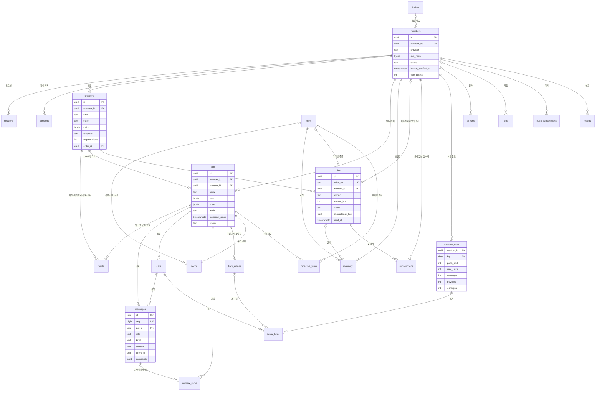

# 마롱이 반려동물 서비스: DB 표

상태: 초안(2026-11-17 15시대 KST, Claude, corthex 0.12.1). 스키마 동결 전이에요. 01 질문 1\~3과 02 질문 A\~D가 추천안과 다르면 3절의 표가 바뀌어요.
원본: [`marong/pet/schema.sql`](../../marong/pet/schema.sql). 이 그림은 그 파일에서 손으로 옮긴 것이고, 다르면 SQL이 맞아요.
입력: [기능 명세](../04-functional-spec/pet.md) SPEC-310\~369와 3절, [도메인](../01-domain/pet.md) CTX-022\~025·TERM-101\~148.
사람 보기: 다른 05 문서처럼 GitHub의 Mermaid 그림으로 봐요(`.corthex/project.json` 05-erd 메모).

## 1. 바뀌는 것

새 DB `marong_pet`의 스키마 `pet`에 표 24개(TBL-140\~163)를 만들어요. 지금 마롱이 DB(`marong`)와 그 표는 바꾸지 않아요(REQ-418). 마이그레이션은 `schema.sql` 하나가 첫 번이고, 뒤 바뀜은 `marong/pet/migrations/NNN_<이름>.sql`로 더해요. TBL 범위는 05 단계에서 140\~159에 160\~169를 더했어요(160\~163 씀).

| TBL | 표 | 하는 일 | 명세 |
| --- | --- | --- | --- |
| TBL-140 | `pet.members` | 회원. 회원 번호(8자), 로그인 공급자, OIDC `sub`의 HMAC, 상태(`active`·`minor_locked`·`deleting`), 성인 자기 확인 시각, 본인인증 시각과 CI의 HMAC, 무료 만들기권 수. 생년월일·이름·전화번호·이메일은 없어요 | SPEC-310, 311, 313, 314, 346, 361 |
| TBL-141 | `pet.sessions` | 세션. 쿠키 값의 SHA-256, 가입 대기(30분)와 회원(30일, 처음부터 90일) | SPEC-310, 311, 314 |
| TBL-142 | `pet.consents` | 동의 기록. 바꿀 때마다 줄을 더하고 고치지 않아요(서비스 계정에 UPDATE 없음) | SPEC-311, 312 |
| TBL-143 | `pet.invites` | 초대 코드의 해시와 남은 사용 수 | SPEC-311, 368 |
| TBL-144 | `pet.media` | 회원 그림 파일의 목록: 처리한 사진, 미리 보기, 후보, 캐릭터 시트, 새 그림, 작별 그림, 내보내기 zip. 파일은 데이터 폴더에 두고 줄이 누가 볼 수 있는지와 지울 때를 가져요. 배경·아이템 레이어·글꼴·템플릿은 정적 파일이라 줄이 없어요 | SPEC-316\~324, 336, 340, 342, 364 |
| TBL-145 | `pet.creations` | 캐릭터 만들기. 상태(명세 3.2), 특징표, 몸 템플릿, 가린 얼굴 수, 미리 보기, 다시 만들기 수(2까지), 고른 후보, 주문, 실패 이유, 30일 만료 | SPEC-316\~326 |
| TBL-146 | `pet.pets` | 반려동물 캐릭터. 이름, 아이 소개, 종, 몸 템플릿, 캐릭터 시트(정면 + 표정 6장의 그림 id), 모드와 추억 모드로 바꾼 때, 보관 | SPEC-324, 325, 331, 338, 339, 341 |
| TBL-147 | `pet.messages` | 아이 대화: 회원 말, 아이 말(첫 인사·선톡·아이템 반응), 안내(`reply_failed`·`crisis_notice`), 통화 자막. 합성 그림은 파일이 아니라 지정(배경·표정·착용)으로 둬요 | SPEC-325, 327, 328, 330, 332, 333, 335, 344 |
| TBL-148 | `pet.calls` | 통화. 일회용 토큰의 해시, 연결·끝 시각, 쓴 분, 한도를 넘어 물리지 않은 분, 끝난 이유 | SPEC-344, 345 |
| TBL-149 | `pet.memory_items` | 아이의 기억 항목. 친구 마롱이의 기억 항목(TBL-123)을 (회원, 아이)로 옮긴 것이고 열린 고리(TBL-124)는 종류 `open_loop`로 합쳤어요 | SPEC-329 |
| TBL-150 | `pet.diary_entries` | 아이 시점 그림일기 하루 한 장과 작별 장 하나. 글, 합성 지정, 새 그림, 다시 그리기 수(2까지), 스티커(10개까지) | SPEC-335, 336, 340, 342, 343, 351 |
| TBL-151 | `pet.items` | 상점 아이템. 종류(착용·스티커 팩·테마·글꼴·테마 패키지), 자리, 값, 기본·판매·한정, 판매 기간, 라이선스 대장 키, 태그, 패키지 안 아이템, 정적 파일 이름 | SPEC-346, 347, 348, 352 |
| TBL-152 | `pet.inventory` | 보관함. 받은 곳(무료 기본·주문·패키지), 철회로 뺀 때 | SPEC-346, 349\~351, 357, 360 |
| TBL-153 | `pet.orders` | 주문. 주문 번호, 상품, 원화 총액과 부가세, 철회 규칙 버전, 상태, 멱등 키, 결제 대행 거래 번호, 처음 쓴 때(철회 끝). 계정을 지워도 회원 없이 5년 남아요 | SPEC-321, 355\~360, 314 |
| TBL-154 | `pet.decor` | 아이마다 꾸밈 상태: 머리·몸·목 착용, 일기장 테마, 글꼴 | SPEC-333, 334, 349, 350 |
| TBL-155 | `pet.subscriptions` | 구독. 상태, 암호화한 빌링 키, 값, 기간, 다음 결제, 값 변경 동의 | SPEC-353, 357, 359, 360 |
| TBL-156 | `pet.member_days` | 회원의 하루(04:00 KST 경계): 한도 100·200, 쓴 단위, 채운 단위, 메시지 수(300까지), 미리 보기 수(3까지), 충전권 수(3까지), 휴식 권유·충전 안내를 한 때 | SPEC-320, 328, 353, 354, 357, 358 |
| TBL-157 | `pet.quota_holds` | 한도 잡기: 단위, 목적(통화 1분·새 그림), 잡음 → 확정·돌려줌. 10분 넘은 잡음은 돌려줘요 | SPEC-336, 344, 345, 353 |
| TBL-158 | `pet.ai_runs` | 모델 부르기와 통화 1분마다 한 줄: AI 항목, 원가 종류, 모델, 지시문·단가표 버전, 토큰·그림 수, 걸린 시간, 결과, 멈춘 이유, 대체 이유, 추정 원가. 글·사진·지시문 원문은 없어요 | SPEC-318\~363, 367 |
| TBL-159 | `pet.reports` | 신고. 대상, 이유 6종, 메모(200자), 신고 때 아이 말 사본, 처리 상태 | SPEC-315 |
| TBL-160 | `pet.jobs` | 작업 큐(`run_pet.py`)와 걸린 시간 기록(SPEC-369). 줄에는 id만 둬요 | SPEC-314, 318\~324, 327, 333, 335, 336, 340, 342, 357, 359, 369 |
| TBL-161 | `pet.push_subscriptions` | 웹 푸시 구독(기기마다). 404·410이면 지워요 | SPEC-337 |
| TBL-162 | `pet.proactive_turns` | 선톡 결과(친구 마롱이 TBL-121을 (회원, 아이)로). 아이템 반응 선톡은 (아이, 아이템)마다 한 줄 | SPEC-332, 333, 338 |
| TBL-163 | `pet.settings` | 운영 설정: 결제 켜짐, 사업자 정보(Git에 넣지 않음), 월 예산 알림을 보낸 달 | SPEC-362, 363, 368 |

표가 없는 용어: TERM-104(무지개다리, 말), TERM-122(확률형 아이템, 팔지 않음), TERM-131(워터마크, 내보낸 파일에 그림), TERM-139(광고성 푸시 동의, 1차에 없음), TERM-144(배경 세트, `design/pet/backgrounds` 정적 그림), TERM-147(공개 서비스, 배치).

## 2. 그림

## 3. 규칙을 DB가 지키는 곳

| 규칙(명세) | DB에서 |
| --- | --- |
| OIDC 계정 하나에 회원 하나(SPEC-310). 지운 회원의 `sub`로 다시 오면 새 가입 | `members_login` 고유 색인(`sub_hash`가 있을 때만), 지우기 시작 때 `sub_hash`를 비움 |
| 생년월일·이름·전화번호를 두지 않음(SPEC-311, 313) | 그런 열이 없음. 성인 확인은 시각, 본인인증은 CI의 HMAC만 |
| 동의는 덮어쓰지 않음(SPEC-311) | 서비스 계정에서 `consents` UPDATE 권한을 뺌 |
| 하루 한도를 넘지 않음, 동시 요청도(SPEC-353) | `used_units ≤ quota_limit` CHECK, 잡기는 `UPDATE … WHERE used_units + n <= quota_limit` 한 문장(빈 DB 시험: 남은 40에 40 두 번이면 두 번째는 0줄) |
| 메시지 300, 미리 보기 3, 충전권 3(SPEC-328, 320, 358) | `member_days`의 CHECK(빈 DB 시험: 301은 거절) |
| 다시 만들기 2, 다시 그리기 2, 스티커 10(SPEC-323, 336, 351) | `creations`·`diary_entries`의 CHECK |
| 작별 의식 한 번(SPEC-340), 그림일기 하루 한 장 | `diary_one_farewell`, `diary_one_day` 고유 색인 |
| 통화는 회원마다 하나(SPEC-344) | `calls_one_open` 고유 색인 |
| 같은 멱등 키는 주문 하나(SPEC-355), 결제 대행 거래 하나에 주문 하나 | `orders_idempotent`, `orders_pg_tx` 고유 색인 |
| 아이템을 한 번만 가짐(SPEC-346, 355) | `inventory_once` 고유 색인(철회하지 않은 것) |
| 살아 있는 구독은 하나(SPEC-359) | `subscriptions_one` 고유 색인 |
| 아이템 반응 선톡은 (아이, 아이템)마다 한 번(SPEC-333) | `proactive_item_once` 고유 색인 |
| 신고는 같은 대상에 하나(SPEC-315) | `reports_once` 고유 색인 |
| 그리기는 만들기마다 하나(`busy`, SPEC-323) | `jobs_one_drawing` 고유 색인 |
| 추억 모드만 보관(SPEC-341), 글꼴은 단독 판매 없음(REQ-395), 끝난 한정 아이템은 다시 열지 않음 | `pets`·`items`의 CHECK, `ended_at`(다시 열기는 운영 도구가 거절) |
| 계정 지우기: 회원 것은 지우고 주문은 회원 없이 5년(SPEC-314) | 회원에서 내려가는 FK는 `ON DELETE CASCADE`, 주문은 `SET NULL`(빈 DB 시험: 회원 지움 → 아이·메시지·그림 0줄, 주문 1줄은 회원·만들기 없이 남음) |

DB가 지키지 않고 서비스가 지키는 것: 아이 5마리와 진행 중 만들기 3개(회원 키의 `pg_advisory_xact_lock` 안에서 셈), 아이템 자리 맞음(`wrong_slot`), 기억 항목의 근거가 회원 말인지(SPEC-329), 아이를 지울 때 그 만들기 줄도 지우기(SPEC-341).

## 4. 검사

- 빈 Postgres 16(이 작업 환경의 `/usr/lib/postgresql/16`, 임시 클러스터)에서 `schema.sql`을 두 번 돌려 둘 다 통과, 표 24개(2026-11-17).
- 같은 DB에서 3절의 세 시험(한도 동시 잡기, 메시지 301, 회원 지우기)을 돌려 기대대로였어요. 이 시험은 GPT의 12 단계 시험(TC)으로 옮겨요.
- 명세의 데이터가 모두 표와 열에 있어요: SPEC-310\~369를 한 줄씩 보며 1절 '명세' 열에 적었어요. SPEC-334(합성 그림), 348(미리 입혀 보기)은 저장이 없고 SPEC-347(상점 목록)은 `items`를 읽기만 해요.
- 표마다 기본 키와 TBL ID가 있고 쓰이지 않는 표가 없어요.
- ERD 도구 내보내기는 없어요(이 프로젝트는 SQL이 원본, 05-erd 메모).

## 5. 질문과 메모

- 통화 자막: 그림일기 하루 모음(SPEC-335)에 통화 자막이 들어가서 `messages`에 `kind = call`로 두었어요. 통화 서버가 끝날 때 내부 API로 자막을 넘겨요(06 단계에서 통화 끝 `POST /internal/calls/{id}/end`(API-209)의 `transcript`로 정함).
- 빌링 키: 결제 대행이 주는 빌링 키를 서버 키로 암호화해 둬요. 결제 대행이 회원 키만으로 결제할 수 있는 방식이면 그 키만 두도록 바꿔요 [확인 필요: 결제 대행 선택 뒤].
- 파일 저장: 그림은 서버 데이터 폴더(`/var/lib/marong-pet/media/`)에 두고 백업에 넣어요. 오브젝트 저장소는 1차에 쓰지 않아요 [추정: 회원 수가 늘면 다시 봄].
