# 마롱이 통합 앱(MVP): DB 표

상태: 초안(2026-11-19 KST, Claude). 설계 제안 [unified-app.md](../unified-app.md)는 D104(2026-11-19 10:15 KST, 설계 스레드, 동희님 '승인')로 승인됐어요. 마이그레이션은 파일로만 있고 서버 DB에는 적용하지 않았어요. 적용은 구현 승인 뒤 단계예요.
원본: [`marong/migrations/020_unified.sql`](../../marong/migrations/020_unified.sql)과 [`marong/call/migrations/008_unified.sql`](../../marong/call/migrations/008_unified.sql). 이 그림은 그 파일에서 손으로 옮긴 것이고, 다르면 SQL이 맞아요.
입력: [기능 명세](../04-functional-spec/unified.md) SPEC-370\~396, [도메인](../01-domain/unified.md) CTX-026\~029·TERM-173\~198, 설계 제안 8절.
사람 보기: 다른 05 문서처럼 GitHub의 Mermaid 그림으로 봐요(`.corthex/project.json` 05-erd 메모).
API 계약: [`api/unified.openapi.yaml`](../../api/unified.openapi.yaml) API-211\~242.

## 1. 바뀌는 것

지금 마롱이 DB(`marong`)의 스키마 `marong`에 새 표 9개(TBL-164\~172)를 더하고, 있는 표 2개(`rooms`, `friendships`)에 칸을 더해요. 새 DB나 새 스키마를 만들지 않아요(D90). 통화 쪽 008은 표를 바꾸지 않고 권한만 더해요. 지우거나 이름을 바꾸는 표·칸은 없어요(6절).

| TBL | 표 | 하는 일 | 명세 |
| --- | --- | --- | --- |
| TBL-164 | `marong.invites` | 초대 링크 하나에 한 줄. 토큰의 SHA-256, 종류(`join` 새 가입, `link` 기존 친구 행 연결, `relogin` 다시 로그인), `link`·`relogin`의 대상 친구, 동희님 메모(40자), 기한(만든 때 + 7일), 쓴 때와 쓴 친구, 거둔 때. 토큰 원문은 없어요 | SPEC-370, 373, 395 |
| TBL-165 | `marong.app_sessions` | 기기 로그인 하나에 한 줄. 쿠키 토큰의 SHA-256, 시작 방법(`invite`·`code`), 기기 종류를 줄인 글(40자), 마지막으로 쓴 때, 기한(마지막으로 쓴 때 + 90일), 끊은 때. 앱 서버와 통화 서버가 같이 읽어요 | SPEC-371, 372, 374, 395 |
| TBL-166 | `marong.device_codes` | 기기 추가 코드(6자리, 10분, 한 번). 코드는 서버 비밀 값으로 만든 HMAC-SHA-256만 둬요(6자리라 SHA-256만으로는 되짚을 수 있어서요). 쓴 때 | SPEC-372 |
| TBL-167 | `marong.friend_profiles` | 초대 링크로 들어온 친구마다 한 줄. 마롱이 이름(기본 '마롱이', 1\~12자), 쓰는 캐릭터(비어 있으면 기본 마롱이), 통화 목소리(비어 있으면 기본 목소리), 친구 코드(6자, 고유), 티켓 잔액. 가입이나 연결 때 만들고, 줄이 없는 친구는 기본값으로 읽어요 | SPEC-373, 377, 379, 381, 385, 394 |
| TBL-168 | `marong.contact_settings` | 친구마다 먼저 말 걸기 설정과 상태. `discord_dm_links`가 들고 있던 칸(허락한 때, 하루 횟수, 시작·끝 시각, 마지막 받은 때·칸·시도, 실패 수)을 디스코드 id 없이 옮긴 표예요 | SPEC-373, 383 |
| TBL-169 | `marong.characters` | 친구가 사진으로 만든 캐릭터. 종류(강아지·고양이), 몸 템플릿 5종, 이름(1\~12자), 특징표(jsonb), 말투 한 줄(60자), 만들기 단계(`photos`→`traits`→`preview`→`candidates`→`sheet`→`name`→`done`), 상태(`draft`·`ready`·`retired`), 남은 후보 다시 만들기(0\~2) | SPEC-378, 379, 380 |
| TBL-170 | `marong.character_images` | 캐릭터의 그림 파일 한 장에 한 줄. 자리(올린 사진 3, 미리 보기, 후보 4, 정면과 표정 6), 캐릭터 폴더 아래 상대 경로, 크기, 지운 때. 파일은 DB 밖(`MARONG_CHARACTER_DIR`)에 있어요 | SPEC-378, 379 |
| TBL-171 | `marong.character_jobs` | 만들기 작업 하나(특징 읽기, 미리 보기, 후보, 표정). 상태(`queued`·`running`·`done`·`failed`), 시도 수(0\~3), 실패 코드, 든 비용(달러). 모델의 글은 없고 코드만 둬요. 비용의 달 합이 그림 예산이에요 | SPEC-378, 380 |
| TBL-172 | `marong.usage_daily` | 친구·사용일마다 한 줄. 글 답 수, 통화 초, 그림 수, 검색 수, 쇼핑 읽기 수, 사용 단위, 쓴 티켓. 숫자만 있고 글은 없어요. 하루는 한국 시각 04:00에 바뀌어요 | SPEC-394, 390 |

표가 없는 용어: 관리자 화면(TERM-176)은 화면이고, 캐릭터 구간(TERM-180)은 코드가 프로필과 캐릭터 값으로 그때그때 만들어요. 입혀 보기(TERM-181)는 저장하지 않는 응답이에요. 적용(TERM-182)과 기본 마롱이(TERM-186)는 `friend_profiles.character_id`의 값(비어 있으면 기본)이고, 목소리 견본(TERM-184)은 미리 만든 소리 파일이에요. 친구 요청(TERM-188)과 가까운 사이 바람(TERM-189)은 `friendships`의 새 칸, 방 주인(TERM-193)은 `rooms`의 새 칸이에요(3절). 앱 서버·턴 계획·사전 조회·도구 대기 소리·작업 루프(TERM-194\~198)는 저장하는 값이 없어요.

## 2. 그림

새 표 9개와, 칸이 늘어나는 `rooms`·`friendships`, 모두가 기대는 `friends`예요. 있는 표는 이 일에 쓰는 칸만 그렸어요.

```mermaid
erDiagram
  friends |o--o{ invites : "link·relogin 대상"
  friends |o--o{ invites : "쓴 친구(used_by)"
  friends ||--o{ app_sessions : "기기 로그인"
  friends ||--o{ device_codes : "기기 추가 코드"
  friends ||--o| friend_profiles : "내 마롱이"
  friends ||--o| contact_settings : "먼저 말 걸기 설정"
  friends ||--o{ characters : "3개까지 보관"
  characters ||--o{ character_images : "사진·미리 보기·후보·표정"
  characters ||--o{ character_jobs : "만들기 작업"
  characters |o--o{ friend_profiles : "쓰는 캐릭터(없으면 기본 마롱이)"
  friends ||--o{ usage_daily : "하루 사용량"
  friends |o--o{ rooms : "방 주인(1대1 방만)"
  friends ||--o{ friendships : "friend_a·friend_b"
  friends |o--o{ friendships : "요청한 친구(requested_by)"

  friends {
    bigint id PK
    text name
    boolean share "공유 켬·끔(이제 본인이 바꿈)"
  }
  invites {
    bigint id PK
    bytea token_hash UK "SHA-256, 32바이트"
    text kind "join·link·relogin"
    bigint friend_id FK "join이면 비움"
    text note "동희님 메모 40자"
    timestamptz expires_at "만든 때 + 7일"
    timestamptz used_at
    bigint used_by FK
    timestamptz revoked_at
  }
  app_sessions {
    bigint id PK
    bigint friend_id FK
    bytea token_hash UK "SHA-256, 32바이트"
    text method "invite·code"
    text label "기기 종류 40자"
    timestamptz last_seen_at
    timestamptz expires_at "마지막으로 쓴 때 + 90일"
    timestamptz revoked_at
  }
  device_codes {
    bigint id PK
    bigint friend_id FK
    bytea code_hash "HMAC-SHA-256, 안 쓴 것끼리 고유"
    timestamptz expires_at "만든 때 + 10분"
    timestamptz used_at
  }
  friend_profiles {
    bigint friend_id PK, FK
    text bot_name "기본 마롱이, 1~12자"
    bigint character_id FK "비면 기본 마롱이"
    text voice "비면 기본 목소리"
    text friend_code UK "6자"
    integer tickets "0 이상"
  }
  contact_settings {
    bigint friend_id PK, FK
    timestamptz opted_in_at
    timestamptz proactive_moved_at
    smallint per_day "1~48"
    smallint start_hour "0~23"
    smallint end_hour "시작보다 크고 24까지"
    timestamptz last_incoming_at
    timestamptz last_slot
    timestamptz last_attempt_at
    smallint failures "0~2"
  }
  characters {
    bigint id PK
    bigint friend_id FK
    text kind "dog·cat"
    text template "몸 템플릿 5종"
    text name "1~12자"
    jsonb traits "특징표"
    text tone "말투 60자"
    text stage "photos부터 done까지"
    text status "draft·ready·retired"
    smallint regen_left "0~2"
    timestamptz ready_at
    timestamptz retired_at
  }
  character_images {
    bigint id PK
    bigint character_id FK
    text slot "자리 15가지"
    text path "캐릭터 폴더 아래 상대 경로"
    integer width
    integer height
    integer bytes
    timestamptz removed_at
  }
  character_jobs {
    bigint id PK
    bigint character_id FK
    text step "traits·preview·candidates·sheet"
    text state "queued·running·done·failed"
    smallint attempts "0~3"
    text error "실패 코드"
    numeric cost_usd "그림 예산에 더함"
    timestamptz finished_at
  }
  usage_daily {
    bigint friend_id PK, FK
    date day PK "04:00에 바뀌는 사용일"
    integer chat_turns
    integer call_seconds
    integer images
    integer searches
    integer shop_reads
    integer units
    integer tickets_used
  }
  rooms {
    text room_key PK
    boolean is_channel
    bigint owner_friend_id FK "새 칸. 단체방은 비움"
  }
  friendships {
    bigint friend_a PK, FK "둘 중 작은 id"
    bigint friend_b PK, FK "둘 중 큰 id"
    text label
    boolean close "읽는 값. 둘 다 켰을 때만 참"
    text state "새 칸. pending·accepted·declined·ended"
    bigint requested_by FK "새 칸"
    timestamptz responded_at "새 칸"
    boolean close_a "새 칸. friend_a의 바람"
    boolean close_b "새 칸. friend_b의 바람"
  }
```



## 3. 있는 표에 더하는 칸과 백필 세 가지

백필(backfill)은 이미 있는 줄에 새 칸의 값을 채워 넣는 일이에요. 020은 칸을 더한 뒤 같은 트랜잭션에서 세 가지를 채워요. 셋 다 다시 돌려도 결과가 같아요.

| 표 | 더하는 칸 | 뜻 |
| --- | --- | --- |
| `marong.rooms` | `owner_friend_id`(친구 id, 비울 수 있음)와 색인 `rooms_owner_idx` | 1대1 방의 주인(REQ-452). 단체방과 채널 방은 비워 둬요 |
| `marong.friendships` | `state`(기본 `accepted`), `requested_by`, `responded_at`, `close_a`, `close_b` | 친구 요청과 수락(SPEC-381). 020 전에 있던 줄은 모두 `accepted`가 돼요. `close`는 지금처럼 읽는 값으로 남고, 두 사람의 바람(`close_a`, `close_b`)이 모두 참일 때만 코드가 참으로 써요(REQ-457) |

| 백필 | 하는 일 | 다시 돌리면 |
| --- | --- | --- |
| 1. 방 주인 | `discord_dm_links`에 묶인 계정의 디스코드 DM 방과 카톡 1대1 방(옛 대화가 든 방)에 그 친구를 주인으로 적어요. 방과 대화 줄은 복사하지 않고 칸 하나만 채워요 | 주인이 비어 있는 방만 채워요 |
| 2. 먼저 말 걸기 설정 | `discord_dm_links`의 설정과 상태 칸을 `contact_settings`로 복사해요. 두 표의 범위 규칙(CHECK)이 같아서 값이 걸리지 않아요 | 이미 줄이 있는 친구는 건너뛰어요(`ON CONFLICT DO NOTHING`) |
| 3. 가까운 사이 | 동희님이 `close`로 정해 둔 사이는 두 사람의 바람을 모두 참으로 채워요. 그래서 지금 가까운 사이가 그대로 가까운 사이예요 | `close`가 참인데 바람이 다 참이 아닌 줄만 고쳐요 |

- 프로필(`friend_profiles`)은 백필하지 않아요. 가입이나 연결 때 만들어요(SPEC-373). 그 전까지 지금 계정은 기본값(이름 '마롱이', 기본 마롱이, 기본 목소리)으로 읽혀요.
- `discord_dm_links`는 그대로 남고 새 코드는 읽지 않아요(REQ-454). 020은 여기서 값을 복사만 해요.
- `friendships`를 읽는 지금 코드 두 곳(`marong/store.py`의 친구 목록, `tools/vertex_live/call_memory.py`의 통화 기억)은 상태를 보지 않아요. 친구 요청을 켜기(`MARONG_FRIENDS=1`) 전에 두 곳에 `state = 'accepted'` 조건을 넣어야 `pending`·`declined`·`ended` 줄이 아는 사이로 읽히지 않아요(SPEC-382). 설정을 켜기 전에는 그런 줄이 생기지 않아요.
- 통화 쪽 008은 앱 서버 계정(`marong`)에 `call.callers`의 읽기와 넣기 권한을 줘요. 가입 때 통화 계정 줄을 같은 트랜잭션에서 만들기 위해서예요(SPEC-373). `call.caller_logins`는 그대로 남고 로그인이 더는 읽지 않아요(REQ-436).

## 4. 사람마다 마롱이가 달라지면 조인이 복잡해지나

동희님이 걱정한 점은 '사람마다 이름·캐릭터·목소리가 따로면 표를 읽을 때마다 사람을 가려내느라 조인이 늘지 않느냐'였어요. 늘지 않아요. 이유는 셋이에요.

1. 지금 표 대부분이 이미 친구 id를 갖고 있어요. `marong/`의 SQL 파일에서 세면 020 전의 표 64개(`marong` 44, `call` 20) 가운데 34개에 `friend_id`(또는 `friend_a`) 칸이 있어요. 기억 항목, 열린 고리, 친구 약속, 일기, 일정, 선톡 결과가 모두 여기에 들어요. 이 표들은 지금처럼 `WHERE friend_id = …` 하나로 읽어요. 통화 표는 `call.callers`(친구마다 한 줄)를 한 번 거쳐요. 이것도 지금 그대로예요.
2. 친구 id 없이 방 키만 있는 표는 넷뿐이에요: `messages`, `summaries`, `notes`, `embeddings`. 이 넷은 `rooms.owner_friend_id` 하나로 걸러요. 답을 만들 때 그 사람의 방 키 목록을 먼저 한 번 읽고(SPEC-375), 네 표는 지금 쓰는 방 키 색인으로 읽어요. 네 표에 칸을 더하거나 줄을 옮기지 않아요.
3. 사람마다 다른 값(마롱이 이름, 쓰는 캐릭터, 목소리, 친구 코드, 티켓)은 `friend_profiles`의 한 줄이에요. 답이나 통화를 시작할 때 기본 키로 한 번 읽어요. 캐릭터를 바꾸는 것은 이 줄의 `character_id` 하나를 바꾸는 일이라, 대화·요약·기억 표는 건드리지 않고 그대로 이어져요(REQ-448).

```sql
-- 친구 id가 있는 표(34개): 조인 없음
SELECT kind, body FROM marong.memory_items WHERE friend_id = $1;

-- 방 키만 있는 표(4개): 방 주인을 한 번 거침
SELECT m.id, m.role, m.content
  FROM marong.messages m
  JOIN marong.rooms r ON r.room_key = m.room_key
 WHERE r.owner_friend_id = $1
 ORDER BY m.id DESC LIMIT 30;

-- 사람별 값: 기본 키로 한 줄
SELECT bot_name, character_id, voice FROM marong.friend_profiles WHERE friend_id = $1;
```

위 SQL은 모양을 보이는 예예요(칸 이름은 줄였어요). 단체방은 주인이 비어 있고 지금처럼 방 키로만 읽어요.

## 5. 규칙을 DB가 지키는 곳

| 규칙(명세) | DB에서 |
| --- | --- |
| 토큰·코드 원문을 두지 않음(REQ-435) | 해시 칸만 있고 길이 32바이트 CHECK. 기기 추가 코드는 HMAC |
| 초대 링크 하나는 한 번(SPEC-370) | `token_hash` 고유, 쓴 때와 쓴 친구는 함께만 채워짐(CHECK). `join`만 대상 친구가 비어 있음(CHECK) |
| 살아 있는 기기 추가 코드는 겹치지 않음(SPEC-372) | `device_codes_live_idx` 고유 색인(안 쓴 것만) |
| 친구 코드는 사람마다 하나(SPEC-381) | `friend_code` 고유, 헷갈리는 글자(I·O·0·1)를 뺀 6자 CHECK |
| 캐릭터 하나에 도는 작업은 하나(SPEC-378) | `character_jobs_open_idx` 고유 색인(`queued`·`running`) |
| 자리마다 지금 그림은 한 장(SPEC-378) | `character_images_live_idx` 고유 색인(지우지 않은 것) |
| `ready`는 다 만든 캐릭터만(SPEC-379) | `ready`이면 단계 `done`, 끝난 때, 이름·템플릿·특징표가 모두 있어야 함(CHECK) |
| 끝난 작업만 끝난 때가 있고, 실패만 실패 코드가 있음 | `character_jobs`의 CHECK 둘 |
| 사용량은 친구·사용일마다 한 줄(SPEC-394) | 기본 키 `(friend_id, day)`, 모든 숫자 0 이상 |
| 줄을 지우지 않음 | 두 서비스 계정에 DELETE 권한이 없음. 끝난 줄은 시각 칸이나 상태로 표시 |

DB가 지키지 않고 앱이 지키는 것: 캐릭터 3개까지(친구 단위 잠금 안에서 셈, REQ-446), 프로필의 캐릭터가 본인 것이고 `ready`인지, 초대 링크와 세션의 기한, `close`가 두 바람의 곱인지, 요청 중인 사이에 `requested_by`가 있는지, 하루 요청 10번, 그림 예산.

## 6. 지우는 것이 없어요

- 020과 008에는 표·칸을 지우거나 이름을 바꾸는 문장이 없고 줄을 지우는 문장도 없어요(두 파일에서 `DROP`, `RENAME`, `DELETE`, `TRUNCATE`를 찾았을 때 주석 한 줄뿐).
- 그래서 지금 코드(`main` `0953b86`)는 020을 적용한 DB에서 그대로 돌아요. 새 표와 새 칸을 읽지 않기 때문이에요. 되돌릴 때는 코드만 되돌리고 표는 남겨 둬요.
- `discord_dm_links`, `call.caller_logins`, 지금 방과 그 대화·요약·메모·임베딩은 그대로예요. 복사도 하지 않아요(REQ-453).
- 새 표에도 지우기 권한이 없어요. 쓴 초대 링크, 끊은 세션, 뺀 캐릭터, 끝난 친구 사이는 줄이 남고 시각 칸이나 상태만 바뀌어요.
- DB 밖에서 지워지는 것은 하나예요. 올린 사진 파일은 표정 그림이 끝나면 앱이 지우고 그 줄에 `removed_at`을 적어요(SPEC-378). 줄은 남아요.

## 7. 권한

| 계정 | 020·008이 주는 것 |
| --- | --- |
| `marong`(앱 서버) | 새 표 9개의 읽기·넣기·고치기. `call.callers`의 읽기·넣기(008) |
| `marong_call`(통화 서버) | `app_sessions`, `friend_profiles`, `characters`, `character_images` 읽기. `app_sessions`의 `last_seen_at`·`expires_at` 고치기(로그인 연장만, 만들거나 끊지 못함). `usage_daily` 읽기·넣기·고치기(통화 초 더하기). `friend_profiles`의 `tickets`·`updated_at` 고치기(한도를 넘은 통화의 티켓 빼기만) |

`rooms`와 `friendships`의 새 칸은 두 계정이 이미 가진 표 권한(앱 서버는 읽기·넣기·고치기, 통화 서버는 읽기)을 그대로 따라요.

## 8. 검사

- 두 SQL 파일을 줄마다 읽어 CHECK와 색인, 권한을 명세(SPEC-370\~396)와 맞춰 봤어요. 9절의 메모가 그 결과예요.
- 임시 Postgres 16.2(`pgserver`, 임시 폴더)에서 돌려 봤어요(2026-11-19, 합성 행만). `schema.sql`, 통화 스키마, 통화 002\~007, 010\~019 뒤에 020과 통화 008을 두 번 적용해 통과했고, 확인 44개가 모두 맞았어요: 방 주인·먼저 연락 설정·가까운 사이 채우기, 앱 서버 계정으로 가입 한 번에 여덟 표에 넣기, 5절의 규칙이 거절하는지(초대 종류와 대상, 친구 코드 글자, 이름 길이, `ready` 조건, 열린 작업 하나, 자리마다 그림 하나, 요청 보낸 사람), 두 계정의 권한(지우기 없음, 통화 서버는 로그인 연장과 티켓·사용량만). 운영 DB에는 적용하지 않았어요.
- 백필이 채울 줄 수는 서버에서 세지 않았어요 [확인 안 함]. 적용 전에 `discord_dm_links` 줄 수와 `close`가 참인 `friendships` 줄 수를 세어 적용 뒤와 견줘요.
- 4절의 표 수는 `marong/schema.sql`, `marong/migrations/`, `marong/call/schema.sql`, `marong/call/migrations/`의 `CREATE TABLE`과 `ADD COLUMN`을 스크립트로 세었어요(2026-11-19, `main` `0953b86` + 020·008).
- 명세의 데이터가 표와 칸에 있어요: 가입·로그인(SPEC-370\~374), 방 주인(SPEC-375), 캐릭터(SPEC-377\~380), 친구(SPEC-381, 382), 보내기 경로의 설정(SPEC-383), 목소리(SPEC-385), 사용량(SPEC-394), 관리자(SPEC-395). SPEC-376, 384, 386\~393, 396은 새로 저장하는 값이 없어요.
- 표마다 기본 키와 TBL ID가 있어요. ERD 도구 내보내기는 없어요(이 프로젝트는 SQL이 원본, 05-erd 메모).

## 9. 질문과 메모

SQL을 읽다가 본 것과 그 처리예요(2026-11-19 같은 날 SQL에 반영).

1. 권한 문장의 자리(고침): 020과 008 모두 다른 마이그레이션처럼 `marong_owner`인 채로 권한을 주게 바꿨어요.
2. 그림 예산 색인(고침): `character_jobs_month_idx`의 조건을 '끝난 때가 있음'으로 바꿔 실패한 작업이 쓴 비용도 달 합에 들어가요(SPEC-380).
3. 티켓 빼기(고침): 통화가 끝날 때 통화 서버가 사용량을 더하는 같은 트랜잭션에서 티켓을 빼요. `marong_call`에 `friend_profiles`의 `tickets`·`updated_at`만 고치는 권한을 줬어요.
4. 친구 요청 칸(고침): CHECK `friendships_request_check`를 더했어요. `pending`이면 `requested_by`가 있어야 하고, `requested_by`는 두 친구 중 하나여야 해요. 옛 줄(모두 `accepted`, 비어 있음)은 걸리지 않아요.
5. 먼저 말 걸기 설정의 복사 시점: 백필 2는 한 번 복사하고 다시 돌려도 덮어쓰지 않아요. 020을 적용한 뒤에도 작업 루프를 옮기기(`MARONG_LOOPS_HOME=app`) 전까지는 지금 봇이 `discord_dm_links`를 계속 고쳐요. 옮기는 순간에 한 번 더 맞추지 않으면 그 사이에 바뀐 허락·횟수·실패 수가 `contact_settings`에 없어요. 적용 절차에 '옮기기 직전 다시 복사'를 넣었어요([작업 목록](../10-wbs/unified.md) TASK-384).
6. 관리자 명령과 `close`: `admin friendship … close`는 남는데(설계 제안 9절) 지금 코드는 `close`만 고쳐요. 새 코드가 `close`를 두 바람에서 다시 계산하면 관리자가 정한 값과 어긋날 수 있어요. 관리자 명령도 `close_a`·`close_b`를 같이 고치게 했어요(TASK-396). 백필 3을 다시 돌리면 참으로 바뀐 쪽은 맞춰져요.
7. 읽은 특징표의 자리(고침): 따로 칸을 두지 않고 `characters.traits`·`template`에 넣어요. 단계 `traits`에서는 '모델이 읽은 값', 그 뒤로는 '친구가 정한 값'이에요. SQL 주석을 그렇게 고쳤어요.
8. 기기 추가 코드의 고유 색인은 시각을 보지 못해서, 기한이 지났지만 쓰지 않은 코드도 '살아 있는 것'으로 쳐요. 명세대로 겹치면 다시 뽑으면 되고(SPEC-372), 사람마다 남는 줄이 하나뿐이라 실제로 겹칠 일은 드물어요.
9. `characters`의 첫 CHECK(고침): 괄호를 하나 더 둬 읽기 쉽게 했어요. 뜻은 같아요(`ready`면 단계 `done`과 끝난 때가 있음). `draft`인데 단계만 `done`이고 끝난 때가 없는 줄은 DB가 막지 않지만 API에서는 생기지 않아요.
10. 꺼진 설정과 얼굴 그림(정함): 캐릭터 설정이 꺼지면 만들고 바꾸는 API만 404이고, 그림 읽기(API-242)와 프로필의 캐릭터 값(API-216)은 그대로 답해요. 이미 적용한 캐릭터의 얼굴이 보여요(명세 공통 규칙 9).
