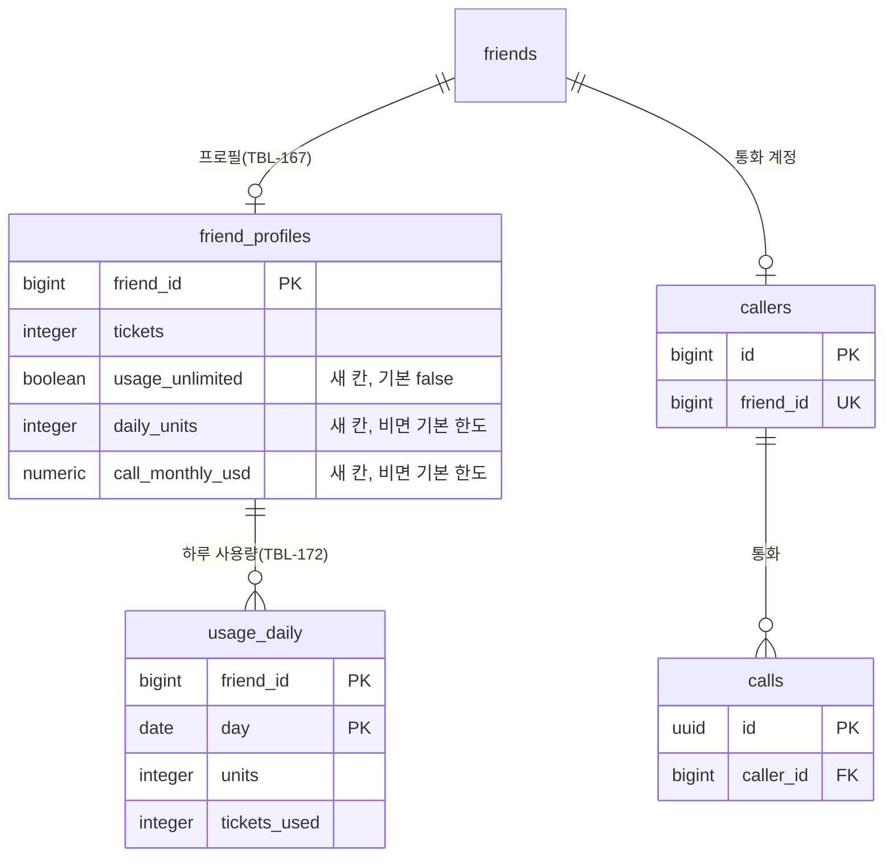

# 마롱이 사람별 사용 한도: DB 표

상태: 초안(2026-11-21 KST, Claude). 마이그레이션은 파일로만 있고 서버 DB에는 적용하지 않았어요. 적용은 GPT가 구현·반영 때 해요.
원본: [`marong/migrations/021_usage_limit.sql`](../../marong/migrations/021_usage_limit.sql)과 [`marong/call/migrations/009_usage_limit.sql`](../../marong/call/migrations/009_usage_limit.sql). 이 문서는 그 파일에서 손으로 옮긴 것이고, 다르면 SQL이 맞아요.
입력: [기능 명세](../04-functional-spec/usage-limit.md) SPEC-397\~399, [도메인](../01-domain/usage-limit.md) TERM-199\~200, 통합 앱 표 [unified.md](unified.md)의 TBL-167·172.
API 계약: [`api/unified.openapi.yaml`](../../api/unified.openapi.yaml)의 API-243과 바뀌는 API-216·234·236·240.

## 1. 바뀌는 것

새 표는 없어요. 있는 표 `marong.friend_profiles`(TBL-167)에 칸 셋과 제약 하나를 더하고, 통화 스키마에 함수 하나를 더해요. 지우거나 이름을 바꾸는 표·칸은 없어서 지금 `main`(`ad9f2f4`)의 코드가 이 마이그레이션 뒤에도 그대로 돌아요.

| 곳 | 더하는 것 | 뜻 | 명세 |
| --- | --- | --- | --- |
| TBL-167 `friend_profiles.usage_unlimited` | `boolean NOT NULL DEFAULT false` | 계정 한도(TERM-199)가 무제한인지. 칸을 처음 더하는 실행에서 그때 있던 행만 모두 참(D106). 새 행은 거짓 | SPEC-397 |
| TBL-167 `friend_profiles.daily_units` | `integer`, 1\~100,000 | 이 계정의 하루 사용 단위 한도. 비면 기본 한도 `MARONG_DAILY_UNITS`(TERM-200) | SPEC-397, 398 |
| TBL-167 `friend_profiles.call_monthly_usd` | `numeric(7,2)`, 0.01\~1,000 | 이 계정의 통화 월 달러 한도. 비면 기본 한도 `MARONG_CALL_PERSON_MONTHLY_USD`(TERM-200) | SPEC-397, 398 |
| TBL-167 제약 `friend_profiles_usage_limit_check` | 위 범위와 '무제한이면 두 숫자는 비어 있음' | 무제한인데 숫자가 남는 모순을 DB가 막아요 | SPEC-397 |
| 함수 `call.friend_month_usd(friend, start, end)` | `numeric`, `STABLE SECURITY DEFINER`, `search_path = pg_catalog, call` | 그 친구의 이번 달(UTC) 통화 비용 합. 지금 `personal_budget_blocked`의 SQL과 같은 식이에요 | SPEC-397, 399 |

계정 한도의 세 상태와 칸 값:

| 상태(API의 `mode`) | `usage_unlimited` | `daily_units` | `call_monthly_usd` |
| --- | --- | --- | --- |
| 무제한(`unlimited`) | 참 | 비움 | 비움 |
| 기본(`default`) | 거짓 | 비움 | 비움 |
| 직접(`custom`) | 거짓 | 숫자 또는 비움 | 숫자 또는 비움(둘 가운데 하나 이상은 숫자) |

`call.friend_month_usd`는 `callers.friend_id`로 그 친구의 통화 계정을 찾고, 그 계정의 `calls`에 붙은 `live_usage`·`segment_costs`·`ai_runs`의 비용을 더해요. 통화 계정이 없으면 0이에요.

## 2. 권한

| 역할 | 할 수 있는 것 | 근거 |
| --- | --- | --- |
| `marong`(앱 서버) | 새 칸 읽기·고치기(020의 표 전체 SELECT·UPDATE 그대로). 함수 실행. 통화 비용 표 직접 읽기는 여전히 못 함 | 관리자 API-243, 내 사용량 SPEC-399 |
| `marong_call`(통화 서버) | 새 칸 읽기(표 전체 SELECT 그대로). 고치기는 못 함(칸 UPDATE가 `tickets`, `updated_at`뿐). 함수 실행 | 통화 시작 전 확인 SPEC-397 |
| `PUBLIC` | 함수 실행 권한 없음 | 3.2 |

## 3. 검사(2026-11-21 KST, Claude, 버리는 pgserver DB, 합성 행만)

- 020·통화 008까지 적용한 빈 DB에 프로필 2행을 넣고 021·009 적용 → 두 행 모두 무제한. 그 뒤 넣은 행은 (거짓, 비움, 비움). 통과.
- 한 행을 '기본'으로 바꾼 뒤 021·009를 다시 적용 → 그 행이 무제한으로 돌아가지 않음. 통과.
- 무제한인데 하루 5, 하루 0·100001, 통화 0·1000.01 → 모두 제약 오류. 하루 200·통화 5는 들어감. 통과.
- `marong` 역할: 한도 칸 고치기 됨, 함수 실행 됨, `call.live_usage` 직접 읽기는 권한 오류. `marong_call` 역할: 새 칸 읽기 됨, 한도 칸 고치기는 권한 오류, 함수 실행 됨. `PUBLIC` 실행 권한 없음. 통과.
- 통화 비용 시험(TC-173)과 같은 자료(10,000·1,000 토큰, 단가 3·6)로 `call.friend_month_usd` = 0.036000. 지금 `personal_budget_blocked`가 0.036에서 막고 0.037에서 막지 않는 것과 같아요. 다른 친구는 0, 12월은 0. 통과.
- `usage_mode` 설정 없이(그래서 `live_usage` 0줄) 닫힌 2분 구간 하나 → `call.friend_month_usd` = 0.100000(분당 기본 0.05달러 어림), `personal_budget_blocked`도 0.10에서 막고 0.11에서 막지 않음. 통과. 운영 DB에 `usage_mode`가 없다는 관찰은 [기능 명세 3.2](../04-functional-spec/usage-limit.md#32-이번-달-통화-비용callfriend_month_usd)에 있어요.
- 저장소 시험 파일로는 아직 만들지 않았어요. TASK-411의 끝 조건이 이 검사들을 `tests/test_usage_limit.py`로 옮기는 거예요.

## 4. 되돌리기

칸·제약·함수를 더하기만 해서, 반영 뒤 문제가 있으면 코드만 앞 버전으로 되돌려도 돼요(앞 코드는 새 칸을 읽지 않음). DB까지 되돌려야 할 때만 `DROP FUNCTION call.friend_month_usd(bigint, timestamptz, timestamptz)`, `ALTER TABLE marong.friend_profiles DROP CONSTRAINT friend_profiles_usage_limit_check, DROP COLUMN call_monthly_usd, DROP COLUMN daily_units, DROP COLUMN usage_unlimited`를 백업 뒤에 해요. 칸을 지우면 관리자가 정한 한도가 사라지므로 그 전에 값을 따로 남겨요.
