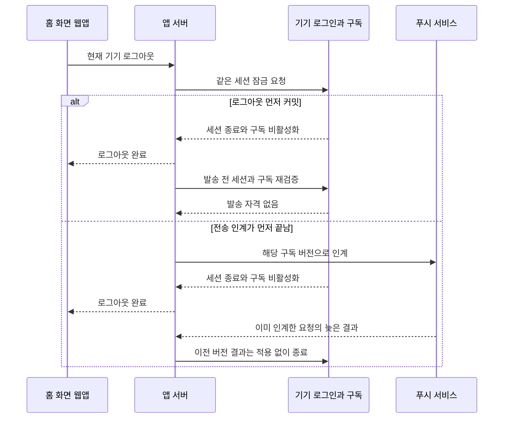

# 아이폰 홈 화면 웹앱 알림 06단계 API·전송 계약 초안

2026-11-25 KST · 마롱이 Orca 항목 143 · API-310~317 · 체크포인트 대기

사용자님은 알림을 눌러 약속 전화에 진입하는 방식을 선택했습니다(e2412). 알림 탭은 조회이고 별도의 받기만 전화 수락을 확정합니다. 푸시 구독은 현재 설치와 기기 로그인에 묶습니다. [OpenAPI 3.1 초안](../../api/iphone-home-webapp-notifications.draft.openapi.yaml) · [04 고정 명세](../04-functional-spec/iphone-home-webapp-notifications-draft.md) · [05 고정 ERD](../05-erd/iphone-home-webapp-notifications-draft.md) · [06 체크포인트 메모](../../iphone-webapp-06-api-checkpoint-2026-11-25.md)

## 기존 계약과 진입 경로

| 기존 계약 | 06에서 사용하는 경계 |
| --- | --- |
| SCR-165 내 마롱이 `/chat/me`, SCR-107 글 대화 `/chat/`, SCR-163 가입, SCR-164 로그인, SCR-001 통화 홈 | 알림 설정과 진입 결과를 연결할 기존 화면입니다. 알림은 같은 출처의 `/chat/#notice=<대상 참조>`로 엽니다. 화면 배치·안내 문구는 07·08에서 검토합니다. 공개된 사이트맵 주석의 ‘웹 알림 없음’은 일반 Safari에 적용할 기존 조건이며 설치한 웹앱 사항은 07 변경 후보입니다. [기존 사이트맵](../07-sitemap/sitemap.yaml) |
| API-212·213·215·216, TBL-165 | 기존 `marong_session` 쿠키·가입·코드 로그인·로그아웃·프로필을 사용합니다. 새로운 구독 작업은 유효한 기기 로그인과 해당 설치 증명을 함께 확인합니다. 기존 토큰·응답 본문·쿠키 조건을 사용합니다. [통합 인증 계약](../../api/unified.openapi.yaml) |
| API-101~104, TBL-101/API-105 | 기존 방과 메시지 조회·대기·전송을 사용합니다. 웹 푸시 전송을 위해 답변·선톡·일정의 방 기록을 따로 쓰지 않습니다. Android FID·기기 등록·앱 업데이트는 기존 계약을 사용합니다. [글 대화 계약](../../api/app-chat.openapi.yaml) · [앱 업데이트 계약](../../api/app-update.openapi.yaml) |
| API-107 및 API-124, TBL-102·001·003·004 | 기존 통화 상태·약속 전화·호출자·통화·연결 구간을 사용합니다. 기존 `/live?ring=`은 오래됐거나 받기에 실패한 경우 일반 통화로 갈 수 있습니다. 새 알림 경로는 별도 수락과 엄격한 웹소켓 시작을 사용합니다. 기존 Android와 같은 전화가 경합할 때의 호환성 제안은 체크포인트 Q3에 있습니다. [기존 통화 계약](../../api/call-live.openapi.yaml) · [현재 통화 저장](../../tools/vertex_live/call_memory.py) · [현재 수락 결과 처리](../../tools/vertex_live/live_session.py) |

## HTTP와 클라이언트 작업

HTTP는 기존 Problem Details(`application/problem+json`, 필수 `title,status,code,traceId`) 형식을 사용합니다. 본문 검증은 400 `invalid_input`, 로그인 종료는 401 `login_required`, 출처 위반·설치 검증 실패는 403, 다른 계정·없는·변조된 대상은 같은 404 `not_found`입니다. 대상 참조의 외부 형식 위반은 400으로 처리합니다. 요청에 없는 대상과 서버가 위조를 판정한 대상의 존재 여부를 공개하지 않습니다. 409의 선택·구독 충돌이나 통화 제한은 현재 상태를 다시 확인할 결과입니다. 429의 기존 사용 한도와 이 계약의 요청 제한을 구분합니다. 제안하는 요청 제한은 로그인·설치 단위로 일반 작업 분당 60회, 짧은 열람 신호는 분당 120회이며 `Retry-After`를 따릅니다. 503과 기본 오류는 확인 불가입니다. 응답과 가입 인계 페이지는 `Cache-Control: no-store`이며 요청 값·대상 경로·원문을 오류에 복사하지 않습니다.

| API | 요청과 사용자 상태 | SPEC 및 저장 관계 |
| --- | --- | --- |
| API-310 `GET /chat/api/web-notifications/subscription` | 현재 설치의 서버 상태, 짧은 상태 토큰, 공개 VAPID 키를 반환합니다. OS 권한과 서버 등록이 모두 유효할 때만 ‘수신 가능’입니다. 행이 없으면 200 미등록입니다. | SPEC-522·525, TBL-165·183 |
| API-311 `POST …/subscription/intent` | 상태 토큰과 `enable / refresh / revoke / permission_revoked` 중 하나를 보냅니다. 최신 상태·설치·세션을 검증해 120초 선택 토큰을 반환합니다. 수신 상태는 아직 바뀌지 않습니다. | SPEC-523~527·530, TBL-165·183 |
| API-312 `PUT …/subscription` | 선택 토큰, 브라우저 구독, VAPID 키 ID. 등록·갱신 또는 이미 완료된 동일 결과는 200입니다. 오래된 선택·주소 충돌은 409이며 새 알림 켜기 선택 없이 자동 활성화하지 않습니다. | SPEC-524~526·530, TBL-165·183 |
| API-313 `DELETE …/subscription` | 명시 해제 또는 확인된 OS 권한 철회의 선택 토큰. 현재 설치의 비활성화가 커밋되면 200입니다. 자기 행이 없는 상태는 미등록, 이미 철회됐으면 철회 상태를 반환합니다. | SPEC-525·527~530, TBL-165·183 |
| API-314 `POST …/target/resolve` | 알림 대상 참조로 읽기만 합니다. 올바른 방, 수락 가능, 미수락 만료, 이미 수락, 현재 응답 불가를 200으로 구분합니다. 기한은 수락 가능 화면에만 돌려줍니다. | SPEC-538~542·545·547·549, TBL-165·102·001·003 및 기존 방·메시지 |
| API-315 `POST …/call/accept` | 받기 선택 뒤 대상 참조와 클라이언트 UUID. 수락 확정·같은 클라이언트의 기존 결과 확인은 통화 ID와 짧은 연결 토큰을 반환합니다. 다른 기기의 수락·미수락 만료는 200의 별도 상태입니다. 기존 통화·예산 제한은 409 또는 429입니다. | SPEC-545~547·549~551·553, TBL-165·102·001·003·004 |
| API-316 `POST …/reply-view` | 현재 설치가 볼 수 있는 답변 ID와 표시·숨김을 알립니다. 200은 단기 신호를 처리했다는 결과입니다. | SPEC-531·532·535·536, TBL-165·183 및 기존 방·메시지 |
| API-317 `WSS /live/web-notification` | 별도 웹소켓. 인증과 엄격한 첫 프레임 확인 후 기존 통화 전송·연결 상태를 사용합니다. 시작 모드는 알림 수락 또는 만료 안내 뒤 선택한 일반 발신입니다. | SPEC-546·548·550~553, TBL-165·102·001·003·004 |

SPEC-520·521·543·544·554 등 화면·생성 작업과 기존 기능은 [SPEC 연결 검토](../../iphone-webapp-06-api-checkpoint-2026-11-25.md#spec-연결과-호환성)에 있습니다. OpenAPI의 `x-corthex.omit`에 각 작업의 미적용 응답 근거를, `x-marong-client-contracts`에 기존 세션 작업과 웹소켓·전송 페이로드를 기록했습니다.

## 설치 증명과 구독 생명주기

1. **설치·세션 검증** — 홈 화면에서 실행됨과 OS 기능을 먼저 확인합니다. 웹앱 보관 영역에 설치별 32바이트 난수 증명을 만들고 API에는 TLS의 `X-Marong-Installation`으로 전달합니다. 서버는 이를 검증한 뒤 도메인을 구분해 해시로부터 식별용 UUID를 결정적으로 계산합니다. 설치 증명 원본은 서버 DB·로그·URL에 보관하지 않습니다. 설치 ID 자체는 권한이 아닙니다. 서버는 웹앱 여부를 하드웨어로 증명할 수 없으므로, 전면의 설치·허용 확인, 쿠키, 검증된 증명, 현재 계정·세션·등록의 결합을 사용합니다. 쓰기와 알림 해석은 정확한 Origin을 요구합니다. 읽기는 사용자 정의 헤더와 인증을 요구하고, 제공된 Origin·Fetch Metadata가 교차 출처면 거절합니다. CORS로 다른 출처에 허용하지 않습니다.
2. **직접 선택** — OS 미응답에서는 설치를 연 사용자 클릭에서 권한 또는 브라우저 구독을 요청합니다. 서비스 워커와 현재 설정은 미리 준비하고 시스템 요청 앞에 네트워크 응답을 기다리지 않습니다. 이미 거부한 경우 자동으로 다시 부르지 않고 시스템 설정을 안내합니다. `enable`은 새로운 직접 선택에서만 시작하며 로그인, OS 권한의 단독 변경, 알림 탭이나 다시 열기는 `enable`을 만들지 않습니다. 서버는 브라우저 권한을 원격 조회할 수 없으므로 실제 권한·등록 검사와 호출 조건을 클라이언트 수용 시험으로 확인합니다.
3. **오래된 요청과 재시도** — 짧은 상태·선택 토큰(권장 120초)은 현재 설치, 유효 세션, 동작, 기대 버전 또는 행 없음 상태에 인증된 암호화로 결합합니다. 상태 조회 토큰과 선택 토큰을 서로 대신 쓸 수 없습니다. `enable`과 `refresh` 선택에는 성공할 때 쓸 새 무작위 버전을 함께 봉인합니다. 이전 요청이 같은 세션에서 이미 완료됐고 결과 버전과 제출 구독이 일치하는 경우에만 200으로 읽어 줍니다. 그렇지 않은 이전 요청은 409 또는 401로 끝나며, 토큰 기한 뒤에는 상태를 새로 조회합니다. 이전 요청을 최신 토큰으로 다시 서명하여 자동 실행하지 않습니다. 자동 갱신 뒤에도 현재 동의 안에서 효력이 있는 철회를 받아야 하며, 이미 끝난 동의의 철회가 신규 동의를 지워서는 안 됩니다. 활성 암호화 봉투에 이를 구분할 최소 식별자를 두는 후보와 대안은 체크포인트 Q2에 남깁니다.
4. **계정 변경과 회수** — 기존 가입·코드 로그인 요청에 홈 화면 웹앱의 설치 증명을 선택적으로 전달하는 안입니다. 성공할 때 알려진 동일 설치의 이전 구독을 새 로그인 전환과 함께 비활성화하고, 새 로그인은 새 선택 전에는 수신 권한이 없습니다. 다른 설치의 로그인이나 구독은 그대로입니다. 설치 증명이 사라졌다면 등록 주소 일치만으로 다른 계정 행을 이전하지 않습니다. 브라우저에 남은 기존 PushSubscription을 발견하면 새 등록 전에 현재 브라우저에서 기존 등록을 해제합니다. 가능 여부가 불확실하면 웹 푸시 등록은 미확인으로 두며 기존 로그인과 웹은 사용할 수 있습니다. 소유 관계나 설치 보관이 OS에 의해 끊긴 경우 서버가 이전 등록을 어느 설치인지 알아낼 수 없으므로, 기존 주소 차단 및 권한 제거가 실제 기기에서 가능한지 출시 전에 확인합니다.
5. **비활성화와 오래된 공급자 결과** — 철회·세션 종료 정리·확인된 구독 만료 또는 영구 무효는 상태 전환과 함께 전송 주소·키가 담긴 봉투, 지문과 구독 만료 시각을 NULL로 비웁니다. 설치 ID·세션 FK·새 버전·상태만 남깁니다. 공급자 결과는 발송 당시 설치·구독 버전과 현재 행의 활성 버전이 같을 때만 적용합니다. 공급자 응답은 새 등록을 만들 수 없고, HTTP 선택 토큰을 대신하지 않습니다. 세션 물리 삭제 때 FK로 행을 정리합니다. 시간 경과에 따른 로그인 만료는 실시간 자격 검사에서 즉시 제외하고 재료의 물리 정리 시점, 역할·복제·백업 주기는 출시 전 계약에 남깁니다.

### 로그인 종료와 실제 발송 인계

발송은 큐에서 대상이 선정된 때와 전송 직전에 대상 계정·세션·구독 버전·OS 허용 상태 및 기한을 확인합니다. 발송 쪽과 API-215 로그아웃·세션 폐기·설치 전환 작업은 같은 세션 단위의 공유 잠금으로 순서를 정합니다. 세션을 잠근 뒤 설치를 확인하며, 두 세션이 필요한 계정 전환은 세션 ID 순으로 잠금을 취득합니다.

인계의 기준은 인증된 공급자 연결로 완전한 요청을 넘기는 시점입니다. 헤더나 본문이 부분적으로 전송되다가 실패한 경우를 성공으로 표시하지 않습니다. 실제 전송 수행자와 세션 잠금을 함께 유지하고, 전송을 중단할 때 연결을 닫은 뒤 잠금을 풀도록 제안합니다. 공급자 응답 대기에는 잠금을 해제할 수 있습니다. DB 행을 읽고 나중에 독립적으로 보내는 비동기 방식은 이 조건을 충족하지 않습니다. TLS 연결 준비는 사전에 할 수 있으며 인계 동작은 최대 2초와 해당 기한 중 먼저 도달하는 시각으로 제한하고 내부 재전송·리다이렉트를 끕니다. 로그아웃이 먼저 확정되면 미인계 요청은 0건이고, 이미 인계한 건은 탭에서 최신 계정으로 다시 확인합니다. 공급자 결과가 현재 구독의 버전을 바꾸려면 위 5번 검증을 다시 거칩니다.

## 전송 방식과 플랫폼 범위

| 선택지 | 확인된 지원과 후속 검증 |
| --- | --- |
| 통상 Web Push | iOS/iPadOS 16.4부터 홈 화면 웹앱을 지원합니다. 서비스 워커 등록의 `pushManager`를 사용하며 직접 사용자 동작과 알림 표시가 필요합니다. 일반 Safari 창은 설치 및 권한 안내 진입입니다. 서비스 워커 유지·종료 및 OS 알림 표시 동작을 실제 기기에서 확인합니다. [WebKit iOS Web Push](https://webkit.org/blog/13878/web-push-for-web-apps-on-ios-and-ipados/) · [Apple iPhone 사용 설명서](https://support.apple.com/en-afri/guide/iphone/iphea86e5236/27/ios/27) |
| 선언형 Web Push | 홈 화면 웹앱에서 iOS/iPadOS 18.4부터 지원합니다. OS가 표준 JSON의 제목과 진입 URL로 자체 표시할 수 있어 서비스 워커가 없거나 표시하지 못한 경우의 전달 경로가 남습니다. 선언형만 쓰면 16.4~18.3 사용자는 푸시를 받을 수 없습니다. WebKit은 구버전용 워커에서 같은 JSON을 읽는 호환 방식을 설명합니다. [선언형 방식](https://webkit.org/blog/16535/meet-declarative-web-push/) · [Safari 18.4 릴리스](https://webkit.org/blog/16574/webkit-features-in-safari-18-4/) |
| **추천 후보** | 알림 최소 iOS 16.4, 단일 서비스 워커 구독과 단일 선언형 호환 페이로드, 18.4 이상은 안전한 선언형 기본 알림을 사용합니다. 설치·OS 판정은 가능 여부로 확인합니다. 서비스 워커는 `/chat/`의 푸시·클릭 관리만 담당하고 로그인, 글과 통화 요청을 캐시하지 않습니다. 기존 manifest 식별자·시작 URL과 아이콘을 보존하며 동일 저장 영역에서 등록 API를 한 번만 선택합니다. 지원 범위가 넓지만 두 표시 경로, 버전별 중복 동작과 워커 수명 시험이 늘어납니다. [WebKit Safari 26.0](https://webkit.org/blog/17333/webkit-features-in-safari-26-0/) |

알림이 잠금 화면에 표시될 수 있음을 플랫폼 문서가 뒷받침합니다. 마롱이의 늦은 탭, 잠금 해제, 앱 전환·종료, 재연결과 양방향 오디오는 지원 버전별 실기기 증거가 필요합니다. 푸시 워커의 역할은 사용자에게 보이는 알림을 표시하는 데 한정하며 통화·마이크를 거기서 시작하지 않습니다. [Apple Web Push 개발자 문서](https://developer.apple.com/documentation/usernotifications/sending-web-push-notifications-in-web-apps-and-browsers) · [WebKit iOS Web Push](https://webkit.org/blog/13878/web-push-for-web-apps-on-ios-and-ipados/)

### 이벤트와 중복 표시

- 새 답변·선톡·일정은 기존 방의 커밋된 메시지 한 건에서만, 약속 전화는 기존 TBL-102의 유효한 약속 전화에서만 생성합니다. 구독이 없는 경우에도 기존 방 기록과 조회를 유지합니다. Android와 웹의 대상과 전송 결과는 별도로 판정합니다. 통화 차단·기한·기존 방 안내 여부와 FCM 건수는 기존 정책을 적용합니다.
- API-316은 정확한 기존 답변 ID, 실제 해당 답변이 보이는 전면 웹앱, 현재 설치와 세션을 확인하는 신호입니다. 5초 이내 유효한 최신 신호만 보며, 마지막 표시 전에 숨김으로 바뀌면 종료합니다. 답변 저장 직후 최대 2초의 작은 확인 창을 두는 후보를 추천합니다. 보고가 없거나 ID 정밀도·현재 세션·다른 설치와의 분리를 확인할 수 없으면 적격 설치를 발송 대상으로 유지합니다. 다른 기기·선톡·일정·약속 전화·방 기록에는 이 생략을 적용하지 않습니다.
- 안정된 이벤트 ID와 설치를 기반으로 짧은 `Topic`과 알림 `tag`를 만듭니다. `renotify:false`로 같은 알림이 남아 있을 때 교체하고, 공급자 큐에서는 `Topic`으로 대기 중인 요청을 합칩니다. 둘 다 이미 닫힌 알림의 정확히 한 번 표시를 보장하지 않습니다. 같은 발생에 한 전송 실행만 시작하고, 확인할 수 없는 인계 결과를 자동 재전송하지 않습니다. 재시도는 공급자가 받지 않았음을 명시적으로 확인한 경우, 남은 기간에 같은 이벤트·구독 버전으로 한 번만 제안합니다. 중복 패킷, 이미 닫은 알림, 선언형 폴백이 SPEC-537을 충족하는지 실제 기기로 검증합니다. 충족되지 않으면 출시 범위에서 검토를 다시 열고 체크포인트 Q4에서 대안을 확인합니다. [RFC 8030 §5.4](https://www.rfc-editor.org/rfc/rfc8030.html#section-5.4) · [WHATWG Notifications API](https://notifications.spec.whatwg.org/)
- 기본 알림에는 유형을 구분하는 안내와 사용자 데이터 없는 제목, 같은 출처의 대상 참조, 중복 제어 태그만 둡니다. 대화·일정·전화 원문, 계정·방·전화 ID, 원본 구독 재료, 인증 정보를 넣지 않습니다. 진입 참조는 대상 종류·계정·기존 사건 식별자를 인증된 암호화로 봉인하고, 권한 확인은 다시 서버 원본에서 합니다. 수신 기기 간 이벤트 연계와 원문 노출을 줄이기 위해 설치별 태그를 구분합니다. 대상 참조 유효 기간은 알림 전송 TTL과 별개이며, 알려진 원래 전화가 늦게 열렸을 때 같은 계정에 만료 상태를 보여 줄 수 있어야 합니다.

### 주소, 암호화와 전송 오류

| 범위 | 전송 계약 제안 |
| --- | --- |
| 주소·요청 한도 | 설치 등록은 JSON 최대 4,096바이트, 주소 최대 2,048자, `p256dh`는 비압축 P-256 유효 공개점 65바이트, `auth`는 16바이트를 각각 패딩 없는 base64url로 받습니다. 브라우저의 `expirationTime`은 UTC 밀리초 또는 NULL입니다. 등록·발송 양쪽에서 HTTPS·443, 엄격한 허용 공급자 호스트, 공개 IP와 TLS 호스트 인증을 확인합니다. 검증한 DNS 결과로만 연결하고 TLS SNI는 원래 허용 호스트를 사용합니다. 리다이렉트·다른 출처·사용자 정보·IP 리터럴·로컬 및 내부 주소를 거부합니다. 공급자 경로를 추측하거나 브라우저 구독 주소를 다시 쓰지 않습니다. Apple 발송 범위는 우선 공식 `*.push.apple.com`입니다. [Apple 개발자 문서](https://developer.apple.com/documentation/usernotifications/sending-web-push-notifications-in-web-apps-and-browsers) |
| 이동 중 암호화 | RFC 8030의 HTTPS 요청과 RFC 8291/8188의 `aes128gcm`을 사용합니다. 등록 시 연결한 VAPID P-256 키 ID로 공급자 origin을 `aud`로 지정하고, 별도 서명 키와 일회성 키 교환키를 사용합니다. `exp`는 24시간 이내이고 Apple 권고를 따라 같은 유효 JWT를 최소 한 시간 캐시하도록 제안합니다. 접수 서버가 키를 변경하면 새 키에 묶인 브라우저 구독을 만들어 같은 설치에서 교체해야 합니다. 정상 회전은 기존 허용 상태에서 발급 키와 기존 구독의 키를 모두 유지해 순차 교체합니다. 구독 거부 상태를 키 회전으로 복원하지 않습니다. [RFC 8030](https://www.rfc-editor.org/rfc/rfc8030.html) · [RFC 8291](https://www.rfc-editor.org/rfc/rfc8291.html) · [RFC 8188](https://www.rfc-editor.org/rfc/rfc8188.html) · [RFC 8292 §4.2](https://www.rfc-editor.org/rfc/rfc8292.html#section-4.2) |
| 저장 중 암호화 | 구독 주소·키 재료·VAPID 키 ID는 키 버전과 키별로 재사용하지 않는 nonce를 포함한 AES-256-GCM 봉투로 저장하고, 설치·세션·구독 버전을 인증 데이터에 포함하도록 제안합니다. 키 저장 역할과 DB 접근 역할을 분리합니다. 봉투 키는 재포장할 수 있게 두고, HMAC 지문 키 교체에는 동시에 두 지문으로 같은 주소가 중복 활성되지 않도록 쓰기를 잠깐 중지한 상태에서 일괄 전환을 검증합니다. 인증 키, 지문 키, 봉투 키, 알림 대상 키는 역할별로 구분합니다. 어떤 직접 식별값도 운영 로그에 남기지 않습니다. |
| 전송 수명 | 새 답변·선톡·일정은 기존 종류별 정책의 남은 수명을 상한으로 사용합니다. 전화 TTL은 현재 전화 `answer_until`과 개별 알림 수명 중 먼저 끝나는 시점까지이며 인계 경과를 뺀 양의 정수 초를 보냅니다. 남은 시간이 1초 미만이면 인계하지 않습니다. 공급자는 더 짧게 보관하거나 배달하지 못할 수 있습니다. 구독 상태는 그대로 유지합니다. 평문 최대 2,048바이트, 암호화 본문 최대 4,096바이트를 제안합니다. [RFC 8030 §5.2](https://www.rfc-editor.org/rfc/rfc8030.html#section-5.2) · [Apple 개발자 문서](https://developer.apple.com/documentation/usernotifications/sending-web-push-notifications-in-web-apps-and-browsers) |
| 접수·영구 무효 | Apple 201은 공급자 인계 접수입니다. 실제 기기 표시·탭·수락·음성 연결과 별개로 기록합니다. 허용된 Apple Web Push 경로의 확인된 410은 문서의 만료된 토큰으로 분류하고 해당 구독 버전만 종료합니다. 늦게 도착해도 현재 버전에 대한 이 구독 무효 증거와 해당 알림만의 수명 종료는 별도 판정합니다. RFC 8030 §7.3의 404 규칙을 Apple 404에 그대로 적용하지 않습니다. Apple 문서의 404/BadPath는 잘못된 경로로 구독 삭제 근거가 아닙니다. 향후 다른 공급자는 공식 영구 무효 계약을 확인할 때만 추가합니다. [Apple 오류 응답](https://developer.apple.com/documentation/usernotifications/sending-web-push-notifications-in-web-apps-and-browsers.md#review-responses-for-push-notification-errors) · [RFC 8030 §7.3](https://www.rfc-editor.org/rfc/rfc8030.html#section-7.3) |
| 일시 실패·불확실 | Apple 429, 503과 공급자가 미접수를 명시한 일시 오류에는 `Retry-After`와 해당 알림 남은 기간을 적용합니다. 응답 유실·네트워크 타임아웃·미확인 응답은 구독을 유지하고 자동 재전송을 보류합니다. 400·403·404·405·413과 구성·키 오류는 구독 상태를 유지하고 발송 경로를 점검합니다. 로그는 승인된 범주·건수·마롱이의 임의 요청 추적 ID만 남깁니다. 공급자 원문이나 URL, 구독 키, 지문, 토큰과 통화·메시지 식별자는 수집하지 않습니다. [Apple 개발자 문서](https://developer.apple.com/documentation/usernotifications/sending-web-push-notifications-in-web-apps-and-browsers) · [RFC 9110](https://www.rfc-editor.org/rfc/rfc9110.html) |

## 알림 대상과 통화 결과

1. **잠금 해제·재로그인** — 알림 URL fragment의 참조를 읽은 후 주소창에서 제거하고, 현재 탐색의 단기 상태에만 유지합니다. 인증 전에는 대상 정보가 없고, 동일·다른 계정의 로그인 뒤 API-314로 현재 세션과 대상의 실제 소유를 다시 확인합니다. 누락·변조·삭제·권한 없음은 안전한 400 또는 404에 대응합니다. 취소 또는 오프라인은 성공 없이 되돌리며, 연결 복구 후 재조회합니다. 탭으로 방 기록·전화 수락·마이크를 시작하지 않습니다.
2. **확인된 방** — 계정의 현재 허용된 방과 실제 메시지의 소속·표시 가능 조건을 검증한 뒤 기존 `/chat/`를 엽니다. 화면이 기존 계약으로 메시지를 읽습니다. 다른 방을 현재 방으로 대신 열지 않습니다. 현재 기존 웹이 열 수 없는 방이면 404를 반환합니다.
3. **별도 받기** — 사용자가 받기를 눌러 기존 마이크·통화 준비 조건을 충족할 때 API-315를 호출합니다. 마이크 거부 등 수락 전 실패는 전화 행을 변경하지 않습니다. 유효 계정과 세션·호출자, 대상 `reason='promise'`, 기존 통화·예산 조건을 다시 확인합니다. 호출자 및 전화 잠금을 확보한 뒤 실제 서버 시각으로 기한·선행 수락을 판정합니다. 같은 TBL-102의 `answered_at`·`call_id`와 최초 통화 예약은 하나의 트랜잭션으로 확정합니다. 호출자가 같더라도 다른 클라이언트가 먼저 수락했다면 이미 수락 상태를 반환합니다. Android의 같은 전화 처리가 먼저 확정돼도 같은 결과입니다.
4. **응답 유실과 연결** — 현재 설치에 결합한 클라이언트 UUID와 목표 전화 ID를 재확인하면 새 수락 없이 기존 `call_id`를 복원합니다. 브라우저 클라이언트 식별자는 설치에서 검증된 요청으로부터 서버가 통화 엔진의 클라이언트 ID에 결합합니다. 동일 브라우저 클라이언트의 유효 연결 또는 재연결만 허용하며, 현재 TBL-003의 소유 클라이언트가 바뀌면 다른 기기의 연결을 탈취하지 않습니다. 연결 토큰은 유효 로그인·설치·클라이언트·통화 ID에 묶인 120초 값입니다. 응답 유실은 같은 요청을 재확인할 수 있고, 세션이 끝났으면 재로그인 뒤 대상을 다시 확인합니다. 수락 확정 후 공급자·오디오 실패는 기존 ID의 재연결 또는 종료 안내로 이어집니다.
5. **만료와 일반 통화** — 로그인·잠금 해제 중 만료와 받기 요청이 처리되기 직전 만료는 수락 0건입니다. 이미 받은 전화는 기한이 지난 뒤에도 ‘이미 수락’입니다. 미수락 만료 안내 뒤 별도 일반 통화를 눌렀을 때만 `start_ordinary`를 받습니다. 서버는 만료 안내의 대상과 현재 계정을 다시 확인하고, 일반 통화 분기에서 어떤 약속 전화도 자동 검색·수락하지 않습니다. 확인 실패·탭·늦은 받기는 일반 통화 선택으로 바꾸지 않습니다.
6. **엄격한 웹소켓** — API-317은 기존 `/live`와 구분된 URL 및 서브프로토콜을 검사합니다. 쿠키와 Origin은 업그레이드 전, 인증된 설치 증명·연결 토큰 또는 만료 대상은 첫 프레임(2,048바이트 이하, 5초 내)으로 검사합니다. 토큰은 쿼리, 로그 또는 오디오 진단에 넣지 않습니다. 유효한 시작 뒤 기존 오디오·텍스트 프레임과 통화 ID를 사용합니다. 새 경로를 인식하지 못하는 구 서버에서는 연결을 종료합니다. 이전 경로에 자동으로 재시도하지 않습니다. WebRTC 준비와 PCM 대체에서도 검증된 같은 통화·클라이언트만 오디오에 연결합니다. 두 클라이언트를 같은 통화에 붙이지 않으며 통화 연결 실패는 사용자용 상태로 돌려줍니다.

## 검증 배치

HTTP 응답 예시와 스키마는 모의 서버에서 먼저 읽습니다. 계약 수용에는 합성 바인딩·전송·전화 순서 시험 및 실제 버전별 기기가 필요합니다. [검토 메모의 모의 사례와 출시 조건](../../iphone-webapp-06-api-checkpoint-2026-11-25.md#모의-검증과-출시-조건)
