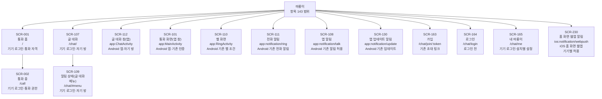

# 아이폰 홈 화면 웹앱 알림 07단계 사이트맵

2026-11-25 KST · 항목 143 · 07 체크포인트 대기 · [YAML 초안](iphone-home-webapp-notifications.draft.sitemap.yaml)

이 페이지의 트리, 목록, 분기, 흐름 대조표를 YAML에서 생성했습니다. 기존 경로·부모·수명주기는 사이트맵에서 읽었습니다. 아래 접근 조건은 이번 기능에서 사용하는 기기 로그인·자기 방·통화 또는 설치 자격입니다. [기존 사이트맵](sitemap.yaml) · [07 체크포인트 기록](../../iphone-webapp-07-sitemap-checkpoint-2026-11-25.md)

## 트리 보기

최상위 연결은 기존 사이트맵의 루트를 나타냅니다. 화면 간 실제 가능한 이동은 분기 보기에서 확인할 수 있습니다.

## 목록 보기

| SCR | 화면·분류 | 부모 | 경로 | 접근 | 수명주기 | 이번 흐름 |
| --- | --- | --- | --- | --- | --- | --- |
| SCR-001 | 통화 홈 · 변경 초안 | 루트 | `/` | 기기 로그인과 통화 자격이 있는 사용자 | active | FL-225 · FL-226 · FL-227 |
| SCR-002 | 통화 중 · 기존 화면 재사용 | SCR-001 | `/call` | 기기 로그인과 기존 통화에 대한 접근 조건을 충족한 사용자 | active | FL-225 · FL-226 · FL-227 |
| SCR-107 | 글 대화 · 변경 초안 | 루트 | `/chat/` | 자기 글 대화를 볼 수 있는 유효한 기기 로그인. 알림 대상의 보호된 내용은 확인 전까지 표시하지 않음 | active | FL-220 · FL-222 · FL-223 · FL-225 · FL-227 · FL-228 |
| SCR-109 | 알림 상태(글 대화 메뉴) · 기존 화면 재사용 | SCR-107 | `/chat/#menu` | 자기 글 대화를 볼 수 있는 유효한 기기 로그인 | active | FL-220 · FL-227 · FL-228 |
| SCR-112 | 글 대화 창(앱) · 기존 화면 재사용 | 루트 | `app:ChatActivity` | Android 앱의 기존 인증 조건과 방 접근을 충족한 사용자 | active | FL-228 |
| SCR-101 | 통화 화면(앱 창) · 변경 초안 | 루트 | `app:MainActivity` | Android 앱과 기존 로그인·통화 조건을 충족한 사용자 | active | FL-228 |
| SCR-110 | 벨 화면 · 기존 화면 재사용 | 루트 | `app:RingActivity` | Android 앱의 수신과 기존 벨 권한에 맞는 기기 | active | FL-228 |
| SCR-111 | 전화 알림 · 기존 화면 재사용 | 루트 | `app:notification/ring` | Android 앱의 기존 약속 전화 알림 자격을 충족한 기기 | active | FL-228 |
| SCR-108 | 앱 알림 · 기존 화면 재사용 | 루트 | `app:notification/talk` | Android 앱의 기존 글·일정 알림 자격을 충족한 기기 | active | FL-228 |
| SCR-130 | 앱 업데이트 알림 · 기존 화면 재사용 | 루트 | `app:notification/update` | Android 앱과 APK 업데이트의 기존 자격을 충족한 기기 | active | FL-228 |
| SCR-163 | 가입 · 변경 초안 | 루트 | `/chat/join/:token` | 가입은 기존 초대 링크 검증을 마친 사용자. 로그인 전에는 기존 가입 안내 | active | FL-227 |
| SCR-164 | 로그인 · 기존 화면 재사용 | 루트 | `/chat/login` | 유효한 로그인이 없는 사용자. 기존 기기 인증 조건 적용 | active | FL-220 · FL-221 · FL-223 · FL-225 · FL-227 |
| SCR-165 | 내 마롱이 · 변경 초안 | 루트 | `/chat/me` | 유효한 기기 로그인. 일반 Safari는 설치 안내, 지원되는 홈 화면 웹앱에서만 현재 설치의 알림 설정 | active | FL-220 · FL-221 · FL-227 |
| SCR-230 | 홈 화면 웹앱 알림 · 새 시스템 표면 | 루트 | `ios:notification/webpush` | 유효 로그인·수신 자격과 기기별 허용이 확인된 홈 화면 웹앱에 전달된 알림. OS 표시 뒤 탭에서는 계정과 대상을 다시 확인 | active | FL-222 · FL-223 · FL-224 · FL-225 |

## 분기 보기

각 분기의 화면 목록을 한 번씩 싣고, 실제 이동을 이어서 표시했습니다.

### 웹 통화

| 화면 | 역할 | 08에서 정의할 상태 |
| --- | --- | --- |
| SCR-001 통화 홈 | 변경 초안 | 알림의 전화 상태 확인 · 이 계정의 응답 가능·미수락 만료·이미 수락·응답 불가 · 받기 처리 중·결과 확인 필요·기존 통화 제한 · 대상 검증 실패 또는 연결 불가 · 별도 일반 통화 선택·기존 다시 걸기 |
| SCR-002 통화 중 | 기존 화면 재사용 | 연결 중·통화 중 · 같은 클라이언트 재연결·연결 확인 필요 |

### 글 대화

| 화면 | 역할 | 08에서 정의할 상태 |
| --- | --- | --- |
| SCR-107 글 대화 | 변경 초안 | 알림 탭 진입·대상 확인 중·대상 미확인 · 권한 없는 계정·누락되거나 변조된 대상의 접근 거절 · 확인된 글 대화·기존 안 읽은 기록 · 직접 진입한 기존 약속 전화 받기 |
| SCR-109 알림 상태(글 대화 메뉴) | 기존 화면 재사용 | 기존 글 대화 메뉴와 내 마롱이 진입 · Android에만 기존 업데이트 메뉴 |

### 웹 계정과 설치

| 화면 | 역할 | 08에서 정의할 상태 |
| --- | --- | --- |
| SCR-163 가입 | 변경 초안 | 가입 전·가입 성공 · 가입 뒤 기존 아이폰 설치 안내의 플랫폼 제한 문구 조정 |
| SCR-164 로그인 | 기존 화면 재사용 | 기존 로그인·재로그인 · 기존 로그인 취소·실패 · 로그인 뒤 알림 대상 재검증 |
| SCR-165 내 마롱이 | 변경 초안 | 일반 Safari 홈 화면 추가 안내 · 미지원·연결 필요·서버 등록 확인 불가 · 명시적 권한 선택·거절·OS 설정 안내 · 구독 등록 중·등록 미완료·수신 가능 · 갱신·철회·해제·구독 만료·영구 무효·다시 켜기 · 계정·설치 검증 실패·오래된 요청 |

### 아이폰 시스템 알림

| 화면 | 역할 | 08에서 정의할 상태 |
| --- | --- | --- |
| SCR-230 홈 화면 웹앱 알림 | 새 시스템 표면 | 잠금 화면과 알림 센터의 글·일정 또는 약속 전화 알림 · OS 잠금 해제 요구·취소 · 기기별 단일 표시·원문 제외 |

### Android 기존 진입

| 화면 | 역할 | 08에서 정의할 상태 |
| --- | --- | --- |
| SCR-112 글 대화 창(앱) | 기존 화면 재사용 | 기존 앱 글 대화 창과 SCR-107 내용 |
| SCR-101 통화 화면(앱 창) | 변경 초안 | 기존 통화 시작·통화 중·유효한 재연결 · 동일 약속 전화를 다른 클라이언트가 먼저 수락한 경우 기존 call_busy |
| SCR-110 벨 화면 | 기존 화면 재사용 | 기존 벨·받기·거절 |
| SCR-111 전화 알림 | 기존 화면 재사용 | 기존 시스템 전화 알림 |
| SCR-108 앱 알림 | 기존 화면 재사용 | 기존 글·일정 알림과 탭 진입 |
| SCR-130 앱 업데이트 알림 | 기존 화면 재사용 | 기존 APK 업데이트 알림·배너 회귀 |

#### 설치·알림 설정

| 출발 | 동작 | 도착 | 접근·판정 | API |
| --- | --- | --- | --- | --- |
| SCR-107 | 글 대화 메뉴 열기 | SCR-109 | 기존 메뉴 | — |
| SCR-109 | 내 마롱이 열기 | SCR-165 | 기기 로그인 | — |
| SCR-165 | 기존 또는 새 홈 화면 아이콘 열기 | SCR-107 | Safari 설치 후 사용자 실행, 일반 Safari 계속 이용도 가능 | — |
| SCR-165 | 유효 로그인 없음 | SCR-164 | 기존 로그인 | API-310 |
| SCR-164 | 설정으로 복귀 | SCR-165 | 인증 완료 뒤 현재 설치 상태 확인 | API-310 |
| SCR-165 | 알림 켜기·갱신·해제·재동의 | SCR-165 | 지원 홈 화면 웹앱, 명시적 동의와 구독 결과 분리 | API-310 · API-311 · API-312 · API-313 |
| SCR-165 | 로그아웃 완료 | SCR-164 | 기존 응답 후 자기 설치의 이후 수신 차단 | API-215 |

#### 알림 탭·인증·대상 확인

| 출발 | 동작 | 도착 | 접근·판정 | API |
| --- | --- | --- | --- | --- |
| SCR-230 | 글·일정 또는 전화 알림을 탭 | SCR-107 | 잠금 해제 후 /chat/#notice, 대상 확인만 실행 | API-314 |
| SCR-107 | 현재 로그인 없음 | SCR-164 | 대상·통화 정보 비표시 | API-314 |
| SCR-164 | 알림 진입으로 복귀 | SCR-107 | 인증 완료 뒤 현재 계정으로 대상 재검증 | API-213 · API-314 |
| SCR-107 | 방 열기 또는 대상 미확인 | SCR-107 | 권한 있는 방만 열기. 접근 거절·오프라인은 상태 | API-314 |
| SCR-107 | 현재 계정의 약속 전화 결과 확인 | SCR-001 | 유효 대기·미수락 만료·선행 수락·응답 불가 상태 | API-314 |

#### 별도 받기·일반 통화·복귀

| 출발 | 동작 | 도착 | 접근·판정 | API |
| --- | --- | --- | --- | --- |
| SCR-001 | 별도 받기 뒤 연결 | SCR-002 | 유효한 최초 수락 또는 같은 클라이언트의 확정 통화 | API-315 · API-317 |
| SCR-001 | 수락 전 상태 표시 | SCR-001 | 응답 유실의 재확인·미수락 만료·선행 수락·권한·오프라인 | API-315 |
| SCR-001 | 받기나 연결 전에 로그인 종료 확인 | SCR-164 | 로그인 완료 뒤 SCR-107에서 대상과 기한을 다시 확인. 이전 받기 선택은 자동 실행하지 않음 | API-315 · API-317 |
| SCR-001 | 미수락 만료 뒤 일반 통화 선택 | SCR-002 | 별도 선택, 약속 전화 조회·수락 없이 일반 발신 | API-317 |
| SCR-002 | 같은 클라이언트 복구 | SCR-002 | 기존 통화 ID 유지 | API-317 |
| SCR-002 | 재연결 불가 또는 실제 다른 기기 통화 | SCR-001 | 기존 종료·다시 걸기·통화 중 안내 | API-107 · API-317 |

#### 일반 Safari 기존 진입

| 출발 | 동작 | 도착 | 접근·판정 | API |
| --- | --- | --- | --- | --- |
| SCR-163 | 기존 가입 완료 | SCR-107 | 가입 승인 후 진입 | API-212 |
| SCR-164 | 기존 통화 홈 복귀 | SCR-001 | 기기 로그인과 통화 허용 | API-213 · API-124 |
| SCR-001 | 기존 글 대화 진입 | SCR-107 | 기존 탭에서 사용 | API-101 |
| SCR-107 | 기존 직접 약속 전화 받기 | SCR-002 | 일반 Safari·직접 진입의 기존 pendingRing 규칙 | API-216 · API-107 |
| SCR-001 | 기존 일반 발신 | SCR-002 | 기존 마이크·계정 조건 | API-107 |

#### Android 기존 진입

| 출발 | 동작 | 도착 | 접근·판정 | API |
| --- | --- | --- | --- | --- |
| SCR-108 | 기존 글·일정 알림 열기 | SCR-112 | 기존 Android 수신 자격 | API-105 |
| SCR-112 | 앱 창에 기존 글 대화 표시 | SCR-107 | 자기 방·기존 Android 인증 | API-102 |
| SCR-111 | 기존 전화 알림에서 벨 보기 | SCR-110 | 기존 Android 벨 자격 | API-105 |
| SCR-110 | 기존 받기 선택 | SCR-101 | 동일 전화 선행 수락이 확인되면 기존 call_busy, 그 밖은 기존 규칙 | API-107 |
| SCR-110 | 기존 벨 거절 | SCR-110 | 벨을 닫고 통화로 이동하지 않음 | — |
| SCR-101 | 기존 앱에서 글 대화 열기 | SCR-112 | 기존 Android 앱 경로 | API-101 |
| SCR-130 | 업데이트 뒤 기존 앱 다시 열기 | SCR-101 | 기존 APK 설치와 필요한 OS 확인을 마친 뒤 사용자가 앱을 다시 엶 | API-141 · API-142 |

## 경로 확인 사항

- **SCR-001** · 사이트맵의 통화 홈 경로는 /입니다. 알림 진입의 /chat/에서 논리적으로 통화 홈 상태를 사용합니다. 홈 화면 웹앱의 창과 클라이언트가 유지되는 방법은 08과 실기기에서 확인합니다.
- **SCR-002** · /call은 기존 사이트맵의 화면 주소입니다. 현재 서버는 /의 통화 문서와 /live를 사용합니다. 별도의 /call HTTP 페이지나 새 딥 링크를 전제하지 않습니다.
- **SCR-107** · /chat/#notice=<대상 참조>는 /chat/의 진입 형태입니다. 읽고 난 fragment는 제거하고 잠금 해제 또는 로그인 복귀 때 대상 확인을 다시 합니다.
- **SCR-109** · #menu는 기존 같은 페이지 메뉴입니다. 기존 메뉴에서 내 마롱이로 이동합니다.
- **SCR-165** · 알림 설정과 구독 관리는 /chat/me 안에서 표시합니다. iOS 공유 메뉴·시스템 권한 요청·설정은 OS가 표시합니다.
- **SCR-230** · ios:notification/webpush는 OS 알림 표면의 식별자입니다. 주소로 열 수 있는 제품 페이지가 아니며 탭 시 /chat/#notice=<대상 참조>로 들어갑니다.
- 권한 팝업·공유 메뉴·잠금 해제는 OS 표면입니다. 웹 푸시 구독의 저장·버전, 공급자 전송·열람 확인과 응답 기한 자체는 화면을 갖지 않습니다.

## 승인 흐름과 화면 대조

### FL-220

[FL-220 아이폰 홈 화면에 추가하고 알림 허용](../03-user-flow/FL-220-iphone-webapp-enable-notifications-draft.md)

| 노드 | 화면에 보이는 단계 | SCR | OS 맥락 |
| --- | --- | --- | --- |
| A | 웹 알림을 쓰려 함 | SCR-165 | — |
| C | 홈 화면 추가 안내 | SCR-165 | — |
| D | 홈 화면에 추가하나요? | SCR-165 | Safari 공유 메뉴·홈 화면 추가는 OS |
| E | 홈 화면 아이콘 열기 | SCR-107 | 홈 화면 아이콘은 OS |
| F | 일반 Safari 계속 이용 | SCR-107 | — |
| G | 알림 설정 상태 확인 | SCR-165 | — |
| I | 알림 없이 이용 안내 | SCR-165 | — |
| J | 연결 필요 상태 | SCR-165 | — |
| L | 기존 로그인으로 이동 | SCR-164 | — |
| M | 로그인을 마쳤나요? | SCR-164 | — |
| N | 알림 설정 종료 | SCR-165 | — |
| O | 권한과 구독 상태는? | SCR-165 | — |
| P | OS 설정에서 변경 안내 | SCR-165 | — |
| Q | 알림 켜기를 선택했나요? | SCR-165 | — |
| S | 시스템 권한 요청 | SCR-165 | 시스템 권한 요청은 OS |
| T | 알림을 허용했나요? | SCR-165 | 허용·거절·닫기는 OS 권한 요청 |
| U | 계정과 설치의 구독 등록 | SCR-165 | — |
| W | 알림 수신 가능 | SCR-165 | — |
| X | 등록 미완료 안내 | SCR-165 | — |

별도 화면이 없는 노드 B · H · K · R · V. 설치 지원·로그인·등록 성공 여부는 분기 판정이며, 공유 메뉴·권한 팝업·아이콘은 OS에 속합니다.

### FL-221

[FL-221 웹 알림 구독 확인·변경·해제](../03-user-flow/FL-221-iphone-webapp-manage-subscription-draft.md)

| 노드 | 화면에 보이는 단계 | SCR | OS 맥락 |
| --- | --- | --- | --- |
| A | 구독 상태 확인 또는 변경 | SCR-165 | — |
| D | 접근 거절 | SCR-165 | — |
| E | 이 설치의 상태 표시 | SCR-165 | — |
| F | 어떤 작업을 선택하나요? | SCR-165 | — |
| G | 이 설치의 수신 해제 | SCR-165 | — |
| H | 알림 다시 켜기 선택 | SCR-165 | — |
| I | FL-220에서 다시 등록 | SCR-165 | — |
| J | 상태 확인 완료 | SCR-165 | — |
| O | 갱신 상태 안내 | SCR-165 | — |

별도 화면이 없는 노드 B · C · M · N · P · Q · R · S · T · U. 구독 교체·세션 종료 후 대상 차단·권한 철회·영구 무효·오류 기록은 서버 처리입니다. 다시 확인한 상태는 SCR-165에, 로그아웃 후 인증은 SCR-164에 표시합니다.

### FL-222

[FL-222 새 답변·선톡·일정 알림 받기](../03-user-flow/FL-222-iphone-deliver-message-notifications-draft.md)

| 노드 | 화면에 보이는 단계 | SCR | OS 맥락 |
| --- | --- | --- | --- |
| F | 이 설치에서 해당 새 답변을 보고 있나요? | SCR-107 | — |
| M | 첫 도착만 표시 | SCR-230 | 기기에서 OS 알림이 보임 |
| N | FL-223에서 열 수 있음 | SCR-230 | — |
| O | 방에 남은 기록으로 확인 | SCR-107 | — |

별도 화면이 없는 노드 A · B · C · D · E · G · H · I · J · K · L · P · V. 방 저장과 발송 자격·열람·중복 판정은 내부 처리입니다. F에서 이미 보고 있는 답변은 SCR-107입니다.

### FL-223

[FL-223 글 알림을 눌러 해당 방 열기](../03-user-flow/FL-223-iphone-open-message-notification-draft.md)

| 노드 | 화면에 보이는 단계 | SCR | OS 맥락 |
| --- | --- | --- | --- |
| A | 새 답변·선톡·일정 알림 탭 | SCR-230 | OS 알림 탭 |
| C | 연결 필요 · 대상 미확인 | SCR-107 | — |
| E | 기존 로그인 열기 | SCR-164 | — |
| F | 로그인을 마쳤나요? | SCR-164 | — |
| G | 인증 없이 종료 | SCR-164 | — |
| I | 해당 방의 글 대화 열기 | SCR-107 | — |
| J | 현재 계정의 대화 표시 | SCR-107 | — |
| K | 대상 접근 거절 | SCR-107 | — |

별도 화면이 없는 노드 B · D · H. 연결·로그인·계정·방 판정은 내부 처리입니다. 다른 계정이나 대상 무효는 SCR-107에서 안전한 상태로 표시합니다.

### FL-224

[FL-224 유효한 약속 전화 알림 받기](../03-user-flow/FL-224-iphone-deliver-scheduled-call-notification-draft.md)

| 노드 | 화면에 보이는 단계 | SCR | OS 맥락 |
| --- | --- | --- | --- |
| K | 첫 도착만 표시 | SCR-230 | 기기에서 OS 알림이 보임 |
| L | 탭할 때 FL-225로 이동 | SCR-230 | — |

별도 화면이 없는 노드 A · B · C · D · E · F · G · H · I · J · M · N · P. 전화 생성·대상·기한·개별 알림 수명과 공급자 결과는 화면 없이 판정합니다.

### FL-225

[FL-225 홈 화면 웹앱 전화 알림을 눌러 받기](../03-user-flow/FL-225-iphone-answer-call-notification-draft.md)

| 노드 | 화면에 보이는 단계 | SCR | OS 맥락 |
| --- | --- | --- | --- |
| A | 약속 전화 알림 탭 | SCR-230 | OS 알림 탭 |
| C | 잠금 해제 시도 | SCR-230 | OS 잠금 해제 시도 |
| D | 잠금을 풀었나요? | SCR-230 | OS 잠금 해제 완료 또는 실패 |
| E | 닫거나 취소함 | SCR-230 · SCR-164 · SCR-001 | OS 취소, 로그인 취소 또는 받기 취소 중 해당 단계 |
| G | 연결 필요 · 대상 미확인 | SCR-107 · SCR-001 | — |
| I | 기존 로그인 열기 | SCR-164 | — |
| J | 로그인을 마쳤나요? | SCR-164 | — |
| L | 대상 접근 거절 | SCR-107 · SCR-001 | — |
| N | 기존 받기 화면 열기 | SCR-001 | — |
| O | 별도로 받기를 눌렀나요? | SCR-001 | — |
| R | 기존 약속 전화 연결 | SCR-002 | — |
| S | 기존 시작 실패 처리 | SCR-001 | — |
| T | 이미 처리된 전화 안내 | SCR-001 | — |
| U | 만료 상태 안내 | SCR-001 | — |
| V | 일반 통화를 별도로 선택했나요? | SCR-001 | — |
| W | FL-002 일반 통화 시도 | SCR-001 · SCR-002 | — |
| X | 통화 시작 없이 종료 | SCR-001 | — |

별도 화면이 없는 노드 B · F · H · K · M · P · Q. 탭은 조회이고 유효 수락은 별도 선택입니다. 첫 수락 자체는 서버 트랜잭션이며 통화 연결에서 화면이 바뀝니다.

### FL-226

[FL-226 잠금이나 앱 전환 뒤 통화로 돌아가기](../03-user-flow/FL-226-iphone-resume-call-draft.md)

| 노드 | 화면에 보이는 단계 | SCR | OS 맥락 |
| --- | --- | --- | --- |
| A | 잠금 해제 또는 앱 복귀 | SCR-002 · SCR-001 | OS 잠금 해제·앱 복귀 후 기존 통화 상태 확인 |
| C | 기존 통화 계속 사용 | SCR-002 | — |
| D | 같은 통화로 재연결 요청 | SCR-002 | — |
| F | 같은 통화에서 대화 재개 | SCR-002 | — |
| G | 연결 확인 뒤 다시 시도 | SCR-002 | — |
| H | 기존 다른 기기 통화 안내 | SCR-001 | — |
| I | 기존 다시 걸기 안내 | SCR-001 | — |
| J | FL-002에서 다시 걸기 | SCR-001 · SCR-002 | — |
| K | 다시 걸기를 선택했나요? | SCR-001 | — |
| L | 통화 없이 종료 | SCR-001 | — |

별도 화면이 없는 노드 B · E. 기존 연결과 재연결 결과의 판정은 내부 처리입니다. 연결 중 또는 이어진 통화는 SCR-002, 다른 기기 통화와 종료 안내는 SCR-001입니다.

### FL-227

[FL-227 일반 Safari에서 기존 웹 기능 사용](../03-user-flow/FL-227-iphone-safari-use-draft.md)

| 노드 | 화면에 보이는 단계 | SCR | OS 맥락 |
| --- | --- | --- | --- |
| A | 일반 Safari에서 마롱이 열기 | SCR-001 · SCR-107 | — |
| B | 무엇을 하려 하나요? | SCR-001 · SCR-107 | — |
| C | 기존 가입 또는 로그인 | SCR-163 · SCR-164 | — |
| D | 기존 글 대화 사용 | SCR-107 | — |
| E | 기존 통화 걸기 또는 받기 | SCR-001 · SCR-002 · SCR-107 | — |
| F | FL-220 설치 안내 보기 | SCR-165 | — |

모든 노드가 기존 화면 또는 화면 진입과 연결됩니다. 일반 Safari의 가입·글·통화는 기존 접근으로 열립니다. 설치는 별도 안내입니다.

### FL-228

[FL-228 Android에서 기존 알림과 전화 이용](../03-user-flow/FL-228-android-notification-regression-draft.md)

| 노드 | 화면에 보이는 단계 | SCR | OS 맥락 |
| --- | --- | --- | --- |
| D | 기존 Android 알림 전송 | SCR-108 · SCR-111 | Android 기존 OS 알림 표시 |
| F | 기존 글 대화 알림 열기 | SCR-108 · SCR-107 · SCR-112 | — |
| G | 기존 벨에서 받기 또는 거절 | SCR-101 · SCR-110 · SCR-111 | — |

별도 화면이 없는 노드 A · B · C · E. Android의 대상 자격과 알림 종류는 내부 판정입니다. 앱 업데이트는 기존 SCR-130 회귀 경로입니다.
