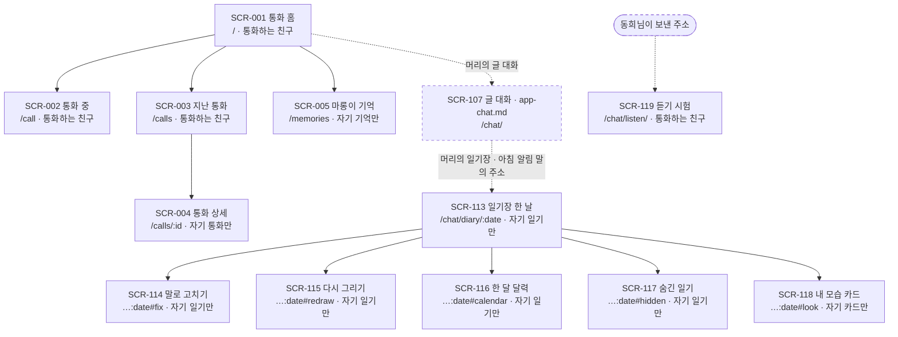

# 마롱이 웹 화면 목록

그린 때: 2026-11-16 19:45(한국 시각), [`sitemap.yaml`](sitemap.yaml)에서 그림. 화면을 바꿀 때는 YAML을 고치고 이 세 보기를 같은 변경에서 다시 그려요.
화면은 열두 개예요. 통화 웹앱 다섯 개(SCR-001\~005), 2026-11-16에 설계한 일기장 여섯 개(SCR-113\~118)와 듣기 시험 한 개(SCR-119)예요. 모두 Cloudflare Access 뒤에 있어서 허용된 Google 계정(통화하는 친구, 지금은 현경님)만 봐요. 카톡에서 일어나는 FL-010은 화면이 없어요.
앱 창과 글 대화 화면(SCR-101\~112)은 [android-app.md](../android-app.md), [app-chat.md](../app-chat.md), [app-ring.md](../app-ring.md)에 있어요. 아래 보드의 점선 칸 SCR-107은 일기장으로 가는 길을 보이려고 그린 그 문서의 화면이에요.

## 보드

## 목록

| ID | 이름 | 경로 | 누가 보나 | 흐름 | 용어 |
| --- | --- | --- | --- | --- | --- |
| SCR-001 | 통화 홈 | `/` | 통화하는 친구 | FL-001, FL-002, FL-006, FL-007, FL-008, FL-009, FL-121 | CTX-002, CTX-006, TERM-001, TERM-003, TERM-014, TERM-018 |
| SCR-002 | 통화 중 | `/call` | 통화하는 친구 | FL-002, FL-003, FL-004, FL-005, FL-006, FL-007, FL-009 | CTX-002, CTX-003, TERM-001, TERM-002, TERM-009\~012, TERM-017\~019 |
| SCR-003 | 지난 통화 | `/calls` | 통화하는 친구 | FL-008 | CTX-004, TERM-001, TERM-006 |
| SCR-004 | 통화 상세 | `/calls/:id` | 통화하는 친구(자기 통화만) | FL-007, FL-008 | CTX-004, TERM-001, TERM-005\~007, TERM-015 |
| SCR-005 | 마롱이 기억 | `/memories` | 통화하는 친구(자기 기억만) | FL-008 | CTX-004, TERM-007 |
| SCR-113 | 일기장 한 날 | `/chat/diary/:date`(비우면 가장 최근 일기 날) | 통화하는 친구(디스코드 DM 연결 있음, 자기 일기만) | FL-115, FL-116, FL-117, FL-118, FL-119 | CTX-007, TERM-021, TERM-022, TERM-024, TERM-026\~029 |
| SCR-114 | 말로 고치기 | `/chat/diary/:date#fix` | 통화하는 친구(자기 일기만) | FL-116 | CTX-007, TERM-021 |
| SCR-115 | 다시 그리기 | `/chat/diary/:date#redraw` | 통화하는 친구(자기 일기만) | FL-116 | CTX-007, TERM-024, TERM-028, TERM-032 |
| SCR-116 | 한 달 달력 | `/chat/diary/:date#calendar` | 통화하는 친구(자기 일기만) | FL-117 | CTX-007, TERM-022, TERM-026, TERM-027, TERM-029 |
| SCR-117 | 숨긴 일기 | `/chat/diary/:date#hidden` | 통화하는 친구(자기 일기만) | FL-117 | CTX-007, TERM-021, TERM-029 |
| SCR-118 | 내 모습 카드 | `/chat/diary/:date#look` | 통화하는 친구(자기 카드만) | FL-119 | CTX-007, TERM-030, TERM-031 |
| SCR-119 | 듣기 시험 | `/chat/listen/` | 통화하는 친구(디스코드 DM 연결 있음) | FL-123 | CTX-002, TERM-039 |

화면이 없는 용어:

- 통화: TERM-004 로그인 이메일(Access 로그인 화면은 Cloudflare가 그림), TERM-008 위임(목소리로만 답함), TERM-013 신호, TERM-016 sideband, TERM-020 미리 넘기기(친구에게 보이지 않음).
- 일기: TERM-023 하루 모음(밤 작업 안에서만), TERM-025 장면(친구에게 보이지 않음), TERM-033 아침 알림(앱 알림과 디스코드 DM의 말 한 줄).
- 통화 비용: TERM-034 통화 사용량, TERM-035 단가표, TERM-036 지출 상한 예산(Google Cloud 콘솔), TERM-037 설정 실험, TERM-038 글로 갈아타기. 동희님 관리 명령·시트만이거나 친구에게 보이지 않아요.

화면이 없는 흐름: FL-010(카톡), FL-114(밤 작업), FL-120(사용량 기록, 관리 명령·시트), FL-122(설정 실험, 관리 명령). FL-121의 디스코드 음성방 안내는 소리뿐이에요.

## 슬라이드

### 1. 통화하기 (SCR-001 → SCR-002)

- 화면: SCR-001 통화 홈, SCR-002 통화 중
- 흐름: FL-001 처음 들어오기, FL-002 전화 걸기, FL-003 통화 중 기억, FL-004 끊김과 재연결, FL-005 쉬기·깨우기, FL-006 이어 받기, FL-007 끝내기, FL-009 예산, FL-121 지금 통화의 예산
- 볼 점: 홈에서 한 번 눌러 바로 통화(코드·안내·동의 없음). 통화 중 화면에는 시간이 없어요. 뒤로 가도 통화는 이어져요. 마롱이 얼굴이 통화 상태·말소리·느낌에 따라 바뀌고, 말할 때 입은 GPT talk 움직임이에요(TERM-018, TERM-019). 지금 통화(Gemini 길)도 예산을 다 쓰면 홈이 예산 상태가 돼요(FL-121, 모양은 08단계 SCR-001).

### 2. 지난 통화 (SCR-001 → SCR-003 → SCR-004)

- 화면: SCR-003 지난 통화, SCR-004 통화 상세
- 흐름: FL-007 끝내기와 정리, FL-008 보기·지우기
- 볼 점: 상세에서 카드·통화 기억·자막을 보고 통화를 지울 수 있어요. 정리 중·정리 실패·자막 지움(180일)이 상태로 보여요.

### 3. 마롱이 기억 (SCR-001 → SCR-005)

- 화면: SCR-005 마롱이 기억
- 흐름: FL-008 보기·지우기
- 볼 점: 통화에서 생긴 기억만 보여요. 카톡 기억은 여기 없고 카톡 규칙(동희님에게 말하기)을 따라요.

### 4. 마롱이의 일기 (글 대화 SCR-107 → SCR-113 → SCR-114\~118)

- 화면: SCR-113 일기장 한 날, SCR-114 말로 고치기, SCR-115 다시 그리기, SCR-116 한 달 달력, SCR-117 숨긴 일기, SCR-118 내 모습 카드
- 흐름: FL-115 아침에 받아 보기, FL-116 고치기와 다시 그리기, FL-117 넘겨 보기·달력·숨기기, FL-118 도장, FL-119 내 모습 카드
- 볼 점: 일기장은 글 대화 머리의 '일기장'이나 아침 알림 말의 주소로 들어와요. 페이지는 하나이고, 고치기·다시 그리기·달력·숨긴 일기·내 모습 카드는 그 위에 뜨는 칸(`#fix` 등)이라 서버 주소가 늘지 않아요. 앱에서는 글 대화 창 안에서 열리고 안드로이드 뒤로 가기는 그 창을 닫아서(SPEC-143), 일기장 머리에 '글 대화로' 버튼을 둬요. 마음 날씨 고르기·도장·숨기기는 한 날 화면 안의 동작이에요. 켜기·끄기는 동희님 관리 명령이라 화면이 없어요.

### 5. 듣기 시험 (SCR-119)

- 화면: SCR-119 듣기 시험
- 흐름: FL-123 듣기 시험
- 볼 점: 동희님이 보낸 주소로만 들어오고 다른 화면에서 가는 길은 없어요. 후보 이름은 화면에 나오지 않아요. 통화 중 기억 시험과 바꿀지 보기는 관리 명령이라 화면이 없어요.
