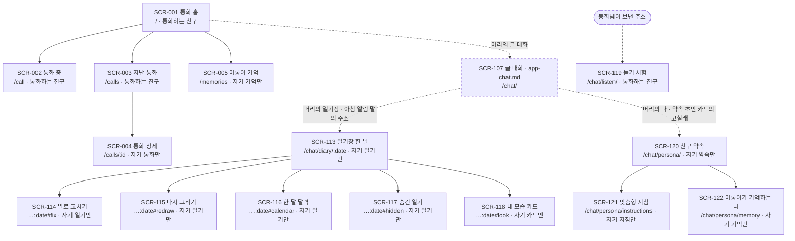
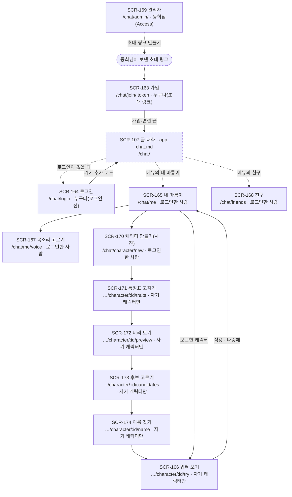
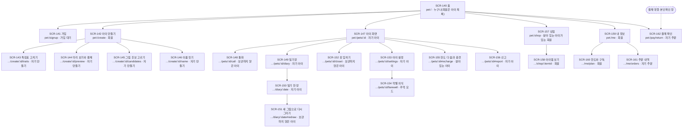

# 마롱이 웹 화면 목록

그린 때: 2026-11-19 11시대(한국 시각), [`sitemap.yaml`](sitemap.yaml)에서 그림(통합 앱 열두 개를 더함. 그 앞은 2026-11-17 16:10). 화면을 바꿀 때는 YAML을 고치고 이 세 보기를 같은 변경에서 다시 그려요.
화면은 쉰 개예요. 친구용 마롱이 열다섯 개는 통화 웹앱 다섯 개(SCR-001\~005), 2026-11-16에 설계한 일기장 여섯 개(SCR-113\~118)와 듣기 시험 한 개(SCR-119), 2026-11-17에 설계한 성향 맞춤 세 개(SCR-120\~122)이고, 지금 반영된 서버에서는 모두 Cloudflare Access 뒤에 있어서 허용된 Google 계정(통화하는 친구)만 봐요. 2026-11-19에 설계한 통합 앱 열두 개(SCR-163\~174)는 초대 링크로 가입한 사람이 기기 로그인으로 여는 화면이고 아래 [통합 앱(MVP)](#통합-앱mvp) 절에 그렸어요. 통합 앱으로 바뀌면 관리자 화면(SCR-169)만 Access 뒤에 남고, 위 열다섯 개도 로그인한 사람이 열어요(REQ-436, 전환은 설정값 `MARONG_AUTH`). 2026-11-17에 설계한 반려동물 서비스 스물세 개(SCR-140\~162)는 다른 도메인의 공개 서비스라 아래 [반려동물 서비스](#반려동물-서비스) 절에 따로 그렸어요. 카톡에서 일어나는 FL-010은 화면이 없어요.
앱 창과 글 대화 화면(SCR-101\~112)은 [android-app.md](../android-app.md), [app-chat.md](../app-chat.md), [app-ring.md](../app-ring.md)에 있어요. 아래 보드의 점선 칸 SCR-107은 일기장·성향 맞춤으로 가는 경로를 보이려고 그린 그 문서의 화면이에요.

앱 자동 업데이트(CTX-021, 2026-11-17 설계)는 웹 화면을 바꾸지 않아요. 앱의 글 대화 메뉴 SCR-109에 '자동 업데이트' 줄이 늘고(FL-148, TERM-092·097), 새 화면은 안드로이드 알림 SCR-130 하나예요(FL-148, TERM-095·098). 08 정의는 `docs/08-screens/app-update.md`(PR #27)예요. 화면이 없는 흐름은 FL-146(서버 명령)·FL-147(조용히 일어남), 화면이 없는 용어는 TERM-093·094·096·099·100이에요. 모든 화면의 번호표와 목업 자리는 [`design/README.md`](../../design/README.md)에 있어요.

## 보드

## 목록

| ID | 이름 | 경로 | 누가 보나 | 흐름 | 용어 |
| --- | --- | --- | --- | --- | --- |
| SCR-001 | 통화 홈 | `/` | 통화하는 친구 | FL-001, FL-002, FL-006, FL-007, FL-008, FL-009, FL-121, FL-177 | CTX-002, CTX-006, CTX-029, TERM-001, TERM-003, TERM-014, TERM-018, TERM-167, TERM-178, TERM-190 |
| SCR-002 | 통화 중 | `/call` | 통화하는 친구 | FL-002, FL-003, FL-004, FL-005, FL-006, FL-007, FL-009, FL-142, FL-178 | CTX-002, CTX-003, CTX-020, TERM-001, TERM-002, TERM-009\~012, TERM-017\~019, TERM-080, TERM-083, TERM-179, TERM-197 |
| SCR-003 | 지난 통화 | `/calls` | 통화하는 친구 | FL-008 | CTX-004, TERM-001, TERM-006 |
| SCR-004 | 통화 상세 | `/calls/:id` | 통화하는 친구(자기 통화만) | FL-007, FL-008 | CTX-004, TERM-001, TERM-005\~007, TERM-015 |
| SCR-005 | 마롱이 기억 | `/memories` | 통화하는 친구(자기 기억만) | FL-008 | CTX-004, TERM-007 |
| SCR-113 | 일기장 한 날 | `/chat/diary/:date`(비우면 가장 최근 일기 날) | 통화하는 친구(디스코드 DM 연결 있음, 자기 일기만) | FL-115, FL-116, FL-117, FL-118, FL-119 | CTX-007, TERM-021, TERM-022, TERM-024, TERM-026\~029 |
| SCR-114 | 말로 고치기 | `/chat/diary/:date#fix` | 통화하는 친구(자기 일기만) | FL-116 | CTX-007, TERM-021 |
| SCR-115 | 다시 그리기 | `/chat/diary/:date#redraw` | 통화하는 친구(자기 일기만) | FL-116 | CTX-007, TERM-024, TERM-028, TERM-032 |
| SCR-116 | 한 달 달력 | `/chat/diary/:date#calendar` | 통화하는 친구(자기 일기만) | FL-117 | CTX-007, TERM-022, TERM-026, TERM-027, TERM-029 |
| SCR-117 | 숨긴 일기 | `/chat/diary/:date#hidden` | 통화하는 친구(자기 일기만) | FL-117 | CTX-007, TERM-021, TERM-029 |
| SCR-118 | 내 모습 카드 | `/chat/diary/:date#look` | 통화하는 친구(자기 카드만) | FL-119 | CTX-007, TERM-030, TERM-031 |
| SCR-119 | 듣기 시험 | `/chat/listen/` | 통화하는 친구(디스코드 DM 연결 있음) | FL-123 | CTX-002, TERM-039 |
| SCR-120 | 친구 약속 | `/chat/persona/` | 통화하는 친구(마롱이 친구에 묶임, 자기 약속만) | FL-124, FL-125, FL-126, FL-127 | CTX-008, CTX-020, TERM-040\~042, TERM-044, TERM-048, TERM-090 |
| SCR-121 | 맞춤형 지침 | `/chat/persona/instructions` | 통화하는 친구(마롱이 친구에 묶임, 자기 지침만) | FL-128 | CTX-008, TERM-043, TERM-044 |
| SCR-122 | 마롱이가 기억하는 나 | `/chat/persona/memory` | 통화하는 친구(마롱이 친구에 묶임, 자기 기억만) | FL-135 | CTX-011, TERM-063, TERM-064, TERM-066, TERM-071\~073 |

화면이 없는 용어:

- 통화: TERM-004 로그인 이메일(Access 로그인 화면은 Cloudflare가 그림), TERM-008 위임(목소리로만 답함), TERM-013 신호, TERM-016 sideband, TERM-020 미리 넘기기(친구에게 보이지 않음).
- 일기: TERM-023 하루 모음(밤 작업 안에서만), TERM-025 장면(친구에게 보이지 않음), TERM-033 아침 알림(앱 알림과 디스코드 DM의 말 한 줄).
- 통화 비용: TERM-034 통화 사용량, TERM-035 단가표, TERM-036 지출 상한 예산(Google Cloud 콘솔), TERM-037 설정 실험, TERM-038 글로 갈아타기. 동희님 관리 명령·시트만이거나 친구에게 보이지 않아요.
- 성향 맞춤: TERM-046 선호 신호(서버가 셈), TERM-049\~057 선톡 칸·게이트·이유·기억형 선톡·안 보냄·답 없는 선톡·백오프·잠금 화면 등급·꺼낼 얘기(선톡 그래프 안), TERM-058 기능 목록(코드), TERM-059·060 부탁·조건 연락(대화로만), TERM-065 기억 연산, TERM-067\~070 돌봄 안부·고정 요약·찾은 기억·정리 작업(서버 안), TERM-074·075 위기 상태·위기 신호(화면에 보이지 않음), TERM-076\~079 보내기 전 검사·기운 단계·통화 화제 목록·그림자 모드(서버 안). 고르기 카드(SCR-123)에 보이는 것은 TERM-041·045·047·061·062.

화면이 없는 흐름: FL-010(카톡), FL-114(밤 작업), FL-120(사용량 기록, 관리 명령·시트), FL-122(설정 실험, 관리 명령). FL-121의 디스코드 음성방 안내는 소리뿐이에요.

선 전화·그림 화두(CTX-020, 2026-11-16)는 새 화면이 없고 있는 화면의 상태만 늘어요([08단계 정의](../08-screens/call-first.md)). 통화 중(SCR-002)의 선 전화 그림 카드, 앱의 벨 화면 SCR-110·전화 알림 SCR-111([app-ring.md](../app-ring.md))의 '마롱이가 먼저 걸었어요', 앱 알림 SCR-108·글 대화 SCR-107·SCR-112([app-chat.md](../app-chat.md))의 그림 말풍선과 '먼저 건 전화' 태그예요. 디스코드 DM의 그림 첨부는 디스코드 화면이에요. 화면이 없는 용어: TERM-081 약속 전화(앱 벨 화면들에 이미 있음), TERM-082 화두, TERM-084 그림 세트, TERM-085 검수, TERM-086 화두 시각, TERM-087 선 전화 시간대, TERM-088 화두 답, TERM-089 간격 늘리기, TERM-090 선 전화 설정(말과 관리 도구로만), TERM-091 알림 미리보기 한 줄(알림의 글). 화면이 없는 흐름: FL-140 화두 고르기(서버 판단), FL-145 그림 세트(관리 도구).

## 슬라이드

### 1. 통화하기 (SCR-001 → SCR-002)

- 화면: SCR-001 통화 홈, SCR-002 통화 중
- 흐름: FL-001 처음 들어오기, FL-002 전화 걸기, FL-003 통화 중 기억, FL-004 끊김과 재연결, FL-005 쉬기·깨우기, FL-006 이어 받기, FL-007 끝내기, FL-009 예산, FL-121 지금 통화의 예산, FL-142 선 전화 받기
- 볼 점: 홈에서 한 번 눌러 바로 통화(코드·안내·동의 없음). 통화 중 화면에는 시간이 없어요. 뒤로 가도 통화는 이어져요. 마롱이 얼굴이 통화 상태·말소리·느낌에 따라 바뀌고, 말할 때 입은 GPT talk 움직임이에요(TERM-018, TERM-019). 마롱이가 먼저 건 전화(선 전화)를 받으면 마롱이가 화두로 먼저 말하고, 그림이 있으면 얼굴 위에 그림 카드가 15초 떠요(FL-142). 지금 통화(Gemini 경로)도 예산을 다 쓰면 홈이 예산 상태가 돼요(FL-121, 모양은 08단계 SCR-001).

### 2. 지난 통화 (SCR-001 → SCR-003 → SCR-004)

- 화면: SCR-003 지난 통화, SCR-004 통화 상세
- 흐름: FL-007 끝내기와 정리, FL-008 보기·지우기
- 볼 점: 상세에서 카드·통화 기억·자막을 보고 통화를 지울 수 있어요. 정리 중·정리 실패·자막 지움(180일)이 상태로 보여요.

### 3. 마롱이 기억 (SCR-001 → SCR-005)

- 화면: SCR-005 마롱이 기억
- 흐름: FL-008 보기·지우기
- 볼 점: 통화에서 생긴 기억만 보여요. 카톡 기억은 여기 없고 카톡 규칙(동희님에게 말하기)을 따라요.

### 4. 마롱이의 일기 (글 대화 SCR-107 → SCR-113 → SCR-114\~118)

- 화면: SCR-113 일기장 한 날, SCR-114 말로 고치기, SCR-115 다시 그리기, SCR-116 한 달 달력, SCR-117 숨긴 일기, SCR-118 내 모습 카드
- 흐름: FL-115 아침에 받아 보기, FL-116 고치기와 다시 그리기, FL-117 넘겨 보기·달력·숨기기, FL-118 도장, FL-119 내 모습 카드
- 볼 점: 일기장은 글 대화 머리의 '일기장'이나 아침 알림 말의 주소로 들어와요. 페이지는 하나이고, 고치기·다시 그리기·달력·숨긴 일기·내 모습 카드는 그 위에 뜨는 칸(`#fix` 등)이라 서버 주소가 늘지 않아요. 앱에서는 글 대화 창 안에서 열리고 안드로이드 뒤로 가기는 그 창을 닫아서(SPEC-143), 일기장 머리에 '글 대화로' 버튼을 둬요. 마음 날씨 고르기·도장·숨기기는 한 날 화면 안의 동작이에요. 켜기·끄기는 동희님 관리 명령이라 화면이 없어요.

### 5. 듣기 시험 (SCR-119)

- 화면: SCR-119 듣기 시험
- 흐름: FL-123 듣기 시험
- 볼 점: 동희님이 보낸 주소로만 들어오고 다른 화면에서 가는 경로는 없어요. 후보 이름은 화면에 나오지 않아요. 통화 중 기억 시험과 바꿀지 보기는 관리 명령이라 화면이 없어요.

### 6. 성향 맞춤과 친구 기억 (글 대화 SCR-107 → SCR-120 → SCR-121·122)

- 화면: SCR-120 친구 약속, SCR-121 맞춤형 지침, SCR-122 마롱이가 기억하는 나. 글 대화 안의 고르기 카드(SCR-123)는 SCR-107 메시지 안 부품이라 목록에 없어요([08 정의](../08-screens/persona.md))
- 흐름: FL-124 새 친구 첫 질문, FL-125 약속 초안, FL-126 말로 고치기, FL-127 약속 바꾸기 제안, FL-128 맞춤형 지침, FL-135 기억 보기·잊기
- 볼 점: 글 대화 머리의 '나' 버튼(API-127이 200일 때만 보임, 일기장 버튼과 같은 방식)이나 약속 초안 카드의 '고칠래'로 들어와요. 앱에서는 글 대화 창 안에서 열리고 그 창의 뒤로 가기는 창을 닫아서, 세 페이지 머리 왼쪽에 돌아가는 버튼을 둬요(SCR-120은 '글 대화', SCR-121·122는 '친구 약속'). 모두 자기 것만 보고 바꿔요. 선톡·부탁·위기 대응처럼 서버 안에서만 일어나는 것은 화면이 없어요(용어는 `sitemap.yaml`의 성향 맞춤 주석).

## 통합 앱(MVP)

2026-11-19에 설계한 통합 앱(CTX-026\~029, D90\~D104)의 화면 열두 개예요. 아직 만들지 않았어요. 앱 서버가 `/chat/` 아래로 내보내고, 앱과 웹(아이폰 사파리)이 같은 페이지를 써요(SPEC-396). 화면 정의는 [08 unified.md](../08-screens/unified.md), API는 `api/unified.openapi.yaml`(API-211\~242)이에요. 와이어프레임과 목업은 아직 그리지 않았어요.

접근은 세 가지예요. '누구나'는 로그인 전(가입은 초대 링크를 가진 사람만 끝까지 가요), '로그인한 사람'은 초대 링크로 가입해 로그인 쿠키가 있는 기기, '동희님'은 Cloudflare Access 뒤의 관리자 화면이에요(REQ-438). 로그인한 사람은 자기 것만 보고 바꾸고, 남의 것과 없는 것은 같은 404예요. 로그인이 없으면 어느 화면이든 로그인(SCR-164)으로 보내요(REQ-436).

### 보드

사이트맵의 부모는 내 마롱이(SCR-165)이고, 그 아래에 목소리 고르기와 캐릭터 화면 여섯 개가 있어요. 보드의 캐릭터 화면 사이 화살표는 만드는 순서예요.

### 목록

| ID | 이름 | 경로 | 누가 보나 | 흐름 | 용어 |
| --- | --- | --- | --- | --- | --- |
| SCR-163 | 가입 | `/chat/join/:token` | 누구나(초대 링크를 가진 사람, 로그인 전) | FL-169, FL-170, FL-171 | CTX-026, TERM-173\~175, TERM-178 |
| SCR-164 | 로그인 | `/chat/login` | 누구나(로그인 전) | FL-171 | CTX-026, TERM-173\~175 |
| SCR-165 | 내 마롱이 | `/chat/me` | 로그인한 사람(초대 링크로 가입) | FL-171, FL-173, FL-174, FL-177 | CTX-027, CTX-029, TERM-175, TERM-177\~179, TERM-182, TERM-183, TERM-186, TERM-190\~192 |
| SCR-167 | 목소리 고르기 | `/chat/me/voice` | 로그인한 사람(초대 링크로 가입) | FL-174 | CTX-027, TERM-183, TERM-184 |
| SCR-170 | 캐릭터 만들기(사진) | `/chat/character/new` | 로그인한 사람(초대 링크로 가입) | FL-172 | CTX-027, TERM-179, TERM-110, TERM-150, TERM-151 |
| SCR-171 | 특징표 고치기 | `/chat/character/:id/traits` | 로그인한 사람(자기 캐릭터만) | FL-172 | CTX-027, TERM-105, TERM-111, TERM-185 |
| SCR-172 | 미리 보기 | `/chat/character/:id/preview` | 로그인한 사람(자기 캐릭터만) | FL-172 | CTX-027, TERM-109, TERM-185 |
| SCR-173 | 후보 고르기 | `/chat/character/:id/candidates` | 로그인한 사람(자기 캐릭터만) | FL-172 | CTX-027, TERM-106\~108, TERM-185 |
| SCR-174 | 이름 짓기 | `/chat/character/:id/name` | 로그인한 사람(자기 캐릭터만) | FL-172 | CTX-027, TERM-107, TERM-178, TERM-179 |
| SCR-166 | 입혀 보기 | `/chat/character/:id/try` | 로그인한 사람(자기 캐릭터만) | FL-173 | CTX-027, TERM-181, TERM-182, TERM-186 |
| SCR-168 | 친구 | `/chat/friends` | 로그인한 사람(초대 링크로 가입) | FL-175 | CTX-028, TERM-187\~189 |
| SCR-169 | 관리자 | `/chat/admin/` | 동희님(Cloudflare Access) | FL-169, FL-170, FL-171, FL-177 | CTX-026, CTX-029, TERM-173, TERM-176, TERM-190, TERM-192 |

화면이 없는 용어: TERM-180 캐릭터 구간(프롬프트 안), TERM-193 방 주인(서버가 읽을 때 거름), TERM-194 앱 서버, TERM-195 턴 계획과 TERM-196 사전 조회(글 답 안에서만), TERM-198 작업 루프(서버 안).

화면이 없는 흐름은 없어요. 있는 화면에 놓인 흐름: FL-176 웹에서 밀린 연락 받기와 FL-177 하루 한도는 글 대화(SCR-107), FL-177은 통화 홈(SCR-001)에도, FL-178 통화 중 도구 대기는 통화 중(SCR-002)에 있어요. 있는 화면에서 바뀌는 곳은 [08 unified.md](../08-screens/unified.md) 15절에 적었어요: 글 대화 SCR-107·109·112의 머리말 이름·얼굴과 '내 마롱이'·'친구' 줄, 통화 홈 SCR-001의 통화 못 거는 상태, 통화 중 SCR-002의 대기 소리와 캐릭터 얼굴, 일기장·듣기 시험·성향 맞춤(SCR-113·119·120\~122)의 디스코드 DM 연결 안내 삭제. 앱 알림(SCR-108·111)의 제목에는 그 사람의 마롱이 이름이 들어가요(REQ-441).

### 슬라이드

#### 1. 가입과 로그인 (초대 링크 → SCR-163 → SCR-107, SCR-164, SCR-169)

- 화면: SCR-163 가입, SCR-164 로그인, SCR-169 관리자
- 흐름: FL-169 초대 링크로 가입, FL-170 기존 계정 연결, FL-171 기기 추가와 다시 로그인
- 볼 점: 동희님이 관리자 화면에서 초대 링크를 만들어 직접 전해요. 링크는 한 사람이 한 번만 쓰고 7일이 지나면 못 써요. 새 사람은 이름만 넣으면 가입이 끝나고, 그 화면에서 앱 받기와 기기 추가 코드를 봐요. 기존 계정(`link`)과 다시 로그인(`relogin`) 링크는 이름을 묻지 않아요. 앱의 첫 화면은 로그인이고 6자리 기기 추가 코드를 넣어요. 틀린 코드가 5번이면 10분 쉬어요.

#### 2. 내 마롱이: 이름과 목소리 (SCR-107 → SCR-165 → SCR-167)

- 화면: SCR-165 내 마롱이, SCR-167 목소리 고르기
- 흐름: FL-174 이름과 목소리 바꾸기, FL-171 기기 추가, FL-177 하루 사용량과 한도
- 볼 점: 한 화면에 마롱이 이름, 쓰는 캐릭터, 보관한 캐릭터, 통화 목소리, 기기 추가, 오늘 사용량이 있어요. 이름을 바꾸면 화면 머리말·알림·통화에서 그 이름으로 보여요. 목소리는 견본을 듣고 고르고 다음 통화부터 바뀌어요. 한도는 설정값이 있을 때만 숫자로 보여요. 아이폰 사파리에서는 '홈 화면에 추가' 안내가 한 줄 보여요.

#### 3. 캐릭터 만들기 (SCR-165 → SCR-170 → SCR-171\~174)

- 화면: SCR-170 캐릭터 만들기(사진), SCR-171 특징표 고치기, SCR-172 미리 보기, SCR-173 후보 고르기, SCR-174 이름 짓기
- 흐름: FL-172 캐릭터 만들기
- 볼 점: 반려동물 사진 1\~3장으로 강아지·고양이 캐릭터를 만들어요. 결제 단계가 없고 미리 보기 뒤 바로 후보 4장으로 가요. 그리는 일은 작업으로 돌아서 화면을 닫아도 되고, 다시 열면 서버의 단계에 맞는 화면으로 와요. 다시 만들기는 2번까지, 보관은 3개까지예요. 그림 월 예산을 다 쓰면 새로 만들기가 닫혀요.

#### 4. 입혀 보기와 적용 (SCR-174 → SCR-166 → SCR-165)

- 화면: SCR-166 입혀 보기, SCR-165 내 마롱이
- 흐름: FL-173 입혀 보기·적용·되돌리기
- 볼 점: 적용 전에 대화 화면과 통화 화면에 입힌 모습을 미리 봐요. 미리 보기는 정해 둔 견본 말이고 아무것도 저장하지 않아요. 적용하면 이 계정의 대화·통화·알림에서 이름과 모습이 바뀌고 대화와 기억은 이어져요. '나중에'를 고르면 보관돼요. 내 마롱이에서 언제든 기본 마롱이나 다른 캐릭터로 바꿔요.

#### 5. 친구 (SCR-107 → SCR-168)

- 화면: SCR-168 친구
- 흐름: FL-175 친구 요청·수락·끊기
- 볼 점: 내 친구 코드를 보여 주고, 상대의 코드를 넣어 요청을 보내요. 받은 요청은 수락하거나 거절해요. '가까운 사이'는 두 사람이 모두 켰을 때만 적용돼요. 공유를 끄는 스위치와 친구 끊기도 여기 있어요.

## 반려동물 서비스

친구용 마롱이와 다른 공개 서비스(CTX-022\~025)예요. 새 프로세스 `run_pet.py`가 내보내는 모바일 웹(PWA)이고 Cloudflare Access 없이 카카오·구글 로그인으로 들어와요(SPEC-310, 368). 경로 앞의 `pet:`은 아직 정하지 않은 공개 도메인이라는 뜻이고 실제 주소는 `pet:`을 뺀 경로예요. 화면 정의는 [08 pet.md](../08-screens/pet.md), API는 [`api/pet.openapi.yaml`](../../api/pet.openapi.yaml)이에요.

접근은 세 가지예요. '누구나'는 로그인 전, '가입 대기'는 로그인했지만 가입하지 않은 세션(가입만 됨), '회원'은 가입한 만 19세 이상이에요. 회원은 자기 것만 보고, 남의 것과 없는 것은 같은 404예요(SPEC-364). 아래 탭은 홈·상점·내 정보 세 칸이고 SCR-140·157·159에만 있어요. 살아 있는 아이가 하나도 없으면 상점 탭을 숨겨요(REQ-378, D72로 정함, 2026-11-17 16:33 KST). `#` 뒤 이름은 같은 페이지 위에 아래에서 올라오는 칸이고, 신고 칸(SCR-156)은 일기 한 장(SCR-150) 위에서도 같은 모양으로 떠요.

### 보드

### 목록

| ID | 이름 | 경로 | 누가 보나 | 흐름 | 용어 |
| --- | --- | --- | --- | --- | --- |
| SCR-140 | 홈 | `pet:/` | 누구나(로그인 전에는 소개와 카카오·구글 로그인, 회원은 자기 아이 목록) | FL-150, FL-151, FL-155, FL-161 | CTX-022, CTX-025, TERM-101\~103, TERM-132, TERM-134, TERM-136 |
| SCR-141 | 가입 | `pet:/signup` | 가입 대기 | FL-150 | CTX-025, TERM-134, TERM-136\~138 |
| SCR-142 | 아이 만들기 | `pet:/create` | 회원 | FL-151 | CTX-022, TERM-110, TERM-138 |
| SCR-143 | 특징표 고치기 | `pet:/create/:id/traits` | 회원(자기 만들기만) | FL-151, FL-152 | CTX-022, TERM-105, TERM-110 |
| SCR-144 | 미리 보기와 결제 | `pet:/create/:id/preview` | 회원(자기 만들기만) | FL-152 | CTX-022, CTX-024, TERM-109, TERM-127\~129, TERM-148 |
| SCR-145 | 그림 후보 고르기 | `pet:/create/:id/candidates` | 회원(자기 만들기만) | FL-153 | CTX-022, TERM-106\~108 |
| SCR-146 | 이름 짓기 | `pet:/create/:id/name` | 회원(자기 만들기만) | FL-154 | CTX-022, TERM-101, TERM-107, TERM-134, TERM-141 |
| SCR-147 | 아이 화면 | `pet:/pets/:id` | 회원(자기 아이만) | FL-154\~157, FL-159\~161 | CTX-022\~024, TERM-101\~103, TERM-120, TERM-123, TERM-132, TERM-134, TERM-142, TERM-146 |
| SCR-148 | 통화 | `pet:/pets/:id/call` | 회원(자기 아이만, 보관하지 않은 아이) | FL-156 | CTX-022, CTX-024, TERM-101, TERM-123, TERM-134 |
| SCR-149 | 일기장 | `pet:/pets/:id/diary` | 회원(자기 아이만) | FL-160, FL-162 | CTX-022, CTX-023, TERM-116, TERM-130, TERM-135 |
| SCR-150 | 일기 한 장 | `pet:/pets/:id/diary/:date` | 회원(자기 아이만) | FL-160, FL-162 | CTX-023, TERM-116\~118, TERM-130, TERM-131, TERM-135, TERM-142 |
| SCR-151 | 새 그림으로 다시 그리기 | `pet:/pets/:id/diary/:date#redraw` | 회원(자기 아이만, 보관하지 않은 아이) | FL-157, FL-160 | CTX-023, CTX-024, TERM-123, TERM-143 |
| SCR-152 | 옷 입히기 | `pet:/pets/:id/closet` | 회원(자기 아이만, 보관하지 않은 아이) | FL-159 | CTX-023, TERM-112\~115, TERM-120 |
| SCR-153 | 아이 설정 | `pet:/pets/:id/settings` | 회원(자기 아이만) | FL-161\~163 | CTX-022, TERM-102\~104, TERM-132, TERM-133, TERM-141 |
| SCR-154 | 작별 의식 | `pet:/pets/:id/farewell` | 회원(자기 아이만, 추억 모드, 작별 의식 전) | FL-162 | CTX-022, TERM-103, TERM-130, TERM-132 |
| SCR-155 | 한도 다 씀과 충전 | `pet:/pets/:id#recharge` | 회원(살아 있는 아이 모드. 추억 모드는 SCR-147의 안내만) | FL-157 | CTX-024, TERM-123\~126 |
| SCR-156 | 신고 | `pet:/pets/:id#report` | 회원(자기 아이의 대화 한 줄이나 그림) | FL-166 | CTX-025, TERM-140 |
| SCR-157 | 상점 | `pet:/shop` | 회원(살아 있는 아이가 하나 이상) | FL-158 | CTX-023, TERM-113, TERM-116\~119, TERM-121 |
| SCR-158 | 아이템 보기 | `pet:/shop/:itemId` | 회원 | FL-158 | CTX-023, CTX-024, TERM-112\~114, TERM-128, TERM-129 |
| SCR-159 | 내 정보 | `pet:/me` | 회원 | FL-150, FL-166 | CTX-025, TERM-136\~138, TERM-148 |
| SCR-160 | 한도와 구독 | `pet:/me/plan` | 회원 | FL-157, FL-164 | CTX-024, TERM-123\~126, TERM-129 |
| SCR-161 | 주문 내역 | `pet:/me/orders` | 회원(자기 주문만) | FL-165 | CTX-024, TERM-127\~129 |
| SCR-162 | 결제 확인 | `pet:/pay/return` | 회원(자기 주문만, 결제 대행 창에서 돌아옴) | FL-152, FL-157, FL-158, FL-164 | CTX-024, TERM-127, TERM-129 |

화면이 없는 용어: TERM-111 몸 템플릿(서버가 고름), TERM-122 확률형 아이템(팔지 않음), TERM-139 광고성 푸시 동의(1차에 없음), TERM-144 배경 세트(합성 그림 안에서만), TERM-145 한도 단위(회원에게는 %로만 보임), TERM-147 공개 서비스(서비스 전체).

화면이 없는 흐름: FL-167(운영자 아이템 올리기)·FL-168(운영자 결제 켜기·예산)은 서버 셸의 `tools/pet_admin.py`예요. 본인인증 창과 결제 창은 결제 대행·본인확인 기관이 그리고(02 질문 A·B), 기록 내보내기(FL-163)는 받기 주소의 zip 파일이에요.

### 슬라이드

#### 1. 들어오기와 가입 (SCR-140 → SCR-141, SCR-159)

- 화면: SCR-140 홈, SCR-141 가입, SCR-159 내 정보
- 흐름: FL-150 가입하고 동의하기, FL-166 계정 지우기
- 볼 점: 로그인 전 홈은 소개와 카카오·구글 로그인 단추 둘뿐이에요. 처음 로그인한 사람만 가입으로 가고, 생년월일·필수 동의 셋·국외 이전 동의를 한 화면에서 받아요. 만 19세 미만은 그 자리에서 끝나고 아무것도 남지 않아요. 국외 이전 동의는 내 정보에서 언제든 바꾸고, 계정 지우기도 여기 있어요.

#### 2. 아이 만들기 (SCR-140 → SCR-142 → SCR-143\~146 → SCR-147)

- 화면: SCR-142 아이 만들기(사진), SCR-143 특징표 고치기, SCR-144 미리 보기와 결제, SCR-145 그림 후보 고르기, SCR-146 이름 짓기
- 흐름: FL-151 사진과 특징표, FL-152 미리 보기와 결제, FL-153 후보와 캐릭터 시트, FL-154 이름과 첫 인사
- 볼 점: 한 번 만들기는 다섯 단계이고, `pet:/create/:id`로 들어오면 서버의 만들기 상태(명세 3.2)에 맞는 단계로 보내요. 결제 전까지는 돈이 들지 않고(미리 보기 하루 3장), 결제는 미리 보기 화면에서만 해요. 후보와 표정을 그리는 동안은 화면을 닫아도 되고 웹 푸시로 알려요. 이름을 지으면 첫 인사와 함께 아이 화면으로 가요.

#### 3. 아이와 지내기 (SCR-147 → SCR-148, SCR-152, SCR-155, SCR-156)

- 화면: SCR-147 아이 화면(대화), SCR-148 통화, SCR-152 옷 입히기, SCR-155 한도 다 씀과 충전, SCR-156 신고
- 흐름: FL-155 글 대화, FL-156 통화, FL-157 한도와 충전, FL-159 입히기와 아이템 반응 선톡, FL-166 신고
- 볼 점: 아이 화면 맨 위에 'AI가 만든 캐릭터예요' 줄이 늘 있어요(닫을 수 없음). 하루 한도는 %로만 보이고, 다 쓰면 살아 있는 아이는 충전 칸이 한 번 뜨지만 추억 모드는 '오늘은 여기까지' 안내만 떠요. 글 대화는 한도와 상관없이 이어 가요(하루 300개 뒤 잠듦). 대화 한 줄이나 그림을 길게 누르면 신고 칸이 떠요.

#### 4. 그림일기 (SCR-147 → SCR-149 → SCR-150 → SCR-151)

- 화면: SCR-149 일기장, SCR-150 일기 한 장, SCR-151 새 그림으로 다시 그리기
- 흐름: FL-160 그림일기와 꾸미기, FL-162 작별 의식의 마지막 장
- 볼 점: 일기는 아이가 쓴 그림일기이고 그림은 합성 그림이에요. 테마·글꼴 고르기와 스티커 붙이기는 일기 한 장 안의 꾸미기 상태이고, 새 그림은 한도를 쓰는 다시 그리기 칸이에요. 카드 공유는 워터마크를 단 그림을 기기의 공유 창으로 넘겨요.

#### 5. 추억 모드와 작별 (SCR-147 → SCR-153 → SCR-154)

- 화면: SCR-153 아이 설정, SCR-154 작별 의식
- 흐름: FL-161 추억 모드로 바꾸기, FL-162 작별 의식과 보관, FL-163 기록 내보내기
- 볼 점: '무지개다리를 건넜어요'는 아이 설정 안에서만 하고, 바뀌는 것을 먼저 보여 준 뒤 확인을 받아요(7일 안 되돌리기). 작별 의식은 추억 모드에서 한 번만이고, 끝나면 보관할지 물어요. 보관한 아이는 홈의 아래 칸에서 일기와 그림만 봐요.

#### 6. 상점과 결제 (SCR-140 → SCR-157 → SCR-158 → SCR-162, SCR-159 → SCR-160·161)

- 화면: SCR-157 상점, SCR-158 아이템 보기, SCR-160 한도와 구독, SCR-161 주문 내역, SCR-162 결제 확인
- 흐름: FL-158 상점, FL-157 충전, FL-164 구독, FL-165 청약철회
- 볼 점: 정가 판매만 있고 확률형 아이템은 없어요. 착용 아이템은 내 아이에게 입혀 보고, 일기장 테마·스티커는 일기장에 대어 보고 사요. 결제 전 화면마다 원화 총액과 청약철회 제한을 보여요. 결제 대행 창에서 돌아오면 결제 확인 화면이 결과를 받아 원래 화면으로 보내요. 추억 모드 아이만 있는 회원에게는 상점 단추가 없어요.
