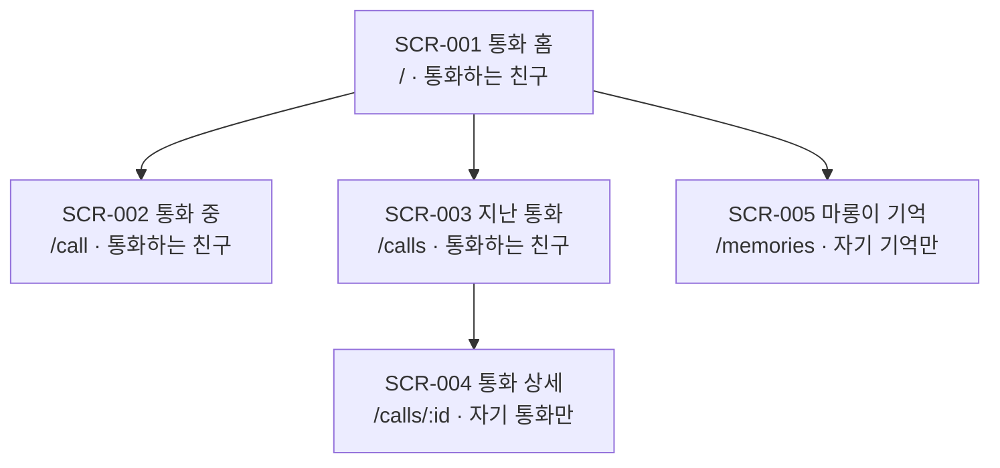

# 마롱이 통화 웹앱 화면 목록

그린 때: 2026-11-16 23:46(한국 시각), [`sitemap.yaml`](sitemap.yaml)에서 그림. 화면을 바꿀 때는 YAML을 고치고 이 세 보기를 같은 변경에서 다시 그려요.
화면은 다섯 개예요. 모두 Cloudflare Access 뒤에 있어서 허용된 Google 계정(통화하는 친구, 지금은 현경님)만 봐요. 카톡에서 일어나는 FL-010은 화면이 없어요.

## 보드

## 목록

| ID | 이름 | 경로 | 누가 보나 | 흐름 | 용어 |
| --- | --- | --- | --- | --- | --- |
| SCR-001 | 통화 홈 | `/` | 통화하는 친구 | FL-001, FL-002, FL-006, FL-007, FL-008, FL-009 | CTX-002, CTX-006, TERM-001, TERM-003, TERM-014, TERM-018 |
| SCR-002 | 통화 중 | `/call` | 통화하는 친구 | FL-002, FL-003, FL-004, FL-005, FL-006, FL-007, FL-009, FL-142 | CTX-002, CTX-003, CTX-020, TERM-001, TERM-002, TERM-009\~012, TERM-017\~019, TERM-080, TERM-083 |
| SCR-003 | 지난 통화 | `/calls` | 통화하는 친구 | FL-008 | CTX-004, TERM-001, TERM-006 |
| SCR-004 | 통화 상세 | `/calls/:id` | 통화하는 친구(자기 통화만) | FL-007, FL-008 | CTX-004, TERM-001, TERM-005\~007, TERM-015 |
| SCR-005 | 마롱이 기억 | `/memories` | 통화하는 친구(자기 기억만) | FL-008 | CTX-004, TERM-007 |

화면이 없는 용어: TERM-004 로그인 이메일(Access 로그인 화면은 Cloudflare가 그림), TERM-008 위임(목소리로만 답함), TERM-013 신호, TERM-016 sideband.

선 전화·그림 화두(CTX-020, 2026-11-16)는 새 화면이 없고 있는 화면의 상태만 늘어요([08단계 정의](../08-screens/call-first.md)). 통화 중(SCR-002)의 선 전화 그림 카드, 앱의 벨 화면 SCR-110·전화 알림 SCR-111([app-ring.md](../app-ring.md))의 '마롱이가 먼저 걸었어요', 앱 알림 SCR-108·글 대화 SCR-107·SCR-112([app-chat.md](../app-chat.md))의 그림 말풍선과 '먼저 건 전화' 태그예요. 디스코드 DM의 그림 첨부는 디스코드 화면이에요. 화면이 없는 용어: TERM-081 약속 전화(앱 벨 화면들에 이미 있음), TERM-082 화두, TERM-084 그림 세트, TERM-085 검수, TERM-086 화두 시각, TERM-087 선 전화 시간대, TERM-088 화두 답, TERM-089 간격 늘리기, TERM-090 선 전화 설정(말과 관리 도구로만), TERM-091 알림 미리보기 한 줄(알림의 글). 화면이 없는 흐름: FL-140 화두 고르기(서버 판단), FL-145 그림 세트(관리 도구).

앱 자동 업데이트(CTX-021, 2026-11-17)는 웹 화면을 바꾸지 않아요([08단계 정의](../08-screens/app-update.md)). 앱의 글 대화 메뉴 SCR-109([app-chat.md](../app-chat.md))에 '자동 업데이트' 줄이 늘고(FL-148, TERM-092 자동 업데이트, TERM-097 출처를 알 수 없는 앱 설치), 새 화면은 안드로이드 알림 SCR-130 '마롱이 앱 새 버전이 있어요' 하나예요(FL-148, TERM-095 버전 이름, TERM-098 사용자 확인). SCR-130\~139는 이 맥락 몫이에요. 화면이 없는 흐름: FL-146 릴리스 올리기(서버 명령), FL-147 앱 업데이트(조용히 일어남). 화면이 없는 용어: TERM-093 릴리스, TERM-094 버전 코드, TERM-096 업데이트 설치, TERM-099 서명 인증서, TERM-100 업데이트 멈춤.

## 슬라이드

### 1. 통화하기 (SCR-001 → SCR-002)

- 화면: SCR-001 통화 홈, SCR-002 통화 중
- 흐름: FL-001 처음 들어오기, FL-002 전화 걸기, FL-003 통화 중 기억, FL-004 끊김과 재연결, FL-005 쉬기·깨우기, FL-006 이어 받기, FL-007 끝내기, FL-009 예산, FL-142 선 전화 받기
- 볼 점: 홈에서 한 번 눌러 바로 통화(코드·안내·동의 없음). 통화 중 화면에는 시간이 없어요. 뒤로 가도 통화는 이어져요. 마롱이 얼굴이 통화 상태·말소리·느낌에 따라 바뀌고, 말할 때 입은 GPT talk 움직임이에요(TERM-018, TERM-019). 마롱이가 먼저 건 전화(선 전화)를 받으면 마롱이가 화두로 먼저 말하고, 그림이 있으면 얼굴 위에 그림 카드가 15초 떠요(FL-142).

### 2. 지난 통화 (SCR-001 → SCR-003 → SCR-004)

- 화면: SCR-003 지난 통화, SCR-004 통화 상세
- 흐름: FL-007 끝내기와 정리, FL-008 보기·지우기
- 볼 점: 상세에서 카드·통화 기억·자막을 보고 통화를 지울 수 있어요. 정리 중·정리 실패·자막 지움(180일)이 상태로 보여요.

### 3. 마롱이 기억 (SCR-001 → SCR-005)

- 화면: SCR-005 마롱이 기억
- 흐름: FL-008 보기·지우기
- 볼 점: 통화에서 생긴 기억만 보여요. 카톡 기억은 여기 없고 카톡 규칙(동희님에게 말하기)을 따라요.
