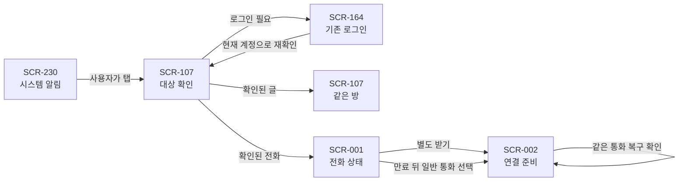

# 아이폰 홈 화면 웹앱 알림 08단계 화면 정의

2026-11-25 KST · 마롱이 Orca 항목 143 · 08 체크포인트 대기

[그레이스케일 와이어프레임](../wireframes-iphone-home-webapp-notifications.draft.html) · [07 고정 사이트맵](../../07-sitemap/iphone-home-webapp-notifications.draft.sitemap.yaml) · [06 고정 OpenAPI](../../../api/iphone-home-webapp-notifications.version-candidate.openapi.yaml) · [08 승인 및 검증 기록](../../../iphone-webapp-08-screen-checkpoint-2026-11-25.md)

## 화면별 정의

아래 문서에는 새로 표시하거나 변경할 상태만 있습니다. 기존 화면의 동작과 문구의 기준은 연결한 원본입니다. SCR-109의 문구 후보는 별도 검토입니다.

| SCR | 영향 |
| --- | --- |
| [SCR-165](SCR-165.md) | 일반 Safari 설치 안내, 홈 화면 웹앱의 명시 선택과 설치별 구독 |
| [SCR-163](SCR-163.md) | 기존 가입 성공의 아이폰 설치 안내 |
| [SCR-164](SCR-164.md) | 기존 로그인 폼에 알림·설정 복귀 맥락 연결 |
| [SCR-107](SCR-107.md) | 탭 뒤 인증·같은 대상·같은 방 확인과 안전한 실패 |
| [SCR-001](SCR-001.md) | 기존 전화 홈의 받기·만료·선행 수락·결과 확인 |
| [SCR-002](SCR-002.md) | 논리 상태로 통화 준비·같은 클라이언트 복귀·미확인 표시 |
| [SCR-230](SCR-230.md) | iOS 시스템 알림에 제공하는 일반 유형과 탭 |
| [SCR-101](SCR-101.md) | Android의 동일 전화 선행 수락에 기존 통화 중 상태 재사용 |
| [SCR-109](SCR-109.md) | 재사용하는 메뉴의 설명 문구만 바꿀지 별도 검토 |

| 재사용 화면 | 이번 08의 연결 |
| --- | --- |
| SCR-108·112 | 기존 Android 글·일정 알림을 누르고 기존 글 대화 창에서 SCR-107을 엽니다. [기존 글 알림·창](../../app-chat.md) |
| SCR-110·111 | 기존 Android 벨과 전화 알림입니다. 거절한 뒤 새 통화가 없습니다. [기존 약속 전화](../../app-ring.md) |
| SCR-130 | 기존 APK의 다운로드·설치·업데이트 알림. 웹 설치·구독과 관계없이 회귀 확인합니다. [기존 업데이트 화면](../app-update.md#scr-130-앱-업데이트-알림안드로이드-알림) |

## 알림 탭과 통화의 논리 전환

홈 화면 웹앱은 `/chat/#notice`의 대상 참조를 읽고 주소에서 제거한 뒤 고정 API-314로 확인합니다. 앱이 창을 유지하며 SCR-001·002를 논리적으로 전환합니다. 기존 설계의 `/`와 `/call`을 알림에서 강제 호출해야 하는 새 HTTP 경로로 해석하지 않습니다. 인증 복귀 시 현재 계정과 대상·기한을 다시 확인하며 보류한 받기는 재실행하지 않습니다.

## 공통 접근성과 표시

- 프로젝트 화면 검토 폭은 세로 **360px·430px**입니다. 그레이스케일의 시스템 글꼴, 44px 이상 터치 영역, 본문 대비 4.5:1 이상과 초점·필수 경계 3:1 이상을 검토합니다. 한국어는 단어 단위로 줄을 바꾸고, 긴 어절에 줄바꿈을 허용합니다. 중요한 설명과 오프라인·권한·기한 상태는 말줄임 없이 표시합니다. [프로젝트 화면 기준](../README.md) · [디자인 확인 기준](../../../design/README.md)
- 상태가 바뀌는 동안 제목·설명·조작의 배치를 보존합니다. 최초 화면 이동만 제목을 읽는 위치로 초점을 옮기고, 같은 화면에서 상태만 바뀌면 실행한 버튼에 초점을 유지합니다. 그 버튼이 제거되면 새 상태 제목이나 논리적으로 다음 조작에 초점을 둡니다. 가장 중요한 동작이라도 받기·일반 통화에 자동 초점을 주거나 실행하지 않습니다.
- 처리 중에는 같은 조작을 한 번만 실행하게 막고 `aria-busy`와 한 번의 상태 안내를 사용합니다. 상태·초점은 회색 차이만으로 나타내지 않습니다. 스크린리더가 메시지와 제목을 겹쳐 읽지 않도록 새 영역에 초점을 옮기거나 상태로 읽히는 방식 중 하나를 사용합니다. 화면 읽기·키보드 순서와 OS 초점 반환은 후속 구현·VoiceOver 시험이 필요합니다.
- OS 공유 메뉴·권한 요청·잠금 해제는 iOS가 표시합니다. 일반 Safari에서는 설치 안내와 기존 글·통화만, Android에서는 기존 앱·벨·업데이트 화면을 사용합니다. 명시적으로 켜기 전 권한 요청, 재로그인 뒤 자동 수락, 만료 뒤 자동 일반 통화는 발생하지 않습니다.

## API 응답 대조표

표의 200 상태 이름은 고정 OpenAPI의 예시 이름입니다. 요청 중과 연결 단절은 각 화면의 상태 표에 있습니다. 317 업그레이드 실패는 브라우저에서 상세 HTTP 번호를 읽기 어려워 현재 상태를 HTTP로 확인하고, 관측한 결과로 화면을 결정합니다.

| API | 상태 | 예시·코드 | 표시 상태 | 처리 |
| --- | --- | --- | --- | --- |
| API-310 | 200 | notRegistered | [SCR-165#notify-off](SCR-165.md#notify-off) · [SCR-165#notify-register](SCR-165.md#notify-register) | OS 허용 여부에 따라 미등록·등록 필요를 구분합니다. OS 거부는 권한 상태를 우선합니다. |
| API-310 | 200 | active | [SCR-165#notify-active](SCR-165.md#notify-active) · [SCR-165#notify-denied](SCR-165.md#notify-denied) | OS 허용과 서버 상태를 함께 확인합니다. OS가 불확실하면 확인 불가 상태입니다. |
| API-310 | 200 | revoked | [SCR-165#notify-revoked](SCR-165.md#notify-revoked) | 현재 계정·설치의 승인된 결과를 표시합니다. |
| API-310 | 200 | expired | [SCR-165#notify-expired](SCR-165.md#notify-expired) | 현재 계정·설치의 승인된 결과를 표시합니다. |
| API-310 | 200 | invalid | [SCR-165#notify-expired](SCR-165.md#notify-expired) | 현재 계정·설치의 승인된 결과를 표시합니다. |
| API-310 | 400 | invalid_input | [SCR-165#notify-input-error](SCR-165.md#notify-input-error) | 보호된 입력값·대상 참조를 표시하지 않습니다. |
| API-310 | 401 | login_required | [SCR-164#notification-settings-login](SCR-164.md#notification-settings-login) | 기존 로그인에서 돌아온 뒤 조회부터 다시 시작합니다. |
| API-310 | 403 | cross_site | [SCR-165#notify-blocked](SCR-165.md#notify-blocked) | 보호 정보를 지우고 안전한 화면을 사용합니다. |
| API-310 | 403 | not_allowed | [SCR-165#notify-blocked](SCR-165.md#notify-blocked) | 보호 정보를 지우고 안전한 화면을 사용합니다. |
| API-310 | 429 | request_limit | [SCR-165#notify-rate-limited](SCR-165.md#notify-rate-limited) | 요청 제한은 Retry-After를 따릅니다. |
| API-310 | 503 | db_unavailable | [SCR-165#notify-unavailable](SCR-165.md#notify-unavailable) | 확정되지 않은 상태를 성공으로 표시하지 않습니다. |
| API-310 | default | internal | [SCR-165#notify-unavailable](SCR-165.md#notify-unavailable) | 동작이 완료됐다고 추정하지 않습니다. |
| API-312 | 200 | registered | [SCR-165#notify-active](SCR-165.md#notify-active) · [SCR-165#notify-denied](SCR-165.md#notify-denied) | 현재 OS 허용을 다시 확인한 뒤 결과를 표시합니다. |
| API-312 | 400 | invalid_input | [SCR-165#notify-input-error](SCR-165.md#notify-input-error) | 보호된 입력값·대상 참조를 표시하지 않습니다. |
| API-312 | 401 | login_required | [SCR-164#notification-settings-login](SCR-164.md#notification-settings-login) | 기존 로그인에서 돌아온 뒤 조회부터 다시 시작합니다. |
| API-312 | 403 | cross_site | [SCR-165#notify-blocked](SCR-165.md#notify-blocked) | 보호 정보를 지우고 안전한 화면을 사용합니다. |
| API-312 | 403 | not_allowed | [SCR-165#notify-blocked](SCR-165.md#notify-blocked) | 보호 정보를 지우고 안전한 화면을 사용합니다. |
| API-312 | 409 | state_changed | [SCR-165#notify-conflict](SCR-165.md#notify-conflict) | 현재 상태를 확인하거나 기존 통화 제한을 표시합니다. |
| API-312 | 409 | subscription_conflict | [SCR-165#notify-conflict](SCR-165.md#notify-conflict) | 현재 상태를 확인하거나 기존 통화 제한을 표시합니다. |
| API-312 | 429 | request_limit | [SCR-165#notify-rate-limited](SCR-165.md#notify-rate-limited) | 요청 제한은 Retry-After를 따릅니다. |
| API-312 | 503 | db_unavailable | [SCR-165#notify-unavailable](SCR-165.md#notify-unavailable) | 확정되지 않은 상태를 성공으로 표시하지 않습니다. |
| API-312 | default | internal | [SCR-165#notify-unavailable](SCR-165.md#notify-unavailable) | 동작이 완료됐다고 추정하지 않습니다. |
| API-313 | 200 | revoked | [SCR-165#notify-revoked](SCR-165.md#notify-revoked) | 현재 계정·설치의 승인된 결과를 표시합니다. |
| API-313 | 200 | notRegistered | [SCR-165#notify-revoked](SCR-165.md#notify-revoked) | 명시적으로 끄기를 한 요청의 비활성 결과입니다. |
| API-313 | 400 | invalid_input | [SCR-165#notify-input-error](SCR-165.md#notify-input-error) | 보호된 입력값·대상 참조를 표시하지 않습니다. |
| API-313 | 401 | login_required | [SCR-164#notification-settings-login](SCR-164.md#notification-settings-login) | 기존 로그인에서 돌아온 뒤 조회부터 다시 시작합니다. |
| API-313 | 403 | cross_site | [SCR-165#notify-blocked](SCR-165.md#notify-blocked) | 보호 정보를 지우고 안전한 화면을 사용합니다. |
| API-313 | 403 | not_allowed | [SCR-165#notify-blocked](SCR-165.md#notify-blocked) | 보호 정보를 지우고 안전한 화면을 사용합니다. |
| API-313 | 409 | state_changed | [SCR-165#notify-conflict](SCR-165.md#notify-conflict) | 현재 상태를 확인하거나 기존 통화 제한을 표시합니다. |
| API-313 | 429 | request_limit | [SCR-165#notify-rate-limited](SCR-165.md#notify-rate-limited) | 요청 제한은 Retry-After를 따릅니다. |
| API-313 | 503 | db_unavailable | [SCR-165#notify-unavailable](SCR-165.md#notify-unavailable) | 확정되지 않은 상태를 성공으로 표시하지 않습니다. |
| API-313 | default | internal | [SCR-165#notify-unavailable](SCR-165.md#notify-unavailable) | 동작이 완료됐다고 추정하지 않습니다. |
| API-311 | 200 | granted | [SCR-165#notify-saving](SCR-165.md#notify-saving) | 단기 선택을 확인했습니다. 화면은 결과를 기다립니다. |
| API-311 | 400 | invalid_input | [SCR-165#notify-input-error](SCR-165.md#notify-input-error) | 보호된 입력값·대상 참조를 표시하지 않습니다. |
| API-311 | 401 | login_required | [SCR-164#notification-settings-login](SCR-164.md#notification-settings-login) | 기존 로그인에서 돌아온 뒤 조회부터 다시 시작합니다. |
| API-311 | 403 | cross_site | [SCR-165#notify-blocked](SCR-165.md#notify-blocked) | 보호 정보를 지우고 안전한 화면을 사용합니다. |
| API-311 | 403 | not_allowed | [SCR-165#notify-blocked](SCR-165.md#notify-blocked) | 보호 정보를 지우고 안전한 화면을 사용합니다. |
| API-311 | 409 | state_changed | [SCR-165#notify-conflict](SCR-165.md#notify-conflict) | 현재 상태를 확인하거나 기존 통화 제한을 표시합니다. |
| API-311 | 429 | request_limit | [SCR-165#notify-rate-limited](SCR-165.md#notify-rate-limited) | 요청 제한은 Retry-After를 따릅니다. |
| API-311 | 503 | db_unavailable | [SCR-165#notify-unavailable](SCR-165.md#notify-unavailable) | 확정되지 않은 상태를 성공으로 표시하지 않습니다. |
| API-311 | default | internal | [SCR-165#notify-unavailable](SCR-165.md#notify-unavailable) | 동작이 완료됐다고 추정하지 않습니다. |
| API-314 | 200 | chat | [SCR-107#notice-room](SCR-107.md#notice-room) | 검증한 동일 방의 기존 내용을 현재 로그인으로 읽습니다. |
| API-314 | 200 | ready | [SCR-001#notice-ring-ready](SCR-001.md#notice-ring-ready) | 전화 홈에서 받기를 기다립니다. 이 응답으로 수락하거나 마이크를 시작하지 않습니다. |
| API-314 | 200 | expired | [SCR-001#notice-ring-expired](SCR-001.md#notice-ring-expired) | 현재 계정에서 미수락 만료가 확인됐습니다. |
| API-314 | 200 | answered | [SCR-001#notice-ring-answered](SCR-001.md#notice-ring-answered) | 먼저 수락된 전화는 기한 뒤에도 처리된 상태입니다. |
| API-314 | 200 | unavailable | [SCR-001#notice-ring-unavailable](SCR-001.md#notice-ring-unavailable) | 현재 계정·설치의 승인된 결과를 표시합니다. |
| API-314 | 400 | invalid_input | [SCR-107#notice-denied](SCR-107.md#notice-denied) | 보호된 입력값·대상 참조를 표시하지 않습니다. |
| API-314 | 401 | login_required | [SCR-164#notice-login](SCR-164.md#notice-login) | 기존 로그인에서 돌아온 뒤 조회부터 다시 시작합니다. |
| API-314 | 403 | cross_site | [SCR-107#notice-denied](SCR-107.md#notice-denied) | 보호 정보를 지우고 안전한 화면을 사용합니다. |
| API-314 | 403 | not_allowed | [SCR-107#notice-denied](SCR-107.md#notice-denied) | 보호 정보를 지우고 안전한 화면을 사용합니다. |
| API-314 | 404 | not_found | [SCR-107#notice-denied](SCR-107.md#notice-denied) | 다른 계정·삭제·없는 대상·검증 실패의 결과를 같은 안내로 표시합니다. |
| API-314 | 429 | request_limit | [SCR-107#notice-rate-limited](SCR-107.md#notice-rate-limited) | 요청 제한은 Retry-After를 따릅니다. |
| API-314 | 503 | db_unavailable | [SCR-107#notice-unavailable](SCR-107.md#notice-unavailable) | 확정되지 않은 상태를 성공으로 표시하지 않습니다. |
| API-314 | default | internal | [SCR-107#notice-unavailable](SCR-107.md#notice-unavailable) | 동작이 완료됐다고 추정하지 않습니다. |
| API-315 | 200 | accepted | [SCR-002#notice-connecting](SCR-002.md#notice-connecting) | 같은 클라이언트의 확정된 통화입니다. 실제 오디오가 연결됐다고 표현하지 않습니다. |
| API-315 | 200 | expired | [SCR-001#notice-ring-expired](SCR-001.md#notice-ring-expired) | 현재 계정·설치의 승인된 결과를 표시합니다. |
| API-315 | 200 | answered | [SCR-001#notice-ring-answered](SCR-001.md#notice-ring-answered) | 현재 계정·설치의 승인된 결과를 표시합니다. |
| API-315 | 200 | unavailable | [SCR-001#notice-ring-unavailable](SCR-001.md#notice-ring-unavailable) | 현재 계정·설치의 승인된 결과를 표시합니다. |
| API-315 | 400 | invalid_input | [SCR-001#notice-ring-denied](SCR-001.md#notice-ring-denied) | 보호된 입력값·대상 참조를 표시하지 않습니다. |
| API-315 | 401 | login_required | [SCR-164#notice-login](SCR-164.md#notice-login) | 기존 로그인에서 돌아온 뒤 조회부터 다시 시작합니다. |
| API-315 | 403 | cross_site | [SCR-001#notice-ring-denied](SCR-001.md#notice-ring-denied) | 보호 정보를 지우고 안전한 화면을 사용합니다. |
| API-315 | 403 | not_allowed | [SCR-001#notice-ring-denied](SCR-001.md#notice-ring-denied) | 보호 정보를 지우고 안전한 화면을 사용합니다. |
| API-315 | 404 | not_found | [SCR-001#notice-ring-denied](SCR-001.md#notice-ring-denied) | 다른 계정·삭제·없는 대상·검증 실패의 결과를 같은 안내로 표시합니다. |
| API-315 | 409 | call_busy | `SCR-001#call-busy`(기존) | 현재 상태를 확인하거나 기존 통화 제한을 표시합니다. |
| API-315 | 409 | calls_full | `SCR-001#calls-full`(기존) | 현재 상태를 확인하거나 기존 통화 제한을 표시합니다. |
| API-315 | 409 | budget_exhausted | `SCR-001#budget`(기존) | 현재 상태를 확인하거나 기존 통화 제한을 표시합니다. |
| API-315 | 429 | request_limit | [SCR-001#notice-ring-rate-limited](SCR-001.md#notice-ring-rate-limited) | 요청 제한은 Retry-After를 따릅니다. |
| API-315 | 429 | daily_limit | `SCR-001#daily-limit`(기존) | 기존 일일 사용 한도 표시입니다. |
| API-315 | 503 | db_unavailable | [SCR-001#notice-ring-result](SCR-001.md#notice-ring-result) | 이미 보낸 수락의 확정 여부가 미확인입니다. 같은 요청 결과 확인만 표시합니다. |
| API-315 | default | internal | [SCR-001#notice-ring-result](SCR-001.md#notice-ring-result) | 이미 보낸 수락의 확정 여부를 추정하지 않습니다. |
| API-316 | 200 | observed | 현재 글 대화 유지 | 해당 설치의 특정 답변 단기 신호입니다. 표시 변경은 없습니다. |
| API-316 | 200 | hidden | 현재 글 대화 유지 | 단기 신호를 종료합니다. 표시 변경은 없습니다. |
| API-316 | 400 | invalid_input | 현재 글 대화 유지 | 알림 생략의 확인으로 취급하지 않습니다. 기존 글 대화 상태 및 인증은 일반 조회에서 판정합니다. |
| API-316 | 401 | login_required | 현재 글 대화 유지 | 알림 생략의 확인으로 취급하지 않습니다. 기존 글 대화 상태 및 인증은 일반 조회에서 판정합니다. |
| API-316 | 403 | cross_site | 현재 글 대화 유지 | 알림 생략의 확인으로 취급하지 않습니다. 기존 글 대화 상태 및 인증은 일반 조회에서 판정합니다. |
| API-316 | 403 | not_allowed | 현재 글 대화 유지 | 알림 생략의 확인으로 취급하지 않습니다. 기존 글 대화 상태 및 인증은 일반 조회에서 판정합니다. |
| API-316 | 404 | not_found | 현재 글 대화 유지 | 알림 생략의 확인으로 취급하지 않습니다. 기존 글 대화 상태 및 인증은 일반 조회에서 판정합니다. |
| API-316 | 429 | request_limit | 현재 글 대화 유지 | 알림 생략의 확인으로 취급하지 않습니다. 기존 글 대화 상태 및 인증은 일반 조회에서 판정합니다. |
| API-316 | 503 | db_unavailable | 현재 글 대화 유지 | 알림 생략의 확인으로 취급하지 않습니다. 기존 글 대화 상태 및 인증은 일반 조회에서 판정합니다. |
| API-316 | default | internal | 현재 글 대화 유지 | 알림 생략의 확인으로 취급하지 않습니다. 기존 글 대화 상태 및 인증은 일반 조회에서 판정합니다. |
| API-317 | 101 | marong-notified-v1 | [SCR-002#notice-connecting](SCR-002.md#notice-connecting) | 첫 프레임 검증과 기존 통화 연결을 기다립니다. |
| API-317 | 400 | invalid_input | [SCR-002#notice-call-check](SCR-002.md#notice-call-check) | 브라우저에서 상태 번호를 확인할 수 없으면 HTTP 조회로 결과를 다시 확인합니다. |
| API-317 | 401 | login_required | [SCR-002#notice-call-check](SCR-002.md#notice-call-check) | 브라우저에서 상태 번호를 확인할 수 없으면 HTTP 조회로 결과를 다시 확인합니다. |
| API-317 | 403 | cross_site | [SCR-002#notice-call-check](SCR-002.md#notice-call-check) | 브라우저에서 상태 번호를 확인할 수 없으면 HTTP 조회로 결과를 다시 확인합니다. |
| API-317 | 409 | call_busy | [SCR-002#notice-call-check](SCR-002.md#notice-call-check) | 브라우저에서 상태 번호를 확인할 수 없으면 HTTP 조회로 결과를 다시 확인합니다. |
| API-317 | 503 | db_unavailable | [SCR-002#notice-call-check](SCR-002.md#notice-call-check) | 브라우저에서 상태 번호를 확인할 수 없으면 HTTP 조회로 결과를 다시 확인합니다. |
| API-317 | default | internal | [SCR-002#notice-call-check](SCR-002.md#notice-call-check) | 브라우저에서 상태 번호를 확인할 수 없으면 HTTP 조회로 결과를 다시 확인합니다. |
| API-317 | 프레임 | login_required | [SCR-164#notice-login](SCR-164.md#notice-login) | 확정된 서버 결과에만 연결합니다. 기존 통화의 수락을 자동으로 다시 실행하지 않습니다. |
| API-317 | 프레임 | not_allowed | [SCR-001#notice-ring-denied](SCR-001.md#notice-ring-denied) | 확정된 서버 결과에만 연결합니다. 기존 통화의 수락을 자동으로 다시 실행하지 않습니다. |
| API-317 | 프레임 | invalid_input | [SCR-001#notice-ring-denied](SCR-001.md#notice-ring-denied) | 확정된 서버 결과에만 연결합니다. 기존 통화의 수락을 자동으로 다시 실행하지 않습니다. |
| API-317 | 프레임 | ring_expired | [SCR-001#notice-ring-expired](SCR-001.md#notice-ring-expired) | 확정된 서버 결과에만 연결합니다. 기존 통화의 수락을 자동으로 다시 실행하지 않습니다. |
| API-317 | 프레임 | ring_answered | [SCR-001#notice-ring-answered](SCR-001.md#notice-ring-answered) | 확정된 서버 결과에만 연결합니다. 기존 통화의 수락을 자동으로 다시 실행하지 않습니다. |
| API-317 | 프레임 | ring_unavailable | [SCR-001#notice-ring-unavailable](SCR-001.md#notice-ring-unavailable) | 확정된 서버 결과에만 연결합니다. 기존 통화의 수락을 자동으로 다시 실행하지 않습니다. |
| API-317 | 프레임 | call_busy | `SCR-001#call-busy`(기존) | 확정된 서버 결과에만 연결합니다. 기존 통화의 수락을 자동으로 다시 실행하지 않습니다. |
| API-317 | 프레임 | calls_full | `SCR-001#calls-full`(기존) | 확정된 서버 결과에만 연결합니다. 기존 통화의 수락을 자동으로 다시 실행하지 않습니다. |
| API-317 | 프레임 | daily_limit | `SCR-001#daily-limit`(기존) | 확정된 서버 결과에만 연결합니다. 기존 통화의 수락을 자동으로 다시 실행하지 않습니다. |
| API-317 | 프레임 | budget_exhausted | `SCR-001#budget`(기존) | 확정된 서버 결과에만 연결합니다. 기존 통화의 수락을 자동으로 다시 실행하지 않습니다. |
| API-317 | 프레임 | db_unavailable | [SCR-002#notice-call-check](SCR-002.md#notice-call-check) | 양방향 오디오를 성공으로 표시하지 않으며 새 통화를 시작하지 않습니다. |
| API-317 | 프레임 | ready (ring=true) | `SCR-002#talking`(기존) | 같은 수락과 통화 ID가 확인될 때입니다. 양방향 오디오는 실제 기기에서 확인합니다. |
| API-317 | 프레임 | ready (ring=false) | `SCR-002#talking`(기존) | 미수락 만료를 안내한 뒤 사용자가 별도 선택한 일반 통화 모드에서만 적용합니다. 예상과 다른 ready는 연결 확인 상태로 갑니다. |

## 오프라인과 회귀 확인

API-314를 보낼 수 없거나 결과가 유실되면 대상 미확인으로 둡니다. 이미 API-315를 보낸 뒤 응답이 없으면 대상 미확인과 구별하여 현재 클라이언트의 받기 결과만 확인합니다. 첫 버튼을 누르기 전에는 조회 상태이고, 서버가 수락 완료를 확정한 뒤 끊겼다면 같은 통화만 복구합니다. 기존 SCR-001의 예산·일일 사용 한도·다른 기기 통화 상태를 적용합니다.

iOS 업그레이드·앱 종료와 세션 변경, 일반 Safari 가입·직접 받기·통화 복귀, Android 수신·거절·기존 업데이트는 서로 독립적으로 확인합니다. 현재 승인된 Android의 예외는 다른 클라이언트가 **동일 약속 전화**를 먼저 유효 수락한 때의 기존 `call_busy`입니다. 일반 Safari와 Android에서 기존 응답 형식과 정상·오프라인 흐름을 회귀 확인하고, 양쪽 선착순에서 수락과 최초 양방향 연결을 각각 한 번 확인합니다.
