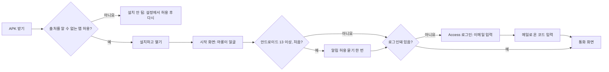
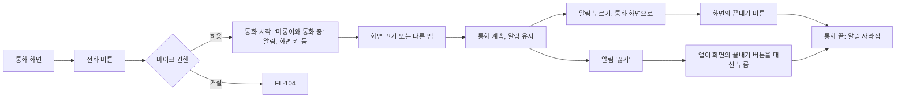
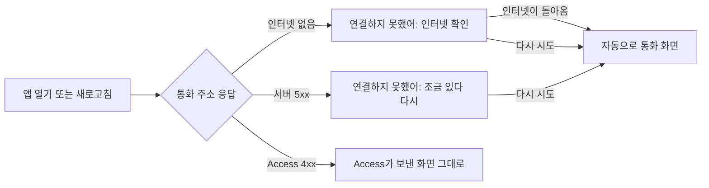
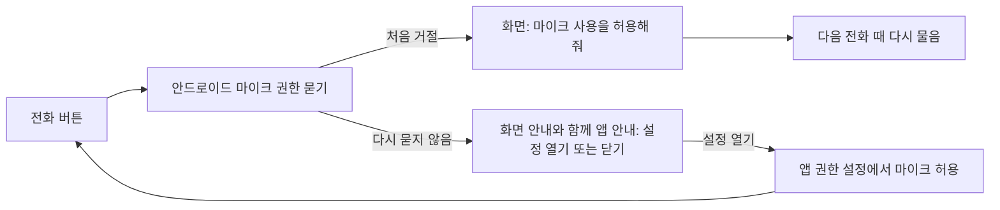

# 마롱이 안드로이드 앱

상태: 1단계(통화 앱) 구현과 자동 시험 끝, 폰 설치 시험 대기 (2026-11-15, Claude). 코드는 `apps/android/`, 시작점은 `codex/marong-vertex-live`의 `8c78988`이에요.
이 문서 하나에 앱 범위의 CORTHEX 02 요구사항, 03 흐름, 04 기능 명세, 07·08 화면, 10 작업, 12 시험을 모았어요([Discord 음성 설계](discord-voice-design.md)와 같은 방식). 병행 작업과 겹치지 않게 ID는 101번대를 써요. 웹 통화 화면과 서버의 계약은 기존 [요구사항](02-prd/requirements.md)과 [기능 명세](04-functional-spec/spec.md)가 그대로 정본이에요. 기획 기록과 결정 원문은 Notion 마롱이 통화 기능 프로젝트의 '마롱이 안드로이드 앱' 행과 '결정할 것' D17에 있어요.

## 출처 표기

| 표기 | 뜻 |
| --- | --- |
| 요청 | 동희님 2026-11-15 17:00 KST 프로젝트 채팅: 마롱이를 안드로이드에서 쓸 수 있게 APK로 만들어 보자는 제안 |
| 진행 | 동희님 2026-11-15 17:00 KST 이 작업 스레드 "어 진행해보자". 코디네이터 추천안(Capacitor로 웹 통화 감싸기, 선톡·일정 알림, 마롱이 얼굴 화면)에 대한 답 |
| D17 | 동희님 2026-11-15 17:30 KST 결정 카드 '마롱이 앱 알림을 어디에 쓸까요?'에서 '앱 안 글 대화까지'. Claude 추천은 '마롱이 전화 벨에만'이었어요 |
| 새 제안 | 이 설계에서 Claude가 정한 것. 검토 때 봐 주세요 |

## 1. 목표와 범위

1단계는 지금 웹 통화(`https://marong.corthex-hq.com`)를 그대로 여는 안드로이드 앱이에요. 화면을 끄거나 다른 앱을 써도 통화가 이어지고, 알림에서 끊을 수 있어요. 서버와 웹 화면은 바꾸지 않아요.
2단계(D17)는 선톡을 앱 알림으로 받고 앱 안 글 대화에서 바로 답장하는 기능이에요. 서버에 글 대화와 알림 보내기를 새로 붙여야 해서 1단계 폰 시험 뒤에 따로 설계해요(10절).
하지 않는 것: Play 스토어 배포, iOS, 웹 화면 수정, 서버와 Access 설정 변경.

| 안 | 좋은 점 | 걸리는 점 | 판단 |
| --- | --- | --- | --- |
| 홈 화면에 웹 추가(PWA) | 만들 것이 없어요 | 화면을 끄거나 다른 앱으로 가면 브라우저가 통화를 멈춰도 막을 방법이 없어요 | 제외 |
| **Capacitor로 웹 감싸기** | 웹 통화를 그대로 쓰고, 통화 유지 서비스와 알림 같은 안드로이드 기능을 붙일 수 있어요 | 앱 안 로그인과 쿠키를 폰에서 확인해야 해요 | **선택(진행)** |
| Kotlin으로 새로 만들기 | 가장 매끄러워요 | 통화 연결(LiveKit·PCM)을 다시 만들어야 해요 | 제외 |

**새 제안.** 앱은 화면 파일을 품지 않고 통화 주소를 그대로 열어요(Capacitor `server.url`). 화면 파일을 앱에 넣으면 출처가 `https://localhost`로 바뀌어 서버의 출처 검사와 Access 쿠키를 고쳐야 하고, 웹이 바뀔 때마다 앱을 다시 배포해야 해요. 그대로 열면 웹 수정이 앱에 바로 반영되고 서버를 건드리지 않아요.

## 2. 요구사항 (02)

| ID | 요구사항 (EARS) | 출처 |
| --- | --- | --- |
| REQ-101 | 앱은 마롱이 웹 통화 주소를 앱 창 안에서 열어야 하고, 통화·글로 이야기하기·표정·자막은 웹과 같아야 한다. | 요청, 진행 |
| REQ-102 | 로그인되지 않은 상태로 앱을 열면, 앱은 Access 이메일 코드 로그인을 앱 창 안에서 보여야 한다. 로그인 뒤에는 Access 세션 기간 동안 다시 묻지 않아야 한다. | 진행, 새 제안 |
| REQ-103 | 통화 화면이 마이크를 쓰는 동안, 앱은 화면이 꺼지거나 다른 앱이 앞에 와도 통화를 이어야 하고 '마롱이와 통화 중' 알림을 보여야 한다. | 진행 |
| REQ-104 | 사용자가 알림의 '끊기'를 누르면, 앱은 화면의 끝내기 버튼과 같은 방법으로 통화를 끝내야 한다. | 새 제안 |
| REQ-105 | 마이크가 거절되면, 앱은 화면의 안내를 그대로 두고, 안드로이드가 다시 묻지 않는 경우에만 설정을 여는 안내를 보여야 한다. | 새 제안 |
| REQ-106 | 인터넷이 없거나 서버가 응답하지 않으면(5xx), 앱은 연결하지 못했다는 화면과 다시 시도 버튼을 보여야 한다. Access가 보낸 4xx 화면은 그대로 보여야 한다. | 새 제안 |
| REQ-107 | 앱의 아이콘·시작 화면은 마롱이 얼굴이어야 하고, 위쪽 상태 표시줄은 화면의 낮(크림)·밤 테마를 따라야 한다. | 진행 |
| REQ-108 | 통화 주소와 Access 로그인만 앱 창 안에 열고 다른 주소는 폰 브라우저로 열어야 한다. 앱 연결(스크립트·플러그인)과 마이크는 통화 주소에만 주어야 한다. | 새 제안 |
| REQ-109 | 앱은 로그인 쿠키와 앱 데이터를 백업하거나 다른 폰으로 옮기지 않아야 한다. | 새 제안 |
| REQ-110 | 앱은 Git 밖에 둔 서명 키 하나로 서명한 APK로 직접 설치해야 하고, 업데이트도 같은 키로 서명해야 한다. | 진행, 새 제안 |

## 3. 사용자 흐름 (03)

**FL-101 설치와 첫 로그인** (REQ-101, REQ-102, REQ-110)



**FL-102 통화와 알림에서 끊기** (REQ-103, REQ-104)



**FL-103 연결하지 못했을 때** (REQ-106)



**FL-104 마이크를 거절했을 때** (REQ-105)



## 4. 기능 명세 (04)

| ID | 동작 | 예외 | 합격 기준 | REQ |
| --- | --- | --- | --- | --- |
| SPEC-101 앱 껍데기 | Capacitor 8.6.0, 패키지 `com.corthexhq.marong`, `server.url`은 통화 주소. 평문 HTTP와 섞인 콘텐츠 금지. 사용자 에이전트 끝에 `MarongApp/0.1.0`. 최소 Android 7.0(API 24), 대상 API 36. | 웹뷰가 너무 오래되면 통화 화면 기능이 웹과 같은 조건으로 안 될 수 있어요. | 앱을 열면 통화 화면이 떠요(TC-114). | REQ-101 |
| SPEC-102 열 수 있는 주소와 연결 범위 | 페이지 스크립트(`assets/marong_page.js`)는 문서 시작 때 통화 주소의 출처에만 넣어요. `https://<한 단어>.cloudflareaccess.com` 로그인 주소는 앱 창 안에 열되 Capacitor 연결은 주지 않아요. 그 밖의 주소는 Capacitor 기본대로 폰 브라우저로 열어요. | 문서 시작 스크립트를 지원하지 않는 웹뷰는 페이지를 다 읽은 뒤 넣어요(두 번 실행돼도 하나만 동작). | TC-101, TC-103, TC-108, TC-109 | REQ-101, REQ-102, REQ-108 |
| SPEC-103 통화 유지 | 화면이 살아 있는 마이크 트랙을 하나라도 잡고 있으면 통화 중이에요. 그동안 마이크 종류 포그라운드 서비스와 알림(제목 '마롱이와 통화 중', 경과 시간, '끊기')을 띄우고, 화면을 켜 두고, 웹뷰 렌더러를 중요하게 둬요. 마지막 트랙이 끝나면 모두 풀어요. 안드로이드 13 이상에서는 처음 열 때 알림 권한을 한 번만 물어요. | 알림 권한을 거절해도 서비스는 돌지만 알림이 목록에 안 보여요. 서비스를 못 띄우면(시스템 거절) 통화는 화면 그대로 이어지고 앱은 조용히 넘어가요. 앱을 최근 앱에서 지우면 서비스도 끝나요. | TC-101, TC-102, TC-110 | REQ-103 |
| SPEC-104 알림에서 끊기 | '끊기'는 화면의 `#stop` 버튼을 눌러 웹과 같은 끝내기(서버 기록 포함)를 해요. 화면이 4초 안에 끝났다고 알리지 않으면 앱이 서비스를 직접 풀어요. | 통화 중이 아니면 아무것도 하지 않아요. | TC-104, TC-111 | REQ-104 |
| SPEC-105 뒤로 가기 | 뒤로 가기는 앱을 닫지 않고 뒤로 내려요(통화 유지). | 없음 | TC-112 | REQ-103 |
| SPEC-106 마이크 권한 | 화면의 마이크 요청은 Capacitor가 안드로이드 권한으로 물어요. 통화 주소가 아닌 출처의 요청은 거절해요. 거절되면 화면이 자기 안내를 보이고, 안드로이드가 다시 묻지 않는 경우에만 앱이 '마이크가 꺼져 있어요' 안내(설정 열기·닫기)를 띄워요. | 처음 거절은 다음 전화 때 안드로이드가 다시 물어요. | TC-105, TC-116 | REQ-105, REQ-108 |
| SPEC-107 화면 모양 | 아이콘·둥근 아이콘·적응형 아이콘과 시작 화면은 마롱이 기본 얼굴(`01-neutral`)을 밤색 바탕(#121729)에 둬요. 상태 표시줄은 화면의 `data-theme`를 따라 낮(`chestnut`)이면 어두운 아이콘(`LIGHT`), 밤이면 밝은 아이콘(`DARK`)이에요. 화면 가장자리 여백은 웹의 `env(safe-area-inset-*)`가 맡아요. | 테마가 바뀔 때만 한 번씩 알려요. | TC-107 | REQ-107 |
| SPEC-108 연결 실패 화면 | 통화 주소를 못 열면(네트워크 오류, 5xx) 앱 안의 `error.html`(SCR-102)을 보여요. 4xx는 그대로 둬요. '다시 시도'와 인터넷 복귀(`online`)는 통화 주소로 돌아가요. | 인터넷은 있는데 서버가 안 되면 '조금 있다가 다시' 문구로 바꿔요. | TC-106, TC-109, TC-117 | REQ-106 |
| SPEC-109 백업·서명 | 백업과 기기 간 이동을 모두 끄고(`allowBackup=false`, 데이터 추출 규칙 전부 제외), 릴리스 빌드는 `MARONG_KEYSTORE_PROPERTIES`가 가리키는 Git 밖 키로 서명해요. 키가 없으면 서명하지 않은 릴리스가 나와요. | 키를 잃으면 업데이트가 안 되고 앱을 지웠다 다시 깔아야 해요(로그인도 다시). | TC-113 | REQ-109, REQ-110 |

## 5. 화면 (07·08)

| ID | 화면 | 상태 | 비고 |
| --- | --- | --- | --- |
| SCR-101 | 통화 화면 | 웹의 상태 그대로(준비 중, 로그인 필요, 통화 중, 다시 잇는 중, 연결 확인 중) | 웹 소유. 앱은 상태 표시줄 색만 맞춰요. |
| SCR-102 | 연결하지 못했어 (`www/error.html`) | 인터넷 없음, 서버 쉬는 중, 다시 연결하는 중 | 앱 소유. 밤 테마 색, 버튼 52px 높이, 파일 하나로 완결. |
| SCR-103 | Access 로그인 | 이메일 입력, 코드 입력, 코드 틀림·허용 안 된 메일(4xx) | Cloudflare 소유. 앱은 창 안에 보여 주기만 해요. |
| SCR-104 | '마롱이와 통화 중' 알림 | 통화 중(경과 시간), 끊는 중 | 누르면 통화 화면, '끊기'는 SPEC-104. 중요도 낮음(소리 없음). |
| SCR-105 | 마이크 설정 안내 | 다시 묻지 않는 거절일 때만 | 제목 '마이크가 꺼져 있어요', 버튼 '설정 열기'·'닫기'. |
| SCR-106 | 아이콘과 시작 화면 | 앱 아이콘, 둥근 아이콘, 적응형 아이콘, 시작 화면 | 얼굴은 적응형 아이콘 안전 영역 안(가로 48%). |

## 6. 작업 (10)

| ID | 작업 | 상태 |
| --- | --- | --- |
| TASK-101 | Capacitor 프로젝트(`apps/android`), 설정, 잠금 파일(2026-11-01 이전 배포본만) | 끝 |
| TASK-102 | 주소 규칙·웹뷰 클라이언트(Access 앱 안, 4xx 유지, 5xx 연결 실패)·마이크 출처 제한 | 끝 |
| TASK-103 | 페이지 스크립트와 플러그인(통화 시작·끝, 알림 끊기, 마이크 거절, 상태 표시줄) | 끝 |
| TASK-104 | 통화 유지 서비스와 알림, 알림 권한 한 번 묻기, 뒤로 가기 | 끝 |
| TASK-105 | 연결 실패 화면 | 끝 |
| TASK-106 | 아이콘·시작 화면·문구 | 끝 |
| TASK-107 | 서명 키(Git 밖)와 릴리스 APK | 끝 |
| TASK-108 | 자동 시험: 주소 규칙(JVM), 페이지 스크립트(Node), 실제 통화 화면(브라우저) | 끝 |
| TASK-109 | 폰 설치 시험(TC-110~TC-117) | 동희님 폰 시험 대기 |
| TASK-110 | 2단계 설계: 선톡 알림과 앱 안 글 대화(D17) | 1단계 폰 시험 뒤 |

## 7. 시험 (12)

자동 시험은 2026-11-15에 이 브랜치에서 돌렸어요. 브라우저 시험은 실제 `tools/vertex_live/static` 화면을 쓰고, 서버 대신 `test/support/call-site.cjs`가 고정 `/status`와 '준비됨'만 보내는 `/live`를 열어요(모델·기억 없음, 127.0.0.1 밖으로 안 나감). 마이크는 Chromium의 가짜 장치예요. 실제 폰·Access·서버 증거는 아니에요.

| ID | 확인할 것 | 방법 | 결과 |
| --- | --- | --- | --- |
| TC-101 | 통화를 걸면 앱에 '통화 시작'이 한 번 가요 | 단위, 브라우저 | 통과 |
| TC-102 | 마이크 트랙이 둘이면 둘 다 끝나야 '통화 끝' | 단위 | 통과 |
| TC-103 | 페이지 스크립트가 두 번 실행돼도 하나만 동작 | 단위 | 통과 |
| TC-104 | 알림 '끊기'가 화면의 끝내기 버튼을 눌러 통화를 끝내고(서버에 `stop`), 통화 중이 아니면 아무것도 안 해요 | 단위, 브라우저 | 통과 |
| TC-105 | 마이크 거절이 앱에 가고 화면 안내('마이크 사용을 허용해 줘…')는 그대로 | 단위, 브라우저 | 통과 |
| TC-106 | 연결 실패 화면 문구 두 가지, 다시 시도와 인터넷 복귀가 통화 주소로 돌아감, 버튼 48px 이상 | 브라우저 | 통과 |
| TC-107 | 상태 표시줄: 낮 12시(서울) `LIGHT`, 밤 10시 `DARK`, Capacitor가 늦게 생겨도, `<html>`이 늦게 생겨도 | 단위, 브라우저 | 통과 |
| TC-108 | Access 로그인 주소만 앱 안에 열고 비슷한 가짜 주소는 아니에요 | JVM | 통과 |
| TC-109 | 통화 주소 출처 판별, 5xx만 연결 실패 화면 | JVM | 통과 |
| TC-110 | 화면을 끄고 10분 넘게 통화가 이어져요 | 폰 | 대기 |
| TC-111 | 알림 '끊기'로 통화가 끝나고 알림이 사라져요 | 폰 | 대기 |
| TC-112 | 뒤로 가기 뒤에도 통화가 이어지고, 알림을 누르면 통화 화면으로 돌아와요 | 폰 | 대기 |
| TC-113 | APK 서명과 패키지 정보 | `apksigner verify`, `aapt2 dump badging` | 통과 |
| TC-114 | 첫 로그인(이메일 코드)과 앱을 껐다 켰을 때 로그인 유지 | 폰 | 대기 |
| TC-115 | 소리가 스피커와 블루투스로 잘 들려요 | 폰 | 대기 |
| TC-116 | 마이크를 두 번 거절하면 설정 안내가 나와요 | 폰 | 대기 |
| TC-117 | 비행기 모드로 열면 연결 실패 화면, 끄면 통화 화면으로 | 폰 | 대기 |

명령과 수치(2026-11-15):

- `apps/android`: `npm test` 7개 통과, `npm run test:browser` 4개 통과(Playwright 1.63.0 Chromium).
- `apps/android/android`: `gradle testDebugUnitTest assembleDebug assembleRelease lintDebug`에서 JVM 5개 통과, lint 오류 0개와 경고 9개(쓰지 않는 템플릿 리소스 4, 더 새 의존성 2, 테마 아이콘용 단색 레이어 없음 2, 더 새 Gradle 1).
- 릴리스 APK `0.1.0`(versionCode 1): 3,703,888바이트, APK 서명 v2 확인, 서명자 1명(RSA 4096). 인증서 SHA-256 `b42ce187 0fe2c90e 88d850db bd571896 9b0d1e1c 07f1a6d2 13247cc8 657c45f9`.

## 8. 위험과 남은 확인

| 위험 | 지금 상태 | 확인·대응 |
| --- | --- | --- |
| Capacitor가 앱을 열 때마다 세션 쿠키를 지워요 | Access 쿠키는 기간이 있는 쿠키라 남는다고 봤어요(추정) | TC-114. 매번 로그인하면 쿠키 처리를 다시 봐요. |
| Access 세션 기간 | 실제 값은 확인 안 했어요 | 기간이 지나면 이메일 코드를 다시 받아요. Access 설정 변경은 동희님 확인 뒤에만. |
| 삼성 배터리 관리가 뒤에 있는 앱을 멈출 수 있어요 | 포그라운드 서비스로 막는 게 기본이에요 | TC-110. 끊기면 앱 배터리 설정을 '제한 없음'으로 안내해요. |
| 웹뷰 렌더러가 죽으면 앱이 닫혀요 | Capacitor 기본 동작 그대로 | 다시 열면 돼요. 자주 생기면 다시 띄우기를 붙여요. |
| 통화 중 진짜 전화가 오면 | 시험 안 했어요 | 폰 시험 때 한 번 봐 주세요. |
| 소리 경로 | 미디어 소리로 나와요(수화기 모드 없음) | TC-115 |
| 낮에 처음 열 때 웹 화면이 밤 테마로 그렸다가 0.45초 동안 크림으로 바뀌어요 | 웹 화면 동작(앱 무관), 관찰만 | 웹 쪽에서 볼 일로 넘겨요. |
| 구글 개발자 인증(직접 설치 앱) | 2026-09-30부터 브라질·인도네시아·싱가포르·태국, 전 세계는 2027년(2026-11-15 기획 때 확인한 구글 안내) | 한국 적용 전에 다시 확인해요. |

## 9. 서명 키와 빌드

서명 키(PKCS12, 별칭 `marong`)와 비밀번호 파일은 Git 밖의 프로젝트 파일 폴더에 있어요. 저장소에 넣지 않고(`android/.gitignore`가 `keystore.properties`, `*.jks`, `*.keystore`를 막아요), 잃지 않게 동희님 컴퓨터에도 백업해 두는 걸 권해요. 키가 바뀌면 이미 깐 앱을 지우고 다시 깔아야 해요.

준비물: Node 22 이상, Java 21, Android SDK(플랫폼 36, 빌드 도구 35.0.0).

```sh
cd apps/android
npm ci
npm run sync                      # www와 설정을 android/로 복사
npm test                          # 페이지 스크립트
npm run test:browser              # Playwright가 있을 때: 실제 통화 화면
cd android
MARONG_KEYSTORE_PROPERTIES=/키/폴더/keystore.properties ./gradlew testDebugUnitTest assembleRelease
# 결과: app/build/outputs/apk/release/app-release.apk
```

`keystore.properties`에는 `storeFile`(절대 경로), `storePassword`, `keyAlias`, `keyPassword` 네 줄이 있어요. 새 버전을 낼 때는 `app/build.gradle`의 `versionCode`를 1씩 올리고 `versionName`과 `capacitor.config.json`의 사용자 에이전트를 함께 바꿔요.

설치: 폰에서 APK를 열고 '출처를 알 수 없는 앱 설치'를 그 앱(파일 앱이나 브라우저)에 한 번 허용해요.

## 10. 2단계: 선톡 알림과 앱 안 글 대화 (D17)

D17대로 선톡을 앱 알림으로 받고 앱 안에서 바로 답장해요. 1단계 폰 시험이 끝나면 /corthex 절차로 설계해요. 지금 정해 둔 방향과 필요한 것:

- 글 대화 화면은 통화 주소의 웹 화면으로 만들어 앱과 브라우저에서 같이 쓰고, 디스코드 DM과 같은 기억을 써요(새 제안).
- 알림은 웹뷰에 알림 API가 없어서 Firebase Cloud Messaging(FCM)을 써요. 동희님 구글 계정의 무료 Firebase 프로젝트가 필요해요.
- 서버에 기기 등록·알림 보내기·글 대화 길을 새로 붙여요. 서버 변경과 배포는 동희님 확인 뒤에만 해요.
- 선톡과 일정 알림을 다루는 다른 작업(일정·알림, 요구사항 정리)과 겹치지 않게 맞춰요.
