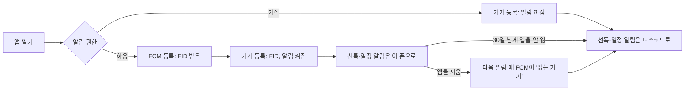
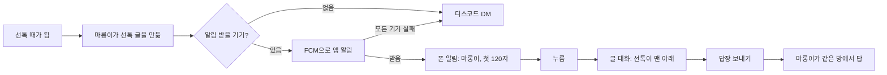
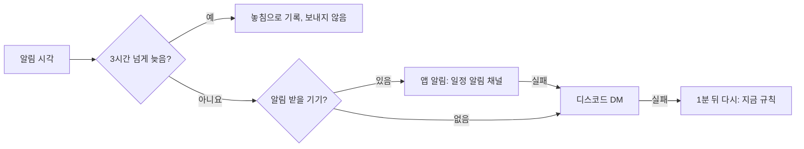
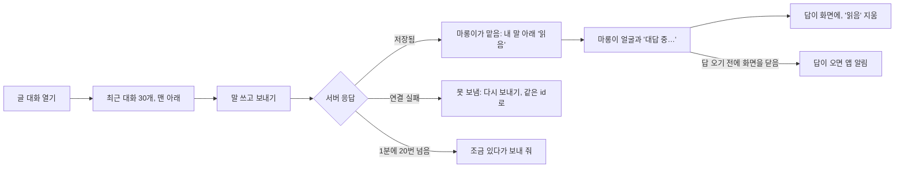
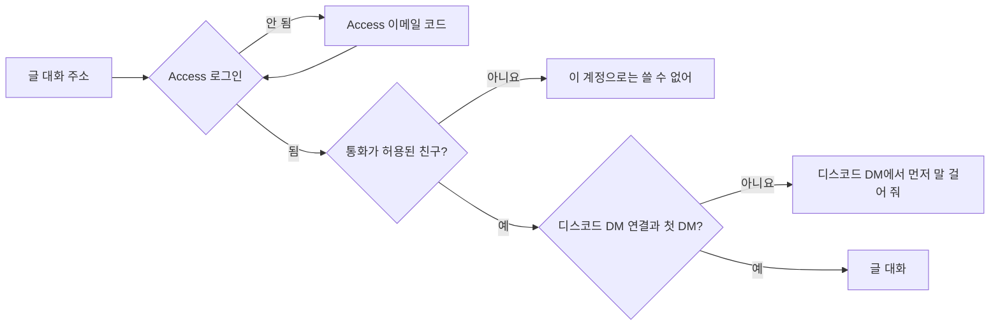
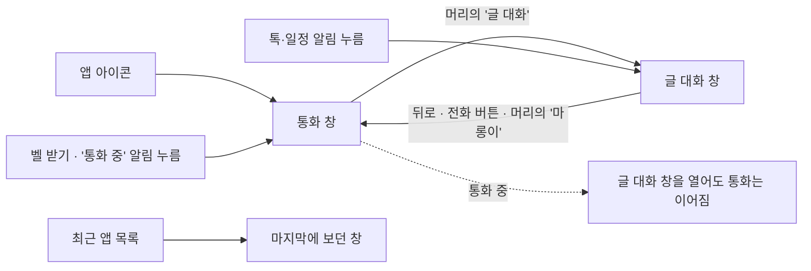
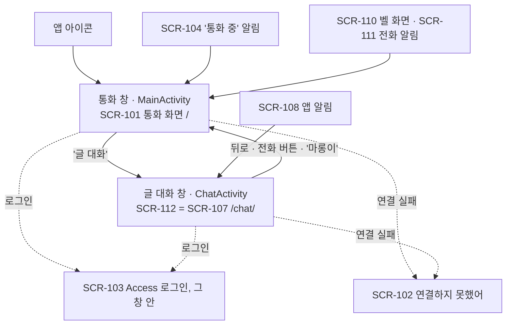

# 마롱이 앱 2단계: 글 대화와 선톡·일정 알림

상태: 서버 반영 끝(2026-11-16 00:31~00:38 KST, 커밋 `64b3e99`), 폰 시험 대기(2026-11-16, Claude). 봇의 글 대화 서버·앱 알림·글 대화 화면, 앱 0.2.0(알림 받기·누르기·기기 보고)과 자동 시험, 실제 Firebase로 한 에뮬레이터 시험(TC-135, 고장 1개 고침)은 끝났어요(8·9절). D20(글 대화를 따로 된 창으로)은 앱 0.2.1로 만들어요(1절 끝, REQ-133~, FL-113, SPEC-143~, SCR-112, TC-149~). D21(읽음·대답 중)은 봇이 주는 글 대화 화면과 API에 만들었고 서버 반영 전이에요(REQ-136~137, SPEC-148~149, TC-155~158, BUG-106). Firebase 준비물은 11/15에 받았어요(11절). 3단계 '마롱이가 먼저 거는 전화'는 [app-ring.md](app-ring.md)예요.
1단계 [안드로이드 앱](android-app.md)에 이어 D17·D18을 CORTHEX 02~08·10·12단계로 이 문서 하나에 모았어요. ID는 1단계 다음 번호(REQ-111, FL-105, SPEC-110, SCR-107, TASK-111, TC-119)부터 쓰고, 표는 TBL-101, API는 API-101부터 써요. API 계약 원본은 [api/app-chat.openapi.yaml](../api/app-chat.openapi.yaml)이에요. 서버 코드는 일정·알림(PR #14)과 DM 도우미(PR #17)가 고친 디스코드 DM 봇 위에 붙어요.

목표: 안드로이드 앱을 깐 사람은 선톡과 일정 알림을 앱 알림으로 받고, 알림을 누르면 앱 안 글 대화에서 바로 답해요. 앱이 없거나 알림을 끄면 지금처럼 디스코드 DM으로 받아요. 마롱이 성격과 기억은 바꾸지 않아요.

## 출처 표기

| 표기 | 뜻 |
| --- | --- |
| D17 | 동희님 2026-11-15 17:30 KST 결정 카드 '마롱이 앱 알림을 어디에 쓸까요?'에서 '앱 안 글 대화까지'("앱에서 선톡을 읽고 바로 답장해요. 서버에 글 대화 기능을 새로 붙여야 해서 1~2주 더 걸려요."). Claude 추천은 '마롱이 전화 벨에만'이었어요 |
| D18 | 동희님 2026-11-15 18:09 KST 결정 카드 '앱을 깔면 선톡과 일정 알림을 어디로 보낼까요?'에서 '앱 있으면 앱으로'("앱 알림이 켜져 있으면 앱으로만 보내고, 앱이 없거나 알림을 끄면 지금처럼 디스코드로 보내요."). Claude 추천과 같아요 |
| D18+ | 앱 알림 보내기가 실패해도 디스코드로 보내는 것. Claude가 18:10 KST 기록 메시지에 덧붙인 해석이고 동희님이 따로 답한 적은 없어요 |
| D20 | 동희님 2026-11-16 11:30 KST 이 작업 스레드의 결정 카드 '채팅창을 어떤 식으로 별개로 만들까요?'에서 '글 대화를 따로 된 창으로'("통화 화면의 '글로도 이야기하기'를 빼고, '글 대화'를 누르면 따로 된 창이 열려요. 통화 중에 열어도 통화가 이어져요."). Claude 추천과 같아요. 고르지 않은 안은 '아래에 통화·글 대화 탭'과 ''마롱이 톡' 아이콘 따로'예요. 요청은 같은 날 11:24 KST 프로젝트 채팅 "그 채팅창을 별개로 만들어주면 좋겠는데 /corthex:corthex"(1단계 에뮬레이터 그림에서 통화 화면 아래 '글로도 이야기하기'를 보고)예요 |
| D21 | 동희님 2026-11-16 11:58 KST 프로젝트 채팅 "읽음, 대답중 / 이런 UX 넣어줘 앱에". 코디네이터가 같은 시각 이 스레드로 넘겨 줬어요(같은 메모: 딥시크 기다림이 최대 1분으로 늘어날 예정). '읽음'을 언제 보이고 지우는지, 디스코드에서 보낸 말과 옛 화면을 어떻게 다루는지는 새 제안이에요 |
| 새 제안 | 이 설계에서 Claude가 정한 것. 검토 때 봐 주세요 |
| 사실(D20) | 2026-11-16에 읽은 것. 앱 0.2.0 코드(`4b1198c`), Capacitor 8.6.0 안드로이드 소스(`BridgeActivity`, `Bridge`, `CapConfig`, `BridgeWebViewClient`), 통화 화면 `tools/vertex_live/static`, 통화 서버 `tools/vertex_live/call_memory.py`, 글 대화 화면 `marong/app_chat_static` |
| 사실 | 2026-11-15에 읽은 것. 봇 코드는 PR #17 브랜치 `ca4da15`(PR #14 포함), FCM은 Firebase 공식 문서(HTTP v1 참고서, Android 출시 노트, 등록 관리, 서버 인증, 요금), 푸시 플러그인은 npm `@capacitor/push-notifications` 8.1.3 소스 |

## 1. 목표와 범위

만드는 것:

- **글 대화 화면** `https://marong.corthex-hq.com/chat/`: 웹 화면이라 앱 안에서도, 폰·컴퓨터 브라우저에서도 열려요. 로그인은 통화와 같은 Access예요. 디스코드 DM과 같은 방(`discord-dm:<id>`)을 써서 어느 쪽에서 말해도 마롱이가 이어 받아요.
- **앱 알림**: 선톡, 일정 알림, 글 대화 화면을 닫은 뒤 온 마롱이 답. 누르면 글 대화가 열려요.
- **읽음·대답 중(D21)**: 마롱이의 답이 내 말을 맡으면 그 말 아래 '읽음', 답을 만드는 동안 목록 끝에 마롱이 얼굴과 점 세 개 '대답 중…'. 봇이 주는 화면이라 앱과 브라우저 모두 바뀌어요.
- **보내는 곳 고르기(D18)**: 알림 받을 기기가 있으면 앱으로만, 없으면 디스코드 DM으로 보내요.

하지 않는 것(이번 단계): 글 대화에서 사진 보내기, 구글 캘린더 연결·끊기(둘 다 디스코드 DM에서), 마롱이가 먼저 거는 전화(3단계 [app-ring.md](app-ring.md)), iOS 앱·웹 푸시, 디스코드 DM이 없는 친구의 글 대화, 안 읽은 수(읽음 표시는 D21로 넣었어요), 폰이 알림을 실제로 띄웠는지 확인하기(10절).

글 대화를 어디에 붙일지:

| 안 | 좋은 점 | 걸리는 점 | 판단 |
| --- | --- | --- | --- |
| **디스코드 DM 봇 안에 붙이기** | DM과 같은 방, 같은 방 잠금, 같은 도구(일정)를 그대로 써요. 한 방에 쓰는 프로세스가 하나뿐이에요 | 봇에 작은 웹 서버와 Access 확인을 더해야 해요 | **선택(새 제안)** |
| 통화 서버에 붙이기 | Access 확인이 이미 있어요 | 다른 프로세스가 같은 DM 방에 써서 방 잠금이 둘로 갈라지고, DM 도구를 다시 붙여야 해요 | 제외 |
| 앱만의 새 방 | 가장 단순해요 | 선톡을 만든 방과 답하는 방이 달라져 마롱이가 맥락을 잃어요 | 제외 |

앱이 알림을 받는 방법:

| 안 | 좋은 점 | 걸리는 점 | 판단 |
| --- | --- | --- | --- |
| **FID 등록, 우리 코드(`firebase-messaging` 26.0.1)** | 지금 Firebase가 권하는 방식이에요. 알림 모양, 누르기, 앱이 앞에 있을 때를 우리가 정해요 | 2026-06에 나온 방식이라 초기 고침(25.1.1, 25.1.2)이 있었어요. 네이티브 코드가 조금 늘어요 | **선택(새 제안)** |
| Capacitor 푸시 플러그인 8.1.3(2026-10-02) | 널리 쓰이고 코드가 적어요 | 지원이 중단된 토큰 방식(`getToken`)이라, 서버도 없어질 예정인 `token` 칸으로 보내야 해요 | 제외 |
| 앱이 서버에 늘 연결해 두기 | Firebase가 필요 없어요 | 배터리를 쓰고, 안드로이드가 뒤에 있는 앱의 연결을 끊어요 | 제외 |

글 대화 화면은 새 메시지를 긴 폴링(최대 25초 기다리는 요청)으로 받아요. 웹소켓보다 터널·Access·다시 연결하기가 단순하고, 쓰는 사람이 몇 명뿐이라 충분해요(새 제안).

**앱 창 두 개(D20, 앱 0.2.1).** 앱에서는 글 대화가 통화 창과 따로 된 글 대화 창에서 열려요. 통화 중에 열어도 통화 창이 그대로 있어서 통화가 이어져요. 앱의 통화 화면에는 '글로도 이야기하기'(자막과, 통화 속 마롱이에게 글 보내기)를 두지 않아요. 서버와 웹 화면은 바꾸지 않아서 브라우저(아이폰 포함)의 통화 화면은 지금과 같아요(새 제안).

0.2.0에서 찾은 것(사실, 코드): 통화 중 머리의 '글 대화'를 누르면 같은 웹뷰가 `/chat/`으로 바뀌고, 통화 화면의 `pagehide`가 통화를 끝내요. 그래서 0.2.0은 통화 중 알림을 눌러도 주소를 바꾸지 않았어요(SPEC-122).

| 안 | 좋은 점 | 걸리는 점 | 판단 |
| --- | --- | --- | --- |
| **글 대화를 따로 된 창으로** | 이미 있는 글 대화 화면을 그대로 써요. 통화 창이 아래에 그대로 있어 통화가 끊기지 않아요 | 앱에 창(Activity)이 하나 늘고 두 창 사이 이동 규칙이 생겨요 | **선택(D20)** |
| 아래에 통화·글 대화 탭 | 두 화면을 한 번에 오가요 | 앱 화면을 새로 짜야 해서 더 오래 걸려요 | 제외(D20) |
| '마롱이 톡' 아이콘 따로 | 다른 앱처럼 따로 열려요 | 홈 화면 아이콘과 최근 앱 목록이 둘이 돼요 | 제외(D20) |

## 2. 요구사항 (02)

| ID | 요구사항 (EARS) | 출처 |
| --- | --- | --- |
| REQ-111 | 친구에게 알림 받을 기기가 있으면, 마롱이는 선톡과 일정 알림을 그 기기의 앱 알림으로만 보내야 한다. | D18 |
| REQ-112 | 알림 받을 기기가 없으면(앱 없음, 알림 꺼짐, 30일 넘게 앱을 열지 않음) 마롱이는 선톡과 일정 알림을 지금처럼 디스코드 DM으로 보내야 하고, 앱 알림 보내기가 모든 기기에서 실패해도 디스코드 DM으로 보내야 한다. | D18, D18+, 새 제안(30일) |
| REQ-113 | 사용자가 마롱이 앱 알림을 누르면, 앱은 글 대화 화면을 열어야 한다. | D17 |
| REQ-114 | 사용자가 글 대화 화면에서 말을 보내면, 마롱이는 디스코드 DM과 같은 방·기억·성격·일정 도구로 답해야 한다. | D17, 새 제안(같은 방) |
| REQ-115 | 글 대화 화면은 그 방의 최근 대화(앱과 디스코드에서 오간 말, 선톡, 일정 알림)를 시간 순서로 보여야 하고, 화면이 열려 있는 동안 온 새 메시지를 30초 안에 보여야 한다. | D17, 새 제안 |
| REQ-116 | 같은 말이 두 번 도착하면(다시 보내기, 끊겼던 연결), 마롱이는 한 번만 저장하고 한 번만 답해야 한다. | 새 제안 |
| REQ-117 | 글 대화와 기기 등록은 Access로 로그인했고 통화가 허용된 친구가 자기 디스코드 DM 방에만 쓸 수 있어야 하고, 다른 사이트에서 온 쓰기 요청은 거절해야 한다. | 새 제안 |
| REQ-118 | 앱 알림은 잠금 화면에서 폰 설정이 허락하는 만큼만 내용을 보여야 하고, 서버 로그에는 메시지 글·기기 식별자·이메일을 남기지 않아야 한다. | 새 제안 |
| REQ-119 | 앱에서 보낸 말에 마롱이 답이 왔을 때 글 대화 화면이 열려 있지 않으면, 앱은 그 답을 알림으로 알려야 한다. | 새 제안 |
| REQ-120 | 이 폰의 마롱이 앱 알림이 꺼져 있으면, 글 대화 화면은 선톡·일정 알림이 디스코드로 간다는 안내와 알림 설정 열기를 보여야 한다. | D18, 새 제안 |
| REQ-121 | 한 친구가 1분에 20번 넘게 보내면, 서버는 잠깐 받지 않고 다시 보낼 수 있는 때를 알려야 한다. | 새 제안(모델 비용 보호) |
| REQ-122 | 알림 보내기에 쓰는 서비스 계정 키와 앱 설정 파일(`google-services.json`)은 Git·Notion·채팅·로그에 넣지 않아야 한다. | 새 제안 |
| REQ-133 | 앱에서 사용자가 '글 대화'를 누르거나 톡·일정 알림을 누르면, 앱은 통화 창과 따로 된 글 대화 창을 열어야 하고, 통화 중이면 통화를 끊지 않아야 한다. | D20 |
| REQ-134 | 앱의 통화 화면은 '글로도 이야기하기'(자막과 글 입력)를 보이지 않아야 한다. 브라우저의 통화 화면은 지금과 같아야 한다. | D20, 새 제안(브라우저는 그대로) |
| REQ-135 | 사용자가 글 대화 창에서 뒤로 가기나 전화 버튼을 누르면, 앱은 글 대화 창을 닫고 통화 창을 하던 그대로 보여야 한다. | 새 제안 |
| REQ-136 | 마롱이의 답이 친구가 보낸 말을 맡으면, 글 대화 화면은 그 말과 그 앞의 아직 답하지 않은 말 아래에 '읽음'을 보여야 하고, 그 말에 마롱이 답이 오면 '읽음'을 지워야 한다. | D21, 새 제안(답이 오면 지움) |
| REQ-137 | 마롱이가 친구의 말에 답을 만드는 동안 글 대화 화면은 마롱이 얼굴과 '대답 중'을 보여야 하고, 연달아 보낸 두 번째 말처럼 앞 말의 답이 뒤 말보다 늦게 저장된 때에도 그래야 한다. | D21, BUG-106 |

## 3. 사용자 흐름 (03)

**FL-105 앱 알림 등록** (REQ-111, REQ-112, REQ-120)



**FL-106 선톡을 앱으로 받고 답하기** (REQ-111~REQ-114)



**FL-107 일정 알림** (REQ-111, REQ-112)



**FL-108 글 대화에서 쓰기** (REQ-114~REQ-116, REQ-119, REQ-121, REQ-136, REQ-137)



**FL-109 로그인과 연결 확인** (REQ-117)



**FL-113 통화 창과 글 대화 창 오가기** (REQ-133~REQ-135, D20)



## 4. 기능 명세 (04)

| ID | 동작 | 예외 | 합격 기준 | REQ |
| --- | --- | --- | --- | --- |
| SPEC-110 글 대화 서버 | 디스코드 DM 봇(`run_discord.py`) 안의 aiohttp 웹 서버가 `127.0.0.1:${MARONG_APP_PORT:-8796}`에서만 들어요. 서버 설정에 `MARONG_APP_CHAT=1`과 Access 값 세 개(`CF_ACCESS_TEAM_DOMAIN`, `CF_ACCESS_AUD`, `CF_ACCESS_EMAILS`, 통화 서버와 같은 값)가 있을 때만 켜요. 터널은 `marong.corthex-hq.com`의 경로 `^/chat(/\|$)`만 이 포트로 보내고 나머지는 지금처럼 통화 앱으로 둬요. 접속 기록을 남기지 않고, 모든 응답에 `Cache-Control: no-store`와 통화 화면과 같은 보안 헤더(CSP `default-src 'self'`, `frame-ancestors 'none'` 등)를 붙여요. `GET /chat/healthz`는 로그인 없이 `ok`만 줘요(서버 안 배포 확인용). | 값이 하나라도 없으면 웹 서버를 켜지 않고 봇은 그대로 돌아요(로그 한 줄). | TC-119, TC-131 | REQ-117, REQ-118 |
| SPEC-111 누구인지 확인 | 모든 API 요청의 `Cf-Access-Jwt-Assertion`을 통화 서버와 같은 규칙으로 확인해요(RS256, 팀 주소의 공개키와 `kid`, `aud`, `iss`, `exp`·`iat`·`sub`·`email` 필수, 이메일 허용 목록). 소문자 이메일의 sha256으로 `call.caller_logins` → 켜진 `call.callers` → 그 친구의 디스코드 DM 링크(봇의 `DM_STATE` 조건 그대로, `channel_id` 있음)를 찾아요. 쓰기(POST·PUT)는 `Origin`이 `https://marong.corthex-hq.com`이어야 해요. 통화 서버의 초대 쿠키 길은 쓰지 않아요. | 증명 없음·틀림 401 `unauthenticated`, 허용 목록 밖·통화 꺼짐 403 `not_allowed`, DM 링크 없음·첫 DM 전 403 `no_dm`, 다른 사이트 403 `cross_site`, DB 문제 503 `db_unavailable`. | TC-119, TC-120 | REQ-117 |
| SPEC-112 말 보내기(API-103) | `{clientId(UUID), text}`를 받아요. 글은 앞뒤 공백을 빼고 1~2,000자예요. 같은 방에 `kakao_id = 'app:<clientId>'`로 저장해서 같은 말은 한 번만 들어가요. 새 말이면 202로 바로 답하고, 뒤에서 그 방의 잠금(`room_lock`, 디스코드 DM과 같은 잠금) 안에서 `agent.handle`을 불러요. 디스코드 DM과 같이 선톡 받기·그만 말은 선톡 설정을 바꾸고 `last_incoming_at`을 새로 적어요. 마롱이에게는 이 말이 앱 글 대화에서 왔다는 한 줄을 더 알려요. | 같은 `clientId`가 다시 오면 200과 처음 저장한 메시지를 주고 답을 다시 만들지 않아요. 구글 캘린더 연결·끊기 명령이면 모델 없이 "구글 캘린더 연결은 디스코드 DM에서 '구글 캘린더 연결'이라고 보내 줘."로 답해요(일회용 링크라서). 1분에 20번을 넘으면 429 `too_many_messages`와 `Retry-After`. 답 만들기가 실패하면 디스코드 DM과 같은 실패 문구가 기록과 화면에 남아요. | TC-121, TC-122 | REQ-114, REQ-116, REQ-121 |
| SPEC-113 대화 읽기(API-102) | DM 방(`room_key`)의 메시지만 오래된 것부터 줘요(기본 30개, 최대 50개, `before`로 앞 쪽). 묶인 카카오 방의 옛 기록은 주지 않아요. 전달되지 않은 마롱이 말(`delivered=false`)과 통화에서 지운 기억(기존 `_call_guard`)은 빼요. 항목은 id, 누가(`me`/`marong`), 글, 시각, 온 길(`app`/`discord`), 종류(`chat`/`proactive`/`reminder`/`note`)예요. | 사진 말은 저장된 '[사진] 설명' 글 그대로예요. 일회용 링크 표시는 '(일회용 링크)'로 바꿔요. | TC-124 | REQ-115 |
| SPEC-114 새 메시지 기다리기(API-104) | `after` 뒤의 메시지가 있으면 바로, 없으면 25초까지 기다렸다가 빈 목록을 줘요. 같은 프로세스의 저장 신호로 바로 깨고, 다른 길로 저장된 것도 잡도록 5초마다 DB를 봐요. 늦게 커밋된 메시지를 놓치지 않게 최근 60초 안의 메시지도 함께 주고, 화면이 id로 겹침을 지워요. 응답의 `typing`은 그 방에서 마롱이가 답을 만드는 중인지예요(SPEC-149). 화면은 지금 보이는 `typing`(0·1)과 `read`(SPEC-148)를 같이 보내고, 서버의 값이 그와 달라지면 새 메시지가 없어도 바로 끝내요(대답 중·읽음 표시가 늦지 않게). | 한 친구의 기다리는 요청은 4개까지예요. 넘으면 가장 오래된 것을 빈 응답으로 끝내요. 화면이 숨으면 기다리기를 멈추고, 다시 보이면 이어요. | TC-123, TC-155, TC-156 | REQ-115, REQ-136, REQ-137 |
| SPEC-115 기기 등록(API-105) | 앱의 페이지 스크립트가 `PUT /chat/api/devices/{installId}`로 `{fid, notifications, appVersion}`을 보내요. 없으면 만들고(201) 있으면 고치고(200), `seen_at`을 지금으로 적어요. 응답은 이 기기로 보낼지(`app`/`discord`)와 그 이유예요. | 같은 installId가 다른 친구로 오면 그 친구로 옮겨요(같은 폰에서 다른 사람이 로그인). 같은 FID가 다른 installId에 있으면 옛 줄의 FID를 지워요. FID가 없으면(구글 Play 서비스가 없는 폰 등) `discord`/`no_fid`. | TC-125, TC-130 | REQ-111, REQ-112, REQ-120 |
| SPEC-116 알림 받을 기기 | 서버에 FCM 키가 있고, 기기에 FID가 있고, 알림이 `granted`이고, `seen_at`이 30일 안이면 '알림 받을 기기'예요(Firebase가 기본으로 쓰는 기준이 '한 달'). 친구에게 하나라도 있으면 앱으로 보내요. | FCM 키가 없으면(준비 전) 기기가 있어도 디스코드로 보내요. | TC-125 | REQ-111, REQ-112 |
| SPEC-117 FCM 보내기 | HTTP v1 `POST https://fcm.googleapis.com/v1/projects/<FCM_PROJECT_ID>/messages:send`, 대상은 `fid`예요(`token` 칸은 지원 중단). 인증은 서비스 계정 키로 서명한 JWT를 `https://oauth2.googleapis.com/token`에서 바꾼 1시간짜리 토큰이에요(범위 `https://www.googleapis.com/auth/firebase.messaging`, 만료 5분 전 갱신, 메모리에만 둠). 메시지는 `notification`(제목 '마롱이', 본문은 글의 첫 120자, 줄 바꿈은 띄어쓰기, 넘으면 '…'), `data`(`kind`, `open`: 누르면 열 주소, 보통 `/chat/`), `android`(`priority: HIGH`, `ttl`, `notification.channel_id`, `notification.visibility: PRIVATE`)예요. 200이면 보낸 거예요. | 404 `UNREGISTERED`나 400 `INVALID_ARGUMENT`이면 그 기기의 FID를 지우고 끊긴 때를 적어요. 429·500·503은 `Retry-After`(10초까지)를 따르거나 1초·2초 뒤 두 번까지 다시 보내요. 401·403(키·권한 문제)은 실패로 하고 경고 로그를 1시간에 한 번 남겨요. 한 번 보내기는 10초 안에 끝내요. | TC-126 | REQ-111, REQ-112, REQ-118 |
| SPEC-118 선톡 보내는 곳 | `DiscordProactive.deliver`에서 슬롯 잡기와 글 만들기는 그대로 두고, 보내기 직전(`still_current` 확인 뒤) 알림 받을 기기가 있으면 FCM으로 한 번 보내요(`kind: proactive`, 채널 `marong_talk`, `ttl` 2시간). 한 기기라도 받으면 `record_delivery(ok)`와 메시지 저장(`proactive: true`, `delivered: true`, `transport: "app"`, `devices: n`)으로 끝내요. | 모든 기기가 실패하면 지금의 디스코드 문장 나눠 보내기로 가요. 앱으로 보낼 수 있으면 디스코드가 끊겨 있어도 보내요. 디스코드가 끊겼고 알림 받을 기기도 없으면 슬롯을 잡지 않고 글도 만들지 않아요(다음 확인 때 다시). | TC-127 | REQ-111, REQ-112 |
| SPEC-119 일정 알림 보내는 곳 | `DiscordReminders.deliver`에서 알림 받을 기기가 있으면 FCM으로 보내요(`kind: reminder`, 채널 `marong_reminder`, `ttl`은 3시간에서 늦은 만큼 뺀 값, 최소 60초). 저장 메시지의 `transport`는 실제로 간 길이에요. | 3시간 넘게 늦은 알림은 지금처럼 놓침이에요. 앱이 실패하면 디스코드 DM, 둘 다 실패하면 지금처럼 `failed`(1분 뒤 다시). | TC-128 | REQ-111, REQ-112 |
| SPEC-120 답 알림 | 앱에서 온 말(`kakao_id`가 `app:`)에 대한 답이 저장될 때 그 친구의 기다리는 요청(SPEC-114)이 하나도 없으면, 알림 받을 기기로 보내요(`kind: reply`, 채널 `marong_talk`, `ttl` 1시간). | 실패해도 디스코드로 보내지 않아요. 답은 글 대화 기록에 있어요. | TC-129 | REQ-119 |
| SPEC-121 앱의 알림 받기 | `com.google.firebase:firebase-messaging:26.0.1`(2026-10-21, minSdk 24), Google 서비스 Gradle 플러그인, Git 밖의 `google-services.json`을 써요. 매니페스트에 `firebase_messaging_installation_id_enabled=true`, 기본 채널 `marong_talk`, 기본 아이콘 `ic_stat_marong`(단색 얼굴), 애널리틱스 끔(`firebase_analytics_collection_enabled=false`)을 넣어요. 앱이 시작할 때 채널 두 개를 만들어요: '마롱이 톡'(`marong_talk`, 기본 중요도: 소리, 머리 알림 없음)과 '일정 알림'(`marong_reminder`, 높은 중요도: 머리 알림). `FirebaseMessaging.register()`를 부르고 `onRegistered(fid)`로 받은 FID를 앱 저장소에 둬요. `installId`(UUID)는 처음 한 번 만들고, 1단계처럼 백업하지 않아요. | 앱이 앞에 있을 때 온 알림(`onMessageReceived`)은 글 대화 화면이 보이면 띄우지 않고, 아니면 같은 채널·모양으로 띄워요. 구글 Play 서비스가 없으면 등록이 실패하고 FID 없이 보고해 디스코드로 받아요. | TC-133, TC-135 | REQ-111, REQ-113, REQ-118 |
| SPEC-122 알림 누르기 | 알림의 `open` 값이 정확히 `/chat/`일 때만 앱 창에 통화 주소 + `/chat/`을 열어요(3단계에서 못 받은 전화 알림용 `/`를 더해요, [app-ring.md](app-ring.md) SPEC-134). 앱이 꺼져 있었으면 시작하면서, 켜져 있으면 새 인텐트로 받아요. | 다른 값은 무시하고 평소처럼 열어요. 통화 중이면 앱만 앞으로 오고 주소는 그대로예요(통화가 끊기지 않게, 0.2.0). 0.2.1부터 `/chat/`은 통화 중에도 글 대화 창을 열어요(SPEC-146). Access 세션이 끝났으면 로그인 화면이 먼저 나와요. 글 대화 주소가 5xx면 1단계 연결 실패 화면이고, '다시 시도'는 지금처럼 통화 주소로 가요. | TC-134, TC-135 | REQ-113 |
| SPEC-123 페이지 스크립트의 기기 보고 | 1단계 페이지 스크립트(통화 주소의 모든 페이지)에 더해요. 새 앱 연결 `MarongPush.state()`로 `{installId, fid, notifications}`를 읽어, 지난 보고와 달라졌거나 12시간이 지났으면 `PUT /chat/api/devices/{installId}`를 보내요. 새 FID가 오면(`registered` 이벤트) 바로 다시 보내요. 글 대화 화면이 보이고 숨을 때 `chatVisible`을 알리고, 보이면 톡·일정 알림을 지워요(통화 알림은 그대로). | 브라우저(앱 밖)에서는 아무것도 하지 않아요. 보고가 실패하면 다음에 페이지를 열 때 다시 해요. | TC-123, TC-133 | REQ-111, REQ-120 |
| SPEC-124 글 대화 화면 | `/chat/`의 HTML·JS·CSS 세 파일을 봇이 같이 내보내요(외부 글꼴·CDN 없음, 통화 화면과 같은 색·글꼴·낮밤 규칙). 처음 열면 최근 30개와 맨 아래를 보이고, 위로 올리면 앞 대화를 불러요. 마롱이 말은 왼쪽(얼굴 `/face/v1/01-neutral.webp`), 내 말은 오른쪽, 날짜가 바뀌면 날짜 줄이 들어가요. 디스코드에서 온 내 말에는 작은 '디스코드', 선톡과 일정 알림에는 '먼저 톡'·'일정 알림' 표시를 달아요. 글은 `textContent`로만 넣고 주소만 링크로 바꿔요(앱 밖 주소는 폰 브라우저로). 입력칸은 2,000자, 엔터는 줄 바꿈, 보내기는 높이 52px 버튼이에요. 보낸 말은 바로 '보내는 중'으로 보여요. 머리에는 '마롱이', 전화 버튼(`/`로), 메뉴(SCR-109). 통화 화면 머리에는 '글 대화' 링크를 더하고 `GET /chat/api/me`가 200일 때만 보여요. 앱 0.2.1에서는 이 링크와 알림이 글 대화 창을 열고(SPEC-144, SPEC-146), 머리의 전화 버튼과 '마롱이'는 글 대화 창을 닫아요. | 보내기가 실패하면 '못 보냄 · 다시 보내기'(같은 clientId). API 요청이 Access 로그인으로 넘어가면(`redirect: 'manual'`의 opaque 응답) 화면을 새로 불러 로그인으로 가요. 401·403·429는 SCR-107 상태로 보여요. | TC-132 | REQ-113, REQ-115, REQ-120 |
| SPEC-125 표와 마이그레이션 | `marong/migrations/014_app_chat.sql`(PR #14의 012·013 다음)이 TBL-101 `marong.app_devices`를 만들고, 봇 계정(`marong`)에 그 표의 읽기·더하기·고치기와 `call.caller_logins`의 두 칸(`email_sha256`, `caller_id`)만 읽기를 줘요. 이메일을 가린 표시(`email_hint`)는 못 봐요. 메시지는 기존 `marong.messages`에 그대로 쌓여요(앱에서 온 말은 `kakao_id`가 `app:`, 앱으로 간 알림은 `meta.transport = "app"`). | 지우기 권한은 주지 않아요. 기기를 끊을 때는 FID만 비워요. | TC-124, TC-130 | REQ-114, REQ-117 |
| SPEC-126 로그와 기록 시트 | 로그에는 결과 이름과 개수만 남겨요(예: `app_chat_sent`, `fcm_send kind=proactive result=UNREGISTERED devices=1`). 글, FID, installId, 이메일, Access 토큰, OAuth 토큰은 남기지 않아요. 기록 시트(`tools/report.py`)는 같은 'Discord DM' 방에 두고, 앱에서 온 말과 앱으로 간 알림의 종류 칸에 '(앱)'을 붙여요. | 없음 | TC-131 | REQ-118 |
| SPEC-127 비밀 다루기 | 서비스 계정 키는 서버의 `/etc/marong-discord/fcm-service-account.json`(root:root 600)에서 systemd `LoadCredential`로만 읽어요. 그 계정의 역할은 'Firebase Cloud Messaging API Admin' 하나예요. `google-services.json`은 프로젝트 파일 폴더에 두고 빌드 때만 `android/app/`에 복사하며, `.gitignore`가 막아요. | 키 파일이 없으면 FCM을 끄고 디스코드로만 보내요(SPEC-116). | TC-133 | REQ-122 |
| SPEC-143 앱 창 두 개 | 앱에 창이 둘이에요. 통화 창(`MainActivity`, 지금처럼 `singleTask`, 통화 주소 `/`)과 글 대화 창(`ChatActivity`, `singleTop`, 내보내지 않음, 같은 작업(task)에서 통화 창 위)이에요. 글 대화 창은 앱의 Capacitor 설정 파일을 그대로 읽고 시작 경로(`server.appStartPath`)만 `/chat/`, 연결 실패 화면만 `error.html?page=chat`으로 바꿔요(그 화면의 '다시 시도'가 `/chat/`으로 가요). 두 창은 쿠키(Access 로그인)와 앱 저장소를 같이 써요. 통화 중 글 대화 창이 위에 오면 통화 창은 숨은 화면이 되고, 통화 유지 서비스·'통화 중' 알림·숨은 화면의 20Hz 소리(1단계 SPEC-103)가 통화를 이어요. 최근 앱 목록에는 앱 하나로 보여요. | 글 대화 창의 뒤로 가기는 그 창만 닫아요(통화 창은 1단계 SPEC-105대로 뒤로 내려가요). 통화 창이 `singleTask`라서 앱 아이콘, '통화 중' 알림, 벨 받기, FCM이 띄운 알림으로 통화 창을 부르면 위의 글 대화 창은 닫혀요(알림은 SPEC-146대로 다시 열어요). 최근 앱 목록으로 돌아오면 마지막 창 그대로예요. 시스템이 앱을 끈 뒤에는 맨 위 창부터 새로 열고 그 창의 시작 주소를 다시 불러요. 글 대화 창이 설정 파일을 못 읽으면 바로 닫혀요. 글 대화 창에서는 화면이 보통처럼 꺼져요(통화 창만 켜 둬요). | TC-149, TC-152 | REQ-133, REQ-135 |
| SPEC-144 창 사이 이동 규칙 | 웹뷰가 화면 전체를 다른 주소로 바꾸려 할 때(링크, 주소 바꾸기, 서버 넘김) 이 규칙을 먼저 봐요. 통화 창에서 통화 주소와 같은 출처의 `/chat` 또는 `/chat/…`이면 화면을 바꾸지 않고 글 대화 창을 열어요(머리의 '글 대화'). 글 대화 창에서 같은 출처의 `/`이면(물음표 뒤 값은 버려요) 화면을 바꾸지 않고 글 대화 창을 닫아 통화 창을 보여요(머리의 '마롱이'와 전화 버튼, 연결 실패 화면의 통화 주소). 글 대화 창은 늘 `/chat/`부터 열고, 누른 주소를 넘겨받지 않아요. 그 밖의 주소는 지금 규칙 그대로예요: Access 로그인 주소는 그 창 안(1단계 SPEC-102), 통화 주소의 다른 길(로그인 마무리 `/cdn-cgi/…` 등)은 그 창 안, 다른 주소는 폰 브라우저. | 경로는 글자 그대로 봐요. `/CHAT/`, `/chatty`, `/%63hat/`, 다른 출처(호스트·포트·`http`)의 `/chat/`, 사용자 정보가 붙은 주소는 글 대화가 아니에요. 화면 안 작은 틀(iframe)의 이동은 보지 않아요. | TC-150, TC-152 | REQ-133, REQ-135 |
| SPEC-145 앱 통화 화면의 글 칸 숨김 | 페이지 스크립트(SPEC-123과 같은 스크립트)가 통화 주소의 모든 페이지에 `#conversation{display:none!important}`를 넣어 '글로도 이야기하기'(자막 `#transcript`, 글 입력 `#text-form`)를 숨겨요. 문서 시작 때 `document.adoptedStyleSheets`로 넣어 첫 그림부터 안 보이고, 그게 없는 웹뷰는 `<style>`을 넣어요(`<html>`이 아직 없으면 페이지를 읽은 뒤). 통화 동작과 서버 기록은 바꾸지 않아요. | 브라우저에는 페이지 스크립트가 없어서 지금처럼 보여요. 글 대화 화면에는 그 칸이 없어서 바뀌는 것이 없어요. 넣기가 실패해도 페이지는 그대로 돌아요(칸이 보일 뿐). | TC-151 | REQ-134 |
| SPEC-146 알림 누르기(D20, SPEC-122 바뀜) | 알림의 `open`이 `/chat/`이면 통화 중이어도 통화 창 위에 글 대화 창을 열어요(통화 창의 주소는 그대로). 앱이 꺼져 있었으면 통화 창을 먼저 열고 바로 위에 글 대화 창을 열어요. `/`(못 받은 전화)는 지금처럼 통화 중이 아닐 때만 통화 창에 통화 주소를 다시 불러요. | 글 대화 창이 이미 위에 있었으면 통화 창을 부를 때 닫혀서(SPEC-143) 새로 열고 `/chat/`을 다시 불러요. 다른 `open` 값은 무시해요(TC-134 그대로). 알림 여럿이 묶여 앱만 열리면 그대로 통화 창이에요(10절). | TC-153 | REQ-113, REQ-133 |
| SPEC-147 글 대화 창의 앱 연결 | 글 대화 창에는 `MarongPush`(기기 보고, 글 대화가 보이는지, 알림 설정 열기)와 Capacitor 기본 연결(상태 표시줄)만 있고 `MarongCall`(통화 유지·끊기)은 없어요. 웹뷰 처리(Access 로그인은 창 안, 5xx만 연결 실패 화면, SPEC-144 이동 규칙)와 페이지 스크립트는 두 창이 같은 코드(`MarongWindowPlugin`)로 넣어요. 글 대화 창의 마이크 같은 권한 요청은 모두 거절해요. '글 대화가 보임'은 창마다 따로 기억하고, 하나라도 보이면 앱이 앞에 있을 때 온 알림을 띄우지 않아요(SPEC-121). FCM의 새 설치 ID 알림(`registered`)은 열린 창 모두에 가요. | 창이 멈추거나(`onPause`) 닫히면 그 창의 '보임'을 지워요. 통화 창 페이지가 '안 보임'을 알려도 글 대화 창의 '보임'은 그대로예요(0.2.0은 앱 전체에 값이 하나라 마지막에 알린 창이 이겼어요). 디버그 빌드에서만 '보임'이 바뀔 때 로그 한 줄(`chat_visible on`/`off`)을 남겨요. | TC-149, TC-154 | REQ-119, REQ-133 |
| SPEC-148 읽음(D21) | API-102·104 응답에 `readUpTo`와 `answeredUpTo`를 줘요. `answeredUpTo`는 친구 말 가운데 마롱이가 답한 가장 새 말이에요(그 방 마롱이 답 최근 20개의 `reply_to` 가운데 가장 큰 값. 연달아 보낸 말을 묶어 답하면 마지막 말에 답해요). `readUpTo`는 `answeredUpTo`와, 이 봇에서 앱 글 대화의 답이 방 잠금을 잡으며 맡은 가장 새 말(메모리) 가운데 큰 값이에요. 화면은 `answeredUpTo` < id ≤ `readUpTo`인 내 말의 시간 앞에 '읽음'을 보여서, 답이 오면 지워져요. API-104는 화면이 보낸 `read`와 서버의 `readUpTo`가 다르면 바로 끝나요. | 디스코드 DM에서 보낸 말은 마롱이 답이 와야 읽음이에요(맡는 순간은 앱 글 대화의 답만 알아요). 봇이 다시 시작하면 맡았던 말의 읽음이 사라져요(그 답도 함께 사라져서 사실과 같아요). 맡은 방은 256개까지 기억해요. `read`를 보내지 않는 옛 화면은 읽음 때문에 일찍 끝나지 않고, 새 칸이 없는 옛 서버에서 새 화면은 읽음을 보이지 않아요. | TC-155, TC-157, TC-158 | REQ-136 |
| SPEC-149 대답 중(D21, SPEC-114 바뀜) | `typing`은 방 잠금을 누가 잡고 있고(앱·디스코드 답, 선톡) 그 방에 `answeredUpTo`보다 새 친구 말이 있을 때 참이에요. 화면은 목록 끝에 마롱이 얼굴과 말풍선 안 점 세 개, 그 아래 '대답 중…'(화면 읽기 프로그램에는 '마롱이가 대답 중…')을 보이고 답이 오면 지워요. | 선톡을 쓰느라 잠금을 잡았을 때 답 못 한 친구 말이 남아 있으면(답 만들기가 실패한 경우) 그동안 대답 중으로 보여요. 2026-11-16 전 규칙(마지막 말이 친구 말)은 앞 말의 답이 뒤 말보다 늦게 저장되면 뒤 말에 답하는 동안 꺼졌어요(BUG-106). | TC-156, TC-157, TC-158 | REQ-137 |

## 5. 데이터 (05)

`marong/migrations/014_app_chat.sql` 안(새 제안):

```sql
-- TBL-101 app_devices ← SPEC-115, SPEC-116, SPEC-117 | 마롱이 앱을 깐 폰. 알림 받을 기기인지는 SPEC-116.
BEGIN;
SET LOCAL lock_timeout = '2s';
SET LOCAL ROLE marong_owner;

CREATE TABLE IF NOT EXISTS marong.app_devices (
  install_id    uuid PRIMARY KEY,                         -- 앱이 처음 한 번 만든 값(백업 안 함)
  friend_id     bigint NOT NULL REFERENCES marong.friends(id),
  fid           text UNIQUE CHECK (fid ~ '^[A-Za-z0-9_-]{16,200}$'),  -- Firebase 설치 ID. NULL: 없음·끊김
  notifications text NOT NULL CHECK (notifications IN ('granted', 'denied')),
  app_version   text NOT NULL CHECK (app_version ~ '^[0-9]{1,3}\.[0-9]{1,3}\.[0-9]{1,3}$'),
  seen_at       timestamptz NOT NULL DEFAULT now(),       -- 앱이 마지막으로 보고한 때
  dropped_at    timestamptz,                              -- FCM이 '없는 기기'라고 한 때
  created_at    timestamptz NOT NULL DEFAULT now(),
  CHECK (dropped_at IS NULL OR fid IS NULL)
);
CREATE INDEX IF NOT EXISTS app_devices_friend_idx ON marong.app_devices (friend_id, seen_at DESC);

GRANT SELECT, INSERT, UPDATE ON marong.app_devices TO marong;
-- 글 대화의 로그인 확인(SPEC-111): 이메일 sha256 → 통화 친구. 가린 이메일은 주지 않아요.
GRANT SELECT (email_sha256, caller_id) ON call.caller_logins TO marong;
COMMIT;
```

알림 받을 기기(SPEC-116): `fid IS NOT NULL AND notifications = 'granted' AND seen_at > now() - interval '30 days'`.
기존 표는 바꾸지 않아요. `marong.messages`의 `UNIQUE (room_key, kakao_id)`가 같은 말 한 번 저장(REQ-116)을 맡아요.

## 6. API (06)

원본은 [api/app-chat.openapi.yaml](../api/app-chat.openapi.yaml)(OpenAPI 3.1)이에요. 기존 통화 API와 같은 규칙(Access 확인, 쓰기의 Origin 확인, RFC 9457 오류에 `code`·`traceId`, 검증 오류 400)을 따라요.

| ID | 길 | 하는 일 | 응답 |
| --- | --- | --- | --- |
| API-101 | `GET /chat/api/me` | 내 이름과 선톡·일정 알림이 가는 곳 | 200, 401, 403, 503 |
| API-102 | `GET /chat/api/messages` | 최근 대화(`before`로 앞 쪽) | 200, 400, 401, 403, 503 |
| API-103 | `POST /chat/api/messages` | 말 보내기 | 202, 200(같은 clientId), 400, 401, 403, 429, 503 |
| API-104 | `GET /chat/api/messages/wait` | 새 메시지 기다리기(25초) | 200, 400, 401, 403, 503 |
| API-105 | `PUT /chat/api/devices/{installId}` | 이 폰의 알림 등록 | 200, 201, 400, 401, 403, 503 |
| API-106 | `GET /chat/healthz` | 서버 안 배포 확인 | 200 |

새 오류 코드는 `no_dm`(403, 디스코드 DM 연결이 없거나 아직 DM을 한 번도 보내지 않음)과 `too_many_messages`(429)예요.

2026-11-16(D21): API-102·104 응답에 `readUpTo`·`answeredUpTo`를, API-104에 `read` 매개변수를 더했어요(계약 `0.2.1-draft`, SPEC-148). 옛 화면은 새 칸을 모르고 지나가요.

## 7. 화면 (07·08)

앱 창 지도(07, 앱 0.2.1, D20):



| ID | 화면 | 상태 | 비고 |
| --- | --- | --- | --- |
| SCR-107 | 글 대화 (`/chat/`) | 불러오는 중, 첫 대화(빈 목록: "마롱이한테 먼저 말 걸어 볼래?"), 보통, 보내는 중, 못 보냄(다시 보내기), 읽음(마롱이가 맡고 아직 답하지 않은 내 말의 시간 앞, D21), 대답 중…(목록 끝에 마롱이 얼굴과 점 세 개, D21), 다시 연결하는 중, 로그인 필요(새로 불러 Access), 쓸 수 없는 계정(`not_allowed`), 디스코드 DM 먼저(`no_dm`), 너무 많이 보냄(`too_many_messages`, 남은 초) | 웹 소유(봇이 내보냄). 앱과 브라우저 모두 |
| SCR-108 | 앱 알림 | 선톡·답(채널 '마롱이 톡'), 일정 알림(채널 '일정 알림'), 잠금 화면(비공개: 폰 설정에 따라 내용 숨김) | 제목 '마롱이', 본문 첫 120자, 누르면 SCR-107(앱 0.2.1은 통화 중에도 글 대화 창 SCR-112) |
| SCR-109 | 알림 상태 (글 대화 메뉴) | 이 폰으로 받는 중, 알림이 꺼져 있어 디스코드로 받는 중 + '알림 설정 열기', 오래 안 열어서 디스코드로(앱을 열면 다시 이 폰으로), 브라우저('알림은 마롱이 앱에서 받을 수 있어') | D18의 '알림을 끄면 디스코드'를 보여 주는 곳. 따로 켜고 끄는 스위치는 두지 않아요(D18에서 '사람마다 고르기'를 고르지 않음) |
| SCR-101 | 통화 화면(웹, 바뀜) | '글 대화' 링크 있음·없음 | 머리 오른쪽. `GET /chat/api/me`가 200일 때만 보여요. 앱 0.2.1에서는 누르면 글 대화 창(SPEC-144)이고, '글로도 이야기하기' 칸이 없어요(SPEC-145) |
| SCR-112 | 글 대화 창(앱 0.2.1, `ChatActivity`) | SCR-107의 상태 그대로, Access 로그인(SCR-103, 창 안), 연결하지 못했어(SCR-102, '다시 시도'는 `/chat/`), 통화 중(통화는 아래 통화 창에서 이어지고 '통화 중' 알림이 떠 있어요) | 앱 소유 창, 화면은 웹 소유(SCR-107). 머리의 전화 버튼·'마롱이'와 뒤로 가기는 통화 창으로(SPEC-144) |

## 8. 작업 (10)

| ID | 작업 | 상태 |
| --- | --- | --- |
| TASK-111 | 마이그레이션 014와 저장소 함수(기기 등록·고르기, 로그인 찾기, 앱 말 들어옴, 대화 읽기) | 끝(`marong/app_store.py`) |
| TASK-112 | Access 확인 공용 모듈(통화 서버 규칙 그대로)과 시험 | 끝(`marong/access.py`) |
| TASK-113 | 글 대화 웹 서버와 API-101~106(aiohttp, 기다리기 신호, 보내기 한도) | 끝(`marong/app_chat.py`, `run_discord.py`) |
| TASK-114 | FCM 보내기(서비스 계정 인증, 오류 처리)와 가짜 FCM 서버 시험 | 끝(`marong/fcm.py`) |
| TASK-115 | 선톡·일정 알림·답의 보내는 곳 고르기(D18), PR #14·#17 코드 위 | 끝(`marong/app_push.py`, `marong/app_delivery.py`, 서버에 올라간 #14·#17·#18·#19 위) |
| TASK-116 | 글 대화 화면(SCR-107·109)과 통화 화면 '글 대화' 링크 | 끝(`marong/app_chat_static/`) |
| TASK-117 | 앱 0.2.0: Firebase 등록, 알림 채널·아이콘, 앱 연결 `MarongPush`, 누르기 처리, 페이지 스크립트 기기 보고. 3단계 벨(TASK-126)도 같은 0.2.0에 넣어요 | 끝(`apps/android/`: `MarongMessagingService`, `MarongPushPlugin`, `Talk`, `Channels`, `PushState`, `PushLinks`, `ic_stat_marong`, 페이지 스크립트 v2) |
| TASK-118 | 배포: systemd drop-in(`deploy/marong-discord-app.conf`), 설정 이름, 터널 경로, 되돌리기 문서 | 끝(11절) |
| TASK-119 | 시험: 자동(서버·페이지·JVM·브라우저), 에뮬레이터(시험용 Firebase), 실제 폰 | 서버·페이지·JVM·브라우저·에뮬레이터 끝, 폰 남음 |
| TASK-120 | 동희님 준비물 받기와 서버 반영(확인 뒤) | 끝(준비물 11/15, 서버 반영 2026-11-16 00:31~00:38 KST `64b3e99`, 결과는 Notion 앱 행) |
| TASK-129 | D20 명세: 요구사항·흐름·기능 명세·앱 창 지도·화면(REQ-133~135, FL-113, SPEC-143~147, SCR-112) | 끝(2026-11-16) |
| TASK-130 | 앱 0.2.1: 글 대화 창(`ChatActivity`), 두 창이 같이 쓰는 웹뷰 처리(`MarongWindowPlugin`), 이동 규칙(`AppWindows`), 알림 누르기, 창마다 '글 대화 보임'(`ChatShown`), 페이지 스크립트의 글 칸 숨김, 연결 실패 화면의 `page=chat`, 버전 0.2.1 | 끝(코드, 2026-11-16) |
| TASK-131 | 시험: JVM(이동 규칙, 창마다 보임), 페이지 스크립트, 앱 설정, 브라우저(통화 화면 글 칸, 연결 실패 화면), 에뮬레이터(TC-152~154) | JVM 19개(이동 규칙·창마다 보임 포함)·페이지 스크립트 19개·앱 설정 8개·브라우저 25개 통과(2026-11-16), 에뮬레이터 남음 |
| TASK-132 | 서명한 APK 0.2.1과 기록(PR #16, Notion) | 서명한 APK 빌드 끝(빌드·단위 시험·린트, 2026-11-16), 기록 남음 |
| TASK-133 | D21 명세: 읽음·대답 중(REQ-136~137, SPEC-148~149, SPEC-114·SCR-107 바뀜, API `0.2.1-draft`) | 끝(2026-11-16) |
| TASK-134 | 읽음·대답 중 서버와 화면: `app_chat.py`(맡은 말 기억, 표시 값, 기다리기의 `read`), `app_store.py`(`app_answered`), `app_chat_static/`(내 말 아래 '읽음', 얼굴과 점 세 개 '대답 중…') | 끝(2026-11-16) |
| TASK-135 | 시험: 서버 TC-155·156, 브라우저 TC-157, 대역 서버의 `answer`, 에뮬레이터 TC-158 | 서버·브라우저 끝, 에뮬레이터 남음 |
| TASK-136 | 서버 반영: 다섯 파일 백업 → 조용할 때 디스코드 DM 봇만 다시 시작 → 확인 | 대기 |

순서: TASK-111~114를 먼저 만들고(가짜 FCM으로 시험), TASK-115는 서버에 올라간 PR #14·#17·#18·#19 코드 위에 맞췄어요.

## 9. 시험 (12)

결과는 2026-11-15 실행이에요(D20·D21은 2026-11-16). 자동 시험은 pgserver Postgres, 가짜 Access 서명 키, 가짜 OAuth·FCM(httpx MockTransport), 가짜 디스코드·Claude로 돌렸고 실제 키와 네트워크는 쓰지 않았어요. 실제 Firebase는 에뮬레이터·폰 시험에서만 써요. 서버 시험은 `tests/test_app_chat.py`(336개 확인), 화면 시험은 `apps/android/test/chat-page.e2e.cjs`(Playwright Chromium 8개)예요.

| ID | 확인할 것 | 방법 | 결과 |
| --- | --- | --- | --- |
| TC-119 | Access 증명의 서명·`aud`·`iss`·만료·허용 목록이 틀리면 401·403, 맞으면 그 친구의 DM 방을 찾아요. Access 값이 없으면 웹 서버가 켜지지 않아요 | 단위(가짜 서명 키) | 통과(서버) |
| TC-120 | 다른 사이트에서 온 POST·PUT은 403 `cross_site` | 단위 | 통과(서버) |
| TC-121 | 같은 clientId를 두 번 보내면 한 번 저장되고 답도 한 번이에요 | 단위, DB | 통과(서버) |
| TC-122 | 글 대화에서 보낸 말이 디스코드 DM과 같은 방에 저장되고, 동시에 온 디스코드 말과 같은 잠금으로 차례대로 답해요. 선톡 그만 말이 설정을 바꿔요. 1분에 21번째는 429 | 단위 | 통과(서버) |
| TC-123 | 기다리기: 새 메시지가 오면 1초 안에, 없으면 25초 뒤 빈 응답. 늦게 커밋된 메시지도 와요. 숨은 화면은 기다리지 않아요 | 단위, 브라우저 | 통과(서버, 브라우저: 새 메시지 1초 안, 숨은 화면은 기다리기 멈춤) |
| TC-124 | 대화 읽기에서 전달 안 된 말, 통화에서 지운 기억, 카카오 방 기록, 다른 친구 방이 빠져요 | DB | 통과(DB) |
| TC-125 | 알림 받을 기기: 알림 거절, 30일 지남, FID 없음, 끊김, FCM 키 없음이면 디스코드 | 단위 | 통과(서버) |
| TC-126 | FCM 응답별 처리: 200, 404 `UNREGISTERED`, 400 `INVALID_ARGUMENT`, 429(`Retry-After`), 503, 401, 시간 초과 | 가짜 FCM 서버 | 통과(가짜 OAuth·FCM) |
| TC-127 | 선톡: 기기 있음 → 앱만, 모두 실패 → 디스코드, 기기 없음 → 디스코드, 디스코드가 끊겨도 앱으로 | 단위 | 통과(서버) |
| TC-128 | 일정 알림: 같은 네 경우, 3시간 넘게 늦으면 놓침, `ttl` 계산 | 단위 | 통과(서버) |
| TC-129 | 답 알림: 기다리는 요청이 있으면 보내지 않고, 없으면 보내요 | 단위 | 통과(서버) |
| TC-130 | 기기 등록: 같은 폰에 다른 사람이 로그인하면 옮기고, 같은 FID가 다른 installId로 오면 옛 줄을 비워요 | DB | 통과(DB) |
| TC-131 | 로그에 글·FID·installId·이메일·토큰이 없어요(로그를 잡아 검사) | 단위 | 통과(봇의 웹 서버를 빈 포트에 띄워 접근 로그 없음·127.0.0.1만 확인 포함) |
| TC-132 | 글 대화 화면의 상태 전부, 글은 `textContent`로만, 링크, 52px 버튼, 다시 보내기의 같은 clientId, 낮밤 색 | 브라우저(가짜 API) | 통과(브라우저 8개, 통화 화면 '글 대화' 링크는 `apps/android/test/call-ring.e2e.cjs`) |
| TC-133 | 앱 설정: FID 사용 표시와 기본 채널·아이콘, 권한 목록(FCM이 더하는 권한까지로 TC-118 기대 목록 고침), 버전 0.2.0 세 곳, 저장소에 `google-services.json` 없음. 페이지 스크립트의 기기 보고(바뀔 때·12시간·새 FID·실패 뒤 다시·겹치지 않음) | 단위, 브라우저 | 통과(설정 단위 7개: 앱이 적은 권한 8개, 빌드한 앱의 합친 권한 11개 = FCM의 `WAKE_LOCK`·`c2dm.permission.RECEIVE`와 androidx의 앱 전용 리시버 권한까지. 기기 보고 단위 6개와 실제 글 대화 화면에 페이지 스크립트를 넣은 브라우저 1개) |
| TC-134 | 알림 누르기: `open`이 정확히 `/chat/`일 때만 글 대화, 다른 값·다른 주소는 무시 | JVM | 통과(`PushLinksTest`: `/chat/`·`/`만, 대소문자·공백·다른 주소·`javascript:` 무시) |
| TC-135 | 에뮬레이터(구글 Play 서비스 이미지)에서 실제 등록 → 대역 서버로 FID 보고 → 시험용 Firebase 프로젝트로 알림 → 누르면 글 대화. 앱이 앞에 있을 때와 글 대화를 보고 있을 때 | 에뮬레이터 | 통과(아래 설명). 처음 열 때 FID 등록과 기기 보고(→ 앱, `app_on`). 앱이 앞(통화 화면)에 있을 때 앱이 띄우고, 글 대화를 보고 있을 때는 안 띄워요(알림 0개). 뒤에 있을 때와 앱 프로세스를 끈 뒤(`am kill`)에는 FCM이 띄우고, 누르면 `/chat/`(끈 앱은 새로 시작). 일정 알림은 머리 알림(중요도 높음), 못 받은 전화 알림은 누르면 통화 화면 `/`. 보내기가 끝나고 3~5초 뒤 볼 때마다 떠 있었어요(에뮬레이터와 서버 시계가 달라 정확한 지연은 못 쟀어요). 앞일 때 알림 색이 달라 고쳤어요(BUG-104) |
| TC-136 | 실제 폰: 화면 꺼짐·잠금 화면(비공개)·삼성 절전에서 선톡과 일정 알림이 오는 시간, 알림 끄기 → 디스코드로 바뀜 | 폰 | 대기 |
| TC-149 | 앱 설정(D20): 글 대화 창이 매니페스트에 있고 내보내지 않으며 `singleTop`, 통화 창은 `singleTask` 그대로, 두 창 모두 `MarongWindowPlugin`을 먼저 등록하고 글 대화 창에는 `MarongCall`이 없음, 버전 0.2.1 세 곳 | 단위(소스 읽기) | 통과(`app-config` 8개, 2026-11-16) |
| TC-150 | 이동 규칙: 통화 창의 `/chat`·`/chat/`·`/chat/?a=1`·`/chat/#b` → 글 대화 창, `/chatty`·`/CHAT/`·`/%63hat/`·다른 호스트·다른 포트·`http`·사용자 정보 → 아님. 글 대화 창의 `/`·빈 경로·`/?ring=…` → 통화 창, `/chat/`·`/cdn-cgi/access/authorized`·`/google/…`·Access 로그인·다른 출처 → 아님 | JVM | 통과(`AppWindowsTest` 6개) |
| TC-151 | 페이지 스크립트를 넣은 실제 통화 화면에서 '글로도 이야기하기'가 처음부터 안 보이고 통화 시작·끝은 그대로, 넣지 않은 브라우저 화면에서는 보여요. `adoptedStyleSheets`가 없으면 `<style>`로 숨겨요. 연결 실패 화면의 `page=chat`은 '다시 시도'가 `/chat/`으로 가요 | 단위, 브라우저 | 통과(페이지 스크립트 3개, 브라우저 2개) |
| TC-152 | 에뮬레이터(시험 빌드, 대역 서버): 통화 중 '글 대화' → 글 대화 창, 대역 서버가 받는 마이크 소리가 끊기지 않음, 글 보내기, 뒤로 가기·전화 버튼 → 통화 중인 통화 창, 앱 아이콘 → 통화 창 | 에뮬레이터 | 대기 |
| TC-153 | 에뮬레이터: 알림 누르기와 같은 인텐트(`open=/chat/`)를 통화 중·통화 없음·글 대화 창이 위·앱 꺼짐에서 보내면 글 대화 창이 열리고 통화는 이어져요. `open=/`는 통화 중이면 그대로예요 | 에뮬레이터 | 대기 |
| TC-154 | 창마다 '글 대화 보임': 글 대화 창이 보이는 동안 통화 창이 '안 보임'을 알려도 보임, 창이 멈추거나 닫히면 지워짐 | JVM, 에뮬레이터(디버그 로그) | JVM 통과(`ChatShownTest` 2개), 에뮬레이터 로그 남음 |
| TC-155 | 읽음(서버): 이력은 마지막으로 답한 말까지 읽음이고 답이 맡지 않은 말은 아님, 답이 맡으면 그 말까지 1초 안에 읽음, 앞 답이 진행 중일 때 뒤에 온 말은 아직 아님, 답이 오면 `answeredUpTo`로 넘어감, `read` 없는 옛 화면은 읽음 때문에 일찍 끝나지 않음, 잘못된 `read`는 400, 맡은 방은 256개까지 | 단위(pgserver, 가짜 Claude를 문으로 멈춤) | 통과(서버 357개 검사) |
| TC-156 | 대답 중(서버): 첫 말의 답이 두 번째 말보다 늦게 저장돼도 두 번째 말에 답하는 동안 `typing` 참, 잠금이 잡혔어도 모든 말에 답했으면 거짓 | 단위 | 통과. 옛 규칙(마지막 말이 친구 말)으로 바꾸면 이 검사가 실패하는 것도 확인 |
| TC-157 | 글 대화 화면: 열 때 읽음, 보낸 뒤 맡으면 1.5초 안에 읽음과 대답 중, 답이 오면 둘 다 지움, 두 말이면 읽음이 두 번째로 옮겨 가고 대답 중이 이어짐, 옛 서버면 읽음 없이 대답 중만, 문구 '대답 중…'(화면 읽기 '마롱이가 대답 중…') | 브라우저(가짜 API) | 통과(3개) |
| TC-158 | 에뮬레이터(시험 빌드, 대역 서버 `answer`): 통화 중 연 글 대화 창에서 보낸 말에 읽음과 대답 중이 보이고 답이 오면 지워짐 | 에뮬레이터 | 대기 |

에뮬레이터 시험(TC-135)은 2026-11-15 23:03~23:26 KST(보낸 시각)에 학원 컴퓨터의 안드로이드 에뮬레이터(Android 16, API 36 `google_apis` x86_64, 구글 Play 서비스 25.26.35, 웹뷰 133)에서 했어요. 시험 빌드 0.2.0(`com.corthexhq.marong.standin`, Firebase 프로젝트 `marong-app`의 시험용 앱)이 실제 FCM에 등록하고, 서버 대신 대역 서버 `apps/android/test/support/emulator-site.cjs`가 글 대화와 통화 화면을 한 주소로 열고 기기 보고를 받아 봇처럼 길을 정해요. 알림은 서비스 계정 키가 있는 서버에서 `tools/fcm_test_send.py`(봇의 `marong/fcm.py`로 종류마다 봇과 같은 메시지)로 만든 글만 보냈어요. FID는 파일로만 넘기고 화면·기록에 남기지 않았어요. 실제 봇·DB·Access 로그인·삼성 폰 증거는 아니에요. 스크린샷은 Git 밖(학원 컴퓨터)에 있어요.

고장:

| ID | 증상 | 찾은 곳 | 원인과 고침 | 확인 |
| --- | --- | --- | --- | --- |
| BUG-104 | 앱이 앞에 있을 때 앱이 띄운 알림만 아이콘 색이 달라요(뒤에 있을 때 FCM이 띄운 알림은 마롱이 색) | 에뮬레이터, 0.2.0 첫 빌드 | 앱이 띄우는 알림에 색을 주지 않아(`color=0x00000000`) 시스템 기본색이 나왔어요. FCM 기본색과 같은 `marong_accent`(#E8A35C)를 앱이 띄우는 알림 셋(선톡·답·일정, 벨, 통화 중)에 줬어요 | TC-135(에뮬레이터: 앱이 띄운 알림도 `color=0xffe8a35c`) |
| BUG-106 | 연달아 보낸 두 번째 말에 마롱이가 답하는 동안 '쓰는 중'이 안 보였어요 | 코드 읽기(D21 작업, 2026-11-16) | 서버는 '방 잠금을 잡았고 마지막 말이 친구 말'일 때만 쓰는 중이라고 했는데, 첫 말의 답이 두 번째 말보다 늦게 저장되면 마지막 말이 마롱이 말이 돼요. 딥시크로 답이 길어지면(최대 1분) 그동안 비어 보여요. '아직 답하지 않은 친구 말이 있음'으로 바꿨어요(SPEC-149) | TC-156(옛 규칙이면 실패), TC-157 |

## 10. 위험과 남은 확인

| 위험 | 지금 판단 | 확인·대응 |
| --- | --- | --- |
| FCM이 받았다고 폰이 띄운 건 아니에요 | 폰 설정에서 앱 알림을 끄고 앱을 열지 않으면 서버가 몰라서 알림이 조용히 사라져요. 다음에 앱을 열면 디스코드로 바뀌고, 놓친 말은 글 대화 기록에 남아요 | v1은 이대로. 나중에 필요하면 앱이 알림을 받았다고 서버에 알리기(데이터 메시지)나 알림 차단 방송(`ACTION_APP_BLOCK_STATE_CHANGED`) 받기를 붙여요 |
| 삼성 절전(쓰지 않는 앱 절전)이 알림을 늦출 수 있어요 | 순정 안드로이드는 FCM 높은 우선순위가 절전 중에도 깨워요. 삼성 고유 동작은 미확인 | TC-136. 늦으면 앱 배터리 설정을 '제한 없음'으로 안내해요 |
| FID 등록은 새 방식이에요 | 2026-06(25.1.0)에 나왔고 등록 고장 고침이 두 번 있었어요(25.1.1, 25.1.2). 26.0.1을 써요 | TC-135 에뮬레이터(구글 Play 서비스 25.26.35)에서 실제 등록이 됐어요. 폰(TC-136)에서 한 번 더 봐요. 안 되면 토큰 방식(지원 중단, 아직 받아 줌)으로 잠시 바꿀 수 있어요 |
| 알림이 여럿이면 안드로이드가 묶어요 | 못 받은 전화 알림 두 개가 묶였을 때 묶음을 누르니 알림의 주소 없이 앱만 열렸어요(에뮬레이터). 펼쳐서 하나를 누르면 그 주소로 가요 | v1은 이대로. 나중 안: 앱이 묶음 요약 알림을 만들어 글 대화로 |
| FCM `token` 칸 없애기 | 날짜는 아직 없어요. 우리는 처음부터 `fid`를 써요 | 해당 없음 |
| Access 세션이 끝남 | API가 401이거나 로그인으로 넘어가면 화면을 새로 불러 이메일 코드 로그인으로 가요 | 1단계 TC-114와 같이 실제 기간을 봐요 |
| 디스코드 DM 화면에는 앱으로 간 선톡이 안 보여요 | D18 그대로예요. 디스코드에서 답해도 같은 방이라 마롱이는 알아요 | 동희님 확인 |
| 한 폰을 여러 사람이 써요 | 마지막으로 로그인한 사람에게 알림이 가요 | 해당 없음(가족 폰 하나에 한 사람 가정) |
| 알림 본문이 구글 서버를 지나요 | 디스코드 DM이 디스코드 서버를 지나는 것과 같은 성격이에요. 본문은 첫 120자만 보내요 | 더 숨기려면 본문 없이 '마롱이가 톡을 보냈어'만 보낼 수 있어요. 동희님 의견 |
| 서비스 계정 키가 새요 | 그 키로는 이 앱에 알림만 보낼 수 있어요(역할 하나) | 서버 root 전용 파일. 새면 구글 클라우드 콘솔에서 키를 지우고 새로 만들어요 |
| 구글 Play 서비스가 없는 폰 | FID를 못 받아 디스코드로 받아요 | 자동 |
| 비용 | FCM은 Firebase 요금표에서 무료(무료 요금제 포함). 글 대화 한 마디의 모델 비용은 디스코드 DM과 같아요 | 1분 20번 한도(REQ-121) |
| 여러 PR이 같은 파일을 고쳐요 | PR #14·#17이 `discord_dm.py`, `run_discord.py`, `discord_store.py`, `tools/report.py`를 고쳐요 | 두 PR이 합쳐진 뒤 TASK-115를 그 위에 맞춰요 |
| 앱 통화 화면에서 글 칸이 빠져요(D20) | 앱에서는 통화 속 마롱이에게 글로 말하기(글만으로 통화 시작하기 포함)와 자막 보기가 없어져요. 글 대화 창에 쓴 말은 디스코드 DM과 같은 방의 글 마롱이가 답해요. 통화 속 마롱이는 통화를 시작할 때 읽은 최근 대화 10개와 기억 찾기로만 그 말을 알아요(사실, `call_memory.py`) | 동희님 확인. 자막이 필요하면 통화 화면에 자막만 보이는 안을 따로 더해요 |
| 앱 아이콘을 누르면 글 대화 창이 닫혀요 | 통화 창이 `singleTask`라서예요(안드로이드 동작). 최근 앱 목록으로 돌아오면 그대로예요 | TC-152에서 확인. 불편하면 통화 창의 실행 방식을 바꾸는 안을 따로 봐요 |
| 글 대화 창이 위에 있을 때 FCM이 띄운 알림을 누르면 글 대화 창을 새로 열어요 | 화면이 한 번 바뀌고 글 대화를 다시 불러요. 쓰던 글은 사라져요 | 폰에서 불편하면 알림을 글 대화 창으로 바로 보내는 안(FCM `click_action`, 서버 변경)을 봐요 |
| 디스코드에서 보낸 말은 답이 와야 읽음이에요(D21) | 맡는 순간은 앱 글 대화의 답만 알아요. 디스코드에서 보낸 말도 대답 중은 보여요 | 불편하면 답 처리(`agent.handle`)가 맡는 순간을 알리게 고쳐요 |
| 앱 글 대화는 연달아 보낸 말마다 따로 답해요 | 디스코드 DM은 2초 기다렸다 묶어 답하는데(`REPLY_WAIT_SECONDS`), 앱 글 대화는 말마다 차례로 답해요(전부터, 코드 읽기). 딥시크로 한 답이 길면 연달아 보낸 말의 답도 그만큼 밀려요. 읽음·대답 중은 말마다 맞게 보여요 | 묶어 답하기는 따로 정해요 |

## 11. 동희님 준비물과 서버 변경

준비물(끝, 2026-11-15): 동희님이 11/15 20:42 KST 이 스레드의 결정 카드에서 'Aside로 전부 하기'를 골라, 학원 컴퓨터 Aside로 만들었어요.

1. Firebase 프로젝트 `marong-app`(무료 요금제, 애널리틱스 끔).
2. 안드로이드 앱 두 개: `com.corthexhq.marong`(실제 앱), `com.corthexhq.marong.standin`(에뮬레이터 시험용). `google-services.json`은 프로젝트 파일 `marong-app/firebase/`에 있어요(Git·채팅·Notion·로그에 넣지 않아요, REQ-122).
3. 서비스 계정 하나(역할 'Firebase Cloud Messaging API Admin'만). JSON 키는 값을 보지 않고 서버의 비공개 폴더로 옮겨 해시를 맞춘 뒤 학원 컴퓨터 사본을 지웠어요. `/etc/marong-discord/fcm-service-account.json`(root:root 600)에 두는 일은 서버 반영 때 해요.

서버 변경(동희님이 11/15 19:58 KST 프로젝트 채팅에서 '만들어지는대로 계속 넣어'라고 하셔서 시험이 끝난 것부터 넣어요. DB 백업 뒤, 통화가 없을 때 다시 시작해요):

1. DB 백업 뒤 `marong/migrations/014_app_chat.sql` 적용.
2. 봇 코드 배포. 봇에 새 의존성 `PyJWT[crypto]==2.15.1`과 `cryptography==50.0.2`(통화 서버와 같은 고정 버전, Access 확인과 서비스 계정 서명). `requirements-discord.txt`에 있어요.
3. `/etc/marong-discord/config`에 `MARONG_APP_CHAT=1`, `FCM_PROJECT_ID`, Access 값 세 개(통화 서버와 같은 값, Git 밖). 포트를 바꿀 때만 `MARONG_APP_PORT`.
4. `deploy/marong-discord-app.conf`를 `/etc/systemd/system/marong-discord.service.d/app.conf`로 설치(`LoadCredential=fcm-service-account.json:...`).
5. 터널: 경로 `^/chat(/|$)`만 `http://127.0.0.1:8796`으로. Access 앱 설정은 그대로예요.
6. 확인: 서버 안 `curl -s http://127.0.0.1:8796/chat/healthz`가 `ok`, 앱에서 글 대화와 알림.

되돌리기: `MARONG_APP_CHAT`을 지우고 drop-in을 빼고 봇을 다시 시작하면 지금의 디스코드 DM과 같아요. 터널 경로도 빼요. 표는 남겨도 아무것도 안 해요.

## 12. 내보내는 순서

1. 서버에 글 대화만 켜요(FCM 키 없음). 브라우저와 1단계 앱에서 글 대화를 써 봐요. 선톡·일정 알림은 아직 디스코드예요(SPEC-116).
2. 앱 0.2.0(알림 등록)을 깔아요. 기기 등록만 쌓이고 보내는 곳은 아직 디스코드예요.
3. FCM 키를 넣고 봇을 다시 시작해요. 그때부터 알림 받을 기기가 있는 사람은 앱으로 받아요(D18).
4. 3단계(마롱이가 먼저 거는 전화)는 [app-ring.md](app-ring.md) 12절 순서로 이어요.
5. 앱 0.2.1(D20 글 대화 창)은 0.2.0 위에 덮어 깔아요(같은 서명, versionCode 4). D20 자체는 서버를 바꾸지 않아요.
6. 읽음·대답 중(D21)은 봇의 글 대화 서버와 화면만 바꿔요(앱은 그대로라 0.2.0·0.2.1 모두, 브라우저도 같이). `marong/app_chat.py`, `marong/app_store.py`와 `marong/app_chat_static/`의 세 파일, 모두 다섯 파일을 백업하고 조용할 때(최근 5분 DM·채널 글 0, 통화 0) 디스코드 DM 봇만 다시 시작해요. 되돌리기: 백업한 다섯 파일을 제자리에 두고 봇을 다시 시작해요.
