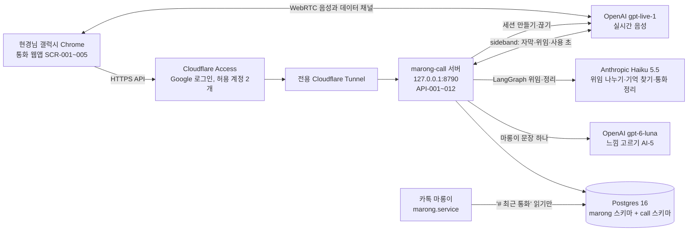
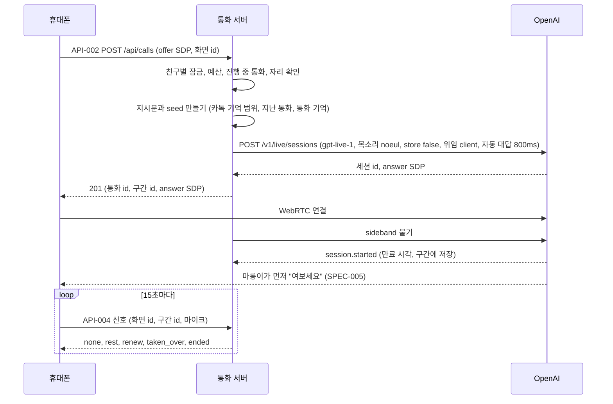
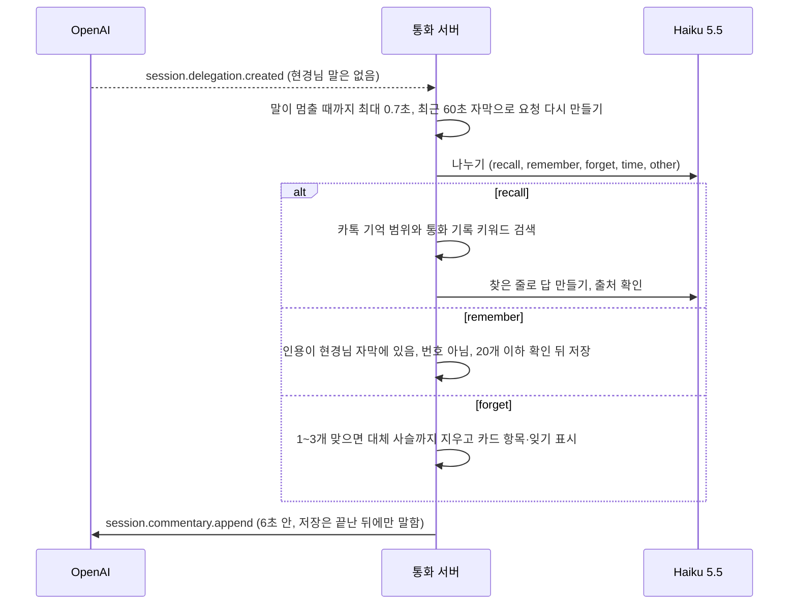

# 마롱이 통화 기능 설계 개요

현경님이 카톡에서 마롱이를 부르는 대신, 휴대폰에서 버튼 하나로 마롱이에게 전화해 친구처럼 목소리로 얘기하게 하는 기능이에요. 코드·인증·안내 같은 기계적인 절차는 두지 않고, 마롱이는 먼저 끊지 않아요. 이 문서는 구현 전 설계(CORTHEX 01\~09단계)의 입구예요.

- 상태: 설계 초안(2026-11-12). Fable 5.2 독립 검토(고칠 것 F1\~F22)를 동희님 15:45 결정 카드 '검토 추천대로 반영'대로 반영했어요(11절). 다음은 갤럭시 시험(기능 명세 7.1), 동희님 확인, 구현이에요.
- 정한 것(동희님, 2026-11-12, Notion '결정할 것' D1\~D8·D14\~D16·P1): 전용 하위 주소의 통화 웹앱, `gpt-live-1`, LangGraph는 통화 중 위임과 통화 뒤 정리에만, 현경님 혼자(허용 Gmail 두 개, 로그인 약 30일), 첫 연결 안내·동의 없음과 원음 저장 안 함, 하루·한 통화 한도 없음(월 150달러), 동희님에게 알림 없음, 기계적인 절차 없음, 오래 조용하면 쉬었다가 말하면 이어받기(D8, 12:36 결정 카드), 표정 그림은 화면용 512px만 저장소에(D14, 14:48 결정 카드), 말할 때 입은 GPT talk GIF대로(D15, 15:05 말씀), 목소리는 성인의 어른스러운 여성(D16, 15:29 말씀).
- 추천안으로 정한 것(Notion '결정할 것' D9\~D13, 동희님 2026-11-12 15:45 결정 카드 '검토 추천대로 반영'의 '정하실 것은 추천안으로 해요', 독립 검토 6절도 다섯 개 모두 동의): D9 예산 120%에서 진행 중 통화도 끝내기(REQ-051), D10 자막 180일(REQ-043), D11 통화 내용을 다른 친구에게 넘기지 않기(REQ-044), D12 하위 주소 `marong.corthex-hq.com`(REQ-058), D13 통화의 19금 수위 낮추기(`call_prompt.md`).
- 마롱이 얼굴(2026-11-12 14:21 동희님이 올린 표정 그림 19장): 통화 상태·마롱이 말소리·문장의 느낌에 따라 얼굴이 바뀌어요(REQ-061\~064, SPEC-029·030, 2.6절). 그림은 화면용 512px 21장(표정 17장과 GPT GIF의 입·눈 조합 4장)만 저장소에 넣고 원본 PNG·GIF는 Git 밖에 둬요(D14, 14:48 결정 카드). 마롱이가 말할 때 입은 동희님이 고른 GPT talk GIF의 순서와 시간대로 움직여요(D15).
- 마롱이 목소리(D16): GPT-Live의 한국어 여성 목소리 `noeul`에 지시문 '목소리' 절(어른스럽고 차분하게, 아이 같은 톤 없이)을 더해요. 목소리는 통화를 걸 때 정해 그 통화의 모든 구간에 같게 쓰고(REQ-024·065, SPEC-004), 어른스럽게 들리는지는 첫 시험 통화에서 동희님이 들어 보고 정해요.

## 1. 한눈에 보기

- 목소리는 휴대폰과 OpenAI 사이를 WebRTC로 오가요. 서버가 붙는 옆길(sideband)로 원음 사본이 함께 오지만, 서버는 읽자마자 버리고 저장하거나 기록하지 않아요(REQ-034, SPEC-006, 독립 검토 F3).
- 우리 서버는 세션을 만들고(지시문과 기억을 넣어), 옆길(sideband)로 자막·위임·사용 초를 받아요. 쓰기(기억해 두기·잊어 주기)는 위임을 거쳐 코드가 확인한 뒤에만 해요. 모델이 위임하지 않아도 자막에 '기억해 줘'·'잊어 줘'가 분명하면 서버가 같은 확인을 거쳐 처리해요(기능 명세 3.6).
- 통화 서버는 카톡 서버와 따로 돌아요(서비스·DB 계정·환경 파일·venv가 따로, SPEC-028). 통화 서버가 멈춰도 카톡 마롱이는 그대로예요.
- 마롱이 얼굴은 휴대폰이 골라요. 소리 크기는 누가 말하는 중인지 알려고 휴대폰 안에서만 재고, 느낌을 고를 때만 마롱이가 말한 문장 하나를 API-012로 보내요(SPEC-029, SPEC-030).

## 2. 주요 흐름

### 2.1 통화 걸기(FL-002, SPEC-003\~006)

### 2.2 위임: 찾기·기억해 두기·잊어 주기·지금 시각(FL-003, SPEC-012\~016)

결과는 찾음·못 찾음·실패 모두 commentary로 보내고, 지시(instructions)는 '방금 잊기로 한 얘기는 먼저 꺼내지 마'처럼 행동을 바꿀 때만 써요(독립 검토 F8). 자막에 분명한 부탁이 있는데 2초 안에 위임이 없으면 서버가 같은 그래프를 돌려요(기능 명세 3.6).

### 2.3 끊김과 재연결(FL-004, SPEC-007)

화면은 자기가 끊지 않은 닫힘을 보면 바로 신호를 보내고, 서버가 `none`이라 하면 같은 통화에 새 구간을 열어요. 마롱이는 인사 없이 하던 얘기를 이어 가요. 10분에 3번을 넘게 끊기면(안전 필터로 닫힌 뒤의 재연결은 따로 5번) 통화를 끝내요. 안전 필터로 말이 끊기면 '끊긴 말' 메모대로 묘사는 넘기되, 현경님이 힘든 얘기를 하던 중이면 화제를 돌리지 않고 계속 들어 줘요(독립 검토 F5).

구간 만료 2분 전에는 서버가 신호로 `renew`를 알려 주고, 휴대폰이 말이 멈춘 틈에 같은 통화의 새 구간으로 미리 넘겨요. 현경님에게는 보이지 않고 재연결 수에도 세지 않아요(SPEC-031, 독립 검토 F11).

### 2.4 조용할 때(FL-005, SPEC-008, D8)

마롱이가 10분 동안 말하지 않았고 맡긴 일이 없으면 구간을 닫아 과금을 멈추고 화면은 그대로 둬요. TV·음악·옆 사람 말소리는 쉬기 판단에 쓰지 않아요(독립 검토 F4). 현경님이 말하거나 '깨우기'를 누르면 새 구간으로 이어요. 통화 화면이 보이는 동안은 화면을 켜 두고, 쉬는 중에는 놓아요(SPEC-027, 독립 검토 F21).

### 2.5 끊기와 정리(FL-007, SPEC-011, SPEC-017)

현경님만 끊을 수 있어요(마롱이에게 끊는 길이 없음, REQ-011). 끊으면 정리 작업자가 LangGraph 정리 그래프로 카드(요약·정한 것·안 정한 것·할 일·다음에 물어볼 것)와 통화 기억을 만들어요. 인용이 현경님 자막에 없는 기억은 버려요.

### 2.6 마롱이 얼굴(SPEC-029, SPEC-030)

연구 문서에 따르면 `gpt-live-1`은 감정이나 입 모양 값을 주지 않아요. 그래서 얼굴은 세 가지를 보고 휴대폰이 골라요. 그림은 동희님이 올린 표정 그림 17장(14·17번은 01번과 같은 파일)과 동희님이 올린 GPT GIF에만 있던 입·눈 조합 4장(20\~23번)이고, 번호와 파일은 [design/marong-face/README.md](../design/marong-face/README.md)에 있어요.

| 보는 것 | 어디서 | 얼굴 |
| --- | --- | --- |
| 화면 상태 | SCR-001·SCR-002의 상태 | 기본 01, 예산·오류 06, 다시 잇는 중·권한 13, 쉬는 중 11 → 12 |
| 누가 말하는 중인지 | 휴대폰 안 `AnalyserNode`(마롱이 목소리·현경님 마이크). 보내지 않음 | 마롱이가 말하면 GPT talk 움직임(01·15·16, D15), 현경님이 말하면 03, 다 듣고 나면 04. 깜빡임은 18·19, 말하는 중이면 조합 20\~23 |
| 문장의 느낌 | 마롱이 자막 문장 → API-012 → AI-5 `gpt-6-luna` | 02 웃음, 05 신남, 06 슬픔, 07 엉엉, 08 놀람, 09 삐짐, 10 수줍음, 13 걱정 |

- 그림을 못 받거나 느낌을 못 골라도 통화는 그대로이고 얼굴만 덜 바뀌어요(REQ-064).
- 그림은 `marong/call/static/face/v1/`의 512px WebP 21장(약 1.2MB)이고 1년 캐시로 내줘요. 1024 원본, 지시문, GPT GIF 3개는 Git 밖 프로젝트 파일에 둬요(D14).
- talk 움직임은 GIF 파일을 그대로 띄우지 않고, 같은 칸을 GIF와 같은 순서·시간으로 화면 코드가 돌려요. 그래야 말이 멈출 때 바로 입을 닫고, 말하면서 아무 때나 깜빡이고, 감정 얼굴·움직임 줄이기와 섞을 수 있어요. 보이는 움직임은 GIF와 같아요(기능 명세 3.5 표 4·5).
- 말하는 중 문턱값, 원격 소리 재기, talk 움직임이 목소리와 어색하지 않은지는 갤럭시 실기기에서 확인해요(7절).

## 3. 단계별 산출물

| 단계 | 원본 | ID |
| --- | --- | --- |
| 01 도메인 | [docs/01-domain/domain.md](01-domain/domain.md) | CTX-001\~006, TERM-001\~020 |
| 02 요구사항 | [docs/02-prd/requirements.md](02-prd/requirements.md) | REQ-001\~066 |
| 03 흐름 | [docs/03-user-flow/](03-user-flow/) | FL-001\~010 |
| 04 기능 명세 | [docs/04-functional-spec/spec.md](04-functional-spec/spec.md) | SPEC-001\~031, AI 호출 5개 |
| 05 DB | [marong/call/schema.sql](../marong/call/schema.sql), [docs/05-erd/erd.md](05-erd/erd.md) | TBL-001\~012 |
| 06 API | [api/openapi.yaml](../api/openapi.yaml) | API-001\~012(계약 0.2.0-draft) |
| 07 화면 목록 | [docs/07-sitemap/sitemap.md](07-sitemap/sitemap.md) | SCR-001\~005 |
| 08 화면 상태 | [docs/08-screens/](08-screens/), 와이어프레임은 디자인 캔버스 | 상태 38개 |
| 09 목업 | [design/base.tokens.json](../design/base.tokens.json), 후보 두 안은 디자인 캔버스, 얼굴 그림은 [design/marong-face/](../design/marong-face/README.md) | 후보 A 밤하늘, B 군밤 크림 |
| 통화 지시문 | [call_prompt.md](../call_prompt.md) | SPEC-004 |

디자인 캔버스: [마롱이 통화 화면 설계](https://claude.ai/artifact/FDFCuk2xc8JE8SCUuh7hL2)(비공개, 공유받은 사람만 열림). 캔버스와 `docs/08-screens/`가 다르면 `docs/08-screens/`가 맞아요.

## 4. 구현 파일 계획

| 파일 | 하는 일 | SPEC |
| --- | --- | --- |
| `marong/call/app.py` | HTTP 서버, API-001\~012 경로, 정적 파일(얼굴 그림은 1년 캐시) | 001\~003, 007\~011, 018\~021, 027, 029 |
| `marong/call/auth.py` | Access JWT 확인, 같은 사이트 쓰기 확인 | 001 |
| `marong/call/live.py` | OpenAI 세션 만들기·끊기, sideband, 자막 줄 만들기 | 003, 005, 006, 011 |
| `marong/call/session.py` | 통화·구간 상태, 친구별 잠금, 신호, 재연결·쉬기·넘겨받기·미리 넘기기, 오래된 통화 정리 | 007\~010, 031 |
| `marong/call/prompt.py` | 지시문과 seed. `prompt.md`의 절은 글자 그대로 가져옴 | 004 |
| `marong/call/delegate.py` | LangGraph 위임 그래프와 서버 보조 판단(3.6) | 012\~016 |
| `marong/call/organize.py` | LangGraph 정리 그래프와 작업자, 매일 보관 정리 | 017, 022 |
| `marong/call/budget.py` | 사용 초 기록, 이번 달 상태 | 023 |
| `marong/call/mood.py` | 느낌 고르기(통화별 한도, AI-5 호출, 목록 확인) | 030 |
| `marong/call/llm.py` | Anthropic 호출 한 곳(effort, 구조화 출력, 시간 제한) | AI-2\~4 |
| `marong/call/store.py` | SQL 한 곳 | TBL-001\~012 |
| `marong/call/static/` | 통화 웹앱(manifest, 서비스 워커, 화면 다섯 개, 화면 켜 두기) | 027 |
| `marong/call/static/face.js` | 얼굴 고르기(상태·말하는 중·느낌, talk 움직임, 깜빡임, 미리 받기) | 029, 030 |
| `marong/call/static/face/v1/` | 얼굴 그림 21장(이미 있음, D14) | 029 |
| `marong/call/schema.sql` | call 스키마(이미 있음) | 05단계 |
| `run_call.py` | 통화 서버 시작(켤 때 확인 포함) | 028 |
| `requirements-call.txt` | 통화 서버만 쓰는 패키지와 고정 판 | 028 |
| `tools/call_admin.py` | 관리 명령 | 025 |
| `deploy/marong-call.service`, `deploy/ovh.sh` | 서비스와 설치·점검 명령 | 028 |
| `marong/agent.py`, `marong/memory.py`, `prompt.md`, `tools/report.py` | 카톡 쪽 작은 변경 | 024, 026 |

- 패키지(구현 첫 작업에서 판 고정): `langgraph`, `langgraph-checkpoint-postgres`, `anthropic`, `httpx`, `websockets`, `psycopg[binary]`, `psycopg-pool`, JWT 확인용 `PyJWT[crypto]`, 웹 서버 하나(추천: Starlette와 uvicorn, 가볍고 비동기라서. 구현 때 정함). `langchain-anthropic`은 effort·구조화 출력을 표본 매개변수 없이 넘길 수 있을 때만 써요(SPEC 3.4) [확인 필요].
- 카톡 서버의 venv와 `requirements.txt`는 건드리지 않아요.

## 5. 환경 변수(이름만)

값은 서버의 `/opt/marong/call.env`(0600)에만 둬요. Git·채팅·Notion에는 넣지 않아요.

| 이름 | 뜻 |
| --- | --- |
| `OPENAI_API_KEY` | 통화 전용 OpenAI 프로젝트 키 |
| `ANTHROPIC_API_KEY` | 통화 전용 Anthropic 키(카톡 키와 따로) |
| `DATABASE_URL` | `postgresql:///marong`(DB 계정 `marong_call`, peer 인증) |
| `CF_ACCESS_TEAM_DOMAIN`, `CF_ACCESS_AUD` | Access JWT 확인에 쓰는 팀 주소와 AUD |
| `CALL_APP_ORIGIN` | 같은 사이트 쓰기 확인에 쓰는 앱 주소 |
| `CALL_BIND` | 기본 `127.0.0.1:8790` |
| `CALL_REST_AFTER_MIN` | 쉬기 시작 분(기본 10, SPEC-008) |
| `CALL_LIVE_MODEL`, `CALL_ANTHROPIC_MODEL` | 기본 `gpt-live-1`, `claude-haiku-5-5` |
| `CALL_MOOD_MODEL` | 느낌 고르기 모델(기본 `gpt-6-luna`). 비우면 느낌 고르기를 끄고 얼굴은 상태·입만 써요(SPEC-030) |
| `DELEGATE_EFFORT`, `ORGANIZE_EFFORT` | 기본 `low`, `xhigh` |
| `PROMPT_PATH`, `CALL_PROMPT_PATH`, `TIMEZONE` | 기본 `prompt.md`, `call_prompt.md`, `Asia/Seoul` |

카톡 쪽 `/opt/marong/.env`에는 `CALL_CONTEXT`(기본 꺼짐) 하나만 더해요(SPEC-024). 목소리·예산·분당 요금은 DB 설정 표(TBL-009)에 두고 관리 명령으로 바꿔요.

## 6. 비용

- [사실] `gpt-live-1`은 분당 0.05달러를 초 단위로 받아요(OpenAI 문서 "Voice sessions cost $0.05 per minute, billed per second", 2026-11-12 확인). 세션이 열려 있는 시간이라 조용한 시간도 들어가요. 월 150달러는 3,000분, 50시간이에요.
- 조용할 때 쉬기(D8) 덕분에 마롱이가 말하지 않는 시간은 10분까지만 과금돼요. TV·옆 사람 말소리가 있어도 마롱이가 대꾸하지 않으면 쉬어요(독립 검토 F4, 첫 실제 통화에서 확인). 쉬기가 없으면 30분 동안 켜 둔 조용한 통화도 1.5달러예요.
- 80%는 동희님만 보는 기록(관리 명령·시트), 100%는 새 통화를 막고 하던 통화는 이어 가요. 120%는 진행 중 통화를 끝내는 안전장치예요(D9). OpenAI 프로젝트에는 지출 알림 120달러와 한도 200달러('Enforce a hard limit' 켬)를 걸어 서버의 120%(180달러) 끊기가 늘 먼저 걸리게 해요. OpenAI 한도가 먼저 막아도(429 `project_spend_limit_exceeded` 등) 화면은 예산 안내를 보여요(SPEC-023). [사실] 조직 등급의 월 사용 한도가 따로 있어요(Build 500달러, Free 등급은 `gpt-live-1`을 못 씀, OpenAI 사용 한도 안내, 독립 검토 F12).
- Anthropic 비용(위임 나누기·찾기·정리)은 AI 호출 기록의 토큰 수로 `call-stats`에 보여요. 크기는 12단계 시험에서 재요.
- 느낌 고르기(AI-5 `gpt-6-luna`)는 [사실] 100만 토큰당 입력 0.10달러, 출력 0.50달러예요(OpenAI 가격표 Standard, 2026-11-12 확인). [추정] 한 시간에 문장 200개, 문장마다 300토큰이면 약 0.0065달러예요. 통화 프로젝트 키를 같이 써서 지출 알림·한도에 함께 들어가요.

## 7. 위험과 실기기 확인

| 위험 | 대응 | 확인 |
| --- | --- | --- |
| OpenAI 안전 필터가 세션을 끝냄(19금 얘기) | 통화 지시문의 수위를 낮추고, 끊기면 '끊긴 말' 메모로 재연결(묘사는 넘기고 힘든 얘기는 계속 들어 줌), 재연결은 따로 5번까지 | 첫 시험(기능 명세 7.2 5번) |
| 마롱이가 먼저 말하지 않음 | 시작 메모와 commentary 한 번 더(SPEC-005). [사실] 문서는 보장하지 않음 | 20번 중 19번 |
| `noeul`이 어리거나 가볍게 들림(문서에 나이 느낌 없음) | 지시문 '목소리' 절을 고쳐 다시 들어 봄. 그래도 안 되면 동희님께 여쭘(설명으로 만드는 목소리는 문서에 `gpt-live-1`의 영어 억양만 적혀 있음) | 첫 시험 통화(동희님 듣기) |
| 화면이 꺼지거나 다른 앱이면 마이크·타이머가 멈춤 | 통화 화면이 보이는 동안 화면 켜 두기, 신호 2분 기준, 쉬는 중엔 깨우기 버튼 | 10단계 전 갤럭시 시험(기능 명세 7.1) |
| TV·옆 사람 말소리에 쉬지 못해 밤새 과금 | 마롱이 소리만으로 쉬기 판단, 지시문 '조용할 때', 예산 120% 끊기 | 첫 실제 통화(7.2 4번) |
| 위임이 덜 불려 '기억해 줘'가 저장되지 않음 | 공식 틀의 지시문, 서버 보조 판단(기능 명세 3.6) | 첫 실제 통화(7.2 2번) |
| 긴 통화에서 세션이 만료됨 | 만료 2분 전 미리 넘기기(SPEC-031), 못 넘기면 재연결 | 첫 실제 통화(7.2 3번) |
| 통화 중 Access 세션이 끝남 | 2분 뒤 통화가 끝나고 다시 걸면 로그인 | 실계정 |
| 위임 답이 늦거나 틀림(effort `low`) | 6초에 '못 찾음', 정확도가 모자라면 `medium` | 12단계 |
| 한국어 자막이 틀려 인용 확인에 걸림 | 걸리면 저장하지 않고 다시 말해 달라고 함 | 12단계 |
| 통화 서버 메모리 | `MemoryMax=1G`, 임베딩 모델을 쓰지 않음 | 부하 시험 |
| 원격 WebRTC 소리를 잴 수 없어 말하는 중을 모름 | 자막 조각이 오는 동안 같은 talk 움직임(SPEC-029) | 갤럭시 실기기 |
| talk 움직임이 목소리와 따로 노는 느낌 | 말이 멈추면 0.3초 뒤 입을 닫음. 어색하면 문턱값을 맞추고, 그래도 어색하면 동희님께 여쭤 소리 크기 방식을 다시 봄 | 갤럭시 실기기 |
| 느낌이 틀리거나 늦음 | 얼굴만 바뀌고 말·기록은 그대로, 1.5초 넘으면 버림. 설정을 비워 끌 수 있음 | 12단계 문장 50개 |
| 얼굴 그림이 흐리거나 늦게 뜸 | 홈에서 미리 받기, 못 받으면 빈 원 | 갤럭시 실기기, LTE |

자세한 확인 목록은 [기능 명세 7절](04-functional-spec/spec.md)에 있어요. 7.1(갤럭시 시험)은 10단계 전에 해요(독립 검토 F7, 동희님 15:45 결정 카드).

## 8. 동희님 승인이 필요한 일

8번은 10단계 전에, 나머지는 구현 때 여쭤요.

1. OpenAI 통화 전용 프로젝트와 키 만들기, 지출 알림 120달러와 한도 200달러 걸기('Enforce a hard limit' 켜기), 조직 사용 등급과 다른 프로젝트 사용량 확인
2. Anthropic 통화 전용 키 만들기
3. Cloudflare Access 앱과 정책(허용 계정 두 개, Google 로그인, 앱 세션 1개월), Tunnel과 DNS(하위 주소 `marong.corthex-hq.com`, D12). manifest를 쿠키와 함께 불러도 설치가 안 되면 manifest와 아이콘 경로만 Access 예외(개인 내용 없는 정적 파일, SPEC-027)
4. 서버에 DB 스키마 적용(백업 뒤)과 `marong-call` 서비스 설치·켜기
5. 카톡 본체의 작은 변경 배포: `prompt.md` 31줄에서 '전화' 빼기, 공유 메모 거르기에 "통화에서 들은 얘기는 넣지 않음" 한 줄, 카톡 답의 '# 최근 통화' 블록, 시트 '통화' 탭
6. 현경님과 첫 실제 통화 시험
7. 백업과 복구 연습, 백업 파일 보관 기간(제안 14일, SPEC-022)
8. 갤럭시 시험(기능 명세 7.1): 시험 페이지를 HTTPS로 띄울 곳과 시험에 쓸 OpenAI 세션(분당 0.05달러, 1\~2시간이면 3\~6달러 [추정])

## 9. 범위 밖

APK(2단계에서 다시 봄), 인형이나 전용 기기로 마롱이 얼굴·목소리 내기(표정·인형 연구 문서에서 따로 봄), 카톡 본체의 LangGraph 전환, 다른 친구의 통화, 영상 통화, 원음 저장, 동희님 알림(D7), 마롱이가 먼저 전화 걸기, 통화 중 웹 검색(날씨·뉴스는 못 찾아본다고 말함).

## 10. 시험 메모

- API 모의 서버: `npx @stoplight/prism-cli mock api/openapi.yaml`. Prism은 가장 낮은 2xx를 기본으로 돌려줘서 `POST /api/calls`가 200(넘겨받기)으로 나와요. 새 통화(201)를 보려면 `Prefer: code=201` 머리글을 보내요.
- DB 규칙 시험: [docs/05-erd/schema-check.sql](05-erd/schema-check.sql)은 버려도 되는 DB에서만 돌려요.

## 11. 독립 검토 반영(2026-11-12)

Fable 5.2 독립 검토(Notion '마롱이 통화 설계 독립 검토', 고칠 것 F1\~F22, 기준 커밋 `f66f657`)를 동희님 2026-11-12 15:45 KST 결정 카드 '검토 추천대로 반영'대로 반영했어요. 카드 설명은 "막힘·높음 7개와 중간 대부분을 지금 설계에 반영하고, 나머지는 시험 뒤나 구현 때 고쳐요. 정하실 것은 추천안으로 해요."예요. F 번호는 그 검토 문서의 번호예요. 같은 검토 스레드의 2차 검토(CORTHEX 단계별, F23 이후)는 이 반영과 따로 진행 중이에요.

### 11.1 어디에 반영했나

| F | 내용 | 반영한 곳 | 상태 |
| --- | --- | --- | --- |
| F1 | 자동 짧은 대답 대기 1200 → 800(허용 0\~800) | SPEC-003·012, FL-003, 기능 명세 7.2 1번 | 설계에 반영 |
| F2 | 지시문을 공식 틀로(`Backchannel policy`, `Interruption policy`, `Delegation policy`, `Generate <\|SpawnThinking\|>`), 날씨·뉴스는 위임 없이 못 한다고 말함, 서버 보조 판단 | `call_prompt.md`, SPEC-004·012, 기능 명세 3.6, TBL-008(`origin`·`same_as`), 7.2 2번 | 설계에 반영 |
| F3 | sideband로 원음 사본이 옴 → '읽자마자 버림'으로 문구와 규칙을 고침 | 1절, REQ-026, SPEC-003·006, API 머리말, TERM-016 | 설계에 반영 |
| F4 | 쉬기는 마롱이 소리로, 헛깨움은 마롱이 대답으로 판단, 지시문 '조용할 때' | SPEC-008, 3.3, FL-005, REQ-019, API-004(`quietMs` 뺌), TBL-003(`last_marong_sound_at`), 7.2 4번 | 설계에 반영. 쉬기 전 한마디는 두지 않음(추천안) |
| F5 | 안전 필터 뒤 '끊긴 말' 메모를 조건부로, 따로 세기 5번 | 3.1, SPEC-006·007, REQ-014·015, FL-004, 7.2 5번 | 설계에 반영 |
| F6 | 잊기: 대체 사슬까지 지우기, 카드 항목 지우기와 잊기 표시, 정리에서 빼기, 같은 통화 지시 | 3.7, SPEC-015·017·019·021, REQ-029·042, FL-003·007·008, TBL-005\~007, API-007·010, SCR-004·005, 지시문 '기록 지우기' | 설계에 반영(범위는 추천안 '기억과 통화 카드까지') |
| F7 | 화면 꺼짐·다른 앱 동작을 10단계 전에 갤럭시로 봄 | 기능 명세 7.1, 8절 8번 | 설계에 반영(시험은 아직) |
| F8 | 위임 결과는 모두 commentary, 지시는 행동을 바꿀 때만 | SPEC-012\~016, 기능 명세 5.2 | 설계에 반영 |
| F9 | 위임 P95 3초 | 7.2 7번(넘으면 쓸 세 가지) | 첫 실제 통화에서 잼 |
| F10 | 정리 거절은 다시 하지 않음, 출력 한도면 한 번 더, 긴 자막은 나눔, `call-stats`에 비율 | SPEC-017·025, 기능 명세 3.4·5.4, REQ-039, FL-007 | 설계에 반영 |
| F11 | 세션 만료 시각을 읽어 만료 전에 미리 넘기기 | SPEC-031(새), SPEC-006·007·010, REQ-066(새), TERM-020(새), TBL-004(`expires_at`·`renew`), API-003·004, FL-004, 기능 명세 5.1, 7.2 3번 | 설계에 반영 |
| F12 | OpenAI 한도 200달러(서버 180달러 끊기보다 높게), 지출 한도 429는 예산 안내로, 조직 등급 확인 | SPEC-003·007·023, FL-009, TBL-010(`provider_limit`), API 오류 뜻, SCR-001, 6절, 8절 1번 | 설계에 반영 |
| F13 | 지킬 수 있는 지우기 문구, 기억 인용도 180일에 비움, 백업 보관 기간 | SCR-004·005, SPEC-022, REQ-043, TBL-007, 8절 7번 | 설계에 반영(백업 14일은 승인 때 정함) |
| F14 | 기억 찾기 0건 수 | 7.2 8번 | 첫 실제 통화에서 잼 |
| F15 | manifest `crossorigin="use-credentials"`, 안 되면 Access 예외 | SPEC-027, 7.1 5번, 8절 3번 | 설계에 반영 |
| F16\~F20, F22 | 11.2 | 구현 메모 | 구현 때 |
| F21 | 통화 화면이 보이는 동안 화면 켜 두기(Screen Wake Lock) | SPEC-027·029, SCR-002, 7.1 6번 | 설계에 반영(추천안) |

### 11.2 구현 때 할 일

- F16 토큰 한도: OpenAI 한도는 토큰이에요(지시문 16,384, 이어 갈 대화 8,192, 한 번에 보내는 글 500). 글자 상한(14,000자, 6,000자, 300자)은 여유를 둔 근사라고 적고, 한도 오류(400)가 오면 줄여서 한 번 더 보내요. 메모 한 번은 600자 안쪽으로 잡아요.
- F17 안전 식별자: 세션 만들기에 `safety_identifier`로 통화하는 친구 id의 해시를 넣어요. 이메일은 넣지 않아요.
- F18 로그인 만료: 걸 때 Access 토큰 만료가 24시간 안이면 먼저 다시 로그인하게 해요. API 요청에 `X-Requested-With: XMLHttpRequest`를 붙여 만료되면 로그인 화면 대신 401을 받아요(Cloudflare 문서).
- F19 카톡 지시문 절: SPEC-004가 글자 그대로 가져오는 `prompt.md` 절에 카톡에만 맞는 줄이 있어요(검토 때 행 번호로 28행 이모지 예시, 30·41·44행 '방', 31행 전화 약속, 85행 연달아 보낸 말, 93행 날짜와 시각). 통화용으로 덮어쓰거나 통화 지시문에서 다시 말해요. 31행은 8절 5번 배포가 통화보다 먼저 나가야 해요.
- F20 작은 것: 서버가 구간을 끊을 때는 sideband `session.close`를 먼저 쓰고 hangup은 예비로 둬요. 데이터 채널 허용 이벤트를 명세에 적어요. 화면이 보낼 것은 `session.close`, 받을 것은 `session.output_transcript.delta`(얼굴)와 필요하면 `session.delegation.created`예요. `session.started`·`session.closed`에는 지시문이 실려 오니 빼고, 닫힘은 WebRTC 연결 상태와 신호로 알게 해요(SCR-002 '닫힘 알림'과 SPEC-007도 그때 고침). 세션 만들기 실패·시간 넘김의 첫 15초 과금은 AI 호출 기록에 '추정' 한 줄로 남겨요. 겹쳐 말한 자막 줄은 `start_ms`·`end_ms`로 묶거나 인용을 볼 때 이어진 현경님 줄을 붙여 봐요. OpenAI 공식 SDK의 Live 지원과 `httpx`·`websockets` 직접 연결을 첫 구현 작업에서 견줘요.
- F22 얼굴: 느낌 모델의 `reasoning.effort`는 명세 5.6에 사실로 적었어요(`none`이나 `low`, 7.2 13번에서 견줌). 나머지는 구현 때 해요. 문장 끊기는 자막 조각에 적힌 `start_ms`·`end_ms`로 보고 도착 시각은 더 오지 않을 때 마무리(1초)에만 써요. `concerned`·`sad`가 나온 뒤 60초 동안은 02·05·07·09 대신 13이나 01을 쓰고, 시험에 '달래는 문장 20개에서 02·05·07·09가 0번'을 더해요. 위임이 시작된 때(`session.delegation.created`)부터 마롱이가 다시 말할 때까지 생각하는 얼굴(04)을 써요. API-001에 느낌이 켜져 있는지를 넣어 꺼져 있으면 처음부터 보내지 않게 해요(계약을 그때 고침).

### 11.3 설계에서 더하거나 정한 세부

- 자막 줄 잊기 표시(`turns.forgotten_at`): 정한 범위(기억과 카드)만 지우면 180일 자막 검색(SPEC-013)이 그 얘기를 다시 찾아 마롱이가 꺼낼 수 있어서 더했어요. 줄은 지우지 않고 기억 찾기·통화 정리에서만 빼요(기능 명세 3.7).
- 미리 넘기기 방식: OpenAI 세션을 먼저 만들고, 한 트랜잭션으로 직전 구간을 닫고(`renewed`) 새 구간을 열어 '안 닫힌 구간 하나' 규칙을 지켜요. 휴대폰은 양쪽 소리가 1초 멈춘 틈에 넘기고, 재연결 수에 세지 않아요(SPEC-031).
- API 계약 0.2.0-draft: 신호에서 `quietMs`를 뺐어요(쉬기를 서버가 마롱이 소리로 판단해서). `renew`, 카드·자막 줄의 `forgotten`을 더했어요.
- 서버 보조 판단: 2초 기다림, 기억해 두기·잊어 주기만, 10초 안에 온 모델 위임은 `same_as`로 같은 결과를 써요(기능 명세 3.6).
- 백업 파일 14일 보관은 제안이에요. 8절 7번 승인 때 정해요.
- 화면 문구: 지우기 확인 시트를 검토의 예시대로 지킬 수 있는 말로 바꿨어요. SCR-001에 예산 달이 한국 시각 1일 오전 9시에 바뀐다는 메모를 더했어요.
