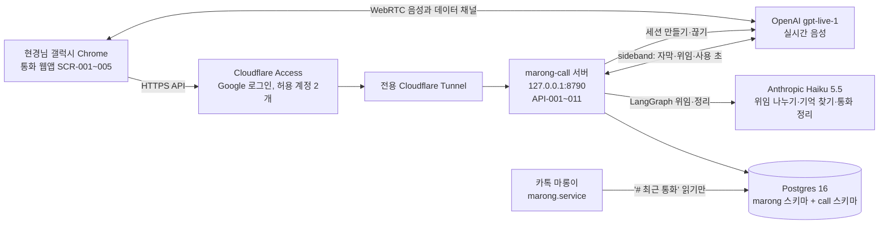
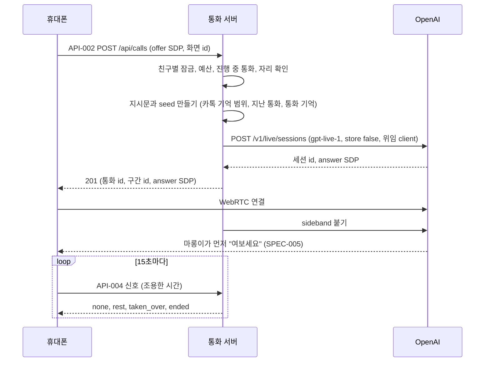
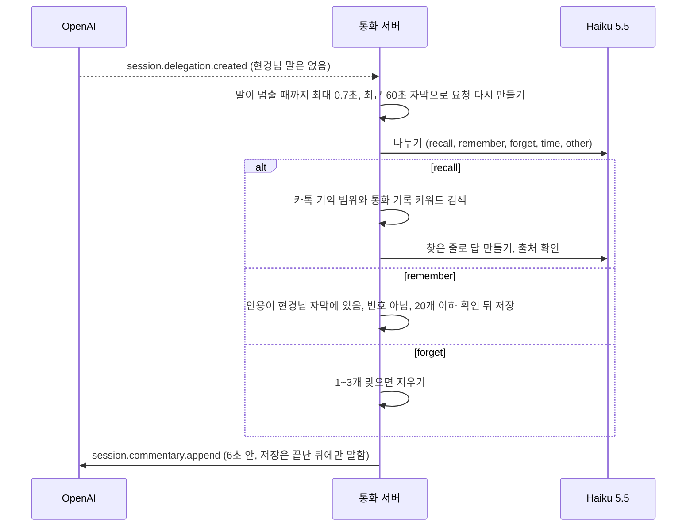

# 마롱이 통화 기능 설계 개요

현경님이 카톡에서 마롱이를 부르는 대신, 휴대폰에서 버튼 하나로 마롱이에게 전화해 친구처럼 목소리로 얘기하게 하는 기능이에요. 코드·인증·안내 같은 기계적인 절차는 두지 않고, 마롱이는 먼저 끊지 않아요. 이 문서는 구현 전 설계(CORTHEX 01~09단계)의 입구예요.

- 상태: 설계 초안(2026-11-12). 다음은 독립 검토, 설계 보완, 구현이에요.
- 정한 것(동희님, 2026-11-12, Notion '결정할 것' D1~D8·P1): 전용 하위 주소의 통화 웹앱, `gpt-live-1`, LangGraph는 통화 중 위임과 통화 뒤 정리에만, 현경님 혼자(허용 Gmail 두 개, 로그인 약 30일), 첫 연결 안내·동의 없음과 원음 저장 안 함, 하루·한 통화 한도 없음(월 150달러), 동희님에게 알림 없음, 기계적인 절차 없음, 오래 조용하면 쉬었다가 말하면 이어받기(D8, 12:36 결정 카드).
- 다른 의견을 기다리는 제안(Notion '결정할 것' D9~D13, 설계는 Claude 추천대로): D9 예산 120%에서 진행 중 통화도 끝내기(REQ-051 `proposed`), D10 자막 180일(REQ-043), D11 통화 내용을 다른 친구에게 넘기지 않기(REQ-044), D12 하위 주소 `marong.corthex-hq.com`(REQ-058), D13 통화의 19금 수위 낮추기(`call_prompt.md`).

## 1. 한눈에 보기

- 목소리는 휴대폰과 OpenAI 사이를 WebRTC로만 오가요. 우리 서버는 원음을 받지도 저장하지도 않아요(REQ-034).
- 우리 서버는 세션을 만들고(지시문과 기억을 넣어), 옆길(sideband)로 자막·위임·사용 초를 받아요. 쓰기(기억해 두기·잊어 주기)는 위임을 거쳐 코드가 확인한 뒤에만 해요.
- 통화 서버는 카톡 서버와 따로 돌아요(서비스·DB 계정·환경 파일·venv가 따로, SPEC-028). 통화 서버가 멈춰도 카톡 마롱이는 그대로예요.

## 2. 주요 흐름

### 2.1 통화 걸기(FL-002, SPEC-003~006)

### 2.2 위임: 찾기·기억해 두기·잊어 주기·지금 시각(FL-003, SPEC-012~016)

### 2.3 끊김과 재연결(FL-004, SPEC-007)

화면은 자기가 끊지 않은 닫힘을 보면 바로 신호를 보내고, 서버가 `none`이라 하면 같은 통화에 새 구간을 열어요. 마롱이는 인사 없이 하던 얘기를 이어 가요. 10분에 3번을 넘게 끊기면 통화를 끝내요.

### 2.4 조용할 때(FL-005, SPEC-008, D8)

말소리가 10분 없으면 구간을 닫아 과금을 멈추고 화면은 그대로 둬요. 현경님이 말하거나 '깨우기'를 누르면 새 구간으로 이어요.

### 2.5 끊기와 정리(FL-007, SPEC-011, SPEC-017)

현경님만 끊을 수 있어요(마롱이에게 끊는 길이 없음, REQ-011). 끊으면 정리 작업자가 LangGraph 정리 그래프로 카드(요약·정한 것·안 정한 것·할 일·다음에 물어볼 것)와 통화 기억을 만들어요. 인용이 현경님 자막에 없는 기억은 버려요.

## 3. 단계별 산출물

| 단계 | 원본 | ID |
| --- | --- | --- |
| 01 도메인 | [docs/01-domain/domain.md](01-domain/domain.md) | CTX-001~006, TERM-001~017 |
| 02 요구사항 | [docs/02-prd/requirements.md](02-prd/requirements.md) | REQ-001~060 |
| 03 흐름 | [docs/03-user-flow/](03-user-flow/) | FL-001~010 |
| 04 기능 명세 | [docs/04-functional-spec/spec.md](04-functional-spec/spec.md) | SPEC-001~028, AI 호출 4개 |
| 05 DB | [marong/call/schema.sql](../marong/call/schema.sql), [docs/05-erd/erd.md](05-erd/erd.md) | TBL-001~012 |
| 06 API | [api/openapi.yaml](../api/openapi.yaml) | API-001~011 |
| 07 화면 목록 | [docs/07-sitemap/sitemap.md](07-sitemap/sitemap.md) | SCR-001~005 |
| 08 화면 상태 | [docs/08-screens/](08-screens/), 와이어프레임은 디자인 캔버스 | 상태 38개 |
| 09 목업 | [design/base.tokens.json](../design/base.tokens.json), 후보 두 안은 디자인 캔버스 | 후보 A 밤하늘, B 군밤 크림 |
| 통화 지시문 | [call_prompt.md](../call_prompt.md) | SPEC-004 |

디자인 캔버스: [마롱이 통화 화면 설계](https://claude.ai/artifact/FDFCuk2xc8JE8SCUuh7hL2)(비공개, 공유받은 사람만 열림). 캔버스와 `docs/08-screens/`가 다르면 `docs/08-screens/`가 맞아요.

## 4. 구현 파일 계획

| 파일 | 하는 일 | SPEC |
| --- | --- | --- |
| `marong/call/app.py` | HTTP 서버, API-001~011 경로, 정적 파일 | 001~003, 007~011, 018~021, 027 |
| `marong/call/auth.py` | Access JWT 확인, 같은 사이트 쓰기 확인 | 001 |
| `marong/call/live.py` | OpenAI 세션 만들기·끊기, sideband, 자막 줄 만들기 | 003, 005, 006, 011 |
| `marong/call/session.py` | 통화·구간 상태, 친구별 잠금, 신호, 재연결·쉬기·넘겨받기, 오래된 통화 정리 | 007~010 |
| `marong/call/prompt.py` | 지시문과 seed. `prompt.md`의 절은 글자 그대로 가져옴 | 004 |
| `marong/call/delegate.py` | LangGraph 위임 그래프 | 012~016 |
| `marong/call/organize.py` | LangGraph 정리 그래프와 작업자, 매일 보관 정리 | 017, 022 |
| `marong/call/budget.py` | 사용 초 기록, 이번 달 상태 | 023 |
| `marong/call/llm.py` | Anthropic 호출 한 곳(effort, 구조화 출력, 시간 제한) | AI-2~4 |
| `marong/call/store.py` | SQL 한 곳 | TBL-001~012 |
| `marong/call/static/` | 통화 웹앱(manifest, 서비스 워커, 화면 다섯 개) | 027 |
| `marong/call/schema.sql` | call 스키마(이미 있음) | 05단계 |
| `run_call.py` | 통화 서버 시작(켤 때 확인 포함) | 028 |
| `requirements-call.txt` | 통화 서버만 쓰는 패키지와 고정 판 | 028 |
| `tools/call_admin.py` | 관리 명령 | 025 |
| `deploy/marong-call.service`, `deploy/ovh.sh` | 서비스와 설치·점검 명령 | 028 |
| `marong/agent.py`, `marong/memory.py`, `prompt.md`, `tools/report.py` | 카톡 쪽 작은 변경 | 024, 026 |

- 패키지(구현 첫 작업에서 판 고정): `langgraph`, `langgraph-checkpoint-postgres`, `anthropic`, `httpx`, `websockets`, `psycopg[binary]`, `psycopg-pool`, JWT 확인용 `PyJWT[crypto]`, 웹 서버 하나(추천: Starlette와 uvicorn, 가볍고 비동기라서. 구현 때 정함). `langchain-anthropic`은 effort·구조화 출력을 표본 매개변수 없이 넘길 수 있을 때만 써요(SPEC 3.4) [확인 필요].
- 카톡 서버의 venv와 `requirements.txt`는 건드리지 않아요.

## 5. 환경 변수(이름만)

값은 서버의 `/opt/marong/call.env`(0600)에만 둬요. Git·채팅·Notion에는 넣지 않아요.

| 이름 | 뜻 |
| --- | --- |
| `OPENAI_API_KEY` | 통화 전용 OpenAI 프로젝트 키 |
| `ANTHROPIC_API_KEY` | 통화 전용 Anthropic 키(카톡 키와 따로) |
| `DATABASE_URL` | `postgresql:///marong`(DB 계정 `marong_call`, peer 인증) |
| `CF_ACCESS_TEAM_DOMAIN`, `CF_ACCESS_AUD` | Access JWT 확인에 쓰는 팀 주소와 AUD |
| `CALL_APP_ORIGIN` | 같은 사이트 쓰기 확인에 쓰는 앱 주소 |
| `CALL_BIND` | 기본 `127.0.0.1:8790` |
| `CALL_REST_AFTER_MIN` | 쉬기 시작 분(기본 10, SPEC-008) |
| `CALL_LIVE_MODEL`, `CALL_ANTHROPIC_MODEL` | 기본 `gpt-live-1`, `claude-haiku-5-5` |
| `DELEGATE_EFFORT`, `ORGANIZE_EFFORT` | 기본 `low`, `xhigh` |
| `PROMPT_PATH`, `CALL_PROMPT_PATH`, `TIMEZONE` | 기본 `prompt.md`, `call_prompt.md`, `Asia/Seoul` |

카톡 쪽 `/opt/marong/.env`에는 `CALL_CONTEXT`(기본 꺼짐) 하나만 더해요(SPEC-024). 목소리·예산·분당 요금은 DB 설정 표(TBL-009)에 두고 관리 명령으로 바꿔요.

## 6. 비용

- [사실] `gpt-live-1`은 분당 0.05달러를 초 단위로 받아요(OpenAI 문서 "Voice sessions cost $0.05 per minute, billed per second", 2026-11-12 확인). 세션이 열려 있는 시간이라 조용한 시간도 들어가요. 월 150달러는 3,000분, 50시간이에요.
- 조용할 때 쉬기(D8) 덕분에 말없이 켜 둔 시간은 10분까지만 과금돼요. 쉬기가 없으면 30분 동안 켜 둔 조용한 통화도 1.5달러예요.
- 80%는 동희님만 보는 기록(관리 명령·시트), 100%는 새 통화를 막고 하던 통화는 이어 가요. 120%는 진행 중 통화를 끝내는 안전장치예요(제안). OpenAI 프로젝트에는 지출 알림 120달러, 한도 180달러를 걸어요.
- Anthropic 비용(위임 나누기·찾기·정리)은 AI 호출 기록의 토큰 수로 `call-stats`에 보여요. 크기는 12단계 시험에서 재요.

## 7. 위험과 실기기 확인

| 위험 | 대응 | 확인 |
| --- | --- | --- |
| OpenAI 안전 필터가 세션을 끝냄(19금 얘기) | 통화 지시문의 수위를 낮추고, 끊기면 화제를 바꿔 재연결 | 첫 시험 |
| 마롱이가 먼저 말하지 않음 | 시작 메모와 commentary 한 번 더(SPEC-005). [사실] 문서는 보장하지 않음 | 20번 중 19번 |
| 화면이 꺼지거나 다른 앱이면 마이크·타이머가 멈춤 | 신호 2분 기준, 쉬는 중엔 깨우기 버튼 | 갤럭시 실기기 |
| 통화 중 Access 세션이 끝남 | 2분 뒤 통화가 끝나고 다시 걸면 로그인 | 실계정 |
| 위임 답이 늦거나 틀림(effort `low`) | 6초에 '못 찾음', 정확도가 모자라면 `medium` | 12단계 |
| 한국어 자막이 틀려 인용 확인에 걸림 | 걸리면 저장하지 않고 다시 말해 달라고 함 | 12단계 |
| 통화 서버 메모리 | `MemoryMax=1G`, 임베딩 모델을 쓰지 않음 | 부하 시험 |

자세한 확인 목록은 [기능 명세 7절](04-functional-spec/spec.md)에 있어요.

## 8. 구현 때 동희님 승인이 필요한 일

1. OpenAI 통화 전용 프로젝트와 키 만들기, 지출 알림 120달러와 한도 180달러 걸기
2. Anthropic 통화 전용 키 만들기
3. Cloudflare Access 앱과 정책(허용 계정 두 개, Google 로그인, 앱 세션 1개월), Tunnel과 DNS(하위 주소는 제안: `marong.corthex-hq.com`)
4. 서버에 DB 스키마 적용(백업 뒤)과 `marong-call` 서비스 설치·켜기
5. 카톡 본체의 작은 변경 배포: `prompt.md` 31줄에서 '전화' 빼기, 공유 메모 거르기에 "통화에서 들은 얘기는 넣지 않음" 한 줄, 카톡 답의 '# 최근 통화' 블록, 시트 '통화' 탭
6. 현경님과 첫 실제 통화 시험
7. 백업과 복구 연습

## 9. 범위 밖

APK(2단계에서 다시 봄), 카톡 본체의 LangGraph 전환, 다른 친구의 통화, 영상 통화, 원음 저장, 동희님 알림(D7), 마롱이가 먼저 전화 걸기, 통화 중 웹 검색(날씨·뉴스는 못 찾아본다고 말함).

## 10. 시험 메모

- API 모의 서버: `npx @stoplight/prism-cli mock api/openapi.yaml`. Prism은 가장 낮은 2xx를 기본으로 돌려줘서 `POST /api/calls`가 200(넘겨받기)으로 나와요. 새 통화(201)를 보려면 `Prefer: code=201` 머리글을 보내요.
- DB 규칙 시험: [docs/05-erd/schema-check.sql](05-erd/schema-check.sql)은 버려도 되는 DB에서만 돌려요.
