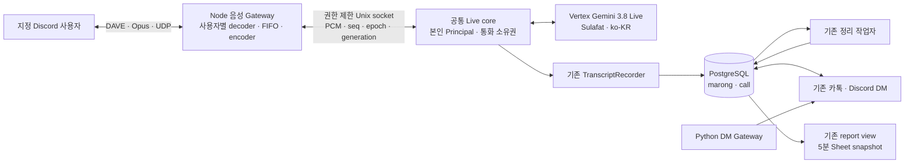
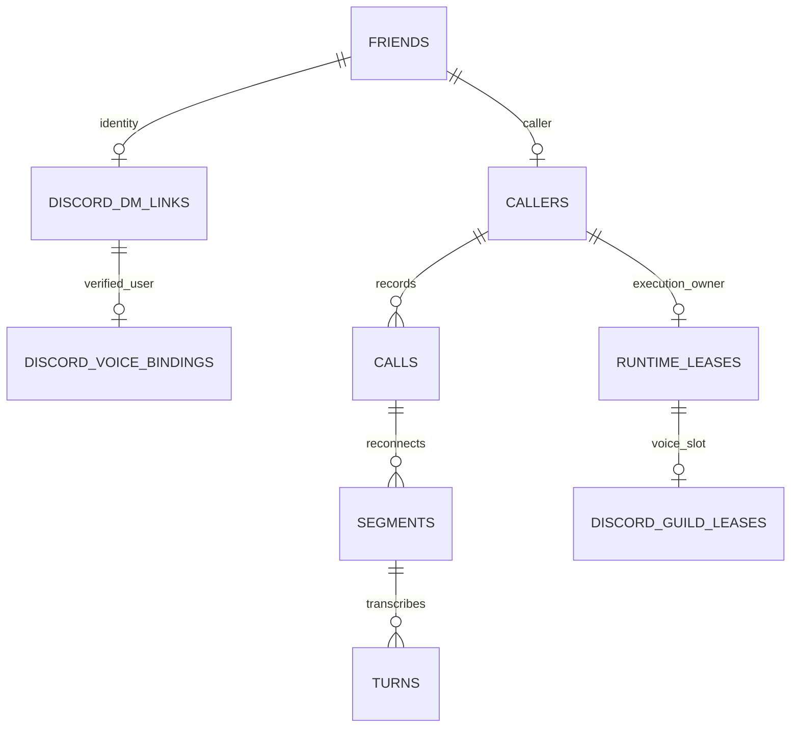

**마롱이 Discord 개인 음성 통화 설계**

상태: 연구 기반 설계 초안. 확인일 **2026-11-13 KST**, 코드 기준 `f61599d`. 이 문서는 CORTHEX 04 기능·05 ERD·06 내부 API의 추가 계약을 한곳에 제안한다. 실제 SDK 설치·채널 생성·배포·양방향 청취 합격을 뜻하지 않는다. 기존 [통화 기능 명세](04-functional-spec/spec.md), [ERD SQL](../marong/call/schema.sql), [운영 문서](../tools/vertex_live/OPERATIONS.md)의 해당 계약은 아래 추가안과 실제 구현을 대조해 갱신해야 한다.

**권장 A안은 기존 Python Discord DM 봇을 유지하면서 Node `@discordjs/voice@0.19.2`를 음성 전용 Gateway로 두고, 같은 서버의 내부 소켓으로 기존 Vertex Live core에 연결하는 것이다.** 같은 봇·같은 길드에서는 개인방 한 개만 통화하도록 한다. 동희와 현경이 같은 길드의 서로 다른 방에서 동시에 통화해야 한다면 B안으로 별도 봇 ID를 배정한다. 두 안 모두 한국어·Sulafat·기존 카톡/Discord DM/통화 기억 DB와 5분 시트 경로를 재사용한다. Discord가 웹 AudioContext 경로를 대체하는 효과는 있지만, Vertex의 음성 공급 지연이나 서버 버퍼 문제까지 자동으로 해결하지는 않는다.

**운영 사실과 미검증 범위**

| 11월 13일 읽기 전용 확인 | 설계에 주는 제약 |
|---|---|
| 동희: Discord 연결 있음, DM 열림, 통화 caller 0 | 기존 Discord→friend 매핑으로 본인 caller를 명시적으로 준비해야 한다. 현경 caller를 빌려 쓰지 않는다. |
| 현경: Discord 연결 있음, DM 열림, 통화 caller 1, 열린 웹 통화 1 | 기존 통화를 유지한다. 새 연결이 client/segment를 덮어쓰거나 전역 startup 정리를 실행하면 안 된다. |
| 14:19 KST 웹·RTC·음성 기억 작업자·카톡·DM 서비스 active, 웹 health 200 | 프로세스 상태 확인이다. Discord DAVE 왕복이나 실기기 청취 증거는 아니다. |
| 기존 `marong-vertex-tunnel` inactive/disabled, 시트 timer 5분 | 고정 도메인을 유지하고 trycloudflare 서비스를 다시 켜지 않는다. 시트 전용 적재 경로를 새로 만들지 않는다. |

운영 조사 기준 빌드는 `20261113-failover1`이다. 현재 웹 출력은 LiveKit RTC와 PCM fallback을 사용하며 입력은 별도 PCM 제어 연결이다. 이를 Discord↔LiveKit room bridge로 확장하면 홉·토큰·버퍼가 늘어나므로 초기안에서는 직접 내부 Live core 어댑터를 택한다. 동희 통화 허용의 후속 구현·적용 여부는 별도 배포 결과에서 확인하며, 위 caller 수는 조사 시점의 값이다. ([현재 구성](https://github.com/kodonghui/marong2/blob/f61599d/tools/vertex_live/README.md), [운영 경계](https://github.com/kodonghui/marong2/blob/f61599d/tools/vertex_live/OPERATIONS.md))

**SDK 선택은 “DAVE 연결 성공”과 “사람 말 수신 성공”을 구분한다.**

Discord는 일반 음성·영상 통화에 DAVE E2EE를 요구한다. 봇은 통화 참여자로서 복호화하고 Vertex에 음성을 전달하므로, Discord E2EE가 AI 처리 서버에도 내용을 숨긴다는 설명은 하지 않는다. 기능 안내에는 AI 처리와 전사·기억·기존 비공개 시트 반영 범위를 표시하되, 이미 승인된 사용 흐름에 매번 추가 확인이나 새로운 기억·삭제 음성 명령을 강제하지 않는다. ([Discord 시행 공지](https://discord.com/blog/every-voice-and-video-call-on-discord-is-now-end-to-end-encrypted), [DAVE 프로토콜](https://daveprotocol.com/))

| 후보·조사 시점 배포본 | 근거와 한계 | 판단 |
|---|---|---|
| `discord.py 2.7.1` | DAVE 연결 지원과 기본 송신 지원만으로 양방향 수신을 입증할 수 없음 | 기존 DM 유지 |
| `discord-ext-voice-recv 0.5.2a179` | 배포는 DAVE 의무화 이전, DAVE 수신 PR #65는 open | 미병합 패치 유지 부담 때문에 1차 제외 |
| `py-cord 2.8.1` | 배포 코드가 DAVE 때문에 수신이 깨져 있다고 경고 | 현재 배포본으로 수신 성공을 약속하지 않음 |
| `@discordjs/voice 0.19.2` | 배포 코드에 전송 복호화→DAVE 복호화→Opus 수신 경로 존재 | **실제 왕복 시험의 1순위 후보** |

근거는 [discord.py 변경 이력](https://discordpy.readthedocs.io/en/stable/whats_new.html), [수신 확장 PR #65](https://github.com/imayhaveborkedit/discord-ext-voice-recv/pull/65), [Pycord 배포 코드](https://github.com/Pycord-Development/pycord/blob/v2.8.1/discord/voice/client.py), [Node VoiceReceiver 배포 코드](https://github.com/discordjs/discord.js/blob/@discordjs/voice@0.19.2/packages/voice/src/receive/VoiceReceiver.ts)다. Node 배포본은 Node `>=22.12.0`, Davey `^0.1.9` 조합을 기준으로 lockfile을 고정한다. 더 새로운 Davey 0.2.0을 호환 확인 없이 덮어쓰지 않는다. ([npm 패키지 메타데이터](https://registry.npmjs.org/@discordjs/voice))

Node의 예전 RTP padding 문제는 수정됐지만, 사람이 먼저 들어온 방에 봇이 뒤늦게 입장할 때 초기 DAVE transition 0 복호화 실패가 복구되지 않는 보고 #11653은 조사 시점에 열려 있다. 공개 이슈는 현재 마롱이의 실패를 증명하지 않지만 **사용자 먼저/봇 먼저 입장, 입장 즉시 발화, 재키 전환**을 합격 시험에 넣을 근거다. Ready·패킷 수신·음악 송신만으로 통과시키지 않는다. ([수정된 #11419](https://github.com/discordjs/discord.js/issues/11419), [미해결 #11653](https://github.com/discordjs/discord.js/issues/11653))

**A/B 구현 선택과 통화 슬롯**

| 안 | Gateway·미디어 구성 | 동시성 | 선택 조건 |
|---|---|---|---|
| **A: 현재 봇 재사용** | Python은 DM만 처리, Node는 voice-state·음성 입출력만 처리. 같은 토큰의 두 Gateway에 처리 소유권을 명시 | 같은 봇·같은 길드의 음성방 1개. 두 사람은 순차 이용 | 1차 권장. 기존 DM 회귀와 실제 DAVE 왕복부터 검증 |
| **B: 음성 봇 ID 분리** | 기존 DM 유지, 개인방별 별도 음성 봇 또는 명시적 bot pool | 같은 길드의 두 개인방 동시 사용 가능하도록 설계 | 동시 통화가 필요할 때. 독립 Vertex 세션·bot/guild lease·부하 시험 필수 |
| 단일 Gateway + IPC | Gateway 한 개가 DM/voice 이벤트를 담당하고 언어별 업무 worker로 전달 | 봇 ID 하나면 길드당 1개 | 중복 Gateway 운영이 실제 문제가 될 때 후속 정리 |
| 봇 1개·길드 2개 | 길드마다 별도 연결 | 길드별 1개 | 참가·관리 동선이 늘어나는 대안 |
| 공개 `/live`에 봇 접속 | 브라우저 인증·Origin 계약을 재사용하려는 방식 | 기존 웹 전역 슬롯과 충돌 | 채택하지 않음. 사람 JWT·쿠키를 봇에 복제하지 않음 |

Discord 공식 Gateway 문서는 같은 shard 조합의 여러 세션을 허용한다. 따라서 같은 토큰으로 Gateway 두 개를 열면 반드시 기존 DM이 끊긴다는 설명은 맞지 않는다. 다만 같은 봇 ID의 음성 상태는 길드의 단일 channel을 가리킨다. Node `group`은 로컬 연결 분류이며 봇 ID를 늘리는 수단이 아니다. DM/컴포넌트/명령/저장을 양쪽에서 중복 처리하지 않고 voice-state 제어는 Node 하나가 맡는다. ([Gateway sharding](https://docs.discord.com/developers/events/gateway#sharding), [Voice State 갱신](https://docs.discord.com/developers/events/gateway-events#update-voice-state), [Node group 계약](https://discord.js.org/docs/packages/voice/0.19.2/JoinVoiceChannelOptions:Interface))

**요구사항과 흐름 추가 초안**

기존 최대 ID `REQ-066 / FL-010 / SPEC-031 / TBL-012 / API-012` 뒤부터 예약한다. 이 파일의 새 ID는 아직 구현 완료 표시가 아니다. 시험은 별도 `QA-DV-*` 이름 공간을 사용한다.

| ID | 추가 요구 |
|---|---|
| REQ-067 | 검증된 Discord ID를 본인 friend/caller에 연결하고 계정당 지정 개인방 한 개를 사용한다. |
| REQ-068 | 기존 Discord DM과 웹 통화를 유지하고, 같은 caller의 동시 두 연결은 busy로 처리한다. |
| REQ-069 | Node DAVE 실제 수신·Vertex 응답·Discord 실청취 왕복을 입증한다. |
| REQ-070 | 현재 한국어·Sulafat를 유지하고 앱의 시간·횟수 제한이나 AI 임의 종료를 추가하지 않는다. |
| REQ-071 | 본인의 카톡 1:1·Discord DM·허용된 통화 기억을 같은 DB로 이어 준다. |
| REQ-072 | 제3자 참가·잘못된 채널·다른 계정에 개인 음성·기억을 전달하지 않는다. |
| REQ-073 | 전사는 기존 recorder와 `call.turns`에 한 번 저장하고 기존 5분 시트에 출처를 표시한다. |
| REQ-074 | 정상 퇴장·일시 연결 유실을 구분하고 재접속·작업 재시작이 다른 통화를 변경하지 않는다. |
| REQ-075 | 기존 도메인·Vertex 인증·공유/삭제 보호를 유지한다. 새 기억/삭제 음성 명령은 추가하지 않는다. |

| 흐름 ID | 정상 흐름 | 예외 흐름 |
|---|---|---|
| FL-011 개인방 시작 | 본인 입장→신원·현재 참가자 확인→caller와 bot/guild 슬롯 획득→DAVE와 Vertex 준비→음성 대화 | 미등록·채널 불일치·타인 참가면 seed/외부 음성 전송 전 거절 |
| FL-012 동시 시작 | 같은 request 재시도는 기존 결과 반환 | caller busy 또는 guild busy면 기존 통화 유지. 봇 이동·웹 세그먼트 덮어쓰기 없음 |
| FL-013 연결 복구·격리 | Discord/Vertex 유실 각각 재연결, 참가자 재확인, 새 epoch로 재개 | 제3자 참가면 양방향 큐 폐기·개인 처리 중지. 모르는 참가 상태를 빈 방으로 간주하지 않음 |
| FL-014 종료·후속 대화 | 정상 Gateway에서 본인 퇴장 확인 또는 명시 종료→전사 flush→종료·정리 예약 1회→다음 본인 카톡/DM·시트 반영 | Gateway 자체 유실은 resting. 저장/시트 오류는 별도 재시도하며 성공을 꾸미지 않음 |

Discord voice-state만으로 모든 퇴장이 클릭인지 네트워크 장애인지 알 수는 없다. 확인된 퇴장은 `participant_left`, 명시 종료는 `user_end`, 제어 연결 유실은 `transport_lost`로 구분한다. lease 만료·복구 유예는 낡은 실행기의 자원과 쓰기 권한을 회수할 뿐, 시간 경과로 AI가 작별하거나 논리 통화를 종료하는 장치로 쓰지 않는다. 본인이 다른 채널로 이동해도 그 방으로 따라가지 않는다.

**04 기능 명세 추가 초안**

| ID | From | 사전조건·주요 동작 | 예외·합격 조건 |
|---|---|---|---|
| SPEC-032 신원·방 바인딩 | 067,072 | Gateway의 실제 user/guild/channel을 기존 `discord_dm_links`와 voice binding으로 검증, enabled caller를 서버가 결정 | nickname·요청 body의 caller ID 무시. 다른 방 요청은 seed 0건 |
| SPEC-033 DAVE 음성 준비 | 069,070 | `selfDeaf:false`, 고정 SDK·Opus 조합으로 입장하고 지정 사용자 수신 스트림만 연결 | Ready 이후에도 실제 PCM·한국어 응답 실청취가 있어야 합격. 수신 error/close 복구 |
| SPEC-034 소유권·동시성 | 068,074 | caller lease와 `(bot ID,guild ID)` lease를 일관된 순서로 획득. connection generation으로 모든 변경을 보호 | 다른 연결 busy, stale stop/save 무효. 전체 call 초기화 금지 |
| SPEC-035 오디오 변환·끼어들기 | 069,070 | 사용자별 Opus→48k PCM→16k mono, 답 24k mono→48k stereo→Opus. FIFO와 epoch 유지 | 부족을 EOF로 처리하지 않음. interruption 뒤 옛 큐 재생 0 |
| SPEC-036 개인 기억 범위 | 071,072 | `discord_private_v1` scope를 seed·recall·resume 모두에 전달 | 단체방 혼합 요약·타인 원문 제외. 웹의 넓은 resume handle 재사용 금지 |
| SPEC-037 전사·시트 | 073,075 | 기존 recorder→turn upsert→report view→5분 snapshot 사용. source를 Discord voice로 표시 | draft/final 중복 0, 실패는 미저장으로 계측. 새 Sheet writer 없음 |
| SPEC-038 수명·종료 정리 | 070,074 | source와 generation을 확인해 구간 복구/정상 종료를 구분, 종료 정리 한 번 예약 | 무음·turn complete·AfterSilence는 통화 종료가 아님 |
| SPEC-039 참가자·권한 변경 | 072,075 | 허용된 본인 1명+우리 봇을 계속 확인, 바인딩/권한 철회 시 처리 중단 | 제3자 발화를 Vertex에 보내거나 저장하지 않음. 이미 송신한 오디오는 회수 불가 |
| SPEC-040 운영·회귀 | 068,075 | 음성 feature flag·단위별 진단·버전 고정·드레인 배포 | 기존 DM/웹/시트 보호, trycloudflare disabled 유지 |

현재 전사·기억 경로에는 `current_time`과 `recall`만 있다. 종료 후 organizer가 확정된 사용자 발화의 인용을 검증해 장기 기억으로 정리하는 동작을 재사용한다. 별도 “기억해줘/잊어줘” 명령을 새로 넣거나 지금 지원한다고 안내하지 않는다. ([현재 memory tools](https://github.com/kodonghui/marong2/blob/f61599d/tools/vertex_live/memory_tools.py), [현재 organizer](https://github.com/kodonghui/marong2/blob/f61599d/tools/vertex_live/organizer.py))

**미디어와 기억을 잇는 내부 구조**

Discord 입력은 SDK의 전송/DAVE 복호화 후 **사용자별 Opus**로 받는다. 디코더에서 48kHz stereo PCM으로 만들고 mono 혼합·연속 16kHz 리샘플링 후 Vertex로 보낸다. 20ms 입력은 640bytes다. Vertex의 24kHz mono PCM은 실제 샘플 잔량 FIFO를 거쳐 연속 48kHz stereo로 바꾸고 20ms 3,840bytes 단위의 PCM을 Opus로 인코딩한다. 두 byte 수는 포맷에서 계산한 값이다. 리샘플러 상태를 패킷마다 초기화하거나 패킷 길이가 항상 같다고 가정하지 않는다. ([Discord 송신 규격](https://docs.discord.com/developers/topics/voice-connections#transport-encryption-and-sending-voice), [Google PCM 규격](https://docs.cloud.google.com/gemini-enterprise-agent-platform/models/live-api/send-audio-video-streams))

초기 버퍼 150~500ms는 비교 실험 시작 범위다. 설정 지연보다 실제 잔량·송신 소비·고갈 때 넣은 무음·회복 시간을 측정한다. 빈 큐를 발화 종료나 전체 통화 EOF로 취급하지 않는다. Node의 AfterSilence/AfterInactivity는 수신 스트림 종료 조건이며 의미를 이해하는 VAD가 아니다. 자동 VAD를 기본으로 유지하고 수동 activity 신호를 동시에 덧씌우지 않는다. provider interruption 때 해당 output epoch의 PCM·인코더 대기·AudioResource를 폐기하며 음성 연결과 입력 수신은 유지한다. ([Node 수신 스트림](https://github.com/discordjs/discord.js/blob/@discordjs/voice@0.19.2/packages/voice/src/receive/AudioReceiveStream.ts))

0.19.2 공용 Opus 수신 스트림에는 RTP 순번·시각이 함께 노출되지 않는다. 수신 jitter buffer·재정렬·PLC가 완전히 제공된다고 가정하지 않는다. 순번 기반 손실 측정이 필요하면 작은 계측 어댑터를 검토하고, 그 전 값은 0이 아니라 미계측으로 둔다. 현재 웹 끊김과 비교할 때 Discord의 최종 기기 재생도 별도 청취가 필요하다. 일반 3.8 Live는 thinking 미지원이므로 `thinkingBudget=0` 추가를 해결책으로 주장하지 않는다. ([Node 수신 구현](https://github.com/discordjs/discord.js/blob/@discordjs/voice@0.19.2/packages/voice/src/receive/VoiceReceiver.ts), [Google 모델 표](https://docs.cloud.google.com/gemini-enterprise-agent-platform/models/gemini/3-8-live))

**05 ERD 추가 초안: 신원과 실행 소유권을 분리한다.**

| TBL | 제안 표·핵심 열 | 불변 조건 |
|---|---|---|
| TBL-013 | `call.discord_voice_bindings`: discord_user_id PK/FK, guild_id, voice_channel_id, bot_user_id, enabled, policy_version, authorized_at, revoked_at | DM `channel_id`를 음성방으로 덮어쓰지 않음. guild/channel UNIQUE, 숫자 문자열 Snowflake 검사. 기존 승인 근거를 기록할 수 있음 |
| TBL-014 | `call.runtime_leases`: caller_id PK, call_id, holder_connection_id, service_instance_id, source, generation, heartbeat_at, expires_at | caller당 실행 소유자 1개, generation 증가 후 옛 쓰기·종료 거절 |
| TBL-015 | `call.discord_guild_leases`: (bot_user_id,guild_id) PK, holder_connection_id, generation, expires_at | 실제 Gateway 봇 사용자 ID 기준 음성 슬롯 1개. 다른 사람 입장으로 봇을 이동시키지 않음 |

기존 `discord_dm_links → friends → call.callers`를 조인해 principal을 만들므로 binding에 friend/caller를 중복 저장하지 않는다. 동희의 caller 생성은 검증된 기존 friend를 기준으로 명시적으로 수행한다. 현경의 열린 call을 재사용하지 않는다. 기존 `calls/segments/turns`에는 `entry_channel`, `source_connection_id`, scope version을 필요한 위치에 추가하고, report view와 `transport_events` CHECK/표시도 함께 바꾼다. Discord 재연결을 웹 RTC→PCM fallback 수에 합산하지 않는다.

현재 `start_call()`은 미종료 call의 client를 바꾸고 `start_segment()`는 열린 구간을 닫는다. startup은 전역 live call/segment를 복구한다. 이 함수를 독립 Discord 데몬에서 그대로 실행하면 정상 웹 통화까지 변경될 수 있다. **같은 DB를 쓰는 것만으로 통화 격리는 완성되지 않는다.** caller 잠금 안에서 lease·call 선택을 함께 처리하고 startup은 자신의 만료 lease에 속한 구간만 회수한다. 메모리 내 세션·diagnostics·resume도 caller/call/scope/revision별로 분리한다. heartbeat 5초·lease 20초는 시험용 초기값이며 통화 길이 제한이 아니다. ([현재 통화 상태 변경](https://github.com/kodonghui/marong2/blob/f61599d/tools/vertex_live/call_memory.py), [현재 전역 상태와 startup](https://github.com/kodonghui/marong2/blob/f61599d/tools/vertex_live/server.py))

**기억 범위와 전사·시트의 재사용 경계**

Discord DM은 현재 본인 DM방과 검증된 카톡 1:1만 조회하고 `memory_room`을 따라가지 않는다. 웹 통화 MemoryStore는 연결 그룹까지 포함한다. 따라서 본인 Principal을 재사용하면서 **scope는 `discord_private_v1`로 더 좁게** 넘겨야 한다. seed·recall·정리된 기억 출처·resume을 모두 같은 정책으로 검사한다. 혼합 출처를 증명할 수 없는 예전 그룹 요약은 Discord private seed에서 제외한다. 같은 caller라도 넓은 웹 seed가 들어간 provider handle을 Discord에 바로 이어 붙이지 않는다. ([Discord 범위](https://github.com/kodonghui/marong2/blob/f61599d/marong/discord_store.py), [웹 범위](https://github.com/kodonghui/marong2/blob/f61599d/tools/vertex_live/call_memory.py))

전사는 edge에서 새로 만들지 않고 기존 `TranscriptRecorder → call.turns → transcript_report → report.py`로 보낸다. 같은 turn의 draft/final은 stable key로 갱신하고, 음성 문장을 DM 메시지로 복사하지 않는다. 현재 recorder의 write 실패는 카운터만 증가시키고 내구 재시도가 없으므로 무손실을 약속하지 않는다. bounded retry·저장 지연 지표와 삭제 revision 검사를 추가한다. 시트는 기존 V번호와 snapshot 주기를 유지하고 `디스코드 통화(전사/중단)` 출처만 명확히 한다. 정상 주기 5분은 장애 중에도 5분 안에 반영된다는 보장이 아니다. ([전사 기록기](https://github.com/kodonghui/marong2/blob/f61599d/tools/vertex_live/memory_tools.py), [리포트](https://github.com/kodonghui/marong2/blob/f61599d/tools/report.py), [시트 timer](https://github.com/kodonghui/marong2/blob/f61599d/deploy/marong-sheet.timer))

종료 후 organizer의 검증된 기억은 다음 본인 카톡 1:1과 Discord DM에서 기존 `call_context()`로 조회한다. 통화에서 파생된 비공개 내용이 카톡 요약·shared_notes를 거쳐 다른 친구에게 퍼지지 않도록 현재 private guard를 유지한다. 삭제 revision이 바뀌면 오래된 recorder 재시도·organizer·Sheet snapshot이 내용을 되살리지 않게 한다. Opus를 전송했다는 사실은 실제 청취 완료가 아니므로 시트에 `delivered=true`를 추정해서 넣지 않는다. ([기존 call context 보호](https://github.com/kodonghui/marong2/blob/f61599d/marong/store.py))

**06 내부 API 추가 초안: 웹 인증을 흉내 내지 않는다.**

내부 listener는 `/run/marong-voice` 아래 Unix socket에만 두고 공개 aiohttp/Cloudflare 라우터에는 마운트하지 않는다. 전용 UID/GID·0600/0660·peer UID 검증을 사용한다. 현재 DM과 카톡은 OS 사용자 경계를 공유하므로 같은 UID 확인만으로 두 프로세스를 구분했다고 보지 않는다. 음성 edge 전용 UID와 systemd credential 경계를 우선 검토한다. Vertex 키는 기존 core에, Discord 토큰은 edge에 남기며 다른 기기로 인증 파일을 복사하지 않는다. ([Unix socket peer 자격](https://man7.org/linux/man-pages/man7/unix.7.html), [systemd socket 권한](https://www.freedesktop.org/software/systemd/man/latest/systemd.socket.html))

| API | 내부 계약 | 검증·응답 |
|---|---|---|
| API-013 `POST /internal/v1/discord-voice/sessions` | request_id, 검증된 discord_user_id/guild_id/voice_channel_id, edge_instance_id, policy_version | binding·참가자·caller/guild lease 확인. call_id, connection_id, generation, media 참조, voice/language 반환 |
| API-014 session media stream | PCM16 16k mono 입력/24k mono 출력, epoch·seq·sample_offset·generation | stale generation/epoch 거절, 길이·레이트·큐 상한 검사 |
| API-015 session control | heartbeat, stop, transport_lost, participant_changed, binding_revoked | 같은 generation만 변경. stop 멱등, temporary loss와 participant_left 구분 |
| API-016 session diagnostics | 권한 있는 운영자용 숫자 상태 조회 | DAVE/Voice/Vertex 재연결·FIFO·drop·전사 지연만. 원문·키·handle 제외 |

caller ID, email, SQL, 임의 system prompt는 요청 인자로 받지 않는다. 주요 오류 코드는 `not_bound`, `wrong_channel`, `participant_mismatch`, `caller_busy`, `guild_busy`, `stale_generation`, `voice_not_ready`, `storage_unavailable`이다. 실패 때 신원·기억 자료를 과다 반환하지 않으며, transcriptions는 공개 Discord 텍스트방으로 자동 발송하지 않는다.

개인방은 @everyone의 보기/입장을 거부하고 지정 사용자·봇만 허용한다. 인원 제한 2는 보조 수단이며 권한 검사를 대신하지 않는다. Administrator의 overwrite 우회 가능성과 이미 전송한 소리를 회수할 수 없는 한계를 인정한다. 허용 집합 밖 참가자를 발견하거나 참가 상태를 확인하지 못하면 개인 출력·마이크 외부 전송을 먼저 멈춘다. ([Discord permissions](https://docs.discord.com/developers/topics/permissions), [음성 인원 제한](https://docs.discord.com/developers/topics/voice-connections#retrieving-voice-server-information))

**정량 QA 초안과 구현 순서**

아래 수치·횟수는 목표이며 현재 달성값이 아니다. 초기 구현 완료는 실제 DAVE 왕복·본인 격리·기존 서비스 회귀를 통과해야 한다. 같은 길드의 두 방 동시 통화는 B안에서만 시험·표시한다.

| QA ID | 시험 | 제안 합격 기준 |
|---|---|---|
| QA-DV-001 | 오프라인 10초 PCM, 무작위 청크, 48→16/24→48 변환 | 길이 오차 1ms 이내, byte 규격 일치, 경계 클릭·속도/피치 변화 없음 |
| QA-DV-002 | 봇 먼저/사람 먼저 각 20회, 입장 즉시 발화 | 모든 회차 지정 사용자 PCM·입력 의존 한국어 답·실청취 성공. Ready 뒤 무음 방치 0 |
| QA-DV-003 | DAVE 키 전환·mute·재접속 20회 | 지속 복호화 실패·죽은 스트림 방치 0, 제3자 자료 전달 0 |
| QA-DV-004 | PC 헤드셋·iPhone Discord 각 20턴 | 정상망에서 엔진이 삽입한 문장 중 100ms 이상 무음 0 목표, 자연스러운 쉼 제외 |
| QA-DV-005 | 응답 중 끼어들기 20회, 스피커/헤드셋 A/B | interruption 수신→서버 큐 폐기 p95≤50ms, 사용자 발화→실제 청취 중단 p95≤500ms 목표 |
| QA-DV-006 | 정상망 응답 지연 | 발화 종료→첫 실제 청취 p95≤3초 목표, Google·Discord 구간 분리 |
| QA-DV-007 | 같은 caller 웹+Discord, 같은 bot/guild 다른 caller, stale stop | 기존 통화 상태 불변, 새 요청 busy, 옛 generation 쓰기·종료 0 |
| QA-DV-008 | 합성 두 인물·잘못된 방·제3자 입장·범위 다른 resume | 오디오/전사/기억의 계정 교차 0, 잘못된 source ID 0 |
| QA-DV-009 | DB 지연·recorder 실패·Sheet 429/500 | 오디오 루프 비차단, 저장 실패 계측, 다음 성공 snapshot에 V키 중복 0 |
| QA-DV-010 | 종료→다음 카톡/DM→시트, 삭제와 작업 retry 경쟁 | 같은 본인 기억 반영, 다른 친구/shared_notes 노출 0, 삭제 재등장 0 |
| QA-DV-011 | 100/300/1,000ms 공급 정지·Discord/Vertex 각각 유실·edge 재시작 | 원인별 복구, stale 음성 0, 다른 인스턴스 call 변경 0. 고장 중 무음 0은 요구하지 않음 |
| QA-DV-012 | 긴 통화 및 B안 두 방 각 30분 | 앱 시간 제한·AI 임의 종료 0, 재개 handle/오디오/기억 교차 0, 큐·CPU 누적 없음 |

구현 순서는 **고정 SDK의 DB 없는 DAVE 왕복 → 신원·lease·transport 어댑터 → 좁은 기억 scope → 전사·시트 출처 → 기존 DM/웹 회귀 → 한 개인방 적용**이다. 합성 fault는 해당 시험 세션에만 주입하며 운영 전역 포트를 끊지 않는다. 지표의 키는 call/connection/build/library version/generation/epoch로 묶고, DAVE·Discord Voice·Vertex 재연결을 따로 센다. RTP 원자료가 없는 손실률, 실제 기기에서 확인하지 않은 청취 지연은 미계측으로 표시한다.

적용 때 기존 웹의 활성 통화가 있으면 공통 core를 재시작하지 않는다. 새 Discord 입장만 feature flag로 제어하고 유휴 전환 시점을 사용한다. 롤백은 Discord 신규 시작 차단→활성 음성 드레인→voice edge 중지 순서이며 DM·웹·시트는 유지한다. 추가 스키마·개인정보 보호 guard를 제거하거나 사용자 기록·인증 파일을 복원 대상으로 섞지 않는다. Google 모델·프로젝트·인증 경로도 유지하며 무료 크레딧 잔액·무과금이나 공급자 무중단을 이번 연구가 보장하지 않는다. ([Google 세션 관리](https://docs.cloud.google.com/gemini-enterprise-agent-platform/models/live-api/start-manage-session), [기존 롤백 지침](https://github.com/kodonghui/marong2/blob/f61599d/tools/vertex_live/OPERATIONS.md))

**실기기 결과 기록란 — 아직 수행 결과 없음**

| 검증 항목 | 실제 값·증거 | 판정 |
|---|---|---|
| 배포 commit / Node·voice·Davey·Opus 버전 | — | 미검증 |
| DAVE 사용자 먼저/봇 먼저 왕복 | — | 미검증 |
| PC / iPhone 앱·OS·출력 장치·망 | — | 미검증 |
| 첫 소리 p50/p95 / 고갈 / 끼어들기 실청취 | — | 미검증 |
| 기존 DM·웹 통화 유지 / caller 소유권 | — | 미검증 |
| 같은 사람 카톡·DM 기억 / 5분 시트 / 삭제 | — | 미검증 |
| B안 두 방 동시 통화 | — | 범위 선택 후 검증 |

이 초안의 완료 기준은 연결 표시가 아니라, **본인 음성이 DAVE를 거쳐 Vertex에 도달하고 같은 기기에서 한국어 답을 들으며, 그 사람의 기록만 기존 DB·시트·다음 대화로 이어지는 실제 왕복**이다.
