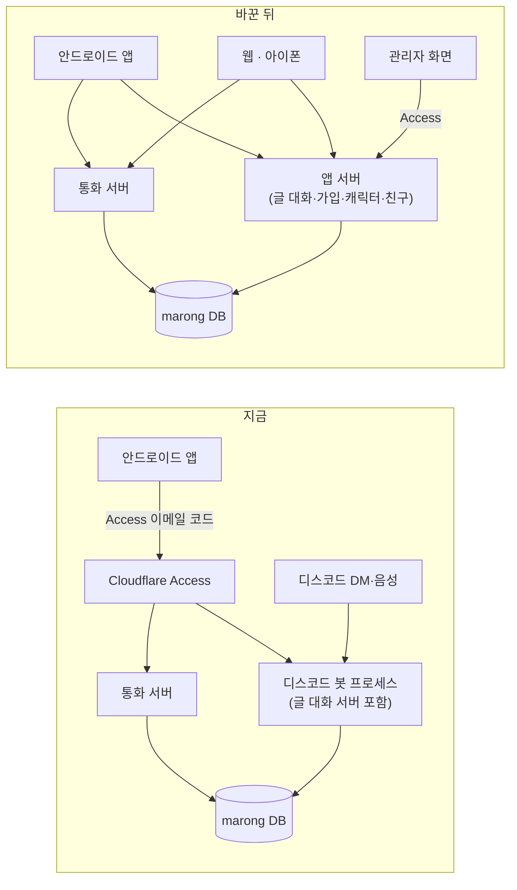
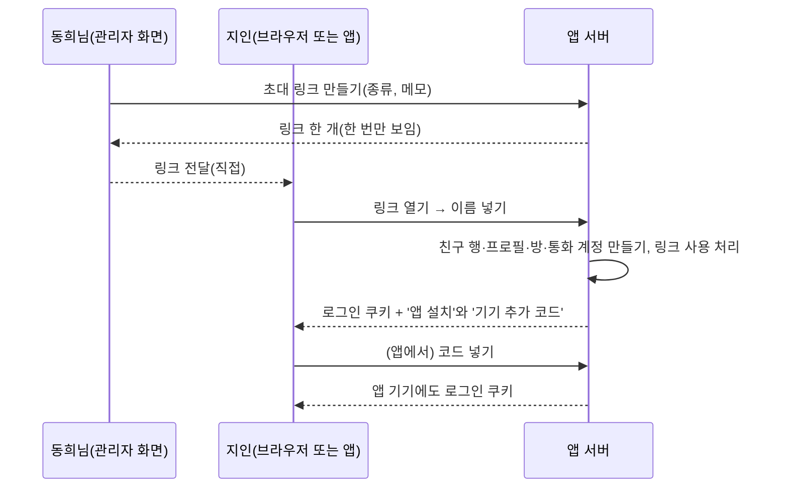
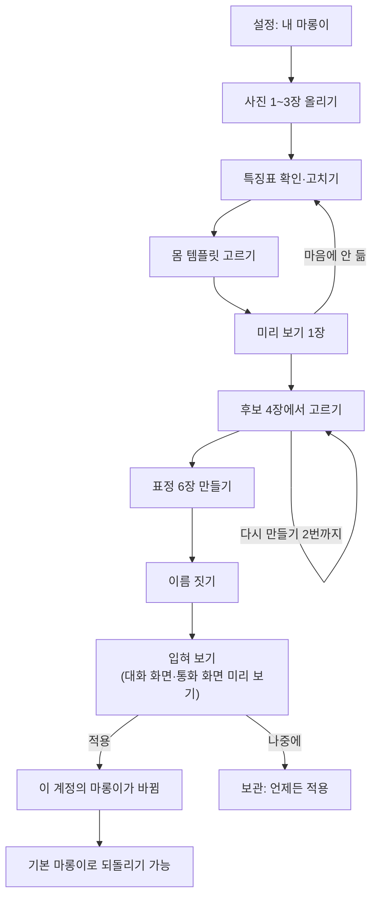
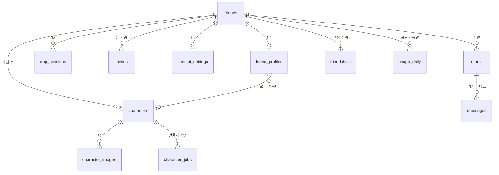

# 마롱이 통합 앱(MVP) 설계 제안

상태: 승인(2026-11-19 10:15:45 KST, 이 설계 스레드, 동희님 "승인", D104). 승인 뒤 이 문서의 ID를 그대로 써서 CORTHEX 단계 문서(part 이름 `unified`)로 옮겼어요: [01 도메인](01-domain/unified.md), [02 요구사항](02-prd/unified.md), 03 흐름(`03-user-flow/FL-169`~`FL-178`), [04 기능 명세](04-functional-spec/unified.md), 05 표([020_unified.sql](../marong/migrations/020_unified.sql), [그림](05-erd/unified.md)), [06 계약](../api/unified.openapi.yaml), [07 사이트맵](07-sitemap/sitemap.md), [08 화면 상태](08-screens/unified.md), [10 작업 목록과 GPT 인계](10-wbs/unified.md), [12 시험 계획](12-qa/unified.md). 이 문서는 배경과 이유를 한곳에서 읽는 용도이고, 이 문서와 단계 문서가 다르면 단계 문서가 맞아요. 구현은 GPT가 해요.

단계 문서를 쓰면서 고친 곳(아래 본문에도 반영했어요):

- 마이그레이션 번호는 020이에요(019는 성향 맞춤이 이미 씀). 통화 스키마에는 권한만 주는 008이 하나 더 있어요.
- 새 화면과 API는 모두 지금 앱 서버의 경로 접두부 `/chat/` 아래에 둬요. 프로필은 `/chat/api/profile`이에요(`/chat/api/me`는 이미 있음).
- 캐릭터 만들기 화면은 반려동물 part의 SCR-142~146을 고치지 않고 새 번호 SCR-170~174로 써요. 반려동물 part의 화면·흐름·표는 그대로 보류예요.
- API는 동작 하나에 번호 하나로 나눠 API-238~242를 더했어요.
- 친구 관계(`friendships`)에 상태(요청·수락·거절·끊김)와 양쪽의 '가까운 사이' 뜻(`close_a`·`close_b`) 칸을 더했어요.
- 프로필 행은 미리 채우지 않고 가입하거나 연결할 때 만들어요.
- 2026-11-19 14시대 KST 검토(설계 문서끼리, 표와 계약, 실제 코드와 대조)에서 고친 것은 단계 문서에만 반영했어요. 이 제안 본문과 다르면 단계 문서가 맞아요. 큰 것: 통화 서버 코드는 `tools/vertex_live/`에 있어요. 통화 시작의 거절은 HTTP 상태가 아니라 웹소켓 메시지예요. 통화 쇼핑은 통화 서버가 직접 읽지 않고 앱 서버의 내부 경로를 불러요. 약속 전화의 '받기'는 프로필 응답의 `pendingRing`으로 그려요. 전체 통화 예산 코드는 PR #41에 있어서 사람별 상한은 그 뒤에 만들어요. 통화의 능력 소개는 다섯 가지 고정이 아니라 그 통화에 붙은 능력만 말해요. 목록은 [작업 목록의 '검토에서 고친 것'](10-wbs/unified.md#검토에서-고친-것2026-11-19)에 있어요.

기준 코드: `main` `0953b86`(2026-11-19 01:39 KST, PR #52 합침). 운영 서버의 봇 코드는 `main`과 꼭 같지 않아요(15절).

## 1. 한눈에

- 무엇을 만드나: 안드로이드 앱과 웹(아이폰) 두 곳에서 쓰는 마롱이. 동희님이 보낸 초대 링크로 지인이 가입하고, 사람마다 자기 마롱이를 가져요. 마롱이의 이름과 통화 목소리를 바꿀 수 있고, 반려동물 사진으로 만든 강아지·고양이 캐릭터로 바꿀 수 있어요. 대화와 기억은 그대로 이어져요.
- 범위(D103): MVP예요. 쓰는 사람은 동희님 주위 사람들이고 같이 개발하는 사람들이에요. 그래서 고지·동의·본인 확인·결제·사람별 차단 장치는 만들지 않고, 지금 돌아가는 것(기록 시트, 프롬프트 한 벌, 무료 중계)은 그대로 둬요.
- 큰 변화 다섯 가지
  1. 로그인이 Cloudflare Access 이메일 코드에서 **초대 링크 + 기기 로그인 유지**로 바뀌어요.
  2. 글 대화 서버가 디스코드 봇 프로세스에서 나와 **앱 서버**가 돼요. 디스코드 봇과 디스코드 음성 중계는 끄고, 카카오 흔적은 문서에서 정리해요.
  3. DB는 새로 짜지 않고 **확장**해요. `friends`가 회원 표이고, 표 9개와 칸 몇 개를 더해요.
  4. 반려동물 캐릭터는 별도 서비스가 아니라 **기존 앱 안의 설정**이 돼요. PR #47의 계산 함수와 공급자 어댑터만 가져와요.
  5. 사람이 늘어도 서로 막지 않게 통화 동시 사용, 친구 맺기, 사용량 세기를 사람별로 바꿔요.
- 하지 않는 것: 결제와 티켓 판매, 추억 모드(떠난 아이), 마롱이끼리 직접 대화, 웹 푸시, iOS 앱, 구글 로그인, 일반 웹페이지 읽기 도구, 공개 가입.

## 2. 결정(이 설계의 근거)

D73~D89는 비워 둬요(진행 중인 구현 PR과 번호가 겹치지 않게). 아래는 모두 2026-11-19 KST, 설계 논의 스레드에서 동희님이 한 말이에요. '읽은 뜻'은 Claude의 해석이에요.

| 번호 | 때 | 동희님 말 | 읽은 뜻 |
| --- | --- | --- | --- |
| D90 | 01:04 | "①로 정하기" | 캐릭터와 만들기 상태를 기존 `marong` DB에 `friend_id` 키로 두고, PR #47의 계산 함수와 공급자 어댑터만 꺼내 써요 |
| D91 | 01:13 | "B: 모두 승인" | 능력(쇼핑·공부·검색·일정·고민)은 그대로, 이름·말투·모습만 반려동물. 금지선(건강 판단, 붙잡는 말, 진짜 그 아이라는 주장), 반려동물 캐릭터일 때 19금 절 끔, 지난 대화는 캐릭터 자신의 기억, 1차는 살아 있는 아이만, 'AI가 만든 캐릭터예요' 띠 없음 |
| D92 | 01:13 | "카톡/디코는 서비스 x. 이제 apk랑 웹(나는 아이폰이라 웹에서 해야해)에서만 할거야" | 카카오톡과 디스코드는 서비스하지 않아요. 안드로이드 앱과 웹만 |
| D93 | 01:13 | "전부 설계에 넣어" | 11/18 개선 사항(통화 문제 1·2·4·5·6, 이름 바꾸기, 아이폰 웹, 비동기 원칙, 회원 가입, 친구 맺기)을 모두 이 설계에 넣어요 |
| D94 | 01:13 | "일단 현경이랑 나(웹) 그리고 누나(apk) 등 지인들이 사용할 수 있으면 돼", "나랑 현경이 + 회원가입하는사람(내 지인들. apk 혹은 웹으로)" | 쓰는 사람은 지인. 가입을 설계에 넣어요 |
| D95 | 01:13 | "그림 모델 이미 연구문서에 정했잔아" | 그림 `gpt-image-2.5-flare`, 사진 읽기 `claude-sonnet-5-5`(AI-30·31)를 그대로 써요 |
| D96 | 01:13 | "목소리 8개정도 놓고 선택할 수 있도록" | 통화 목소리를 8개쯤 두고 사람마다 골라요 |
| D97 | 05:19 | "초대링크로 ㄱㄱ" | 가입·로그인은 동희님이 보낸 초대 링크 + 기기 로그인 유지. 구글 로그인은 이번에 만들지 않아요 |
| D98 | 10:02 | "추천 승인" | DB는 새로 짜지 않고 확장해요(8절) |
| D99 | 10:02 | "지금처럼 전부 남기고, 가입화면에서 알릴필요도 없어" | 기록 시트와 추적은 지인 것도 지금처럼 남겨요. 가입 화면 고지·동의 없음 |
| D100 | 10:02 | "전부 켜 좀. 그냥 좀 냅둬 지금 하는건. 서비스하면 그때가서 진짜로 시스템프롬프트 다시쓰던뭘하던하면되니까" | 모든 계정에 지금 프롬프트를 그대로 써요. 사람별로 끄는 장치는 안 만들어요. D91의 '반려동물 캐릭터일 때 끔'은 그대로(Claude의 해석) |
| D101 | 10:02 | (지인의 글 답 모델 질문에) "2" | 지인도 지금의 글 답 경로(무료 중계 우선, 실패하면 Claude)를 그대로 써요 |
| D102 | 10:02 | "비즈니스 모델을 '피클 에이전트' 처럼 하루에 일정한 양 만큼 대화를 얼마든지 할 수 있게 할거야. 그리고 그 이상은 티켓이나 뭐 이런걸 사야 되는걸로. (근데 지금은 기능만 만들어놓고 추천처럼 150달러로 해)" | 지금은 하루 사용량을 세고 막을 수 있는 기능과 티켓 잔액 자리만 만들어요. 판매는 없어요. 통화 예산은 전체 월 150달러 + 한 사람당 상한(설정값) |
| D103 | 10:02 | "일단 MVP를 내는거지 지금 서비스를 내는게 아니잔아", "내 주위 사람들만 하고 다 안다고 이거 개발하는거 이거 같이 개발하는 사람들이라고" | 이번 범위는 MVP. 공개 서비스용 장치는 넣지 않아요 |
| D104 | 10:15 | "승인" | 이 설계 제안(PR #54)을 승인해요. 단계 문서로 옮기고 GPT 인계 절을 써요 |
| D105 | 14:13 | "ㅇㅇ ㄱㄱ 프롬프트 줘 지피티한테시킬게" | 목업을 그린 방향 그대로 가고(09-unified-1), GPT가 구현을 시작해요. 목업 방향 질문("목업을 그린 방향 그대로 갈까요?")의 답이에요 |

앞선 결정 가운데 그대로 쓰는 것: 11/18 "사람마다 자기 마롱이… 이름도 바꿀 수 있게", 웹 알림은 필요 없음, 통화 도구 대기 소리(1안), 통화에도 쇼핑 도구, 비동기를 기본으로(모두 Notion 11/18 인계 문서), D62(Gemini Live 유지), D9(월 150달러와 80·100·120% 규칙), D65(APK 빌드·서명은 GPT).

## 3. 격차표

| 영역 | 원하는 것 | 지금(`main`) | 바꿀 것 |
| --- | --- | --- | --- |
| 가입 | 지인이 초대 링크로 가입 | 가입 없음. 계정은 손으로 5단계(친구 행, 디스코드 연결, 통화 계정 SQL, Access 이메일, APK) | 초대 링크, 기기 로그인, 관리자 화면에서 링크 만들기 |
| 로그인 | 기기에서 로그인 유지 | Cloudflare Access 이메일 코드(허용 이메일 2개, 한 달) | 앱 서버가 직접 확인하는 로그인 쿠키. Access는 관리자 화면에만 |
| 글 대화 서버 | 앱·웹만으로 동작 | 디스코드 봇 프로세스 안. 디스코드 DM 연결이 없으면 403 `no_dm`, 폰 알림 등록도 막힘 | 디스코드 없이 뜨는 앱 서버, 사람 기준 방 |
| 방과 기억 | 사람마다 자기 대화·기억 | 대화·요약·메모·임베딩이 방(`room_key`) 기준, 방과 사람을 잇는 표는 `discord_dm_links` 하나 | 방에 주인 칸. 기존 방은 그대로 두고 주인만 채움. 새 사람은 `app:<friend_id>` 방 |
| 마롱이 이름 | 사람마다 바꿈 | '마롱이' 고정(프롬프트, 알림 제목, 화면) | 사람별 이름 값. 알림 채널 이름과 앱 이름은 그대로 |
| 캐릭터 | 사진으로 강아지·고양이 캐릭터, 미리 보고 적용 | 별도 서비스 설계(새 서버·새 DB·회원 로그인·결제), 코드는 PR #47~#51 | 기존 앱 안 설정으로. 결제·추억 모드·상점 뺌 |
| 목소리 | 8개쯤에서 고름 | Sulafat 하나 고정(코드 상수) | 사람별 목소리 값, 고르는 화면, 미리 듣기 |
| 통화 동시 사용 | 여러 사람이 각자 통화 | 서버 전체에서 통화 하나(409) | 사람마다 하나, 전체는 설정값만큼 |
| 친구 | 가입자끼리 요청·수락 | 관계는 관리자 명령으로만. 앱 글 대화에는 친구 정보가 안 들어감(`friend_circle`이 빈 목록) | 친구 코드로 요청·수락, 관계를 글 대화와 통화 맥락에 넣음 |
| 먼저 연락 | 앱은 알림, 웹은 열었을 때 | 앱 알림이 안 되면 디스코드 DM. 디스코드 채널 값이 없으면 일정 알림을 '놓침' 처리 | 디스코드 경로 제거. 웹은 열었을 때 보임 |
| 아이폰 웹 | 같은 기능을 웹으로 | 통화·글 대화·성향 화면은 사파리에서 동작. 로그인은 Access | 로그인만 바꾸면 사용 가능. 홈 화면 추가용 파일을 더함 |
| 사용량 | 하루 사용량 세기, 나중에 티켓 | 전체 합계 한도 몇 개(메모리에만), 사람별 집계 없음 | 사람별 하루 집계 표, 한도는 설정값이 있을 때만 |
| 통화 품질 | 11/18 문제 1·2·4·5·6 | 되묻기 규칙 없음, 관계가 통화에 안 들어감, 쇼핑 도구 없음, 도구 대기 소리 없음 | 11절 |
| 글 답 도구 | 빠르고 틀리지 않는 도구 사용 | 답 하나의 약 90%가 모델 호출 한 번. 턴당 호출 상한 없음(PR #52 뒤) | 12절 |
| 디스코드·카카오 | 서비스 안 함 | 봇과 음성 중계가 돌고 있음. 문서에 흔적 | 13절 순서로 끔 |

## 4. 구조

- 앱 서버: 지금 `AppChat`이 하던 일을 디스코드 클라이언트 없이 띄워요. 먼저 말 걸기, 일정 알림, 구글 캘린더 동기화, 기억 정리 작업도 여기서 돌아요. 비동기 원칙에 따라 새 경로는 모두 비동기로 만들어요.
- 로그인 확인: 앱 서버와 통화 서버가 같은 로그인 쿠키를 같은 표(`app_sessions`)에서 확인해요. 두 서버가 같은 주소 아래에 있어서 쿠키 하나로 돼요.
- 화면은 지금처럼 서버가 주는 웹 페이지예요. 앱은 그 페이지를 감싸요. 그래서 가입·캐릭터·친구 화면은 앱과 웹이 같아요.

## 5. 가입과 로그인

- 초대 링크(REQ-430~433): 동희님만 만들어요. 한 사람용이고 한 번 쓰면 끝나요. 7일 안에 안 쓰면 못 써요. 종류는 셋이에요.
  - `join`: 새 사람 가입.
  - `link`: 기존 계정(동희님, 현경님) 연결. 만들 때 어느 친구 행에 잇는지 정해요. 이메일이 같다고 자동으로 잇지 않아요.
  - `relogin`: 로그인이 풀린 사람에게 다시 보내는 링크.
- 기기 로그인(REQ-434~436): 로그인 쿠키는 쓸 때마다 연장돼요. 90일 동안 안 쓰면 끝나요. 서버에는 토큰의 해시만 둬요.
- 기기 추가 코드(REQ-437): 로그인된 기기에서 6자리 코드를 만들어 다른 기기에 넣어요. 10분 동안 한 번만 써요. 틀린 코드를 10분에 5번 넣으면 그 주소는 10분 동안 막아요.
- 안드로이드 순서: 초대 링크를 브라우저에서 열어 가입 → 그 화면에서 APK를 받고 → 앱 첫 화면(서버의 로그인 페이지)에 기기 추가 코드를 넣어요. 앱에 링크를 받는 기능을 따로 만들지 않아요.
- 보호(MVP 수준): 추측할 수 없는 긴 토큰, 한 번 쓰면 끝, 위의 코드 시도 제한, 쓰기 요청의 Origin 확인. 그 이상은 만들지 않아요.
- 관리자 화면(REQ-438): 초대 링크 만들기, 회원 목록, 로그인 끊기, 티켓 넣기. Cloudflare Access 뒤에 그대로 둬요.
- 가져다 쓰는 코드: `marong/pet/http.py`의 쿠키·Origin 확인과 `pet.invites`의 해시 코드 방식. 반려동물 서비스의 구글·카카오 로그인, 19세 확인은 쓰지 않아요.

## 6. 사람마다 자기 마롱이

- 프로필(REQ-440~443): 사람마다 마롱이 이름(기본 '마롱이'), 쓰는 캐릭터(기본 마롱이 또는 만든 캐릭터), 통화 목소리를 가져요.
- 이름이 쓰이는 곳: 프롬프트의 캐릭터 구간, 글 대화·통화 화면 머리말, 알림 본문, 통화의 호출어. 알림 채널 이름('마롱이 톡', '마롱이 전화')과 앱 이름은 그대로예요.
- 프롬프트 구조: `prompt.md`(공통, 그대로) 뒤에 사람별 '캐릭터 구간'을 붙여요. 구간에는 이름, 종류(기본·강아지·고양이), 특징 요약, 말투 한 줄, 금지선이 들어가요. 공통 부분이 앞에 그대로 있어서 캐시 접두사는 바뀌지 않아요.
- 19금 절: 모든 계정에 지금대로(D100). 쓰는 캐릭터가 반려동물이면 그 절을 빼고 보내요(D91). 이를 위해 `prompt.md`에 절의 시작과 끝 표시만 더해요. 서버에만 있는 한 줄은 지금처럼 서버에 둬요.
- 기억: 대화·요약·메모·통화 기억은 지금도 방과 친구 기준이라 그대로예요. 캐릭터를 바꿔도 이어져요.

## 7. 캐릭터 만들기와 적용

- 순서와 규칙은 반려동물 명세 SPEC-316~325를 그대로 써요(사진은 화면에서 줄이고 EXIF 제거, 서버에서 다시 인코딩, 사람 얼굴 가림, 원본 미저장, 그림 모델에는 사진을 보내지 않음, 템플릿 5종, 후보 4장, 표정 6장). 바뀌는 것만 적어요.
  - 결제 단계가 없어요. 미리 보기 뒤 바로 후보로 가요.
  - 주인이 회원 uuid가 아니라 `friend_id`예요.
  - 끝에 '입혀 보기'와 '적용'이 생겨요(REQ-447~449). 적용 전에는 대화에 아무 영향이 없어요.
  - 한 사람이 캐릭터를 3개까지 보관하고, 쓰는 것은 하나예요.
  - 살아 있는 아이만 만들어요. 추억 모드는 없어요.
- 만들기는 오래 걸려서 작업으로 돌리고(202 응답), 화면은 상태를 다시 물어요. 앱은 끝나면 알림을 받아요.
- 비용: 캐릭터 한 번에 약 775원[추정, 반려동물 연구 6.3]. 그림 월 예산은 설정값 `MARONG_IMAGE_MONTHLY_USD`이고 기본 20달러예요(Claude 기본값, 약 30번 분량[추정]). 80%에 동희님께 알리고 100%면 새 만들기를 거절해요.
- 가져오는 코드(PR #47): `traits.py`, `vision.py`, `images.py`, `candidates.py`, `sheet.py`, `artwork.py`, `photos.py`, `tools/pet_templates.py`. 가져오지 않는 것: `billing.py`, `identity.py`, `pets.py`의 회원·결제 부분, 별도 DB 설정.
- 통화와 얼굴: 통화 화면의 얼굴 그림은 캐릭터의 표정 6장을 써요. 기본 마롱이는 지금 21장 그대로예요. 그림 화두 31장은 기본 마롱이 그림이라, 반려동물 캐릭터를 쓰는 사람에게는 그림 화두를 보내지 않고 글 화두만 보내요.

## 8. 데이터

새 표(모두 `marong` 스키마, 마이그레이션 020부터):

| ID | 표 | 칸(요약) | 쓰임 |
| --- | --- | --- | --- |
| TBL-164 | `invites` | `id`, `token_hash` 유일, `kind`(`join`·`link`·`relogin`), `friend_id`(link·relogin일 때), `note`, `expires_at`, `used_at`, `used_by` | 초대 링크 |
| TBL-165 | `app_sessions` | `id`, `friend_id`, `token_hash` 유일, `method`(`invite`·`code`), `label`, `created_at`, `last_seen_at`, `expires_at`, `revoked_at` | 기기 로그인. 나중에 구글 로그인을 더하면 `method` 값만 늘어요 |
| TBL-166 | `device_codes` | `code_hash`, `friend_id`, `expires_at`, `used_at` | 기기 추가 코드 |
| TBL-167 | `friend_profiles` | `friend_id` 기본 키, `bot_name`, `character_id`, `voice`, `friend_code` 유일, `tickets` 기본 0 | 사람별 마롱이 이름·캐릭터·목소리, 친구 코드, 티켓 잔액 |
| TBL-168 | `contact_settings` | `friend_id` 기본 키, 먼저 말 걸기 켬·끔, 하루 횟수, 시작·끝 시각, 마지막 받은 때, 마지막 보낸 때 | `discord_dm_links`에 있던 먼저 말 걸기 설정과 상태 |
| TBL-169 | `characters` | `id`, `friend_id`, `kind`(`dog`·`cat`), `template`, `name`, `traits`(JSON), `status`(`draft`·`ready`·`retired`), 시각 | 만든 캐릭터 |
| TBL-170 | `character_images` | `character_id`, `slot`(`preview`·`candidate_1~4`·`front`·표정 6종), 파일 경로, 크기, 시각 | 캐릭터 그림 |
| TBL-171 | `character_jobs` | `id`, `character_id`, `step`, `state`, 시도 횟수, 오류 코드, 비용, 시각 | 만들기 작업 |
| TBL-172 | `usage_daily` | `friend_id`, `day`, 글 답 수, 통화 초, 그림 수, 검색 수, 쇼핑 읽기 수, 단위 합 | 하루 사용량(새벽 4시 기준) |

바뀌는 표:

| 표 | 바꿈 | 기존 데이터 |
| --- | --- | --- |
| `rooms` | `owner_friend_id` 칸 추가(1:1 방의 주인, 채널 방은 비움) | 기존 `discord-dm:` 방은 `discord_dm_links`를 읽어 주인만 채워요. 대화·기억은 복사하지 않아요 |
| `friendships` | `state`(`pending`·`accepted`), `requested_by`, `responded_at` 추가 | 기존 행은 `accepted` |
| `people` | 새 사람의 `user_key`는 `app-user:<friend_id>` | 기존 행 그대로 |
| `discord_dm_links` | 읽기 전용으로 남김. 새 코드는 읽지 않아요 | 지우지 않아요 |
| `call.callers` | 가입할 때 행을 자동으로 만듦 | 기존 행 그대로 |
| `call.caller_logins` | 로그인에는 더 쓰지 않아요 | 지우지 않아요 |
| `call.settings` | 사람별 목소리는 `friend_profiles.voice`가 이겨요 | 그대로 |

- 조인 걱정에 대한 답: 약 30개 표가 이미 `friend_id`를 갖고 있어서 "이 사람 것만" 조건을 걸 수 있어요. 방 기준인 대화·요약·메모·임베딩 4개 표는 방의 주인 칸으로 같은 조건을 걸어요. 코드에서는 방 키의 접두사(`discord-dm:`)를 보던 세 곳(`_reply_rooms`와 필터 두 개)을 주인 칸으로 바꿔요.
- 지우는 표와 칸은 없어요. 모든 마이그레이션은 더하기만 해서 옛 코드와 같이 돌 수 있어요.

## 9. 친구 맺기와 관계

- 친구 코드(REQ-455~458): 사람마다 짧은 코드가 있어요. 상대의 코드를 넣으면 요청이 가고, 상대가 수락하면 '아는 사이'가 돼요. 거절하거나 끊을 수 있어요.
- 가까운 사이: 두 사람이 모두 '가까운 사이'를 켜면 근황 층까지 공유돼요. 공유 자체를 끄는 설정(`friends.share`)은 본인이 바꿔요. 공유 층의 내용 규칙은 지금 그대로예요(가벼운 층, 가까운 사이 근황 층, 통화 내용은 공유 안 함, 위기·몸·식단 얘기는 넘어가지 않음).
- 관계를 맥락에 넣기(REQ-459, 통화 문제 2): 글 대화와 통화의 맥락에 "이 사람의 친구 목록과 관계"를 넣어요. 캐릭터 구간에 "너는 이 사람들 모두와 아는 친구야"라는 한 줄이 들어가요. 지금 앱 글 대화는 친구 정보를 하나도 받지 못하고 있어요(`DiscordStore.friend_circle`이 빈 목록).
- 관리자 명령(`admin friendship`·`share`)은 남겨요. 동희님과 현경님의 지금 관계는 `accepted`로 옮겨져요.
- 마롱이끼리 직접 말을 주고받는 것은 이번에 만들지 않아요.

## 10. 웹(아이폰)과 먼저 연락

- 웹에서 되는 것: 가입·로그인, 글 대화, 통화, 성향 화면, 캐릭터·이름·목소리 설정, 친구, 구글 캘린더 연결.
- 웹에서 안 되는 것(만들지 않음): 푸시 알림, 전화 벨, 화면을 끄거나 다른 앱으로 간 동안의 통화 유지, 앱 스스로 업데이트.
- 먼저 연락(REQ-462~464): 앱 기기가 있으면 지금처럼 앱 알림으로 가요. 앱 기기가 없으면 방에 써 두고 웹을 열었을 때 안 읽은 말로 보여요. 약속 전화는 웹을 열었을 때 약속 시각의 앞뒤 안이면 '받기' 버튼이 보여요. 일정 알림은 디스코드 채널 값이 없어도 '놓침'으로 처리하지 않아요.
- 홈 화면 추가: 웹 앱 설정 파일(manifest)과 아이콘을 더해 아이폰 홈 화면에서 열 수 있게 해요. 서비스 워커와 웹 푸시는 넣지 않아요.
- 구글 캘린더 연결·끊기(REQ-465): 설정 화면에서 해요. 연결이 끝났다는 말은 글 대화 방에 남겨요.
- 확인 필요: 아이폰 사파리에서 로그인 쿠키가 실제로 얼마나 유지되는지(16절).

## 11. 통화

| 항목 | 바꿀 것 | 근거 |
| --- | --- | --- |
| 목소리(REQ-466~468) | 사람별 목소리 값. 고를 수 있는 목록은 설정값(8개), 기본은 Sulafat. 설정 화면에서 짧은 견본을 듣고 골라요. 통화를 시작할 때 정해지고 통화 중에는 안 바뀌어요 | D96, D62 |
| 목소리 목록 | Gemini Live의 미리 만든 목소리 가운데 한국어로 들어 보고 8개를 골라요. 듣기 시험 화면(SCR-119)을 써요. 목록이 정해지기 전에는 Sulafat 하나만 보여요 | 한국어로 들어 본 기록이 Sulafat뿐 |
| 동시 통화(REQ-469) | 한 사람은 통화 하나. 서버 전체는 설정값(기본 3)까지 | 지금은 서버 전체 하나 |
| 문제 1 되묻기(REQ-470) | 앞뒤가 안 맞는 단어는 넘겨짚지 않고 한 번 되물어요. 정정을 들으면 바로 고쳐요 | 11/18 통화 V352~V371 |
| 문제 2 관계(REQ-459) | 9절의 친구 목록과 관계를 통화 맥락에 넣어요 | 11/18 통화 V381~V409 |
| 문제 4 쇼핑(REQ-471) | 글 대화의 쇼핑 페이지 읽기 도구를 통화에도 붙여요. 통화 한 번에 읽기 3번, 하루 한도는 글 대화와 함께 셈 | 11/18 동희님 결정 |
| 문제 5 대기 소리(REQ-472) | 도구가 돌거나 모델이 생각하는 동안 효과음을 결과가 올 때까지 내요. 마롱이 목소리와 겹치지 않아요. "기다려" 같은 말은 넣지 않고, 실패하면 "못 찾았어"라고 말해요 | 11/18 동희님 결정(1안) |
| 문제 6 화제(REQ-473) | 친구가 꺼낸 화제를 붙잡고, 지적을 받으면 사과로 덮지 않고 내용으로 돌아가요. "뭘 할 수 있어?"에는 능력 다섯 가지를 말해요 | 11/18 통화 V426~V457 |
| 통화 중 글 보내기 | 성향 4단계 설계(SPEC-239, TASK-257) 그대로. 보내는 경로만 SPEC-383을 따라요 | D63 ③ |
| 통화 예산(REQ-474) | 전체 월 150달러와 80·100·120% 규칙 그대로. 한 사람당 월 상한은 설정값 `MARONG_CALL_PERSON_MONTHLY_USD`(비우면 없음) | D102, D9 |

- 도구 호출을 기다리지 않는 방식(2안)은 이번에 넣지 않아요. 대기 소리를 먼저 넣고, 지금 Live 모델이 그 방식을 받는지 GPT가 코드와 공식 문서로 확인한 사실을 보고 다음에 정해요.
- 끼어들기 감도 값은 이번에 바꾸지 않아요. 문제 6의 지시문 변경 뒤에도 끊김이 많으면 값을 측정하는 작업을 따로 잡아요.

## 12. 글 답의 도구 사용과 사전 조회

2026-11-19 연구(코드, 추적 기록, 공식 문서 대조)의 결론만 옮겨요.

- 사실: 진짜 앱 글 답 한 번이 8.9초였고 그 가운데 모델 호출 한 번이 8.1초, 사전 조회 전체가 0.8초였어요. 입력은 약 15,400토큰이고 도구 정의는 그 가운데 약 11%예요. 캐시는 0이었어요. 도구는 5개예요.
- 결론: 도구가 5개인 지금은 도구를 골라서 주는 것보다 **허용된 도구를 고정된 순서로 모두 주는 것**이 맞아요. 고르다가 필요한 도구를 숨길 위험이 더 커요.
- 넣는 것
  1. 턴 계획(REQ-476): 맥락을 준비하기 전에 이번 말이 무엇을 묻는지 가볍게 판단해 기록해요. 첫 쓰임은 사전 조회 범위예요(예: "다음 달 일정"이면 그 기간을 미리 읽어 모델 호출 한 번을 줄임). 설정값 `MARONG_TURN_PLAN`은 `off`·`shadow`·`prefetch` 순서로 켜요. 처음에는 `shadow`(기록만)예요.
  2. 사전 조회를 동시에(REQ-477): 일정, 구글 캘린더, 최근 대화, 기억 검색을 한꺼번에 읽어요.
  3. 답 하나의 상한(REQ-478): 모델 호출 6번, 도구 실행 8번. PR #52 전에는 4번이었고 지금은 시간 제한만 있어요.
  4. 실행 전 확인(REQ-479): 이번 답에 준 도구 이름만 실행하고, 일정 취소는 이번에 보여 준 번호만 받아요.
  5. `schedule_add` 설명과 시스템 프롬프트에 겹쳐 적힌 규칙을 한 곳으로 모아요.
- 기존 결정과의 충돌: REQ-056과 D3은 글 답 본체에 LangGraph를 넣지 않는다고 했는데 PR #52가 글 답의 모델·도구 반복을 LangGraph로 옮겨 `main`에 합쳐졌어요. 이미 운영에서 돌고 있으니 요구사항과 결정을 지금 코드에 맞게 고쳐요(REQ-056 바꿈).
- 넣지 않는 것: 도구 그룹 나누기(도구가 10개를 넘거나 정의가 4,000~5,000토큰을 넘으면 다시 봄), 일정 저장·취소 전 확인 버튼, 일반 웹페이지 읽기.

## 13. 사용량

- 세기(REQ-480): 사람마다 하루의 글 답 수, 통화 초, 그림 수, 검색 수, 쇼핑 읽기 수를 `usage_daily`에 더해요. 하루는 새벽 4시에 바뀌어요.
- 한도(REQ-481): 하루 단위 한도는 설정값 `MARONG_DAILY_UNITS`가 있을 때만 막아요. 기본은 비어 있어서 세기만 해요. 단위 환산의 출발값은 반려동물 명세 3.7의 값(통화 1분 30, 그림 1장 40)이고 [추측]이에요.
- 티켓(REQ-482): `friend_profiles.tickets`에 잔액만 둬요. 한도가 켜져 있고 하루 양을 넘으면 티켓에서 빼요. 티켓은 관리자 화면에서만 넣어요. 판매·결제는 만들지 않아요.
- 전체 합계 한도(글 검색 40, 쇼핑 읽기 100, 통화 검색 60, 먼저 말 걸기 60)는 지금대로 둬요. 사람이 늘어 실제로 닿으면 그때 값을 바꿔요.

## 14. 변경안(ID)

새 번호는 REQ-430~483, SPEC-370~396, FL-169~178, TBL-164~172, API-211~242, SCR-163~174, TASK-379~410, TC-430~495예요(`main`과 열린 PR 8개에서 가장 큰 번호 다음).

### 14-1. 요구사항

| ID | 요구사항 | 우선 | 절 |
| --- | --- | --- | --- |
| REQ-430 | 관리자는 초대 링크를 종류(`join`·`link`·`relogin`)와 메모를 넣어 만들 수 있어야 한다 | Must | 5 |
| REQ-431 | 초대 링크는 한 번만 쓸 수 있어야 하고 만든 지 7일이 지나면 쓸 수 없어야 한다 | Must | 5 |
| REQ-432 | `join` 링크를 열어 이름을 넣으면 친구 행, 프로필, 방, 통화 계정이 만들어지고 그 기기가 로그인돼야 한다 | Must | 5 |
| REQ-433 | `link` 링크는 만들 때 정한 기존 친구 행에만 이어져야 하고, 이메일 일치로 자동 연결하지 않아야 한다 | Must | 5 |
| REQ-434 | 로그인된 기기는 쓸 때마다 로그인이 연장되고 90일 동안 쓰지 않으면 끝나야 한다 | Must | 5 |
| REQ-435 | 서버는 초대 링크·로그인 토큰·기기 코드의 해시만 저장해야 한다 | Must | 5 |
| REQ-436 | 앱 서버와 통화 서버는 같은 로그인을 인정해야 하고, 로그인이 없으면 로그인 화면으로 보내야 한다 | Must | 4 |
| REQ-437 | 로그인된 사람은 10분 동안 한 번 쓰는 기기 추가 코드를 만들 수 있어야 하고, 틀린 코드가 10분에 5번이면 그 주소를 10분 막아야 한다 | Must | 5 |
| REQ-438 | 관리자 화면(초대 링크, 회원 목록, 로그인 끊기, 티켓 넣기)은 Cloudflare Access 뒤에 있어야 한다 | Must | 5 |
| REQ-439 | 글 대화 서버는 디스코드 연결 없이 떠야 하고, 디스코드 DM 연결이 없는 사람도 글 대화·기기 등록·성향 화면을 쓸 수 있어야 한다 | Must | 4 |
| REQ-440 | 사람마다 마롱이 이름을 바꿀 수 있어야 한다(1~12자, 기본 '마롱이') | Must | 6 |
| REQ-441 | 바꾼 이름은 프롬프트, 화면 머리말, 알림 본문, 통화 호출어에 쓰여야 한다 | Must | 6 |
| REQ-442 | 프롬프트는 공통 부분 뒤에 사람별 캐릭터 구간을 붙여 만들어야 한다 | Must | 6 |
| REQ-443 | 쓰는 캐릭터가 반려동물이면 19금 절을 빼야 하고, 그 밖의 계정은 지금 프롬프트를 그대로 써야 한다 | Must | 6 |
| REQ-444 | 사람은 반려동물 사진 1~3장으로 강아지·고양이 캐릭터를 만들 수 있어야 한다(SPEC-316~325의 순서, 결제 없음) | Must | 7 |
| REQ-445 | 캐릭터 만들기는 작업으로 돌고 화면은 진행 상태를 볼 수 있어야 한다 | Must | 7 |
| REQ-446 | 한 사람은 캐릭터를 3개까지 보관할 수 있어야 한다 | Should | 7 |
| REQ-447 | 적용 전에 대화 화면과 통화 화면에 입혀 본 모습을 볼 수 있어야 한다 | Must | 7 |
| REQ-448 | 적용하면 그 계정의 대화·통화·알림에서 이름과 모습과 말투가 바뀌고, 대화와 기억은 이어져야 한다 | Must | 7 |
| REQ-449 | 언제든 기본 마롱이나 보관한 다른 캐릭터로 바꿀 수 있어야 한다 | Must | 7 |
| REQ-450 | 반려동물 캐릭터는 건강을 판단하거나, 붙잡는 말을 하거나, 진짜 그 아이라고 주장하지 않아야 한다 | Must | 6 |
| REQ-451 | 그림 월 예산이 80%에 닿으면 관리자에게 알리고 100%면 새 만들기를 거절해야 한다 | Must | 7 |
| REQ-452 | 1:1 방은 주인 친구를 가져야 하고, 대화·기억 읽기는 주인 조건으로 걸러야 한다 | Must | 8 |
| REQ-453 | 기존 방의 대화와 기억은 복사하지 않고 그대로 이어 써야 한다 | Must | 8 |
| REQ-454 | 먼저 말 걸기 설정과 상태는 전송 수단과 무관한 사람별 표에 있어야 한다 | Must | 8 |
| REQ-455 | 사람마다 친구 코드를 가져야 하고, 상대의 코드로 친구 요청을 보낼 수 있어야 한다 | Must | 9 |
| REQ-456 | 친구 요청은 상대가 수락해야 이어지고, 거절하거나 끊을 수 있어야 한다 | Must | 9 |
| REQ-457 | '가까운 사이'는 두 사람이 모두 켰을 때만 적용돼야 한다 | Should | 9 |
| REQ-458 | 공유 켬·끔은 본인이 바꿀 수 있어야 한다 | Should | 9 |
| REQ-459 | 글 대화와 통화의 맥락에 그 사람의 친구 목록과 관계가 들어가야 한다 | Must | 9, 11 |
| REQ-460 | 웹에서 가입, 글 대화, 통화, 설정, 친구를 쓸 수 있어야 한다 | Must | 10 |
| REQ-461 | 웹은 홈 화면 추가용 설정 파일과 아이콘을 제공해야 한다 | Could | 10 |
| REQ-462 | 먼저 하는 말과 알림은 앱 기기가 있으면 앱 알림으로, 없으면 방에 남겨 다음에 열 때 보여야 한다 | Must | 10 |
| REQ-463 | 일정 알림은 디스코드 채널 값이 없어도 보내야 한다 | Must | 10 |
| REQ-464 | 약속 전화는 웹을 열었을 때 약속 시각 앞뒤 안이면 받기 버튼을 보여야 한다 | Should | 10 |
| REQ-465 | 구글 캘린더 연결과 끊기는 설정 화면에서 할 수 있어야 한다 | Must | 10 |
| REQ-466 | 사람마다 통화 목소리를 목록에서 고를 수 있어야 한다 | Must | 11 |
| REQ-467 | 목소리 목록은 설정값이어야 하고 기본은 Sulafat여야 한다 | Must | 11 |
| REQ-468 | 고르기 전에 목소리 견본을 들을 수 있어야 한다 | Should | 11 |
| REQ-469 | 통화는 한 사람에 하나, 서버 전체는 설정값(기본 3)까지 동시에 할 수 있어야 한다 | Must | 11 |
| REQ-470 | 통화에서 앞뒤가 안 맞는 단어는 한 번 되물어야 하고, 정정을 들으면 바로 고쳐야 한다 | Must | 11 |
| REQ-471 | 통화에서 쇼핑 페이지 읽기 도구를 쓸 수 있어야 한다(통화 한 번에 3번) | Must | 11 |
| REQ-472 | 통화에서 도구가 돌거나 모델이 생각하는 동안 효과음이 나야 하고, 마롱이 목소리와 겹치지 않아야 한다 | Must | 11 |
| REQ-473 | 통화에서 친구가 꺼낸 화제를 이어 가야 하고, 지적을 받으면 내용으로 돌아가야 한다 | Must | 11 |
| REQ-474 | 통화 예산은 전체 월 150달러 규칙을 따르고, 한 사람당 월 상한을 설정값으로 둘 수 있어야 한다 | Must | 11 |
| REQ-475 | 디스코드 봇과 디스코드 음성 중계 없이 모든 기능이 동작해야 한다 | Must | 15 |
| REQ-476 | 글 답은 맥락 준비 전에 턴 계획을 만들고 기록해야 한다(설정값으로 끔·기록만·사전 조회에 씀) | Should | 12 |
| REQ-477 | 글 답의 사전 조회는 동시에 읽어야 한다 | Should | 12 |
| REQ-478 | 글 답 하나는 모델 호출 6번, 도구 실행 8번을 넘지 않아야 한다 | Must | 12 |
| REQ-479 | 글 답은 이번 답에 준 도구만 실행해야 하고, 일정 취소는 이번에 보여 준 번호만 받아야 한다 | Must | 12 |
| REQ-480 | 사람마다 하루 사용량을 세어야 한다 | Must | 13 |
| REQ-481 | 하루 한도는 설정값이 있을 때만 적용돼야 한다 | Must | 13 |
| REQ-482 | 티켓 잔액은 관리자만 넣을 수 있어야 하고, 한도를 넘은 사용은 티켓에서 빠져야 한다 | Could | 13 |
| REQ-483 | 새로 만드는 서버 경로와 작업은 비동기로 만들어야 하고, 동기로 두는 곳은 이유를 적어야 한다 | Must | 4 |

기존 요구사항 처리:

| 기존 | 처리 | 이유 |
| --- | --- | --- |
| REQ-001·002(Access 허용 이메일 2개) | 바꿈 → REQ-430~438 | D97 |
| REQ-018(친구 한 명에 하나, 서버 전체 3개) | 유지. 지금 코드는 서버 전체에서 통화 하나만 받아서 REQ-469로 코드를 맞춤 | 여러 사람 |
| REQ-024·065(목소리 하나), REQ-391(보류) | 바꿈 → REQ-466~468. '어른스러운 여성'은 기본값의 성격으로 유지 | D96 |
| REQ-056, D3(글 답 본체에 LangGraph 없음) | 바꿈: 글 답의 모델·도구 반복은 LangGraph | PR #52 |
| REQ-067~075(디스코드 음성) | 폐기 | D92 |
| REQ-114·117(글 대화 방 = 디스코드 DM 방) | 바꿈 → REQ-439·452 | D92 |
| REQ-128·145·283·287(앱이 안 되면 디스코드 DM) | 폐기 → REQ-462 | D92 |
| 관계·공유 설정은 관리자만(README 규칙, SPEC-202의 `ask_owner`) | 바꿈 → REQ-455~458. 일기와 선 전화의 관리자 설정(REQ-171·301)은 유지 | D93 |
| REQ-268·271(그림 화두 세트 규칙) | 유지(기본 마롱이 그림). 캐릭터 그림은 REQ-444 | D91 |
| REQ-326(웹에는 업데이트 줄 숨김) | 유지 | |
| REQ-418(반려동물은 다른 DB·서버) | 폐기 → REQ-444, D90 | D90 |
| 반려동물 결제·구독·환불·상점·추억 모드·내보내기 요구 | 보류(이 MVP 범위 밖). 문서는 남겨요 | D94, D103 |

### 14-2. 흐름

| ID | 흐름 | 요구사항 |
| --- | --- | --- |
| FL-169 | 초대 링크로 가입 | REQ-430~432, 435 |
| FL-170 | 기존 계정 연결(`link`) | REQ-433 |
| FL-171 | 기기 추가(코드)와 다시 로그인(`relogin`) | REQ-434, 437 |
| FL-172 | 캐릭터 만들기 | REQ-444~446, 451 |
| FL-173 | 입혀 보기·적용·되돌리기 | REQ-447~449 |
| FL-174 | 이름과 목소리 바꾸기 | REQ-440, 441, 466~468 |
| FL-175 | 친구 요청·수락·끊기 | REQ-455~458 |
| FL-176 | 웹에서 밀린 연락 받기 | REQ-462~464 |
| FL-177 | 하루 사용량과 한도 | REQ-480~482 |
| FL-178 | 통화 중 도구 대기 | REQ-471, 472 |

폐기: FL-010(카톡이 통화를 앎), FL-011~014(디스코드 음성, `docs/discord-voice-design.md`), FL-112(벨 받을 기기가 없을 때의 디스코드 경로, `docs/app-ring.md`). 바꿈: FL-150~154(반려동물 가입·만들기)는 FL-169·172·173이 대신해요. FL-155~168은 보류예요.

### 14-3. 명세

| ID | 기능 | 요구사항 | 핵심 규칙 |
| --- | --- | --- | --- |
| SPEC-370 | 초대 링크 만들기·쓰기 | REQ-430~433 | 토큰 32바이트, 해시 저장, 쓰는 순간 한 트랜잭션에서 사용 처리. 이미 썼거나 지난 링크는 410 |
| SPEC-371 | 로그인 쿠키 | REQ-434~436 | HttpOnly·Secure·SameSite=Lax, 하루에 한 번 만료를 90일 뒤로 밂, 쓰기 요청은 Origin 확인 |
| SPEC-372 | 기기 추가 코드 | REQ-437 | 6자리, 10분, 한 번, 시도 제한 |
| SPEC-373 | 가입 때 만드는 것 | REQ-432 | `friends`, `friend_profiles`(친구 코드 포함), `contact_settings`, 방 `app:<friend_id>`(주인 칸), `people`, `call.callers`를 한 트랜잭션으로 |
| SPEC-374 | 로그인 확인 공통 함수 | REQ-436, 439 | 앱 서버의 `_who`와 통화 서버의 확인이 같은 함수. 디스코드 연결을 요구하지 않음 |
| SPEC-375 | 방 주인으로 읽기 | REQ-452, 453 | `_reply_rooms`와 임베딩·요약 필터를 주인 칸 기준으로 |
| SPEC-376 | 앱 서버 진입점 | REQ-439, 475, 483 | 디스코드 클라이언트 없이 글 대화·작업 루프(먼저 말 걸기, 일정 알림, 구글 동기화, 기억 정리)를 띄움. 루프를 어디서 돌릴지는 설정값 `MARONG_LOOPS_HOME=bot|app` |
| SPEC-377 | 캐릭터 구간 만들기 | REQ-440~443, 450 | 이름·종류·특징 요약·말투·금지선·친구 관계 한 줄. 반려동물이면 19금 절 제외 |
| SPEC-378 | 캐릭터 만들기 작업 | REQ-444~446 | SPEC-316~325에서 결제 조건을 빼고 주인을 `friend_id`로 |
| SPEC-379 | 입혀 보기와 적용 | REQ-447~449 | 입혀 보기는 저장하지 않는 미리 보기 응답. 적용은 `friend_profiles.character_id`와 `bot_name`을 한 번에 바꿈 |
| SPEC-380 | 그림 예산 | REQ-451 | `MARONG_IMAGE_MONTHLY_USD`, 작업 비용 합으로 계산 |
| SPEC-381 | 친구 요청·수락 | REQ-455~458 | 코드 6자, 같은 쌍에 요청 하나, 하루 요청 10번 |
| SPEC-382 | 관계를 맥락에 | REQ-459 | 글 대화는 사전 조회에, 통화는 시작할 때 넣는 기억에 친구 목록(이름, 관계, 가까운 사이 여부) |
| SPEC-383 | 보내기 경로 | REQ-454, 462~464 | 앱 알림 → 방에 남김. 디스코드 분기 삭제. 일정 알림의 채널 조건 삭제. 먼저 말 걸기 설정과 상태는 `contact_settings`에서 읽고 씀 |
| SPEC-384 | 구글 연결 화면 | REQ-465 | 설정 화면 → 기존 `/google/*` 페이지 → 끝나면 방에 한 줄 |
| SPEC-385 | 사람별 목소리 | REQ-466~468 | 통화 시작 때 `friend_profiles.voice`를 읽음. 목록 밖 값이면 기본. 견본은 미리 만든 짧은 소리 파일 |
| SPEC-386 | 동시 통화 | REQ-469 | 전역 하나 대신 사람별 하나와 전체 수 |
| SPEC-387 | 통화 지시문 고침 | REQ-470, 473 | 되묻기, 정정 받기, 화제 잇기, 능력 소개 문구 |
| SPEC-388 | 통화 쇼핑 도구 | REQ-471 | 글 대화의 읽기 함수를 그대로 부름. 6초 제한은 12초로 |
| SPEC-389 | 도구 대기 소리 | REQ-472 | 도구 시작이나 응답 대기 0.8초 뒤부터 반복 소리, 마롱이 소리가 시작되면 즉시 멈춤. 클라이언트에서 냄 |
| SPEC-390 | 통화 예산 사람별 상한 | REQ-474 | 통화 시작 전에 그 사람의 이번 달 합을 봄 |
| SPEC-391 | 턴 계획 | REQ-476 | 입력: 이번 말, 최근 말 몇 개, 허용된 도구. 출력: 의도, 사전 조회 범위, 이유, 확신도. 실패하면 지금 방식으로 |
| SPEC-392 | 사전 조회 동시 읽기 | REQ-477 | 읽기마다 시간 제한, 하나가 실패해도 나머지로 답함 |
| SPEC-393 | 답 하나의 상한과 실행 전 확인 | REQ-478, 479 | 6·8번, 넘으면 지금까지 결과로 답함 |
| SPEC-394 | 사용량 세기와 한도 | REQ-480~482 | 답·통화·그림·검색이 끝날 때 더함. 한도는 설정값이 있을 때만 |
| SPEC-395 | 관리자 화면 | REQ-438 | 초대, 회원, 로그인 끊기, 티켓 |
| SPEC-396 | 웹에서 쓰기 | REQ-460, 461 | 로그인한 브라우저에 앱과 같은 페이지를 줌. 홈 화면 추가용 설정 파일과 아이콘. 서비스 워커와 웹 푸시는 없음 |

바꿈: SPEC-110(글 대화 서버가 디스코드 봇 안에 있음 → SPEC-376), SPEC-192(첫 질문 화면의 디스코드 버튼 → 앱 카드), SPEC-267·277(이름이 고정된 문구), SPEC-285(릴리스 확인의 로그인: Access → 로그인 쿠키), SPEC-157·218·270·272(보내는 경로에서 디스코드 부분을 지움), SPEC-239(통화에서 글로 보내기의 보내는 경로를 SPEC-383으로). 폐기: SPEC-273(그림 화두를 디스코드 DM으로), SPEC-175(디스코드 예산 안내 말), SPEC-368(별도 DB와 서비스), 디스코드 음성 설계 문서(`docs/discord-voice-design.md`, `docs/discord-voice-pilot.md`)의 명세.

### 14-4. API

새 계약 파일 `api/unified.openapi.yaml`. 로그인이 필요한 경로는 로그인 쿠키로, 관리자 경로는 Cloudflare Access로 확인해요.

| ID | 경로 | 하는 일 |
| --- | --- | --- |
| API-211 | `GET /chat/api/invites/{token}` | 초대 링크 상태 확인(가입 화면이 부름) |
| API-212 | `POST /chat/api/join` | 이름 넣고 가입 또는 연결, 로그인 쿠키 |
| API-213 | `POST /chat/api/login/code` | 기기 추가 코드로 로그인 |
| API-214 | `POST /chat/api/device-codes` | 기기 추가 코드 만들기 |
| API-215 | `POST /chat/api/logout` | 이 기기 로그아웃 |
| API-216 | `GET /chat/api/profile` | 프로필, 쓰는 캐릭터, 오늘 사용량 |
| API-217 | `PATCH /chat/api/profile` | 마롱이 이름, 목소리, 공유 켬·끔 |
| API-218 | `GET /chat/api/voices` | 목소리 목록과 견본 주소 |
| API-219 | `POST /chat/api/characters` | 캐릭터 만들기 시작 |
| API-220 | `PUT /chat/api/characters/{id}/photos` | 사진 올리기 |
| API-221 | `GET /chat/api/characters/{id}` | 상태, 특징표, 그림 |
| API-222 | `PATCH /chat/api/characters/{id}/traits` | 특징표와 템플릿 고치기 |
| API-223 | `POST /chat/api/characters/{id}/preview` | 미리 보기 1장(202) |
| API-224 | `POST /chat/api/characters/{id}/candidates` | 후보 4장(202) |
| API-225 | `POST /chat/api/characters/{id}/pick` | 후보 고르기와 표정 만들기(202) |
| API-226 | `PATCH /chat/api/characters/{id}` | 이름 짓기 |
| API-227 | `GET /chat/api/characters/{id}/try` | 입혀 보기 |
| API-228 | `PUT /chat/api/profile/character` | 적용(캐릭터 id 또는 기본) |
| API-229 | `GET /chat/api/characters` | 보관 목록 |
| API-238 | `DELETE /chat/api/characters/{id}` | 캐릭터 지우기(쓰던 것이면 기본으로) |
| API-242 | `GET /chat/api/characters/{id}/images/{slot}` | 캐릭터 그림 내려주기 |
| API-230 | `GET /chat/api/friends` | 친구와 요청 목록 |
| API-231 | `POST /chat/api/friends/requests` | 친구 코드로 요청 |
| API-232 | `POST /chat/api/friends/requests/{friendId}` | 수락·거절 |
| API-233 | `PATCH /chat/api/friends/{friendId}` | 가까운 사이(내 뜻) |
| API-239 | `DELETE /chat/api/friends/{friendId}` | 끊기 |
| API-234 | `GET /chat/api/usage` | 사용량 |
| API-235 | `POST /chat/admin/api/invites` | 초대 링크 만들기 |
| API-240 | `GET /chat/admin/api/invites` | 초대 링크 목록 |
| API-236 | `GET /chat/admin/api/members` | 회원 목록 |
| API-241 | `POST /chat/admin/api/members/{friendId}/revoke` | 로그인 끊기 |
| API-237 | `POST /chat/admin/api/members/{friendId}/tickets` | 티켓 넣기 |

바꿈: API-101~106(글 대화)과 통화 서버 API는 인증만 로그인 쿠키로 바뀌고 응답은 그대로예요. `no_dm` 오류는 없어져요. API-150 이후 반려동물 계약(61개)은 만들기에 해당하는 것만 API-219~229가 대신하고 나머지는 보류예요. 폐기: API-125·126(디스코드 음성 중계)과 디스코드 음성 설계 문서의 계약.

### 14-5. 화면

| ID | 화면 | 경로 | 상태 |
| --- | --- | --- | --- |
| SCR-163 | 가입 | `/chat/join/:token` | 정상, 이미 쓴 링크, 지난 링크, 이름 오류, 가입 뒤(앱 받기·기기 추가 코드) |
| SCR-164 | 로그인 | `/chat/login` | 코드 넣기, 틀림, 막힘, 초대 링크가 필요하다는 안내 |
| SCR-165 | 내 마롱이 | `/chat/me` | 이름, 쓰는 캐릭터, 보관한 캐릭터, 목소리, 기기 추가, 사용량 |
| SCR-166 | 입혀 보기 | `/chat/character/:id/try` | 대화 미리 보기, 통화 미리 보기, 적용, 나중에 |
| SCR-167 | 목소리 고르기 | `/chat/me/voice` | 목록, 재생 중, 견본 없음 |
| SCR-168 | 친구 | `/chat/friends` | 목록, 받은 요청, 보낸 요청, 내 코드, 코드 오류 |
| SCR-169 | 관리자 | `/chat/admin/` | 초대 링크, 회원, 티켓 |
| SCR-170 | 캐릭터 만들기(사진) | `/chat/character/new` | SCR-142에서 옴 |
| SCR-171 | 특징표 고치기 | `/chat/character/:id/traits` | SCR-143에서 옴 |
| SCR-172 | 미리 보기 | `/chat/character/:id/preview` | SCR-144에서 옴(결제 상태 없음) |
| SCR-173 | 후보 고르기 | `/chat/character/:id/candidates` | SCR-145에서 옴 |
| SCR-174 | 이름 짓기 | `/chat/character/:id/name` | SCR-146에서 옴 |

바꿈: SCR-107·109(글 대화와 메뉴)에 '내 마롱이'·'친구' 들어가는 곳과 머리말의 이름·얼굴을 더해요. SCR-002(통화 중)에 대기 소리 상태와 캐릭터 얼굴을 더해요. SCR-113·119·120~122의 "디스코드 DM 연결 필요" 상태를 지워요. 보류: SCR-140~162(반려동물 part의 화면은 고치지 않아요). 화면 토큰은 얼려 둔 103개만 써요.

### 14-6. 작업

패키지는 위에서부터 순서대로이고, U1이 끝나야 나머지를 시작할 수 있어요. U3~U8은 서로 독립이에요.

| 패키지 | TASK | 내용 | 끝 조건 |
| --- | --- | --- | --- |
| U1 계정과 방 | TASK-379 | 마이그레이션 020(새 표, 새 칸)와 기존 데이터 채우기 | 채우기 뒤 기존 방의 주인·먼저 연락 설정·가까운 사이 값이 맞음, 옛 코드 시험 통과 |
| | TASK-380 | 초대 링크·로그인 쿠키·기기 코드(SPEC-370~372) | TC-430~437 |
| | TASK-381 | 가입 때 만드는 것(SPEC-373) | TC-438 |
| | TASK-382 | 로그인 확인 공통 함수, 앱 서버·통화 서버 적용(SPEC-374) | TC-439~441 |
| | TASK-383 | 방 주인으로 읽기(SPEC-375) | TC-442, 443 |
| | TASK-384 | 앱 서버 진입점과 작업 루프 이동(SPEC-376) | TC-444, 445 |
| | TASK-385 | 보내기 경로에서 디스코드 분기 삭제(SPEC-383) | TC-446~448 |
| | TASK-386 | 가입·로그인·관리자 화면과 관리자 API(SCR-163·164·169, SPEC-395) | TC-449 |
| U2 내 마롱이 | TASK-387 | 프로필 API와 화면(SCR-165), 이름 반영(SPEC-377) | TC-450~452 |
| | TASK-388 | 19금 절 표시와 캐릭터별 제외 | TC-453 |
| U3 캐릭터 | TASK-389 | PR #47의 계산 함수·어댑터를 `marong/character/`로 옮기고 주인 키를 바꿈 | 옮긴 함수의 기존 시험 통과 |
| | TASK-390 | 만들기 작업과 API(SPEC-378, API-219~226·229·242) | TC-454~459 |
| | TASK-391 | 입혀 보기·적용·되돌리기(SPEC-379) | TC-460~462 |
| | TASK-392 | 화면(SCR-170~174, SCR-166) | TC-463 |
| | TASK-393 | 그림 예산(SPEC-380) | TC-464 |
| U4 목소리와 동시 통화 | TASK-394 | 사람별 목소리, 목록, 견본, 화면(SPEC-385) | TC-465~467 |
| | TASK-395 | 동시 통화(SPEC-386) | TC-468 |
| U5 친구 | TASK-396 | 요청·수락·끊기 API와 화면(SPEC-381) | TC-469~472 |
| | TASK-397 | 관계를 글 대화·통화 맥락에(SPEC-382) | TC-473, 474 |
| U6 통화 개선 | TASK-398 | 지시문 고침(SPEC-387) | TC-475, 476 |
| | TASK-399 | 통화 쇼핑 도구(SPEC-388) | TC-477 |
| | TASK-400 | 도구 대기 소리(SPEC-389) | TC-478, 479 |
| | TASK-401 | 사람별 통화 상한(SPEC-390) | TC-480 |
| U7 글 답 도구 | TASK-402 | 답 하나의 상한과 실행 전 확인(SPEC-393) | TC-481~483 |
| | TASK-403 | 사전 조회 동시 읽기(SPEC-392) | TC-484 |
| | TASK-404 | 턴 계획 `shadow`(SPEC-391), 합성 말 60개로 측정 | TC-485, 486 |
| | TASK-405 | `schedule_add` 규칙 한 곳으로 | 일정 시험 통과, 도구 정의 글자 수 감소 기록 |
| U8 사용량 | TASK-406 | 하루 세기·한도·티켓(SPEC-394) | TC-487~489 |
| U9 웹과 앱 | TASK-407 | 웹 설정 파일·아이콘, 구글 연결 화면(SPEC-384, SPEC-396) | TC-490, 491 |
| | TASK-408 | 앱 0.3.0: Access 로그인 처리 삭제, 쿠키 유지, 사진 고르기 동작 확인, 알림 본문의 이름 | TC-492~494 |
| U10 정리 | TASK-409 | 디스코드 봇·음성 중계 끄기, 문서의 카카오·디스코드 흔적 정리 | TC-495 |
| | TASK-410 | PR #41(일기)·#46(성향 3단계)의 디스코드 연결 조건을 로그인 확인 공통 함수로 바꿈 | 두 PR의 시험 통과 |

### 14-7. 시험

| TC | 확인하는 것 |
| --- | --- |
| TC-430~433 | 초대 링크: 정상 가입, 두 번째 사용 410, 7일 지난 링크 410, 없는 토큰 404 |
| TC-434~437 | 로그인: 쿠키로 통과, 90일 뒤 만료, 끊은 로그인 거절, 기기 코드(정상·만료·5번 틀림) |
| TC-438 | 가입 한 번에 여섯 가지 행이 생기고 중간 실패 때 아무것도 안 남음 |
| TC-439~441 | 디스코드 연결 없는 사람이 글 대화·기기 등록·통화를 씀, 로그인 없으면 로그인 화면 |
| TC-442, 443 | 새 사람의 답에 자기 방의 기억만 들어감, 기존 두 계정의 기억이 전과 같음 |
| TC-444, 445 | 앱 서버만으로 글 답·먼저 말 걸기·일정 알림·기억 정리가 돎, 루프가 두 곳에서 겹쳐 돌지 않음 |
| TC-446~448 | 앱 기기가 있으면 알림, 없으면 방에 남음, 디스코드 값이 없어도 일정 알림이 감 |
| TC-449 | 가입·로그인·관리자 화면의 상태 |
| TC-450~453 | 이름 바꾸기가 프롬프트·화면·알림에 반영, 반려동물 캐릭터면 19금 절 없음, 그 밖에는 프롬프트가 지금과 같음 |
| TC-454~459 | 캐릭터 만들기: 사진 검사, 특징표 고침, 미리 보기, 후보, 다시 만들기 2번 제한, 표정 6장(가짜 모델) |
| TC-460~462 | 입혀 보기는 저장하지 않음, 적용 뒤 대화·기억 유지, 기본으로 되돌리기 |
| TC-463, 464 | 화면 상태, 예산 80% 알림과 100% 거절 |
| TC-465~468 | 목소리 고르기, 목록 밖 값은 기본, 견본, 두 사람 동시 통화와 한 사람 두 번째 통화 거절 |
| TC-469~474 | 친구 요청·수락·거절·끊기, 가까운 사이는 둘 다 켰을 때만, 관계가 글 대화와 통화 맥락에 들어감 |
| TC-475~480 | 통화: 되묻기, 화제 잇기(합성 대본), 쇼핑 도구, 대기 소리가 목소리와 안 겹침, 실패 문구, 사람별 상한 |
| TC-481~486 | 글 답: 상한 6·8, 안 준 도구 실행 거절, 안 보여 준 번호 취소 거절, 동시 읽기, 턴 계획 기록과 실패 때 지금 방식 |
| TC-487~489 | 사용량 세기, 한도 없음이 기본, 한도 켰을 때 티켓 차감 |
| TC-490~495 | 웹 설정 파일, 구글 연결, 앱 0.3.0(로그인 유지·사진 고르기·알림 이름), 디스코드 없이 전체 동작 |

- 시험 데이터는 합성 데이터만 써요. 친구 대화 원문, 이름과 묶인 기억, 사진을 넣지 않아요.
- 진짜 모델을 부르는 시험은 캐릭터 만들기 한 번 분량(약 1달러 이하[추정])과 통화 대기 소리 확인만 허락해요.

## 15. 적용과 되돌리기

운영 서버 주의: 2026-11-19 04:22 KST에 다시 뜬 봇 코드는 `main`과 꼭 같지 않아요(4개 파일은 PR #53과 같고, `agent.py`·`discord_dm.py`·`llm.py`·`app_chat.py` 4개는 `main`과도 PR #53과도 달라요). 구현을 시작하기 전에 GPT가 그 4개 파일의 출처를 확인해 `main`에 맞춰야 해요.

| 순서 | 하는 일 | 되돌리기 |
| --- | --- | --- |
| 1 | DB와 파일 백업 | |
| 2 | 마이그레이션 020(더하기만)와 기존 데이터 채우기 | 새 표와 칸은 옛 코드가 읽지 않아서 그대로 둬도 됨 |
| 3 | 앱 서버를 새 서비스로 띄움. 로그인은 Access와 로그인 쿠키를 모두 인정. 작업 루프는 아직 봇(`MARONG_LOOPS_HOME=bot`) | 새 서비스 끔 |
| 4 | 동희님이 `link` 링크로 자기 계정을 잇고 아이폰 웹에서 확인(16절 가) | |
| 5 | 현경님 계정을 `link` 링크로 잇고 앱에서 확인(16절 나) | |
| 6 | 글 대화 주소를 앱 서버로 돌리고 작업 루프를 앱 서버로(`MARONG_LOOPS_HOME=app`) | 설정값과 주소를 되돌림 |
| 7 | 앱·웹 경로에서 Access를 뺌(관리자 화면만 남김) | Access 정책을 되돌림 |
| 8 | U2~U8 기능을 설정값으로 하나씩 켬 | 설정값 끔 |
| 9 | 앱 0.3.0 배포(지금 배포된 것보다 큰 versionCode, 패키지 `com.corthexhq.marong`, 기존 릴리스 키) | 서버의 릴리스 파일을 앞 버전으로 |
| 10 | 지인에게 `join` 링크 전달 | 로그인 끊기 |
| 11 | 디스코드 봇과 음성 중계 서비스를 멈추고 꺼 둠(지우지 않음) | 서비스 다시 켬 |

- 3~7 사이에는 옛 경로와 새 경로가 같이 돌아요. 옛 앱(0.2.x)도 서버가 주는 로그인 화면을 그대로 보여 주므로 앱을 올리기 전에도 로그인할 수 있어요.
- 서버 반영은 대화와 통화가 없을 때만 다시 띄우고, 되돌리기 스크립트를 먼저 서버에 둬요(AGENTS.md).
- Cloudflare Access 정책 변경(7)은 동희님 계정의 설정이라 GPT가 Aside로 하되, 하기 전에 동희님께 한 번 알려요.

## 16. 실기기 확인 기준

실제 기기에서 본 것만 완료로 적어요. 에뮬레이터나 시험 코드 통과는 '기기 확인 전'으로 적어요.

| 구분 | 기기 | 확인할 것 |
| --- | --- | --- |
| 가 | 동희님 아이폰(사파리) | `link` 링크로 로그인 → 기존 대화가 보임 → 글 답 → 통화 1분 → 이름 바꾸기 → 사흘 뒤에도 로그인 유지 → 홈 화면 추가 뒤 열기 |
| 나 | 현경님 폰(앱) | `link` 링크와 기기 코드로 로그인 → 기존 대화·기억 유지 → 알림 수신 → 약속 전화 벨. 동희님이 현경님께 부탁해 확인한 날짜를 적어요. 자동 설치는 폰에서 확인하기 전에는 완료로 적지 않아요 |
| 다 | 지인 폰(앱, 새 가입) | `join` 링크 → 이름 → APK 설치 → 기기 코드 → 첫 글 답 → 통화 → 캐릭터 만들기 → 입혀 보기 → 적용 → 되돌리기 → 목소리 바꾸기 |
| 라 | 두 계정 | 친구 코드로 요청·수락 → 마롱이가 서로를 아는 친구로 말함 → 두 사람 동시 통화 |
| 마 | 통화 | 쇼핑 부탁 때 대기 소리가 나고 목소리와 겹치지 않음, 낯선 단어를 한 번 되물음 |

## 17. PR 처리

| PR | 처리 |
| --- | --- |
| #47 반려동물 만들기 | 닫지 않고 둠. 계산 함수와 어댑터만 TASK-389에서 가져옴 |
| #48~#51 반려동물 웹·대화·꾸미기·배포 | 보류. 공개 유료 서비스 때 다시 봄 |
| #41 일기·통화 비용, #46 성향 3단계 | U1 뒤에 TASK-410으로 디스코드 조건을 바꿔 이어 감 |
| #53 앱 글 대화 추적 | 그대로 진행(이 설계와 겹치지 않음). U7의 측정에 씀 |
| #26 통화 엔진 측정 도구 | 그대로(합치지 않는 실험) |

## 18. 서비스로 낼 때 다시 볼 것(지금은 안 함)

가입 고지·동의와 나이 확인, 지인 대화 기록의 열람 범위, 계정별 프롬프트(19금 절 포함), 글 답의 유료 공식 API, 티켓 판매와 결제, 탈퇴 때 자동 삭제, 가입 보호 강화(속도 제한, 봇 차단), 구글 로그인, 웹 푸시, 추억 모드, 마롱이끼리 대화, 도구 호출을 기다리지 않는 통화, 전체 합계 한도를 사람별로.

## 19. 기본값으로 둔 것

막는 질문은 없어요. 아래는 Claude가 정한 기본값이고, 다르게 원하시면 그 줄만 말씀해 주세요.

| 항목 | 기본값 | 바꾸면 달라지는 곳 |
| --- | --- | --- |
| 그림 월 예산 | 20달러 | SPEC-380 |
| '기능만'의 범위(D102) | 하루 사용량 세기, 설정값이 있을 때만 막기, 티켓 잔액과 관리자 넣기. 판매 없음 | 13절 |
| 목소리 8개 | 듣기 시험 뒤 목록을 정함. 그 전에는 Sulafat 하나 | SPEC-385 |
| 동시 통화 수 | 3 | SPEC-386 |
| 보관하는 캐릭터 | 3개 | REQ-446 |
| 초대 링크 7일, 로그인 90일, 기기 코드 10분 | 그대로 | SPEC-370~372 |
| 친구 찾기 | 친구 코드(회원 목록을 보여 주지 않음) | SPEC-381 |
| 반려동물 캐릭터와 그림 화두 | 글 화두만 보냄 | 7절 |

## 20. 확인하지 못한 것

- 아이폰 사파리에서 로그인 쿠키가 유지되는 기간. 16절 가에서 확인해요.
- 지금 배포된 앱의 versionCode. `main`의 빌드 설정은 5(0.2.2)이고 인계 기록은 7보다 커야 한다고 해요. 빌드 전에 서버의 릴리스 파일로 확인해요.
- `gpt-image-2.5-flare`의 투명 배경과 크기 지원, 템플릿 5종과 닮음 기준 값(모두 반려동물 명세의 [추측]). 닮음 시험(약 12달러)은 아직 하지 않았어요.
- 지금 Live 모델에서 사람별 목소리 지정이 통화마다 되는지. 코드는 목소리 이름을 상수로 넘기고 있어서 될 것으로 보지만[추정] 실제로 바꿔 본 기록이 없어요.
- 운영 서버 봇 파일 4개의 출처(15절).
- 앱의 글 대화 창(별도 창)에서 사진 고르기가 동작하는지.
- 사람이 늘 때 먼저 막히는 곳(DB 연결 4개, 5초마다 물어보는 글 대화 화면)은 코드에서 읽은 [추정]이에요. 지인 몇 명 규모에서는 그대로 둬요.
