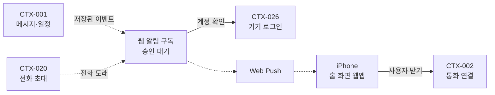

# 아이폰 웹과 Android 0.3.4 기능 비교

2026-11-25 KST · Orca 마롱이 항목 143 · CORTHEX 01단계 현행 조사 및 범위 초안 · 체크포인트 결정 대기

사용자님은 마롱이 Home에서 “내 웹버전은 0.3.4로 못햎”, 이어 “안드로이드랑 똑같은 기능으로 쓰게해줘”라고 하셨습니다. 목표는 아이폰에서도 같은 계정으로 대화하고, 웹을 닫아 두었을 때 마롱이가 보낸 알림을 알아차리며, 통화를 받을 수 있는 것입니다. 여기서 통화 알림을 눌러 받는 경험과 잠금 화면에서 전화처럼 받는 경험은 별도 선택입니다. Android의 설치 절차와 웹의 업데이트 절차도 플랫폼별로 다릅니다.

## 1. 결론과 우선순위

| 우선순위 | 사용자 결과 | 현행 근거와 제안 |
| --- | --- | --- |
| P0 | 웹을 닫아도 새 답변·선톡·일정 알림을 알아차리고 해당 대화를 연다 | Android는 FCM과 알림 채널을 사용합니다. 아이폰에는 마롱이 Web Push 구독·송신·탭 이동 경로가 없습니다. 홈 화면 웹앱에서 사용자가 허용한 뒤 알림을 받는 방향을 추천합니다. 같은 방 기록과 기존 발송 이벤트를 사용합니다. |
| P0 | 마롱이가 거는 약속 전화를 놓치지 않고 시간 안에 받는다 | 두 아이폰 모드 모두 웹에서 유효한 전화의 **받기** 동작을 사용합니다. 닫힌 웹에서 전화가 왔음을 알려 주는 경로가 없습니다. 홈 화면 웹앱의 Web Push를 눌러 기존 받기 화면으로 이어 주는 방식을 추천합니다. Android와 같은 잠금 화면 벨이나 받기·거절이 필수라면 iOS 네이티브 앱을 별도로 판단해야 합니다. |
| P0 검증 | 통화가 끊겨도 돌아오고, 화면 잠금·앱 전환·글 대화 이동 중 무엇이 유지되는지 안다 | BUG-114 재연결 수정은 운영에 반영됐고 항목 70의 실기기 점검이 남았습니다. Android는 네이티브 통화 서비스와 별도 글 대화 창을 사용합니다. 두 아이폰 모드에서 최초 단절, 재연결, 잠금, 앱 전환, 같은 창의 화면 이동을 구분해 시험합니다. 잠금 중 지속이 필수라면 P0 통화 방식 결정에 포함합니다. |
| P1 | 아이폰에서도 설치 여부, 알림 상태, 변경 내역을 알아볼 수 있다 | 홈 화면 설치 안내는 이미 있습니다. 안내의 Android 전용 문구, Android용 배너, 관리자 버전 화면의 의미를 구분해야 합니다. 웹 알림을 채택하면 아이폰 상태 안내를 함께 설계하고, 관리자 화면이나 공통 변경 내역 라벨의 변경은 별도 승인합니다. |
| 회귀 확인 | 글 대화·계정·통화 서버 기능·내 마롱이·친구·일기·사용량을 쓰던 대로 쓴다 | 공통 화면과 서버를 재사용합니다. 활성화가 대기 중인 기능은 기존 항목에서 확인합니다. 이번 제안의 신규 작업은 노출·알림·통화 UX에서 근거가 확인된 차이에 한정합니다. |

## 2. 조사 기준과 운영 상태

- 원격 `refs/heads/main`과 이 작업 폴더 HEAD가 `c82e3b18f05d56c7d332681c4d3b3e85d43fec32`로 일치했습니다. Android 릴리스 기준은 [PR #110](https://github.com/kodonghui/marong2/pull/110)의 `c20891e`입니다. 이 커밋부터 현재 main까지 Android 앱의 `src/main`과 Capacitor 설정 차이는 없었습니다. [저장소 작업 규칙](AGENTS.md) · [WBS](docs/10-wbs/README.md)
- **앱 바이너리** — 11월 23일 16:41:32 KST에 게시한 최신 APK는 `marong-0.3.4-12.apk`입니다. 운영 `release.json`, `history.json`의 코드 12 게시 행, 실제 파일 5,114,302바이트와 SHA-256 `2d652fbb620f3896e2de1a2081a3ead5537ba9a3b084052a9aa3c0064bebb945`가 일치했습니다. 이력은 8행이고 해당 게시 행은 `backfilled: false`입니다. 중지 파일은 없었습니다. 운영 서명 코드 11 위에 코드 12를 덮어 설치한 증거는 격리 Android 16 기록입니다. Orca 항목 2의 e2115 인계에는 11월 24일 16:47:36 KST 운영 기기 코드 12 보고가 있습니다. 이 보고의 설치 방식이나 실제 FCM 도착 경로는 확인되지 않았습니다. 새 조사에서 사용자 기기 행은 읽지 않았습니다. [게시 승인 D150](docs/01-domain/app-update.md#97-034-게시-판단d150) · [게시 및 시험](docs/12-qa/app-update.md#034-게시와-tc-222-재시험) · [앱 변경 기록](marong/changelog/app-0.3.4.json)
- **웹 배포** — 11월 25일 02:45 KST 전후 `ko-family`의 앱 서버(8797)·통화 서버(8792)와 통화 정리기가 실행 중이었습니다. 앱과 통화 헬스 체크는 200이었고, 주요 실행 파일·정적 자산·릴리스 변경 기록 23개를 main의 Git 객체와 SHA-256으로 대조해 23개가 일치했습니다. 비교에는 `run_app.py`, `app_chat.py`, `app_push.py`, `app_update_push.py`, `fcm.py`, `continuity.py`, 글 대화 HTML·JS·CSS·manifest·업데이트 배너, 통화 `server.py`·`live_session.py`·HTML·JS·CSS가 포함됩니다. 앱 실행 위치는 `/opt/marong-app`, 통화는 통합 배포의 별도 `voice-runtime`입니다. 노트북에서 공개 HTTPS에 비로그인 GET을 보내 `/`와 `/chat/` 302, 로그인 페이지·manifest·헬스 체크 200, 릴리스 API 401, 두 일반적인 서비스 워커 URL 404를 확인했습니다. 서버 내부에서 공개 도메인으로 보낸 일부 요청은 403이었고, 공개 수치는 노트북에서 재확인한 값입니다. 인증 후 이용 흐름은 기존 시험과 코드에 근거합니다.
- **기능 설정** — 앱 프로세스는 `MARONG_AUTH=session`, `MARONG_LOOPS_HOME=app`, `MARONG_APP_RING=1`, `MARONG_APP_UPDATE_PUSH=1`, `MARONG_DIARY=1`, `MARONG_FRIENDS=1`입니다. 시작 로그에서 FCM과 약속 전화가 켜져 있고 업데이트 감시가 시작된 것을 확인했습니다. 구글 캘린더 설정 파일은 존재만 확인했습니다. 디스코드 봇·음성·중계는 정지입니다. `MARONG_CHARACTER=0`·`MARONG_DECOR=0`이며 장면 그림·반려동물 목소리 설정은 1입니다. 앱 프로세스에 `MARONG_TOPICS`가 없어 코드의 선 전화·그림 화두 분기 실행 조건을 충족하지 않습니다. `MARONG_CONTINUITY=shadow`는 앱·통화·정리기 3개에 공통입니다. 통화 서버에는 `MARONG_FRIENDS`가 없고 대기음·쇼핑 읽기는 켜져 있습니다. 릴리스 보존 타이머는 active/waiting입니다. [앱 서버 설정 사용](run_app.py) · [통화 서버 설정 사용](tools/vertex_live/server.py) · [통합 전환 QA](docs/12-qa/runs/2026-11-19-unified.md)

**증거 표기** — **승인**은 사용자 결정 또는 승인 문서입니다. **코드**는 실행 조건을 포함한 저장소 동작입니다. **시험**은 기존 로컬·격리·에뮬레이터 결과입니다. **기기**는 실제 폰 사용자나 장치에서 얻은 결과입니다. **운영**은 게시·실행 설정·서비스 상태나 운영 기록입니다. FCM 수락과 폰 수신, 기기 버전 보고와 설치 과정은 각각 다른 관측입니다.

## 3. 사용자 흐름별 비교

| 사용자 흐름 | Android 0.3.4 | iPhone Safari 일반 탭 | iPhone 홈 화면 웹앱 | 승인·코드 및 확인 기록 |
| --- | --- | --- | --- | --- |
| 첫 진입·가입·다시 로그인 | 앱 첫 화면에서 로그인. 초대 링크 가입·연결, 로그인된 기기가 발급하는 6자리 코드로 설치한 앱 연결. | 초대·다시 로그인 링크나 기기 추가 코드. 기존 계정의 방으로 진입합니다. | `/chat/`에서 시작. 설치할 때 로그인 쿠키 복사 가능 여부와 별도 세션 동작은 아래 4절 참조. 같은 계정으로 다시 로그인할 수 있습니다. | **승인** D97·D104, REQ-430~439, SPEC-370~374·396. **코드** `app_session.py`, `app_chat.py`, 통화 서버의 공통 세션 확인. **시험** TC-430~439·490·492, 격리 브라우저의 코드 만료·오입력·별도 세션. **기기** 사흘 유지와 설치 전후 로그인 비교 대기. **운영** 앱·통화 모두 세션 모드. [통합 승인](docs/01-domain/unified.md) · [통합 QA](docs/12-qa/unified.md) |
| 글 대화·기록·읽음·대답 중·새 메시지 | `ChatActivity`의 WebView가 `/chat/`을 엽니다. 전송·재시도·기록·안 읽은 구분·그림이 같은 화면입니다. | 같은 `/chat/`. 열린 화면에서 조회·전송하고, 새 글과 서버에 저장된 알림을 봅니다. | 같은 화면. 아이콘으로 돌아온 뒤 기록 조회. 백그라운드 도착 알림은 미구현입니다. | **승인** REQ-114~119·136~137·460, SPEC-124·148·149·396. **코드** `chat.js`, API-101~104 장기 폴링·전송. **시험** TC-132·157·439·650, 가짜 API와 iPhone WebKit 프로필 포함. **기기** TC-651 일반 Safari에서 사용자님 “빈 공간 없음(고쳐짐)”, iOS 버전 미기록. **운영** #123의 CSS와 현재 제공 소스가 일치합니다. [앱 글 대화](docs/app-chat.md) · [BUG-123](docs/12-qa/BUG-123-web-chat-overflow.md) |
| 전화 걸기·음소거·종료·스피커·이어폰 | 서버 통화 홈에서 마이크를 허용하고 통화를 시작합니다. 음소거·종료는 화면 공통, 소리 출력과 볼륨은 `MarongCallPlugin`·`CallAudio`도 관여합니다. | 같은 통화 서버에 연결. 마이크 권한은 Safari, 소리 경로는 iOS 동작에 따릅니다. | 같은 통화 연결. 통화 홈 `/`이 manifest의 `/chat/` 범위 밖이라 앱 안 이동과 권한 동작을 기기에서 확인해야 합니다. | **승인** SPEC-386·401~405·396. **코드** `/live` 제어와 WebRTC/PCM 대체 경로, Android 출력 기본값·블루투스 등 네이티브 정책. **시험** TC-468·576~579, 배포 당시 가짜 마이크 검증. **기기** TC-587·588·594의 잠금·출력·P95 대기. **운영** 통화 웹 서비스와 RTC 실행. [통화 연결 QA](docs/12-qa/call-connect.md) |
| 끊김·망 전환·다시 연결·다른 기기 | 같은 통화 웹 코드가 같은 클라이언트의 재연결을 시도합니다. 다른 기기가 같은 계정 통화 중이면 거절. | 같은 재연결 규칙. iPhone Safari 최초 단절 원인은 아직 미확정입니다. | 같은 규칙. 백그라운드 복귀가 기존 통화를 살리는지 실기기 대기. | **승인** SPEC-386, SCR-001#call-busy. **시험** TC-643 가짜 오디오·WebSocket 단절 주입, WebKit/Chromium 3개 프로필에서 같은 통화 ID 유지. **기기** e1195 “나중에 해 볼게”, 후속 확인 대기. **운영** #115/#118 반영, 현재 `app.js`와 통화 서버 파일 확인. [BUG-114](docs/12-qa/BUG-114-web-call-reconnect.md) |
| 통화 중 잠금·다른 앱·글 대화 이동 | `CallService`가 통화 중 포그라운드 서비스 및 종료 알림을 사용합니다. D20의 별도 글 대화 창을 열어도 통화 WebView는 남습니다. | 현재 링크는 같은 창에서 이동합니다. `pagehide`가 연결·마이크를 정리하고, 다시 보일 때 오디오 재개를 시도합니다. 별도 창에서 통화와 글을 함께 쓰더라도 iOS가 뒤쪽 페이지를 어떻게 다루는지 확인해야 합니다. | 같은 웹 코드와 수명주기입니다. 화면 켜짐 유지 요청이 잠금 이후 통화 지속을 보장하지 않습니다. | **승인** D20, REQ-133·134, SPEC-143~147·396. **코드** `ChatActivity`, `CallService`, 통화 `app.js`의 `keepAwake`·`pagehide`. **시험** TC-149~154, 초기 Android 에뮬레이터. **기기** 아이폰 화면 잠금·다른 앱·권한 조합 대기. [Android 1단계](docs/android-app.md) · [글 대화 창](docs/app-chat.md) |
| 약속 전화 요청·도착·받기·거절·부재중 | 글로 전화 시각을 정합니다. FCM 벨, 전화 채널, 조건이 맞으면 잠금 화면 벨과 받기·거절. 제한 시 시스템 알림으로 표시합니다. 받으면 `ring`을 건네 자동 시작을 시도합니다. | 웹을 열었을 때 유효한 `pendingRing` 또는 방의 전화 링크에서 **받기**를 누릅니다. 방문 전에 울리는 경로는 없습니다. | 현재 일반 탭과 같은 받기 동작. 홈 화면 추가만으로 벨과 알림은 생기지 않습니다. | **승인** D19, REQ-123~131·464, SPEC-130·132~140, API-107. **코드** `AppReminders.place_call`, `app_profile.py`, `RingActivity`, `answerRing`. FCM 수락 시 전화 링크 생성 분기가 생략될 수 있으나 프로필의 대기 벨 조회를 사용합니다. 전화는 기존 응답 창과 계정 검사를 통과해야 합니다. **시험** TC-146·147 에뮬레이터, TC-447 격리. **기기** TC-148·587 등 대기. **운영** FCM 및 약속 전화 활성, 이번에는 발송을 실행하지 않았습니다. [앱 전화](docs/app-ring.md) · [통합 명세](docs/04-functional-spec/unified.md) |
| 선톡·새 답변·일정 알림·일기 알림·통화에서 글 보내기 | 해당 이벤트가 방에 저장되고, 조건에 맞는 기기는 FCM 알림을 받습니다. 알림을 누르면 글 대화나 연결된 화면을 엽니다. 일반 글 답은 글 화면이 앞에 있으면 푸시 억제 조건이 있습니다. | 열린 동안 대화에 나타납니다. 닫으면 다음에 열 때 읽습니다. 별도 Safari 알림은 없습니다. | 현재 일반 탭과 같은 동작. iOS가 홈 화면 Web Push를 지원해도 마롱이의 실제 구독과 송신은 없습니다. | **승인** REQ-111·112·118·119·462·463, SPEC-119·124·383. **코드** `UnifiedDelivery.say`, `AppProactive`, `AppReminders`, `AppChat` 답장, `AppPush`, `Talk`. **시험** TC-135 에뮬레이터, 통합 일정·선톡 가짜 푸시, FL-176 웹에 남은 선톡. **기기** TC-136과 최신 알림 권한 조합 확인 대기. **운영** 통합 전환 24시간에 선톡 저장 29건, 그 구간 일정 알림 처리 0건. 증거는 개인별 수신을 입증하지 않습니다. [글 대화 QA](docs/app-chat.md) · [통합 전환 기록](docs/12-qa/runs/2026-11-19-unified.md) |
| 선 전화·그림 화두 | 바이너리는 선 전화 이유와 화두를 보여 줄 수 있습니다. 운영의 새 선 전화·그림 화두 생성 스위치가 꺼진 상태입니다. | 보낸 화두나 부재중 기록은 공통 대화 화면에 표시될 수 있습니다. 새 선 전화 생성은 같은 서버 설정에 따릅니다. | 일반 탭과 동일. 나중에 생성이 재개되면 별도 푸시 범위 선택이 필요합니다. | **승인** CTX-020, SPEC-263·267·270·276·280. **코드** `run_app.py`의 `MARONG_TOPICS == "1"`, `topics.py`, `unified_delivery.py`, `chat.js`. **시험** 통합 격리 선톡·선 전화 및 화두 그림 시험 기록. **운영** `MARONG_TOPICS` 미설정. 장면 그림 플래그 1은 선 전화 활성화 근거로 쓰지 않습니다. [선 전화 설계](docs/01-domain/call-first.md) · [QA](docs/12-qa/call-first.md) |
| 대화 이어 주기·통화에서 글로 이어가기 | 같은 방·서버 맥락을 사용합니다. 기존 기록·기억은 활용하되 승인된 최근 대화 강화 경로는 `shadow`입니다. | 같은 상태. 글이나 통화가 직전 내용 전체를 자동으로 이어 준다고 약속할 수 없습니다. 활성 통화 화면의 글 입력은 방 글 대화와 구분합니다. | 일반 탭과 동일. 앱을 다시 여는 동작과 통화 서버의 기존 세션 재연결도 구분합니다. | **승인** 11월 24일 SPEC-480~489·FL-210·211, PR #120. **코드** #128, `continuity.py`, `store.py`, `live_session.py`·정리기. **시험** #133의 가짜 연결과 shadow 요청 본문 비교, TC-675·687 결과 범위는 기존 기록 참고. **기기** `on` 이후 TC-686·688 및 TC-682 청취는 항목 86. **운영** 3서비스 shadow, 활성 압축 설정 `base-20261116`은 #133 기록 기준. [대화 이어 주기](docs/01-domain/continuity.md) · [#133](https://github.com/kodonghui/marong2/pull/133) |
| 통화 내 보조 기능·기억 | 통화 검색·쇼핑 읽기·대기 효과음·종료 요청과 통화 저장은 공통 서버입니다. 앱은 글 대화를 별도 창으로 열고 승인된 앱 전용 표시를 따릅니다. | 공통 통화 페이지의 표시와 통화 도구를 사용합니다. 기존 사이트맵의 `/calls`·`/memories`는 현 공개 경로에서 404이며 현재 통화 화면에서 링크를 찾지 못했습니다. | 일반 탭과 동일한 코드입니다. | **승인** D20, SPEC-386~389, 기존 CTX-003·004. **시험** TC-475·477~479, 가짜 공급자 및 이전 가짜 마이크/제한된 실제 연결. **운영** 통화 대기음·쇼핑 설정 1. `/calls`·`/memories`는 양쪽 공통의 문서와 현재 노출 차이로 별도 추적할 후보입니다. [사이트맵](docs/07-sitemap/sitemap.yaml) · [통화 정적 경로](tools/vertex_live/server.py) |
| 이름·목소리·구글 캘린더·일정 관리 | 내 마롱이에서 이름·목소리 견본과 기본값, 캘린더 연결·해제를 관리합니다. 글·통화 도구에 일정 만들기·읽기 등을 부탁할 수 있고 시간 알림은 글 대화에서 설정합니다. | 동일한 `/chat/me`, `/google/`, 프로필·일정 경로. 캘린더 연동과 폰 알림 수신은 각각 따로 봅니다. | 같은 경로. 외부 Google 승인에서 아이콘으로 다시 돌아오는 흐름은 실기기 확인 대상입니다. | **승인** D96, REQ-440~443·465~468, SPEC-384·385. **코드** `app_profile.py`, `profile.js`, `google_calendar.py`, `schedules.py`. **시험** FL-174, TC-451·491, 가짜 구글 및 격리 일정 시험. **운영** 설정 파일 존재 확인, 실제 연결 계정과 OAuth 결과 미조회. [통합 QA](docs/12-qa/unified.md) |
| 친구 요청·수락·끊기·공유, 성향·지침·기억 설정 | 공통 웹 메뉴에서 친구 코드와 관계·공유를 다룹니다. 성향 페이지의 노출은 계정 및 API 상태가 결정합니다. | 동일. 친분 관계가 통화에 들어가는 동작은 앱 서버의 친구 메뉴 활성과 구분합니다. | 동일. 서로 다른 두 시험 계정으로 액세스 범위를 확인해야 합니다. | **승인** D93, REQ-455~459, SPEC-381·382, SCR-120~122·168. **코드** `app_friends.py`, `app_persona.py`, `chat.js`, 통화 서버 설정. **시험** FL-175, TC-473·474 등. **운영** 앱 친구 켜짐, 통화 `MARONG_FRIENDS` 미설정. 더해지는 이름·관계 주입은 항목 86의 별도 승인 범위. [통합 도메인](docs/01-domain/unified.md) · [성향 QA](docs/12-qa/persona.md) |
| 그림일기·달력·숨김·말로 수정·다시 그리기 | 공유 일기장 화면을 글 대화 창에서 엽니다. 마침 알림은 도착 조건에 따라 Android 푸시 대상이 될 수 있습니다. | 같은 `/chat/diary/` 화면과 작업 경로. 알림은 방에서 읽습니다. | 동일 화면. 설치 모드에서 달력·시트·뒤로 가기는 별도 기기 확인. | **승인** CTX-007, FL-115~119, SCR-113~118, 반려동물 그림 D112. **시험** 일기 화면과 작업 QA, 장면 생성 TC-537·557. **운영** 일기·장면 설정은 1. 사용자 캐릭터와 개별 생성 결과는 확인하지 않았습니다. [일기·비용 QA](docs/12-qa/diary-call-cost.md) · [반려동물 통합 QA](docs/12-qa/pet-app.md) |
| 반려동물 캐릭터·차림·0원 상점·보관함·일기장 꾸미기 | 메뉴와 작업이 공통 서버에 있습니다. 캐릭터·꾸미기 플래그가 꺼져 있어 활성 기능으로 비교할 수 없습니다. | 동일. 일기장 배경·속지·글꼴·스티커는 꾸미기가 켜져야 합니다. 옷 입히기는 사용할 준비가 된 캐릭터도 필요합니다. | 동일. 캐릭터와 꾸미기 메뉴의 노출은 공통 서버가 결정합니다. | **승인** D110~116, SPEC-417~426·459, 항목 106 e1857 “일단 대기”. **코드** `app_profile.py`, `app_decor.py`, 일기장과 공유 화면. **시험** #93 및 TC-538~555 일부, TC-558 대기. **운영** 캐릭터·꾸미기 0. e2123에는 48개 카탈로그와 DB를 확인한 선행 조사 기록이 있습니다. [반려동물 WBS](docs/10-wbs/pet-app.md#2026-11-22-운영-반영) · [꺼짐 안내 QA](docs/12-qa/admin.md) |
| 내 사용량·한도·티켓과 차단 후 복귀 | 공유 프로필과 글·통화의 한도 안내를 사용합니다. 사용량은 서버가 계정별로 계산합니다. | 동일. 글·통화에 개별 클라이언트 사용량 기록을 만들 이유가 없습니다. | 동일. 한도 도달 뒤 원래 화면으로 돌아오는 경로를 확인합니다. | **승인** CTX-029, D106·107, SPEC-394·397~399. **코드** `usage.py`, `app_profile.py`, 양쪽 안내 화면. **시험** FL-177·TC-487 및 사용량 QA의 합성 한도·티켓 시험. **운영** 개인별 한도나 티켓은 미조회. [사용량 QA](docs/12-qa/usage-limit.md) |
| 처음 설치·설치 권한·다시 설치 | 로그인한 Android 브라우저 안내에서 APK 다운로드, Android의 설치 허용과 설치, 앱에서 기기 코드 로그인. README의 직접 APK 링크는 0.3.0 예전 파일을 가리킵니다. | 설치 없이 접속. Safari 공유 메뉴에서 홈 화면에 추가할 수 있습니다. | 홈 화면 아이콘으로 실행. 삭제·다시 추가 시 로그인과 권한을 확인합니다. | **승인** D92·104, REQ-461, SPEC-396. **코드** `account.js`의 Android 조건과 최신 릴리스 API, iPhone 설치 안내, 웹 manifest. **시험** 0.3.4 운영 서명 APK 코드 11 위 덮어 설치는 격리 기기. **기기/운영** 코드 12 보고 이력은 위 2절. [설치 안내](README.md) · [APK 게시 QA](docs/12-qa/app-update.md) |
| **0.3.4 추가** · 게시 직후 자동 받기·검증·설치 | 조용한 Android FCM 데이터 메시지로 최신 릴리스를 확인하고 APK를 받습니다. 해시·서명 조건과 설치 권한을 확인합니다. 앱 창·통화·벨이 남으면 자동 설치를 보류하고, 필요 시 Android 확인 화면으로 이어집니다. 기존 주기·재시도도 사용합니다. | 서버가 반영한 페이지를 다음 요청에서 받습니다. APK 작업과 조용한 업데이트 메시지 경로는 없습니다. 통화 JS처럼 버전 URL로 캐시하는 자산도 있으므로 새로 열기 시 갱신을 확인합니다. | 일반 탭과 같은 서버 자산. 아직 서비스 워커가 없습니다. 설치 UI·재설치 없이 웹 변경이 적용되는지는 캐시와 재개 상황별로 확인합니다. | **승인** D122~128, D134, D150, SPEC-289·294·430~438·442. **코드** #105·#107, `MarongMessagingService` → `AppUpdateJob` → Android 패키지 설치기. **시험** TC-601~613·617 일부 및 TC-222 격리. TC-605 에뮬레이터 주입 기록. **기기** TC-614~616 실제 FCM과 설치 소요시간 대기. **운영** 최신 APK와 스위치 확인. [업데이트 QA](docs/12-qa/app-update.md#2026-11-22-기능-변경-게시-즉시-업데이트와-업데이트-상태) |
| **0.3.4 추가** · 사용자 업데이트 배너·상태·관리자 버전 | 통화 홈·글 대화의 준비·설치 중·보류·실패·자동 업데이트 꺼짐 상태와 **지금 설치**를 앱 연결로 제공합니다. 기기 상태 보고와 관리자용 버전·릴리스 이력도 추가됐습니다. | 배너 자산은 같은 웹 서버에 있으나 네이티브 연결이 없어 배너를 활성화하지 않습니다. 내 아이폰은 Android 폰 상태 보고 대상에 포함되지 않습니다. | 같은 배너 제한. 아이콘을 추가해도 Android 버전 숫자가 부여되지는 않습니다. | **승인** D125~131, SPEC-439~443, SCR-001·107·203. **코드** #108의 `update-banner.js`, `window.__marongApp.version >= 3`, API-105·267, `AppUpdateReport`. **시험** TC-618 등 합성 배너, TC-617 부분 통과. **기기** TC-657 관리자 화면의 ‘앱 지워짐’·‘뒤처짐’ 표시 확인은 앱 자동 업데이트 전 과정을 증명하지 않습니다. [업데이트 결정](docs/01-domain/app-update.md) · [관리자 앱 버전](docs/08-screens/admin.md#7-scr-203-앱-버전) |

### 버전 표시에서 사용자님이 오해할 수 있는 지점

- 관리자 **앱 버전**의 “최신 0.3.4(12)”는 Android APK 배포 이력과 Android 폰의 보고를 뜻합니다. 폰의 상태는 마지막 보고 기준입니다. 웹 변경 기록도 보는 **업데이트 내역**은 별도 화면입니다. 운영 변경 기록의 영역이 `web`인 “앱 업데이트 배너”도 실제 사용 조건은 Android WebView의 네이티브 연결입니다. Android용 표시가 없는 것은 아이폰 웹에 글 대화나 운영 웹 수정이 빠졌다는 의미로 읽힐 수 있습니다. [앱 버전 코드](marong/app_chat_static/admin.js) · [서버 변경 기록](marong/changelog/20261123-app-update-034.json) · [업데이트 내역 명세](docs/04-functional-spec/admin-changelog.md)
- 이름을 손보는 경우 관리자에는 **Android 앱 버전**, 웹에는 필요 시 **웹 변경 내역**과 알림 상태를 쓰는 안을 추천합니다. 앱 버전과 웹 배포를 연결할 기준이 필요하다면 Git 배포 식별자나 반영일을 사용합니다. 기존 0.3.4 번호나 이력에 아이폰을 넣으면 기기 보고와 뒤처짐 지표의 의미가 달라집니다.

## 4. 아이폰 플랫폼에서 가능한 동작

| 조건 | 플랫폼 근거 | 마롱이 조사 결과·검증할 항목 |
| --- | --- | --- |
| Safari 일반 탭 | 글·통화를 방문해 쓰는 경로입니다. iOS 16.4부터 공식 Web Push 지원 대상은 홈 화면 웹앱입니다. | 기존 글 기록 및 웹 통화 유지. 일반 탭에서는 홈 화면 설치 경로 안내를 보여 줄 수 있습니다. 닫힌 일반 탭의 웹 푸시를 완료 기준에 넣지 않습니다. |
| 홈 화면 웹앱 설치·허용 | Safari에서 웹을 열고 공유 → 홈 화면에 추가 → **웹 앱으로 열기**를 켜고 추가합니다. 버전에 따라 버튼 위치·명칭이 다릅니다. 홈 화면 아이콘에서 연 뒤 사용자가 앱의 구독 버튼을 눌렀을 때 권한을 요청합니다. 설정 → 알림에서 허용·잠금 화면·미리보기·소리 등을 조정할 수 있고 집중 모드의 영향을 받습니다. | 현재 manifest는 `start_url=/chat/`, `scope=/chat/`, `display=standalone`입니다. 설치 UX는 존재하고 웹 푸시 UX는 없습니다. 현재 안내는 “알림과 전화 벨은 안드로이드 앱에서만 와”입니다. 설치를 감지한 뒤에도 권한의 허용·거절·철회를 별도로 나타내야 합니다. |
| 홈 화면 웹앱 알림 | iOS 16.4 이상에서 표준 Web Push와 서비스 워커로 사용자에게 보이는 알림을 낼 수 있습니다. iOS 18.4부터 선언형 Web Push도 홈 화면 웹앱에서 지원합니다. WebKit은 보이지 않는 푸시를 허용하지 않습니다. | 새 글·일정·전화 초대를 잠금 화면이나 알림 센터에 보여 줄 후보입니다. 마롱이의 잠금 상태·웹앱 종료·집중 모드·권한·지연별 수신과 탭 이동은 실기기에서 확인해야 합니다. Android APK 갱신용 조용한 FCM 메시지와 별개입니다. |
| 로그인·알림을 눌러 진입 | iOS 17.2부터 홈 화면 웹앱을 만들 때 브라우저의 로그인 쿠키를 복사할 수 있습니다. 이후 다른 웹 저장소와 쿠키 변경을 서로 동기화하는 기능은 아닙니다. | 마롱이는 Secure·HttpOnly·SameSite=Lax 쿠키를 `Path=/`로 발급합니다. 로그인 상태에서 추가, 로그아웃 상태에서 추가, 세션 만료, 같은 기기의 두 아이콘, 알림 클릭, `/` 통화 경로로 이동할 때 화면·쿠키가 유지되는지 확인합니다. 필요한 경우 기존 기기 코드를 사용합니다. |
| 수신 중 잠금, 진행 중 잠금·백그라운드 | Web Push가 제공하는 것은 사용자에게 보이는 알림입니다. Apple의 시스템 전화 수신 UI는 네이티브 앱에서 PushKit과 CallKit으로 제공합니다. | 알림을 누르고 필요 시 잠금을 풀어 웹에서 **받기**를 선택하는 경험은 후보입니다. 시스템 전화 화면, 자동 마이크 연결, 잠금 중 통화 지속, 앱 전환 뒤 오디오 재개는 각각 다른 요구입니다. 웹으로 진행하면 지원 범위를 기기 시험으로 정합니다. |

플랫폼 근거는 WebKit의 [iOS Web Push](https://webkit.org/blog/13878/web-push-for-web-apps-on-ios-and-ipados/), [17.2 로그인 쿠키](https://webkit.org/blog/14787/webkit-features-in-safari-17-2/), [선언형 푸시와 가시성](https://webkit.org/blog/16535/), [18.4 지원 범위](https://webkit.org/blog/16574/webkit-features-in-safari-18-4/), Apple의 [iPhone 홈 화면 웹앱 사용 설명서](https://support.apple.com/en-az/guide/iphone/iphea86e5236/26/ios/26), [iPhone 알림 설정 사용 설명서](https://support.apple.com/en-bh/guide/iphone/iph7c3d96bab/ios), [PushKit 수신과 CallKit](https://developer.apple.com/documentation/pushkit/responding-to-voip-notifications-from-pushkit?changes=_6)입니다.

## 5. 변경된 컨텍스트 조사

기존 구조에서 Android와 아이폰은 글 대화 및 통화 서버를 공유합니다. 아래 그림은 현재 경로를 보여 줍니다. 점선은 비동기 알림 전달입니다. 반려동물 공개 서비스에는 별도의 VAPID 구독 코드와 TC-392가 있으나, 보류된 서비스의 회원·테이블·권한 범위입니다. 통합 마롱이에서 그 스케줄이나 회원 API를 재가동할 이유는 없습니다. 재사용 가능한 검증 로직은 후속 설계에서 확인할 수 있습니다. [공개 반려동물 푸시](marong/pet/push.py) · [보류 근거](docs/10-wbs/README.md)

```mermaid
%% grammar: structure
flowchart LR
    android["Android 0.3.4"]
    safari["iPhone Safari<br/>일반 탭"]
    home["iPhone<br/>홈 화면 웹앱"]
    chat["CTX-001<br/>글 대화와<br/>알림 기록"]
    account["CTX-026<br/>가입과<br/>기기 로그인"]
    call["CTX-002<br/>통화 연결"]
    fcm["Android FCM"]
    android --> chat
    safari --> chat
    home --> chat
    android --> call
    safari --> call
    home --> call
    chat --> account
    call --> account
    chat -.-> fcm
    fcm -.-> android
```

**현행 및 변경 후보의 이벤트 순서(01단계 1-a·1-b 초안)** — 읽기·로그인은 이벤트 목록에서 빼고 행위자와 전제에 기록합니다. 관련 외부 시스템은 Android/FCM, iOS/WebKit Web Push·Apple 알림, iOS 네이티브를 고를 경우 APNs·PushKit·CallKit입니다.

| 흐름·컨텍스트 | 행위자, 명령, 이벤트와 규칙 | 확인할 질문 |
| --- | --- | --- |
| 설치 뒤 알림 활성화 · CTX-026 연계 | 친구가 로그인된 아이콘에서 알림 설정을 시작 → OS 권한 결과가 돌아옴 → 허용 시 계정과 연결한 구독이 등록됨 [추론] → 철회·로그아웃·만료 때 구독이 비활성화됨 [추론]. 구독은 기기 로그인과 연관되고 사용자별 권한을 확인합니다. | 탭과 아이콘에서 로그인 상태가 엇갈릴 때 재로그인 안내, 여러 기기 공유·권한 확인, 탈퇴·로그아웃 때 수신 중단. |
| 글·일정 알림 · CTX-001 | 친구가 글을 보냄 또는 일정 도래·선톡 차례가 처리됨 → 답·알림으로 방에 기록됨 [확실] → 등록된 기기로 알림이 전달될 수 있음 [확실, Android] → Web Push를 선택하면 같은 발생 이벤트를 웹 구독에도 전달 [추론]. 메시지·일정의 결과 기록은 한 번, 전송 수단별 시도는 별도입니다. | Android와 아이폰이 모두 켜져 있으면 양쪽 전달이나 한 기기 우선 중 무엇을 기본으로 둘지. 읽고 있는 화면의 중복 알림 억제와 잠금 화면 문구. |
| 전화 초대·받기 · CTX-002·020 | 약속이 도래함 → 수신 가능한 전화가 만들어짐 → 받음·부재중·이미 통화 중으로 기록됨 [확실]. 웹 알림 탭 → 기존 유효 전화와 계정 확인 → 열린 페이지에서 마이크 허용·받기 [추론]. 친구별로 벨 하나와 기존 응답 창을 사용합니다. | 알림을 늦게 누른 동작, 여러 기기의 동시 수락, 거절이 필요한지, 보통 전화 전환의 문구와 명시적 동작, 선 전화 생성이 다시 켜졌을 때 같은 전달 정책을 적용할지. |
| 통화 전환·재연결 · CTX-002 | 같은 참여자가 연결하면 기존 통화로 복구 [확실, 승인 및 합성]. 실제 네트워크 단절률과 iPhone OS 전환에 따른 마이크 재개 [추측]. | 통화 중 글 대화 이동과 홈 화면 이동에서 각각 허용할 동작, 백그라운드 통화의 완료 기준. |
| 설치·업데이트 표시 · CTX-021 | Android 사용자가 설치하고 릴리스가 게시되면 최신 APK 확인·업데이트 상태가 바뀜 [확실]. 웹은 서버의 반영 상태를 페이지에서 읽음 [확실]. 웹 상태 라벨 변경은 [추론]. | 웹 변경 내역을 어디에 노출할지. 웹 구독을 기존 Android 버전·설치 보고와 혼용하지 않도록 읽기 모델 경계 확인. |

변경 후보는 CTX-001의 메시지 전달 정책, CTX-002·020의 전화 진입 및 수신 정책, CTX-026과 연결되는 웹 구독 수명주기입니다. CTX-021은 Android 릴리스·설치 집계의 경계와 라벨을 점검합니다. CTX-004 통화 기억, CTX-007 일기, CTX-027 내 마롱이, CTX-028 친구, CTX-029 사용량, CTX-030·031 꾸미기·장면 그림은 이번 범위에서 기존 동작을 회귀 확인합니다. 새 도메인 ID는 경계 승인 뒤 부여합니다.

알림과 전화 연결을 추가할 경우의 의존은 아래와 같습니다. 기존 이벤트를 읽어 알림을 전달하고 전화 수락은 기존 통화 서버에서 처리합니다.



점선은 비동기 알림, 실선은 계정 확인이나 사용자 요청입니다. 구독 상태 읽기 모델은 활동 중인 세션·허용 상태·최근 전송 결과를 사용합니다. 받기 화면은 계정에 속한 대기 전화와 응답 기한을 읽습니다. Android 앱 버전 화면은 기존 APK 이력과 기기 보고를 읽습니다.

**컨텍스트 규칙 예시** — 인증된 홈 화면 웹앱의 사용자가 알림을 허용하고 일정을 받게 되면 하나의 알림 기록을 쓰고, 권한 설정에 맞춰 웹 알림에서 그 기록으로 이동합니다. 이미 다른 기기에서 같은 전화를 받았거나 응답 기한이 지났다면 알림 진입으로 두 번째 통화가 시작되지 않습니다. 로그아웃 또는 철회한 구독에는 같은 계정의 새 메시지가 배달되지 않습니다. 단계 01의 후보 용어는 ‘홈 화면 웹앱’, ‘Web Push 구독’, ‘통화 초대 알림’, ‘통화 재연결’이며 기존 ‘약속 전화’ TERM-081과 ‘릴리스’ TERM-093의 쓰임은 유지합니다.

**체크포인트** — 이번 파일은 변경된 컨텍스트의 단계 0~9 검토 자료입니다. 이벤트 순서, 컨텍스트 경계, 규칙·의존성은 모두 제안입니다. 독립 대조에는 iOS 일반 탭·웹앱 알림·네이티브 수신, 알림 권한을 끈 친구·다기기 사용자·관리자를 포함했습니다. iPhone 쪽 마이크·잠금 이후 연속성은 추측으로 남깁니다. 단계 승인 기록은 사용자님 답이 들어온 다음 승인한 원문과 스냅샷에 연결합니다.

## 6. 사용자님 결정 항목

현재 승인 근거는 통합 앱 D92·D104(11월 19일, 병합본 `e474699`, [PR #54](https://github.com/kodonghui/marong2/pull/54)와 [도메인 원문](docs/01-domain/unified.md)), 앱 업데이트 D122~134(11월 22~23일, `15889ff`, [PR #101](https://github.com/kodonghui/marong2/pull/101)), 통화 기존 D19·D20(11월 15~16일, [전화](docs/app-ring.md)·[글 대화](docs/app-chat.md)), 대화 이어 주기(11월 24일, `1a29477`, [PR #120](https://github.com/kodonghui/marong2/pull/120)), FCM 분류 D180~187(11월 24일, `e7c5919`, [PR #130](https://github.com/kodonghui/marong2/pull/130)), 관리 앱 버전 D136(11월 23일, `c277b38`, [PR #104](https://github.com/kodonghui/marong2/pull/104))입니다. D104는 통합 제안의 승인이고 SPEC-396 행은 저장소에 `proposed` 상태로 남아 있습니다. 승인 결정과 병합본을 구분해 표시했습니다.

| 결정 | 기준 문구·승인 자리 | 선택과 추천 |
| --- | --- | --- |
| 1. 아이폰 백그라운드 글·일정 알림 | SPEC-396 “서비스 워커와 웹 푸시는 없어요.” REQ-462 “앱 기기가 있으면 앱 알림으로 보내야 하고, 없으면 방에 남겨 다음에 열 때 보여야 한다.” D92·D104, 11월 19일. | **변경 추천.** 홈 화면 웹앱에서 허용한 기기로 새 답변·선톡·일정과 관련 중요 알림을 전달하고 일반 탭은 현재 결과를 유지합니다. **유지**도 가능하며 설치 절차는 그대로지만 앱을 닫으면 배달을 알아차리지 못합니다. 설치가 어려운 경우 별도 외부 채널을 쓰려면 D92의 서비스 채널 범위 변경이므로 승인 항목을 새로 엽니다. |
| 2. 아이폰 전화 수신의 목표 | REQ-464 “약속 시각의 앞뒤 안에 웹을 열면 … 받기 버튼”. SPEC-396의 “기기 등록, 앱 업데이트, 벨”은 앱 전용. D19에서 아이폰 벨 제외. D92에서 아이폰은 웹. | **홈 화면 웹앱 알림 → 잠금 해제 → 받기 추천.** 약속 전화를 먼저 넣고 선 전화는 공통 생성 설정 재개 시 같은 전달 정책 검토. **유지**는 열어 둔 웹에서만 알 수 있습니다. **iOS 네이티브**는 잠금 화면의 시스템 전화 UI·받기/거절이 필수일 때 별도 프로젝트 범위입니다. 선택하면 D92, D19의 아이폰 범위, REQ-464·SPEC-396, 새 기기 등록과 배포 단계가 바뀝니다. |
| 3. 진행 중 통화와 글 대화·잠금 | D20·REQ-133 “통화 창과 따로 된 글 대화 창” 및 통화 유지. SPEC-396은 브라우저가 화면을 끄거나 다른 앱으로 가서 끊기면 다시 걸기입니다. | **우선 유지하고 기기 결과로 범위 결정 추천.** 잠금·앱 전환 중 끊김에서 올바르게 복귀해야 합니다. **변경**은 두 가지입니다. 한 화면에서 통화와 글을 오가게 하면 기존 화면 상태·흐름이 바뀝니다. 잠금 상태 통화 지속을 필수로 하면 2번의 네이티브 선택까지 검토해야 합니다. |
| 4. 웹 설치 안내와 버전 화면 | REQ-461 “홈 화면 추가용 설정 파일과 아이콘”. SCR-203 “앱 버전”, D129~131의 Android 업데이트 배너, D136의 관리자 배치. | **안내 변경 추천.** 알림을 원하는 사람에게만 설치와 허용을 안내합니다. 사용자 웹 화면은 알림 상태와 필요 시 웹 변경 내역을 보여 줍니다. **관리자 라벨을 변경할지**는 SCR-203에 대한 별도 선택입니다. Android 릴리스·기기 보고 의미를 유지하는 라벨 변경이 가능하며 기존 화면의 유지도 가능합니다. |
| 5. Android와 웹에 동시에 알림을 받을 때 | SPEC-383 “받는 기기가 있으면 앱 알림과 함께 … 방에 남기고”, REQ-118의 잠금 화면 프라이버시. D104 승인 기준. | **각 기기의 명시적 허용을 존중하는 안 추천.** 기존 Android 동작을 보존하고 두 플랫폼의 알림을 허용한 경우만 각각 전달하며, 두 번 눌러도 기록·전화 수락은 한 번입니다. **한 기기 우선**은 반복 알림이 줄지만 우선순위·실패 시 전환과 설정 화면이 필요합니다. 웹 기본 미리보기는 대화 원문 없이, 개별 민감 이벤트는 같은 규칙으로 다루는 안을 추천합니다. |

결정 1~5는 승인 범위를 변경할 수 있는 검토 항목입니다. 승인 항목을 삭제하거나 미루는 제안은 없습니다. 답이 들어오기 전의 다음 단계는 현재 승인 상태를 기준으로 합니다. 사용자가 특정 항목을 미루기로 정하면 재검토 날짜와 담당자를 함께 기록합니다. 실제 코드 수정으로 연결되는 결정은 Orca 항목 143에서 항목별로 확인합니다.

## 7. 관련 작업과 구현 순서

| 기존 작업 | 현재 근거 | 이번 범위에서 재사용할 점 |
| --- | --- | --- |
| **항목 2** · Android 게시 즉시 업데이트 | e2115, #105·107·108·110~114. 코드 12 게시·보고까지 확인, 다음 승인된 게시 때 TC-614~616, TC-617 인증·롤백 증거 검토. | Android APK·FCM 업데이트는 기존 작업이 맡습니다. 웹 갱신과 안내는 4번 결정으로 처리합니다. 릴리스 보존 타이머와 Android 데이터 푸시를 복제하지 않습니다. |
| **항목 70** · BUG-114 | e2119, #115·#118 반영. 최초 단절 원인은 미확정이고 동일 클라이언트 재연결 수정은 반영됐습니다. | 다음 승인된 아이폰 기기 시험에서 일반 탭·홈 화면 웹앱·망 전환을 같은 시나리오로 비교하고 기존 진단을 사용합니다. |
| **항목 86** · 대화 이어 주기 | e2121, #128 병합·#133 기록 초안. 운영 서비스 세 곳에서 shadow 시작 11월 24일 19:02:31 KST. 11월 25일 19:15 KST 자동 확인 일정과 e1772의 조건부 `on` 승인 범위가 인계에 기록됐습니다. | 기존 실행이 TC-687 압축 한계·지표·표본을 확인합니다. 수치 조건 전에는 결과를 사용자 기능으로 세지 않습니다. 자동 실행 상태는 e2121 기록 근거이고 재조회하지 않았습니다. |
| **항목 96** · FCM 등록 해제 분류 | e2122, #130·#135 병합·19:51:21 KST 반영. #137 기록 초안. 12월 1일 20:00 KST 자동 확인이 인계에 기록됐습니다. | TC-726~728의 기존 관찰을 보존합니다. Web Push 구독 만료와 Android FID 제거는 플랫폼 계약이 다르므로 별개 결과로 기록합니다. 자동 실행 상태는 e2122 기록 근거입니다. |
| **항목 106** · 꾸미기 활성화 | e2123, 사용자님 “일단 대기”(e1857, 11월 24일 18:57:36 KST), 운영 설정 0 재확인. | TC-538~555와 BUG-115는 재개 요청이 들어오면 기존 항목에서 처리합니다. 웹 비교를 근거로 강제로 켤 이유가 없습니다. |
| **항목 3·79** · 관리 화면과 글 대화 수정 | #132·#136의 관리자 화면 증거, 항목 79의 TC-651, #123·#124. | Android/웹 표시 이름을 바꿀 경우 관리자 승인 항목과 함께 검토합니다. 글 대화 스크롤 회귀는 TC-650을 재사용합니다. |

기존 승인 원문과의 차이는 아이폰의 알림, 전화 받기, 설치 안내가 중심입니다. 01 체크포인트 답 뒤 이해관계와 승인 항목을 정리하고, CORTHEX 기능 변경 절차에 따라 02에서 12까지 순서대로 단계별 차이 또는 ‘변경 없음’의 근거를 남깁니다. 13 발표는 프로젝트 설정상 생략입니다. 새 승인 이후의 작업 단위는 다음과 같습니다.

1. **공통 기능과 통화 현행 시험** — TC-643·650과 통합 신규 가입, 기기 코드, 통화 시작·종료를 승인된 시험 환경에서 실행합니다. `/chat/`에서 `/`로 갈 때 설치 앱 컨텍스트, 앱 전환·잠금 중 첫 단절 원인을 남깁니다. 현재 승인과 다른 현상은 기존 버그와 중복 여부를 먼저 확인합니다.
2. **홈 화면 웹앱의 알림 가입과 전달** — 1·4·5번 결정이 승인되면 세션 기반 구독 생성·회수, 권한 흐름, 기존 메시지·일정 이벤트에 전송 수단을 연결합니다. 계정과 구독의 연결, 권한 실패, 중복 저장·재전송, 안 읽은 위치 및 알림 탭 이동을 가짜 푸시부터 확인합니다. 16.4~18.3을 지원하는 안은 서비스 워커가 필요합니다. 18.4 이상으로 한정하는 안이나 선언형 혼용은 최소 지원 버전과 캐시 조건으로 검토합니다. 인증된 HTML·API에 서비스 워커 캐시를 넣을 계획은 없습니다.
3. **전화 알림과 기존 받기 연결** — 2번 결정 뒤 기존 `ring` 수명주기와 요청 당사자 검증을 유지하며 알림을 통해 전화 화면에 진입하도록 설계합니다. 설치 앱 안에서 `/`를 열어야 하는 경우 manifest 범위와 기존 설치 식별자를 먼저 시험합니다. 만료, 이미 받음, 통화 중, 오프라인과 재로그인 조건을 성공 흐름과 함께 확인합니다. 네이티브 선택 시 01단계부터 iOS 앱 배포와 통화 권한의 범위를 다시 잡습니다.
4. **변경 내역과 점진 반영** — 필요한 라벨·안내만 승인 문서에 반영합니다. 합성 환경과 승인받은 시험 계정·기기에서 기능 설정을 검증한 뒤 운영 반영 시점과 롤백을 별도로 확정합니다. 나머지 TASK와 PR의 담당 결정은 기존 경로를 따릅니다.

### 실제 기기 확인 조건

| 환경 | 시험 조건과 성공 기준 |
| --- | --- |
| iPhone 일반 탭·홈 화면 아이콘, Android 코드 12 기준 기기 | iPhone 모델·iOS·실행 모드, Android 모델·OS·버전, Wi-Fi·셀룰러, 마이크·알림·집중 모드·잠금 상태를 표기. 합성 두 계정으로 초대·6자리 코드·재로그인, 홈 화면 추가 전후 쿠키, 사흘 뒤 열기, 새 글·이전 글과 일기·친구·프로필을 대조합니다. 정상·권한 거절·만료를 각각 확인합니다. |
| 홈 화면 웹 푸시 | 허용·거절·철회·로그아웃·재설치·다른 사람 로그인에서 구독 결과를 확인합니다. 새 답변·선톡·일정과 각 알림 탭의 도착 화면을 전경·백그라운드·잠금·웹앱 종료 각각에서 봅니다. 발송 시각, 전송 서비스 수락, 기기 표시·탭·화면 도착 시각을 따로 기록합니다. 알림 미리보기와 다른 계정 수신 여부, 중복 수신·잘못된 연결 유무를 확인합니다. 일반 탭에서도 방의 기록은 한 번만 남아야 합니다. |
| iPhone 통화, Android 기준 대조 | 전화 걸기·권한 거절·음소거·종료, 잠금·홈으로 이동·글 대화 이동, Wi-Fi ↔ 셀룰러·일시 단절·복귀에서 양방향 발화와 재연결 ID를 확인합니다. 벨은 잠금·앱 전환·집중 모드, 응답 기한 전후, 다른 기기에서 먼저 받음, 부재중·만료 경로를 나눕니다. 지속 시간을 수치로 기록하되 단계 04에서 승인한 값으로 성공 기준을 판정합니다. 기존 Android TC-587·588·594 결과는 기기별로 따로 붙입니다. |
| 기존 작업에서만 실행할 검증 | Android 0.3.4의 FCM → 받기 → 설치 → 보고와 TC-617 확인은 항목 2의 다음 승인된 게시에서 진행합니다. TC-643 실기기는 항목 70, shadow에서 `on`과 TC-682·686·688은 항목 86, FCM 후속 집계는 항목 96, 꾸미기 시험은 항목 106으로 연결합니다. |

이번 조사에서는 기존 QA 결과를 검토하고 운영 HTTP 상태·설정·파일 해시·APK를 읽기 검증했습니다. 운영 로그인, 개인 데이터 조회·복사, 모델 호출, 알림 발송, 운영 변경, PR·자동 실행 변경, 새 실기기 시험은 수행하지 않았습니다. 협업 기록은 이 로컬 파일에 남겼습니다. 다음 담당자는 Orca 항목 143에서 위 결정과 단계 01 체크포인트를 사용자님에게 전달할 수 있습니다.
